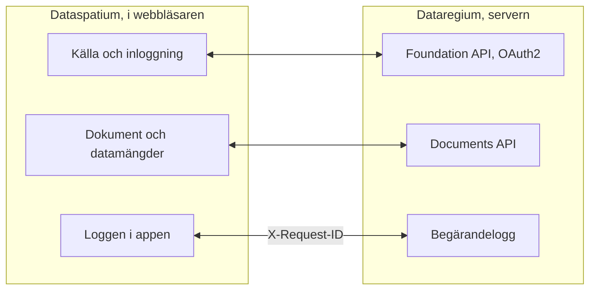

**Svenska** · [Dansk](docs/da/README.md) · [Norsk](docs/nb/README.md) · [Suomi](docs/fi/README.md) · [Íslenska](docs/is/README.md) · [English](docs/en/README.md)

# Dataspatium OpenCDE-klient

*Det här är README för Dataspatium 1.0.0. Den senaste utgåvan, 3.0.0, beskrivs i [README på main](https://github.com/marwiss/Dataspatium#readme).*

Dataspatium är ett program för att arbeta med data, som du öppnar i din vanliga webbläsare. Du hämtar in en tabell, en karta, en plan
eller statistik från en myndighet, rättar och räknar på den, gör diagram och rapporter och skickar resultatet vidare. Allt händer på din
egen dator: ingen installation, inget konto och ingen server. Ingenting lämnar datorn om du inte själv exporterar eller delar det, och
appen frågar alltid innan den använder internet.

Dataspatium kan också hämta dokument från [Dataregium](https://github.com/marwiss/Dataregium), en server där ett byggprojekt samlar
sina dokument, och skicka tillbaka datamängder och filer som nya versioner. Utan Dataregium fungerar allt annat precis likadant.

**För den tekniskt kunnige:** en statisk webbapp utan byggsteg som körs från `file://` i Edge, Chrome och Firefox eller från vilken
statisk webbserver som helst. Varje datamängd är en SQLite-fil (sql.js) i IndexedDB, och R körs i WebR 0.5.9 i en worker. Mot en server
är appen en OpenCDE-klient för Foundation API 1.0, med OAuth2 authorization code och PKCE, och Documents API 1.0. Inga nätverksanrop sker
utan samtycke per ändamål, och hemligheter lagras bara krypterade (AES-GCM).

**Innehåll**

- [Ladda ned och kom igång](#ladda-ned-och-kom-igång)
- [Vad som krävs](#vad-som-krävs)
- [Ord att känna till](#ord-att-känna-till)
- [Vad du kan göra](#vad-du-kan-göra)
- [OpenCDE-API:erna och deras klienter](#opencde-apierna-och-deras-klienter)
- [Dataspatium och Dataregium](#dataspatium-och-dataregium)
- [Lär dig mer](#lär-dig-mer)
- [Begränsningar i korthet](#begränsningar-i-korthet)
- [Personuppgifter](#personuppgifter)
- [Nyare utgåvor](#nyare-utgåvor)
- [Fel och förslag](#fel-och-förslag)
- [Utveckling](#utveckling)
- [Licens](#licens)

## Ladda ned och kom igång

1. **Ladda ned.** Gå till [utgåvan 1.0.0](https://github.com/marwiss/Dataspatium/releases/tag/v1.0.0) och hämta ZIP-filen under
   *Assets* (`dataspatium-1.0.0.zip`, ungefär 95 MB; R och de vanligaste R-paketen ingår).
2. **Packa upp.** Högerklicka på ZIP-filen och välj *Extrahera alla* (Windows) eller dubbelklicka på den (macOS). Lägg mappen där du
   vill ha den, till exempel i Dokument. Appen fungerar inte direkt inifrån ZIP-filen.
3. **Öppna.** Dubbelklicka på `index.html` i mappen, eller dra filen till ett webbläsarfönster. Om Windows frågar vilken app som ska
   användas väljer du Edge, Chrome eller Firefox. Första gången väljer du språk, och sedan erbjuds **Grundkursen**: en genomgång av alla
   sex lägen med exempeldata som tar ungefär tio minuter och kan öppnas igen från hjälpen (?).
4. **Hämta in data.** I läget *Inhämta* släpper du en fil på ytan, eller klickar på *Prova med exempeldata*. Appen visar vad filen
   innehåller; klicka på *Importera*. Datamängden sparas i webbläsaren på din dator.
5. **Arbeta vidare.** Lägena högst upp är stegen i arbetet: *Hantera* håller ordning på dina datamängder, *Bearbeta* visar tabellen med
   knappar för att rätta och räkna, *Analysera* har R, SQL och reguljära uttryck, *Visualisera* gör diagram och kartor och *Exportera*
   sparar filer på datorn och delningspaket till andra.

Det du sparar ligger i webbläsarens egen databas på datorn. Rensar du webbläsarens webbplatsdata försvinner det, så ta regelbundet en
säkerhetskopia under *Hantera > Arbetsyta*. Säkerhetskopian är en ZIP-fil som kan återställas på samma eller en annan dator. Steg för steg
med fler detaljer: [docs/kom-igang.md](docs/kom-igang.md).

Webbversionen på <https://marwiss.github.io/Dataspatium/> är alltid den senaste utgåvan, nu 3.0.0.

### För den tekniskt kunnige

- **Kör:** packa upp ZIP-filen och öppna `index.html` (file://), eller serva mappen: `python -m http.server 8080 --bind 127.0.0.1` och
  öppna <http://127.0.0.1:8080/>. Från en webbserver finns service worker, installerbar app och avbrytbar R.
- **Kontrollera ZIP-filen:** jämför dess SHA-256 med den i utgåvans text (`Get-FileHash` i PowerShell, `shasum -a 256` på macOS och
  Linux).
- **Med en server:** starta Dataregium 1.0.0 med Docker eller Podman, som dess README beskriver, servera Dataspatium på port 8080 och lägg
  till servern med *Inhämta > Lägg till OpenCDE-server*. Klient-id kan lämnas tomt när servern tillåter självregistrering.
- **Prov:** `powershell -File tools/run-tests.ps1` kör hela sviten i headless Edge och Firefox.

## Vad som krävs

- Windows, macOS eller Linux.
- Microsoft Edge eller Google Chrome (version 120 eller senare), eller Firefox (version 128 eller senare). Safari stöds inte.
- Ungefär 300 MB ledigt utrymme för appmappen och minst 4 GB arbetsminne (8 GB rekommenderas för stora datamängder). Inga
  administratörsrättigheter behövs.
- Internet behövs bara när du själv väljer något som kräver det, och appen frågar om lov först för varje ändamål: hämta data från öppna
  API:er och bakgrundskartor, ansluta till en Dataregium-server eller GitHub, söka efter uppdatering eller hämta R-paket utöver de
  vanligaste.
- För Dataregium behövs en server. Att köra en egen kräver Docker eller Podman; det beskriver Dataregiums README.

## Ord att känna till

Du behöver inte kunna orden nedan för att använda appen, men de förekommer i texten.

- **API**: ett sätt för program att hämta data från varandra över nätet. Appen hämtar statistik från myndigheters API:er och pratar
  med Dataregium genom dess API:er.
- **Datamängd**: det appen sparar när du hämtar in något: en tabell, en karta eller en plan.
- **Recept**: listan över allt du har gjort med en datamängd, steg för steg, så att det kan ångras eller göras om på nya data.
- **R och SQL**: språk för att analysera data. Appen har dem inbyggda, men det mesta görs med knappar.
- **OpenCDE**: buildingSMART:s öppna regler för hur program delar modeller, dokument och ärenden i ett byggprojekt, så att program från
  olika tillverkare fungerar ihop.
- **Server**: ett program som andra ansluter till över nätet. Dataregium är en server; Dataspatium behöver ingen.
- **Container**: ett färdigpaketerat program som startas med Docker eller Podman utan att delarna installeras var för sig. Dataregium
  körs så; Dataspatium behöver inga containrar.
- **OAuth2-inloggning**: det vanliga sättet att logga in i en tjänst från en annan app utan att appen ser ditt lösenord.
- **file:// och CORS**: file:// betyder att appen öppnas direkt från en mapp. CORS är webbläsarens regel för vilka webbtjänster en
  webbapp får hämta data från; en tjänst utan CORS kan inte nås direkt.

## Vad du kan göra

Det som går i en version går också i nästa. Varje version hör ihop med samma version av Dataregium.

### Version 1 (med Dataregium 1)

- **Hämta in data**: filer i ett fyrtiotal format, från Excel och CSV till statistikfiler, geodata och tabeller i Word och webbsidor, och
  statistik från myndigheter i Sverige, Norden och Europa med ett klick (se [Öppna API:er](docs/api-konfiguration.md)). *Tekniskt:*
  teckenkodning och kolumntyper känns av; SPSS, Stata, SAS, PX, Parquet och RDS via R; egna källor som `*.api.json`.
- **Rätta och räkna**: ett femtiotal åtgärder med knappar, som rensa, byta typ, koda om, räkna andelar, pivotera och koppla tabeller, med
  kvalitetsregler, pseudonymisering av personnummer, ångra och versioner (se [Bearbeta](docs/bearbeta.md)). *Tekniskt:* varje steg sparas i
  ett recept som kan exporteras som R- eller SQL-kod.
- **Analysera**: R med ggplot2 och tidyverse, SQL över flera datamängder, reguljära uttryck och anteckningsböcker som blir rapporter,
  helt i webbläsaren (se [R](docs/r-guide.md) och [Reguljära uttryck](docs/regex.md)).
- **Planer**: svenska detaljplaner och översiktsplaner som plankartor med Boverkets färger och beteckningar, i planens eget
  koordinatsystem (se [Planer](docs/planer.md)).
- **Diagram, kartor och dokument**: diagram och kartor med Vega-Lite, D3 eller R, dashboards och rapporter ur mallar som HTML, Word, PDF,
  PowerPoint, Markdown eller LaTeX (se [Visualisera](docs/visualisera.md)).
- **Spara och dela**: data i ett tiotal format, delningspaket, kommentarer, säkerhetskopia, synk med GitHub och en portabel mapp.
- **Dataregium som dokumentarkiv**: hämta dokument från servern som datamängder och skicka tillbaka datamängder och filer som nya
  versioner. *Tekniskt:* Foundation API och Documents API.
- **Sex språk och en grundkurs**: svenska, danska, norska (bokmål), finska, isländska och engelska, och kommandopaletten (Ctrl+K) som
  hittar allt.

## OpenCDE-API:erna och deras klienter

OpenCDE är buildingSMART Internationals öppna regler för hur program delar ett byggprojekts modeller, dokument och ärenden. Ett program
som följer reglerna kan arbeta med varje server som också gör det, vem som än har byggt dem. Dataspatium 1.0.0 är ett sådant program, en
klient, och använder två av API:erna:

| API | Vad appen gör med det | Specifikation |
|---|---|---|
| Foundation API 1.0 | Läser vilka API:er servern erbjuder, var man loggar in och vem användaren är; registrerar appen som klient när servern tillåter det | [foundation-API](https://github.com/buildingSMART/foundation-API) |
| Documents API 1.0 | Väljer och hämtar dokument och versioner via serverns egna sidor, så att ett dokument blir en datamängd, och laddar upp nya versioner, datamängder och filer | [documents-API](https://github.com/buildingSMART/documents-API) |

Ärenden genom BCF API och byggnadsmodeller kom i version 2. **Dataregium är en server, inte den enda.** Inget i appen beror på
Dataregium; kapabilitetsdokumentet, Dataregiums tillägg, används bara när servern själv anger det.

**För den tekniskt kunnige:** av en server behöver appen tre saker:

- CORS från appens ursprung: `null` från file://, `http://127.0.0.1:8080` från en lokal webbserver och `https://marwiss.github.io`
  från webben, med rubrikerna Authorization, Content-Type och X-Request-ID;
- en klientregistrering, gjord av serverns administratör (en publik klient med omdirigeringsadressen
  `http://127.0.0.1:8080/oauth-callback.html`, eller motsvarande för appens adress) eller av appen själv (RFC 7591) när servern
  tillåter det, och OAuth2 authorization code med PKCE `S256`; från file:// klistrar du in adressen du hamnar på efter inloggningen;
- Documents API 1.0.

När appen och en specifikation inte stämmer överens avgör specifikationen. Serverns sida beskrivs i Dataregiums README.

## Dataspatium och Dataregium

*Dataregium hette Kontroll fram till den 8 november 2026.*

Dataspatium är appen du arbetar i, och [Dataregium](https://github.com/marwiss/Dataregium) är servern där ett projekt samlar sina
dokument. Du lägger till servern som källa i *Inhämta* och loggar in; sedan väljer du dokument på serverns sida, får dem som
datamängder och skickar datamängder och filer tillbaka som nya dokument eller versioner. Utan server fungerar resten av appen som
vanligt.

**För den tekniskt kunnige:** allt går genom Foundation API och Documents API. Varje anrop bär ett `X-Request-Id` som servern skriver i
sin begärandelogg, så att loggen i appen och serverns logg kan paras ihop.

Så här hänger de ihop:

Dataspatium 1.0.0 fungerar med Dataregium 1.0.0. Samma nummer hör ihop.

### Utgåvorna 1, 2 och 3

Det finns en utgåva per huvudnummer, och Dataspatium och Dataregium med samma nummer hör ihop:

| Dataspatium | Vad den har | Hör ihop med |
|---|---|---|
| 1.0.0 | Datainhämtning från filer och öppna API:er, bearbetning, R, SQL och reguljära uttryck, svenska planer, diagram och kartor i diagram, dashboards, dokument, export och delning. Mot en server bara Documents API: hämta dokument som datamängder och skicka tillbaka datamängder och filer. Inga ärenden, inga modeller och ingen Python | Dataregium 1.0.0 (bara Documents API) |
| 2.0.0 | Allt i 1.0.0 och dessutom lägena Söka och Dela, Python och statistik utan kod, fler källor, kartvyer, nordiska planer, grafer, IFC-modeller i 3D med kontroll mot IDS, flöden, Dataspatium Mobil, ärenden med viewpoints (BCF API 3.0 och 2.1), serverns IFC-graf, kortet *Administration* och kortet *Projektets medlemmar* | Dataregium 2.0.0 |
| 3.0.0 | Allt i 2.0.0 och dessutom kortet *Validera modellen*, kollisionskontroll, Fråga AI och Ändra med AI, nya tomma modeller i valfritt schema, Jämför versioner, publicering med basversion och förhandskontroll, ändringsförslag som prövas och godkänns på servern med val vid krockar, och grafen i lättare form | Dataregium 3.0.0 |

En ny utgåva i samma huvudnummer ersätter den förra; bara den senaste i varje serie rättas. Appens uppdateringskontroll erbjuder nästa
huvudnummer, och datamängder, listor, diagram, mallar och skript följer med när du öppnar den nya versionens `index.html`.

## Lär dig mer

**Börja här**

- **Grundkursen** i appen: en genomgång av alla lägen med exempeldata; öppna den från hjälpen (?) eller med Ctrl+K.
- [Kom igång](docs/kom-igang.md): steg för steg med vanliga frågor.
- [Användarguide](docs/anvandarguide.md): hela arbetsflödet från fil till rapport.
- [De sex lägena](docs/lagen.md): vad som finns var och varför.
- [Vanliga frågor](docs/faq.md): lagring, säkerhet, R, API:er och uppdateringar.

**Per område**

- [Format och import](docs/format.md) och [Öppna API:er](docs/api-konfiguration.md): filformat, teckenkodning, de förinställda källorna,
  nycklar, egna konfigurationer och OpenCDE-servrar.
- [Bearbeta](docs/bearbeta.md) och [Reguljära uttryck](docs/regex.md): rätta, räkna och hitta.
- [R i Dataspatium](docs/r-guide.md) och [Anteckningsbok](docs/anteckningsbok.md): analys med kod.
- [Visualisera](docs/visualisera.md) och [Dokument och mallar](docs/dokumentmallar.md): diagram, kartor, dashboards och rapporter.
- [Planer](docs/planer.md): detaljplaner och översiktsplaner.
- [Licenser](docs/licenser.md): vad du får göra med appen och vilka licenser tredjepartskomponenterna har.
- [Utveckling](docs/utveckling.md), [Arkitektur](docs/arkitektur.md) och [Stilguide](docs/stilguide.md) för den som vill förstå koden;
  hur bidrag tas emot står i [CONTRIBUTING.md](CONTRIBUTING.md).

### Vidare läsning

- [Foundation API](https://github.com/buildingSMART/foundation-API) och [Documents API](https://github.com/buildingSMART/documents-API): specifikationerna som appen följer mot en server.
- Externa resurser: [WebR](https://docs.r-wasm.org/webr/latest/), [Vega-Lite](https://vega.github.io/vega-lite/),
  [SCB:s API](https://www.scb.se/vara-tjanster/oppna-data/api-for-statistikdatabasen/).

## Begränsningar i korthet

- Appen måste öppnas från en uppackad mapp eller en vanlig webbserver; den fungerar inte direkt inifrån ZIP-filen.
- Webbtjänster som inte tillåter anrop från webbläsare (saknar CORS, till exempel Riksbankens) kan inte nås direkt; en egen proxy kan
  anges.
- En datamängd bör hålla sig under ett par miljoner rader; minnet i webbläsaren sätter gränsen.
- När appen öppnas från en mapp kan R-kod inte avbrytas mitt i en beräkning; använd *Starta om R*. Från en webbserver finns knappen
  *Avbryt*.
- Flera flikar fungerar och håller varandra underrättade, men redigera inte samma datamängd i två flikar samtidigt: den som sparar sist
  vinner.
- Den portabla mappen kräver Edge eller Chrome; Firefox saknar mappåtkomst. Säkerhetskopia som ZIP fungerar överallt.
- Appen är gjord för datorer; telefoner och surfplattor stöds inte i version 1.
- Exempeldata och kartgränser som följer med gäller Sverige, Danmark, Norge och Finland, och de förinställda källorna är nordiska och
  europeiska; data från andra länder går lika bra att hämta in själv.

## Personuppgifter

Dataspatium körs i din webbläsare, och du ansvarar själv för de uppgifter du lägger in. Allt som appen sparar (datamängder och deras
versioner, diagram, dokument, anteckningsböcker, kommentarer och inställningar) ligger i webbläsarens lagring på din dator och lämnar den
bara när du exporterar eller delar. Mot en Dataregium-server skickas din inloggning (token hålls i sessionen eller krypterade med din
lösenfras, aldrig i klartext), de datamängder och filer du skickar och ett X-Request-ID per anrop; serverns egen behandling står i
Dataregiums README. Kommentarer och paket bär det namn du själv anger.

## Nyare utgåvor

Dataspatium 2.0.0 lägger till lägena Söka och Dela, Python, kartvyer, grafer, byggnadsmodeller i 3D och ärenden mot Dataregium, och 3.0.0
dessutom kontrollen av modeller, Fråga AI och Ändra med AI och versioner mot servern. Den senaste hämtas från
[senaste utgåvan](https://github.com/marwiss/Dataspatium/releases/latest) och beskrivs i
[README på main](https://github.com/marwiss/Dataspatium#readme). Datamängder, listor, diagram, mallar och skript följer med när du öppnar
den nya versionens `index.html`.

## Fel och förslag

Rapportera fel eller önskemål som *Issues* här på GitHub. Beskriv webbläsare, version av Dataspatium (visas under hjälpknappen) och vad
du gjorde. Se [CONTRIBUTING.md](CONTRIBUTING.md). Bifoga inga personuppgifter och inga hemligheter.

## Utveckling

- Inget byggsteg, inget node.js. Öppna `index.html` direkt, eller serva mappen med `python -m http.server 8080`.
- Arkitektur i korthet: all egen kod är klassiska skript som registreras med `Dataspatium.define` i ordningen i `src/boot.js`;
  `src/platform` bär allt som är file://-specifikt; motorerna SQLite och R (WebR) kör i workers; `src/ui` har designvariablerna,
  komponenterna (`dm-*`), skalet och ett läge per fil. Se [docs/arkitektur.md](docs/arkitektur.md).
- Tredjepartskomponenter: `python tools/fetch_vendor.py` följt av `python tools/wrap_assets.py`.
- Prov: `powershell -File tools/run-tests.ps1` (headless Edge och Firefox). Proven går aldrig mot nätet. Se
  [docs/utveckling.md](docs/utveckling.md).

## Licens

Dataspatiums egen kod, dokumentation och förinställningar (allt utom `vendor/`) är licensierade under
[PolyForm Strict 1.0.0](LICENSE): fri att ladda ned och använda för icke-kommersiella ändamål, inklusive i myndigheter och andra
offentliga institutioner, men inte att ändra, bygga vidare på eller sprida vidare utan skriftligt tillstånd. Licensgivare är
Dataspatiums upphovsperson, som nås via GitHub-kontot [marwiss](https://github.com/marwiss); öppna ett ärende för andra villkor. Vad
licensen betyder i praktiken förklaras i [docs/licenser.md](docs/licenser.md).

Tredjepartskomponenter i `vendor/` har sina egna licenser (MIT, BSD, Apache-2.0, ISC, OFL, MPL, LGPL och GPL), se
[THIRD_PARTY_LICENSES.md](THIRD_PARTY_LICENSES.md). R och de GPL-licensierade R-paketen distribueras oförändrade; källkoden finns hos
[R-projektet](https://cran.r-project.org/sources.html), [webR](https://github.com/r-wasm/webr) och [CRAN](https://cran.r-project.org/) i
de versioner som anges där.
