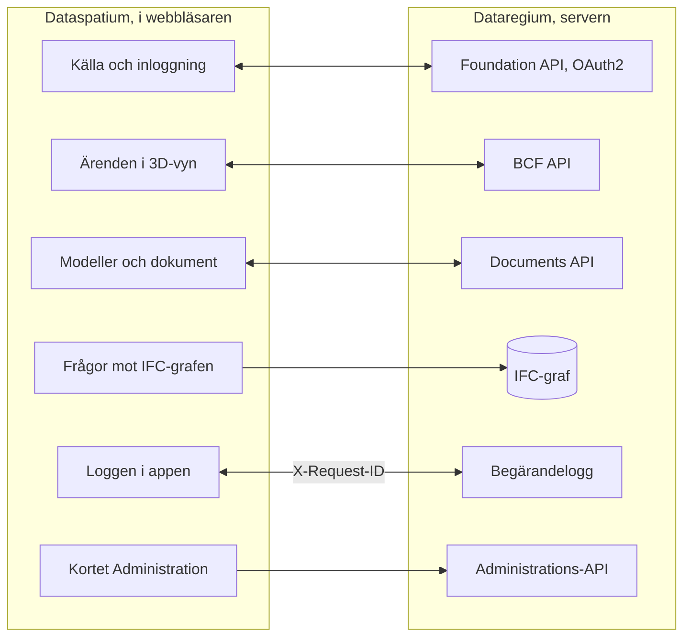

**Svenska** · [Dansk](docs/da/README.md) · [Norsk bokmål](docs/nb/README.md) · [Norsk nynorsk](docs/nn/README.md) · [Suomi](docs/fi/README.md) · [Íslenska](docs/is/README.md) · [English](docs/en/README.md)

# Dataspatium OpenCDE-klient

Dataspatium är en webbapp för data från källa till rapport: hämta in data från filer och öppna API:er, lagra och
hantera datamängder, granska och korrigera värden, analysera med R, visualisera och exportera. Allt körs i din
egen webbläsare. Ingen server, ingen installation, inga konton. Din data lämnar aldrig datorn om du inte själv
exporterar den. Säkerheten är det första kravet: inga nätverksanrop utan din åtgärd och ditt samtycke, hemligheter bara krypterade, komponenter pinnade och kontrollerade, och allt som delas granskas först.

**Innehåll**

- [Ladda ned och kom igång](#ladda-ned-och-kom-igång)
- [Vad som krävs](#vad-som-krävs)
- [Vad du kan göra](#vad-du-kan-göra)
- [OpenCDE-API:erna och deras klienter](#opencde-apierna-och-deras-klienter)
- [Dataspatium och Dataregium](#dataspatium-och-dataregium)
- [Lär dig mer](#lär-dig-mer)
- [Begränsningar i korthet](#begränsningar-i-korthet)
- [Personuppgifter](#personuppgifter)
- [Nästa i 3-serien](#nästa-i-3-serien)
- [Fel och förslag](#fel-och-förslag)
- [Utveckling](#utveckling)
- [Licens](#licens)

## Ladda ned och kom igång

1. **Ladda ned.** Gå till [senaste utgåvan](https://github.com/marwiss/Dataspatium/releases/latest) och hämta
   ZIP-filen under *Assets* (`dataspatium-<version>.zip`, ungefär 100 MB; R och alla R-paket ingår).
2. **Packa upp.** Högerklicka på ZIP-filen och välj *Extrahera alla* (Windows) eller dubbelklicka på den (macOS).
   Lägg mappen där du vill ha den, till exempel i Dokument. Appen fungerar inte direkt inifrån ZIP-filen.
3. **Öppna.** Dubbelklicka på `index.html` i mappen, eller dra filen till ett webbläsarfönster. Om Windows frågar
   vilken app som ska användas väljer du Edge, Chrome eller Firefox. Första gången frågar appen vilket språk du
   vill ha (det kan ändras med språkknappen uppe till höger) och startar sedan **Grundkursen**, en interaktiv
   genomgång av alla lägen med exempeldata som tar ungefär tio minuter. Kursen öppnas igen från hjälpen (?).
4. **Importera.** I läget *Inhämta* släpper du en fil på ytan (eller klickar på *Prova med exempeldata*),
   kontrollerar kolumnernas typer och klickar på *Importera*. Datamängden sparas i webbläsaren på din dator.
5. **Arbeta vidare.** Växla läge högst upp: *Hantera* visar dina datamängder och arbetsytan, *Söka* hittar rader
   i dem, *Bearbeta* visar tabellen med sortering, filter och åtgärder, *Analysera* öppnar R- och SQL-konsolen,
   *Visualisera* bygger diagram, *Exportera* laddar ned data, diagram och dokument och *Dela* ger dem till andra.

Data sparas i webbläsarens egen databas. Rensar du webbplatsdata försvinner den, så ta regelbundet en
säkerhetskopia under *Hantera > Arbetsyta*. Säkerhetskopian är en ZIP-fil som kan återställas på samma eller en
annan dator. Steg för steg med fler detaljer: [docs/sv/kom-igang.md](docs/sv/kom-igang.md).

Appen finns också direkt på webben, utan nedladdning: <https://marwiss.github.io/Dataspatium/>. Från en webbserver
kan den installeras som egen app (Edge och Chrome: *Installera* i adressfältet) och fungerar sedan även utan
nätverk. Webbversionen och mappversionen har skilda arbetsytor; flytta data mellan dem med en säkerhetskopia eller
ett paket.

## Vad som krävs

- Windows, macOS eller Linux.
- Microsoft Edge eller Google Chrome (version 120 eller senare), eller Firefox (version 128 eller senare).
  Safari stöds inte.
- Ungefär 300 MB ledigt utrymme för appmappen och minst 4 GB arbetsminne (8 GB rekommenderas för stora
  datamängder). Inga administratörsrättigheter behövs.
- Internet behövs bara när du hämtar data från öppna API:er, skickar till GitHub, söker efter uppdatering eller
  hämtar en komponent eller ett R-paket som inte följer med i mappen; appen frågar om lov först.

## Vad du kan göra

Det som går i en version går också i nästa. Varje version hör ihop med samma version av Dataregium.

### Version 1 (med Dataregium 1)

- **Hämta in**: filer i ett fyrtiotal format, från kalkylark och statistikfiler till geodata och tabeller i dokument, och data från öppna
  API:er hos nordiska och europeiska myndigheter, med sparade hämtningar (se [Öppna API:er](docs/sv/api-konfiguration.md)).
- **Bearbeta**: sortera, filtrera, rensa, typa, koda om, pivotera och koppla, med regler för datakvalitet, pseudonymisering, ångra,
  versioner och recept (se [Bearbeta](docs/sv/bearbeta.md)).
- **Analysera**: R med ggplot2 och tidyverse, SQL, anteckningsböcker som blir rapporter och reguljära uttryck, helt i webbläsaren (se
  [R](docs/sv/r-guide.md)).
- **Planer**: detaljplaner och översiktsplaner som plankartor med Boverkets färger och beteckningar (se [Planer](docs/sv/planer.md)).
- **Visualisera och dokumentera**: diagram med Vega-Lite, D3 eller R, dashboards och rapporter ur mallar som HTML, Word, PDF,
  PowerPoint eller LaTeX (se [Visualisera](docs/sv/visualisera.md)).
- **Exportera och dela**: data i ett tiotal format, delningspaket, kommentarer, säkerhetskopia, synk med GitHub och en portabel mapp.
- **Dataregium som källa**: dokument hämtas som datamängder, och datamängder och filer skickas tillbaka (Documents API).
- **Sex språk och grundkurs**: svenska, danska, norska (bokmål), finska, isländska och engelska, en interaktiv kurs genom alla lägen och
  kommandopaletten (Ctrl+K) som hittar allt.

### Också i version 2 (med Dataregium 2)

- **Fler källor**: databaser, öppna geodata och WMS, dokument och bilder som samlingar, och text ur skannade sidor (se
  [Källor](docs/sv/kallor.md)).
- **Kartor, planer och grafer**: kartvyer med lager och geoverktyg, planer från hela Norden, och grafer som ritas, frågas med Cypher och
  redigeras (se [Kartor](docs/sv/kartor.md) och [Grafer](docs/sv/grafer.md)).
- **CAD och BIM**: IFC-modeller i 3D med tabeller, egenskaper och mängder, och DXF-ritningar (se [CAD och BIM](docs/sv/cad-bim.md)).
- **Python och statistik utan kod**: en Python-konsol och formulär för statistik och tidsserier som skriver koden åt dig (se
  [Statistik](docs/sv/statistik.md)).
- **Söka och hålla ordning**: läget *Söka* med fasetter och sparade listor, frågor utan kod, mappar, taggar och batchåtgärder (se
  [Söka](docs/sv/soka.md)).
- **Dela och Mobil**: läget *Dela* med paket och publicering, granskning av personuppgifter före delning, överföring med QR-kod och
  *Dataspatium Mobil* för att visa och samla in i fält (se [Dela](docs/sv/dela.md)).
- **Flöden och slag**: sparade kedjor som körs med ett klick, bevakade källor, och lägen som känner igen vad en datamängd är och erbjuder
  rätt vyer och verktyg (se [Lägen](docs/sv/lagen.md)).
- **Dataregium med ärenden**: modeller och ärenden från servern, ärenden ur 3D-vyn, BCF-filer, serverns IFC-graf och administrationen
  (se [Dataspatium och Dataregium](#dataspatium-och-dataregium)).
- **Sju språk**: också nynorska, med handboken i appen och grundkursen genom alla åtta lägen.

### Också i version 3 (med Dataregium 3)

- **Kontroll av modeller**: kortet *Validera modellen* med serverns och appens kontroller, och kollisionskontroll med resultaten som
  BCF-ärenden (se [CAD och BIM](docs/sv/cad-bim.md)).
- **AI-modellering**: *Fråga AI om modellen* och *Ändra med AI*, där AI:n föreslår, du förhandsvisar i 3D och godkänner; AI:n kan aldrig
  spara eller publicera.
- **Versioner mot Dataregium**: publicering med basversion, förhandskontroll, ändringsförslag som servern prövar och en manager
  godkänner, och *Jämför versioner* markerat i 3D.
- **Mer**: serverns IFC-graf i skelettform, en lokal Dataregium på den egna datorn och Sundsvalls WFS bland geodatakällorna.

## OpenCDE-API:erna och deras klienter

OpenCDE är buildingSMART Internationals familj av öppna webb-API:er för en gemensam datamiljö, den plats där ett projekt delar
sina modeller, dokument och ärenden. En klient och en server som följer samma specifikationer kan arbeta tillsammans, vem som än
har byggt dem. Dataspatium använder alla tre:

| API | Vad appen gör med det | Specifikation |
|---|---|---|
| Foundation API 1.0 | Läser vilka API:er servern erbjuder, var man loggar in och vem användaren är; registrerar appen som klient när servern tillåter det | [foundation-API](https://github.com/buildingSMART/foundation-API) |
| BCF API 3.0 och 2.1 | Läser och skriver ärenden om en modell, med kommentarer och viewpoints (kamera, komponenter och bilder) ur 3D-vyn; väljer den nyaste version servern erbjuder | [BCF-API](https://github.com/buildingSMART/BCF-API) |
| Documents API 1.0 | Väljer och hämtar dokument och versioner via serverns egna sidor, så att en IFC-modell blir en datamängd, och laddar upp nya versioner, datamängder och paket | [documents-API](https://github.com/buildingSMART/documents-API) |

**Dataregium är en server, inte den enda.** Appen ska kunna ansluta till varje server som följer specifikationerna: inget i appen
beror på Dataregium, och Dataregiums tillägg utanför specifikationerna (kapabilitetsdokumentet, de namngivna graffrågorna,
förhandskontrollen, basversionen, ändringsförslagen och diffen mellan versioner) visas bara när servern själv anger dem. Av en server
behöver appen tre saker:

- att servern tillåter anrop från webbläsaren (CORS) från appens adress: `null` när appen öppnas från file://, `http://127.0.0.1:8080`
  från en lokal webbserver och `https://marwiss.github.io` från webben, med rubrikerna Authorization, Content-Type och X-Request-ID;
- en klientregistrering, gjord av serverns administratör (en publik klient med omdirigeringsadressen
  `http://127.0.0.1:8080/oauth-callback.html`, eller motsvarande för den adress appen servas från) eller av appen själv när servern
  tillåter det, och inloggning med OAuth2 authorization code med PKCE `S256`; från file:// klistrar du in adressen du hamnar på efter
  inloggningen;
- BCF API 3.0 eller 2.1; Documents API är valfritt, men utan det kan appen inte hämta eller publicera dokument.

Så långt är det visat mot Dataregium: livesviten körs mot servern i båda versionerna av BCF API, och en server med bara 2.1 fungerar.
Andra servrar är inte provade; berätta hur det gick under [Fel och förslag](#fel-och-förslag). När appen och en specifikation inte
stämmer överens avgör specifikationen. Serverns sida beskrivs i Dataregiums README och klientguide; appens i
[kallor.md](docs/sv/kallor.md).

## Dataspatium och Dataregium

*Dataregium hette Kontroll fram till den 8 november 2026.*

Dataspatium (appen i webbläsaren) och [Dataregium](https://github.com/marwiss/Dataregium) (en server för buildingSMARTs OpenCDE-API:er Foundation, BCF och
Documents) är utvecklade för att fungera tillsammans som klient och server. Appen lägger till servern som källa i Inhämta, loggar in
med OAuth2 och registrerar sig själv som klient när servern tillåter det, hämtar projektets modeller och dokument, läser och skriver
ärenden med viewpoints ur 3D-vyn, skickar datamängder, filer och arbetsytepaket tillbaka genom Documents API, frågar serverns
IFC-graf med Cypher och loggar varje anrop med samma X-Request-Id som servern skriver i sin begärandelogg. Frågorna mot grafen och administrationen är tillägg utanför specifikationerna; allt annat går genom de tre OpenCDE-API:erna, så
andra OpenCDE-klienter fungerar också. Servern behövs inte för resten av appen: utan server fungerar allt annat som förut. Dataregiums README och `docs/client-guide.md` beskriver samarbetet från
serverns sida; här beskrivs det i [kallor.md](docs/sv/kallor.md) och [cad-bim.md](docs/sv/cad-bim.md).

Så här hänger de ihop:

Appen talar BCF API 3.0 och 2.1, så den ansluter också till servrar som bara har 2.1, och den ritar och frågar serverns IFC-graf direkt från Inhämta.

Dataspatium 3.0.0 fungerar med Dataregium 3.0.0. Båda får samma utgåvenummer, så samma nummer hör ihop. Snabbstarten
[snabbstart.md](docs/sv/snabbstart.md) tar paret från ingenting till ett ärende på tjugo minuter.

### Utgåvorna 1, 2 och 3

Det finns en utgåva per huvudnummer, och Dataspatium och Dataregium med samma nummer hör ihop:

| Dataspatium | Vad den har | Hör ihop med |
|---|---|---|
| 1.0.0 | Hela 1-serien: datainhämtning, bearbetning, R, Python, kartor, diagram, dokument och delning, samt planer. Mot en server bara Documents API: hämta dokument som datamängder och skicka tillbaka datamängder och filer. Inga ärenden och inga modeller | Dataregium 1.0.0 (bara Documents API) |
| 2.0.0 | Hela 2-serien: IFC-modeller i 3D med tabeller, egenskaper och mängder, ärenden med viewpoints (BCF API 3.0 och 2.1), serverns IFC-graf (IFC-LPG) ritad och frågad, och planer ur planeringsverktyg fullt ut | Dataregium 2.0.0 |
| 3.0.0 | 3-serien: kortet *Validera modellen*, kollisionskontroll i webbläsaren, BCF-kameror i modellens koordinater, grafen i skelettform, Fråga AI och Ändra med AI, Jämför versioner, publicering med basversion och förhandskontroll, ändringsförslag som prövas och godkänns på servern | Dataregium 3.0.0 |

En ny utgåva i samma huvudnummer ersätter den förra; bara den senaste i varje serie rättas. Appens uppdateringskontroll erbjuder
nästa huvudnummer, och datamängder, listor, diagram, mallar och skript följer med när du öppnar den nya versionens `index.html`.

## Lär dig mer

- **Handboken** i appen: samma dokumentation som här, med sökning; öppna den med ? uppe till höger eller F1.
- **Grundkursen** i appen: en interaktiv genomgång av alla lägen med exempeldata; öppna den från hjälpen (?)
  eller med Ctrl+K.
- [Kom igång](docs/sv/kom-igang.md): steg för steg med vanliga frågor.
- [Snabbstart med Dataregium](docs/sv/snabbstart.md): tjugo minuter från ingenting till ett ärende skapat i 3D-vyn och synligt på servern.
- [Användarguide](docs/sv/anvandarguide.md): hela arbetsflödet från fil till rapport.
- [Vanliga frågor](docs/sv/faq.md): lagring, säkerhet, R, API:er och uppdateringar.
- [De åtta lägena](docs/sv/lagen.md): vad som finns var och varför.
- [Söka](docs/sv/soka.md) och [Dela](docs/sv/dela.md): hitta utan kod, och ge data till andra.
- [Dataspatium Mobil](docs/sv/mobil.md): telefonen som kurir, mottagare och visare; överföring mellan enheter.
- [Anteckningsbok](docs/sv/anteckningsbok.md): text, R, Python och SQL i celler som blir en rapport.
- [Dokument och bilder](docs/sv/dokument.md): PDF, Word, OpenDocument, Markdown och bilder som datamängder; dokumentvy, galleri och verktygen Text och Bilder.
- [Kartor](docs/sv/kartor.md): kartan i Bearbeta, kartvyer i Visualisera, geoverktygen och QGIS-projekt.
- [R i Dataspatium](docs/sv/r-guide.md) och [Python i Dataspatium](docs/sv/python.md): konsolerna, `dm_read()`,
  `dm_write()`, paketen och diagrammen.
- [Reguljära uttryck](docs/sv/regex.md): mönster för att analysera, rätta och dela upp text i datamängder.
- [Format och import](docs/sv/format.md): filformat, teckenkodning, decimaltecken, datum och kolumntyper.
- [Öppna API:er](docs/sv/api-konfiguration.md): de förinställda källorna, nycklar och hur du skriver en egen konfiguration.
- [Visualisera](docs/sv/visualisera.md): diagrambyggaren, D3-mallar, R-diagram, kartor och dashboards.
- [Dokument och mallar](docs/sv/dokumentmallar.md): mallspråket och utdataformaten.
- [Säkerhet](docs/sv/sakerhet.md): hotmodell, kontrollerna och proven som visar dem, personuppgifter och lagring, och hur en sårbarhet rapporteras.
- [Licenser](docs/sv/licenser.md): vad du får göra med appen och vilka licenser tredjepartskomponenterna har.
- Hur bidrag tas emot står i [CONTRIBUTING.md](CONTRIBUTING.md).

### Vidare läsning

- [BCF API](https://github.com/buildingSMART/BCF-API), [Foundation API](https://github.com/buildingSMART/foundation-API) och [Documents API](https://github.com/buildingSMART/documents-API): specifikationerna som appen följer mot en server.
- [IFC](https://github.com/buildingSMART/IFC4.x-development): filformatet för byggnadsmodeller, och [IDS](https://github.com/buildingSMART/IDS): kravspecifikationer som modeller kontrolleras mot.
- Externa resurser: [WebR](https://docs.r-wasm.org/webr/latest/), [R för nybörjare](https://www.r-project.org/),
  [Vega-Lite](https://vega.github.io/vega-lite/), [SCB:s API](https://www.scb.se/vara-tjanster/oppna-data/api-for-statistikdatabasen/).

## Begränsningar i korthet

- Appen måste öppnas från en uppackad mapp (file://) eller en vanlig webbserver; den fungerar inte direkt inifrån
  en ZIP-fil.
- API:er som saknar CORS-stöd (till exempel Riksbankens) kan inte anropas direkt från webbläsaren.
- En datamängd bör hålla sig under ett par miljoner rader; minnet i webbläsaren sätter gränsen.
- När appen öppnas från en mapp kan R-kod inte avbrytas mitt i en beräkning; använd *Starta om R*. Från en
  webbserver (localhost eller https) finns knappen *Avbryt*.
- Flera flikar fungerar och håller varandra underrättade, men redigera inte samma datamängd i två flikar
  samtidigt: den som sparar sist vinner.
- Den portabla mappen kräver Edge eller Chrome; Firefox saknar mappåtkomst (File System Access). Säkerhetskopia
  som ZIP fungerar överallt.
- Hela appen är gjord för datorer; på telefoner och surfplattor används Dataspatium Mobil
- Exempeldata, API-förinställningar och kartgränser som följer med är svenska; appen fungerar lika bra med andra länders data, men de får du hämta själv.
  (<https://marwiss.github.io/Dataspatium/m/>), som tar emot, visar och skickar vidare. Safari stöds inte för
  hela appen. I smala fönster öppnas panelerna som flak över arbetsytan.

## Personuppgifter

Dataspatium körs i din webbläsare, och du ansvarar själv för de uppgifter du lägger in. Allt som appen sparar (datamängder och deras
versioner, listor, diagram, dokument, anteckningsböcker, kommentarer och inställningar) ligger i webbläsarens lagring på din dator och
lämnar den bara när du exporterar, delar eller publicerar; då granskas allt i sin helhet först, och personuppgifter kan behållas,
pseudonymiseras eller tas bort i kopian. Mot en Dataregium-server skickas din inloggning (token hålls i sessionen eller krypterade med
din lösenfras, aldrig i klartext), de ärenden, kommentarer, förslag och filer du skapar under ditt namn på servern, och ett
X-Request-ID per anrop; serverns egen behandling står i Dataregiums README. Mot en AI-leverantör skickas bara det du frågar och de
svar verktygen hämtar ur modellen, efter samtycke för ändamålet AI, med din egen nyckel lagrad krypterad; projektets policy kan begränsa
till lokala modeller. Kommentarer och paket bär det namn du själv anger. Kontrollerna och proven som visar dem står i
[docs/sv/sakerhet.md](docs/sv/sakerhet.md).

## Nästa i 3-serien

3.0.0 är 3-seriens första utgåva, gjord tillsammans med Dataregium 3.0.0: kontrollen av modeller, kollisionskontrollen, AI-stegen
och versionsjämförelsen, som [Vad du kan göra](#vad-du-kan-göra) beskriver. Som varje huvudnummer har serien en enda utgåva, som
ges ut igen när den växer. Det som följer gör appen till klienten som redigerar serverns modell och visar dess versioner: AI:n
föreslår, människan granskar och godkänner, servern prövar och sammanfogar. Det här avsnittet säger vad som är beslutat, för den,
människa eller AI-agent, som för en del av det vidare; serverns sida står i Dataregiums README under samma rubrik.

### Beslutat

- **Modelleringen sker i appen, inte på servern.** Modelleringshjulet (skrivverktygen och IfcOpenShell i appens Python) är
  Dataspatiums eget, under Dataspatiums licens, och bär ingen kod ur IFC-LPG; servern når det bara genom API:erna.
- **AI:n föreslår, människan godkänner.** Ett ändringsset förhandsvisas i 3D, kontrolleras lokalt och av serverns förhandskontroll,
  och tillämpas först när du godkänner; radering bekräftas en gång till; publicering och förslag till servern är knappar, aldrig
  verktyg AI:n kan anropa. Byggt i 3.0.0.
- **Versionsmodellen.** Ett ändringsset skickas till servern som ett BCF-ärende med snippet i serverns form (GlobalId och sökväg
  som nyckel), servern prövar det mot basversionen och en *manager* godkänner det till nästa version; en publicering med inaktuell
  bas avvisas (412), och krockarna visas. Byggt i 3.0.0. Härnäst: trevägsmerge i appen vid krock, versionshistoriken per dokument
  och ett BCF-ärende per godkänt ändringsset.
- **Jämför versioner** med tre källor: ögonblicksbilder och andra modeller i appen, serverns ändringsset per version och serverns
  diff mellan versioner. Byggt i 3.0.0.
- **Projektets förvaltare** får en sida i appen när Dataregiums API för medlemmar och roller finns.
- **Steg 4 och 5, efter steg 3:** repoläge per projekt med en lokal Dataregium på den egna datorn och hämta och publicera mellan den
  lokala och den fjärran; stora modeller ritade från serverns geometri-API när webbläsaren inte räcker; projektprofiler med IDS och
  bSDD, IDS som AI:n skriver och buildingSMART-regler kopplade till element.
- **Öppna format** gäller utbytesformat och lagrade data, inte AI-API:er; AI-leverantör väljs av användaren med egen nyckel, lagrad
  krypterad, och projektets policy kan begränsa till lokala modeller.

## Fel och förslag

Rapportera fel eller önskemål som *Issues* här på GitHub. Beskriv webbläsare, version av Dataspatium (visas under
hjälpknappen) och vad du gjorde. Se [CONTRIBUTING.md](CONTRIBUTING.md). Bifoga inga personuppgifter och inga hemligheter. För en
säkerhetssårbarhet, följ [SECURITY.md](SECURITY.md) i stället för att öppna ett ärende.

## Utveckling

- Inget byggsteg, inget node.js. Öppna `index.html` direkt, eller serva mappen med `python -m http.server 8080`.
- Arkitektur i korthet: all egen kod är klassiska skript som registreras med `Dataspatium.define` i ordningen i `src/boot.js`; `src/platform` bär allt som är file://-specifikt (resurser, shims, workers, lagring, samtycke); motorerna SQLite, R (WebR) och Python (Pyodide) kör i workers; `src/ui` har designvariablerna, komponenterna (`dm-*`), skalet och ett läge per fil. Allt som renderas escapas, och inget hämtas från nätet utan din åtgärd och ditt samtycke.
- Tredjepartskomponenter: `python tools/fetch_vendor.py` följt av `python tools/wrap_assets.py`.
- Tester: `powershell -File tools/run-tests.ps1` eller `tools/run-tests.sh` (headless Edge och Firefox).
- Säkerhet: proven för samtycke, hemligheter, granskning före delning, OAuth2 (PKCE, state, återhopp) och loggens maskering ingår i sviten; se [docs/sv/sakerhet.md](docs/sv/sakerhet.md).

## Licens

Dataspatiums egen kod, dokumentation och förinställningar (allt utom `vendor/`) är licensierade under
[PolyForm Strict 1.0.0](LICENSE): fri att ladda ned och använda för icke-kommersiella ändamål, inklusive i
myndigheter och andra offentliga institutioner, men inte att ändra, bygga vidare på eller sprida vidare utan
skriftligt tillstånd. Licensgivare är Dataspatiums upphovsperson, som nås via GitHub-kontot
[marwiss](https://github.com/marwiss); öppna ett ärende för andra villkor. Vad licensen betyder i praktiken
förklaras i [docs/sv/licenser.md](docs/sv/licenser.md).

Tredjepartskomponenter i `vendor/` har sina egna licenser (MIT, BSD, Apache-2.0, ISC, OFL, MPL, LGPL och GPL), se
[THIRD_PARTY_LICENSES.md](THIRD_PARTY_LICENSES.md). R och de GPL-licensierade R-paketen distribueras oförändrade;
källkoden finns hos [R-projektet](https://cran.r-project.org/sources.html), [webR](https://github.com/r-wasm/webr)
och [CRAN](https://cran.r-project.org/) i de versioner som anges där. Se [SECURITY.md](SECURITY.md) för hur en sårbarhet rapporteras och
vad projektet gör för att förbli säkert.
