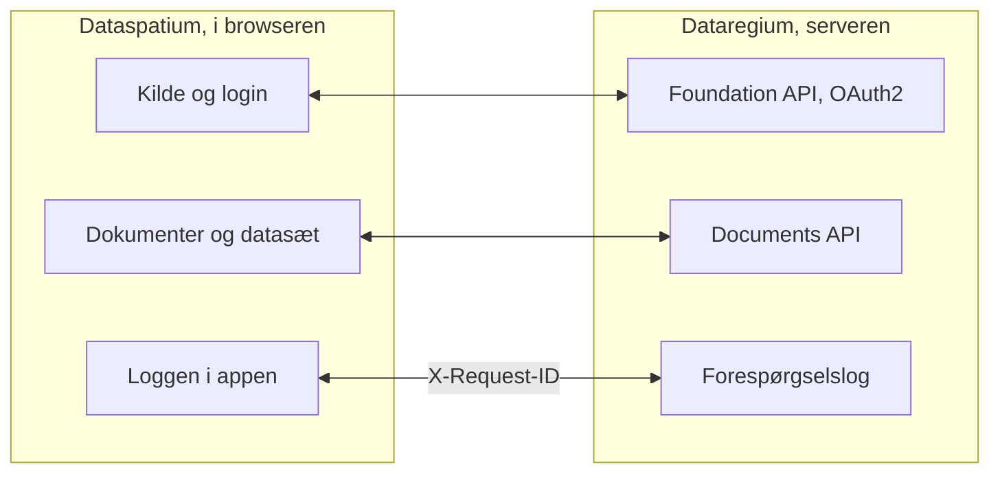

[Svenska](../../README.md) · **Dansk** · [Norsk](../nb/README.md) · [Suomi](../fi/README.md) · [Íslenska](../is/README.md) · [English](../en/README.md)

# Dataspatium OpenCDE-klient

*Dette er README for Dataspatium 1.0.0. Den seneste udgivelse, 3.0.0, beskrives i [README på main](https://github.com/marwiss/Dataspatium/blob/main/docs/da/README.md).*

Dataspatium er et program til at arbejde med data, som du åbner i din almindelige browser. Du henter en tabel, et kort, en plan eller
statistik fra en myndighed ind, retter og regner på den, laver diagrammer og rapporter og sender resultatet videre. Alt sker på din egen
computer: ingen installation, ingen konto og ingen server. Intet forlader computeren, medmindre du selv eksporterer eller deler det, og
appen spørger altid, før den bruger internettet.

Dataspatium kan også hente dokumenter fra [Dataregium](https://github.com/marwiss/Dataregium), en server hvor et byggeprojekt samler sine
dokumenter, og sende datasæt og filer tilbage som nye versioner. Uden Dataregium fungerer alt andet præcis som før.

**For den teknisk kyndige:** en statisk webapp uden byggetrin, der kører fra `file://` i Edge, Chrome og Firefox eller fra en hvilken som
helst statisk webserver. Hvert datasæt er en SQLite-fil (sql.js) i IndexedDB, og R kører i WebR 0.5.9 i en worker. Over for en server er
appen en OpenCDE-klient for Foundation API 1.0, med OAuth2 authorization code og PKCE, og Documents API 1.0. Der sker ingen netværkskald
uden samtykke pr. formål, og hemmeligheder gemmes kun krypteret (AES-GCM).

**Indhold**

- [Download og kom i gang](#download-og-kom-i-gang)
- [Hvad der kræves](#hvad-der-kræves)
- [Ord du bør kende](#ord-du-bør-kende)
- [Hvad du kan](#hvad-du-kan)
- [OpenCDE-API'erne og deres klienter](#opencde-apierne-og-deres-klienter)
- [Dataspatium og Dataregium](#dataspatium-og-dataregium)
- [Lær mere](#lær-mere)
- [Begrænsninger i korte træk](#begrænsninger-i-korte-træk)
- [Personoplysninger](#personoplysninger)
- [Nyere udgivelser](#nyere-udgivelser)
- [Fejl og forslag](#fejl-og-forslag)
- [Udvikling](#udvikling)
- [Licens](#licens)

## Download og kom i gang

1. **Download.** Gå til [udgivelse 1.0.0](https://github.com/marwiss/Dataspatium/releases/tag/v1.0.0) og hent ZIP-filen under *Assets*
   (`dataspatium-1.0.0.zip`, cirka 95 MB; R og de mest almindelige R-pakker er med).
2. **Pak ud.** Højreklik på ZIP-filen og vælg *Udpak alle* (Windows), eller dobbeltklik på den (macOS). Læg mappen, hvor du vil have den,
   for eksempel i Dokumenter. Appen virker ikke direkte inde fra ZIP-filen.
3. **Åbn.** Dobbeltklik på `index.html` i mappen, eller træk filen ind i et browservindue. Hvis Windows spørger, hvilken app der skal
   bruges, vælger du Edge, Chrome eller Firefox. Første gang vælger du sprog, og derefter tilbydes **grundkurset**: en gennemgang af alle
   seks tilstande med eksempeldata, der tager cirka ti minutter og kan åbnes igen fra hjælpen (?).
4. **Hent data ind.** I tilstanden *Hent* slipper du en fil på fladen, eller klikker på *Prøv med eksempeldata*. Appen viser, hvad filen
   indeholder; klik på *Importér*. Datasættet gemmes i browseren på din computer.
5. **Arbejd videre.** Tilstandene øverst er trinene i arbejdet: *Håndter* holder orden på dine datasæt, *Bearbejd* viser tabellen med
   knapper til at rette og regne, *Analysér* har R, SQL og regulære udtryk, *Visualisér* laver diagrammer og kort, og *Eksportér* gemmer
   filer på computeren og delingspakker til andre.

Det, du gemmer, ligger i browserens egen database på computeren. Rydder du browserens webstedsdata, forsvinder det, så tag jævnligt en
sikkerhedskopi under *Håndter > Arbejdsområde*. Sikkerhedskopien er en ZIP-fil, der kan gendannes på samme eller en anden computer. Trin
for trin med flere detaljer: [kom-igang.md](kom-igang.md).

Webudgaven på <https://marwiss.github.io/Dataspatium/> er altid den seneste udgivelse, nu 3.0.0.

### For den teknisk kyndige

- **Kør:** pak ZIP-filen ud og åbn `index.html` (file://), eller server mappen: `python -m http.server 8080 --bind 127.0.0.1` og åbn
  <http://127.0.0.1:8080/>. Fra en webserver er der service worker, en app der kan installeres, og R der kan afbrydes.
- **Kontrollér ZIP-filen:** sammenlign dens SHA-256 med den i udgivelsens tekst (`Get-FileHash` i PowerShell, `shasum -a 256` på macOS
  og Linux).
- **Med en server:** start Dataregium 1.0.0 med Docker eller Podman, som dens README beskriver, server Dataspatium på port 8080 og tilføj
  serveren med *Hent > Tilføj OpenCDE-server*. Klient-id kan stå tomt, når serveren tillader selvregistrering.
- **Prøver:** `powershell -File tools/run-tests.ps1` kører hele suiten i headless Edge og Firefox.

## Hvad der kræves

- Windows, macOS eller Linux.
- Microsoft Edge eller Google Chrome (version 120 eller nyere) eller Firefox (version 128 eller nyere). Safari understøttes ikke.
- Cirka 300 MB ledig plads til appmappen og mindst 4 GB arbejdshukommelse (8 GB anbefales til store datasæt). Der kræves ingen
  administratorrettigheder.
- Internet er kun nødvendigt, når du selv vælger noget, der kræver det, og appen spørger om lov først for hvert formål: hente data fra
  åbne API'er og baggrundskort, forbinde til en Dataregium-server eller GitHub, søge efter opdatering eller hente R-pakker ud over de mest
  almindelige.
- Dataregium kræver en server. At køre din egen kræver Docker eller Podman; det beskriver Dataregiums README.

## Ord du bør kende

Du behøver ikke kende ordene nedenfor for at bruge appen, men de forekommer i teksten.

- **API**: en måde for programmer at hente data fra hinanden over nettet. Appen henter statistik fra myndigheders API'er og taler med
  Dataregium gennem dens API'er.
- **Datasæt**: det, appen gemmer, når du henter noget ind: en tabel, et kort eller en plan.
- **Opskrift**: listen over alt, du har gjort med et datasæt, trin for trin, så det kan fortrydes eller gentages på nye data.
- **R og SQL**: sprog til at analysere data. Appen har dem indbygget, men det meste gøres med knapper.
- **OpenCDE**: buildingSMARTs åbne regler for, hvordan programmer deler et byggeprojekts modeller, dokumenter og sager, så programmer fra
  forskellige producenter fungerer sammen.
- **Server**: et program, som andre forbinder til over nettet. Dataregium er en server; Dataspatium behøver ingen.
- **Container**: et færdigpakket program, der startes med Docker eller Podman, uden at delene installeres hver for sig. Dataregium kører
  sådan; Dataspatium behøver ingen containere.
- **OAuth2-login**: den almindelige måde at logge ind på en tjeneste fra en anden app, uden at appen ser din adgangskode.
- **file:// og CORS**: file:// betyder, at appen åbnes direkte fra en mappe. CORS er browserens regel for, hvilke webtjenester en webapp
  må hente data fra; en tjeneste uden CORS kan ikke nås direkte.

## Hvad du kan

Det, der virker i én version, virker også i den næste. Hver version hører sammen med samme version af Dataregium.

### Version 1 (med Dataregium 1)

- **Hent data ind**: filer i en fyrretyve formater, fra Excel og CSV til statistikfiler, geodata og tabeller i Word og websider, og
  statistik fra myndigheder i Sverige, Norden og Europa med ét klik (se [Åbne API'er](api-konfiguration.md)). *Teknisk:* tegnkodning og
  kolonnetyper genkendes; SPSS, Stata, SAS, PX, Parquet og RDS via R; egne kilder som `*.api.json`.
- **Ret og regn**: en halvtreds handlinger med knapper, som at rense, skifte type, omkode, beregne andele, pivotere og koble tabeller, med
  kvalitetsregler, pseudonymisering af personnumre, fortryd og versioner (se [Bearbejd](bearbeta.md)). *Teknisk:* hvert trin gemmes i en
  opskrift, der kan eksporteres som R- eller SQL-kode.
- **Analysér**: R med ggplot2 og tidyverse, SQL på tværs af datasæt, regulære udtryk og notesbøger, der bliver til rapporter, helt i
  browseren (se [R](r-guide.md) og [Regulære udtryk](regex.md)).
- **Planer**: svenske detailplaner og oversigtsplaner som plankort med Boverkets farver og signaturer, i planens eget koordinatsystem (se
  [Planer](planer.md)).
- **Diagrammer, kort og dokumenter**: diagrammer og kort med Vega-Lite, D3 eller R, dashboards og rapporter ud fra skabeloner som HTML,
  Word, PDF, PowerPoint, Markdown eller LaTeX (se [Visualisér](visualisera.md)).
- **Gem og del**: data i en ti formater, delingspakker, kommentarer, sikkerhedskopi, synkronisering med GitHub og en bærbar mappe.
- **Dataregium som dokumentarkiv**: hent dokumenter fra serveren som datasæt, og send datasæt og filer tilbage som nye versioner.
  *Teknisk:* Foundation API og Documents API.
- **Seks sprog og et grundkursus**: svensk, dansk, norsk (bokmål), finsk, islandsk og engelsk, og kommandopaletten (Ctrl+K), der finder
  alt.

## OpenCDE-API'erne og deres klienter

OpenCDE er buildingSMART Internationals åbne regler for, hvordan programmer deler et byggeprojekts modeller, dokumenter og sager. Et
program, der følger reglerne, kan arbejde sammen med enhver server, der også gør det, uanset hvem der har bygget dem. Dataspatium 1.0.0 er
sådan et program, en klient, og bruger to af API'erne:

| API | Hvad appen gør med det | Specifikation |
|---|---|---|
| Foundation API 1.0 | Læser, hvilke API'er serveren tilbyder, hvor man logger ind, og hvem brugeren er; registrerer appen som klient, når serveren tillader det | [foundation-API](https://github.com/buildingSMART/foundation-API) |
| Documents API 1.0 | Vælger og henter dokumenter og versioner via serverens egne sider, så et dokument bliver et datasæt, og uploader nye versioner, datasæt og filer | [documents-API](https://github.com/buildingSMART/documents-API) |

Sager gennem BCF API og bygningsmodeller kom i version 2. **Dataregium er én server, ikke den eneste.** Intet i appen afhænger af
Dataregium; kapabilitetsdokumentet, Dataregiums udvidelse, bruges kun, når serveren selv angiver det.

**For den teknisk kyndige:** af en server har appen brug for tre ting:

- CORS fra appens oprindelse: `null` fra file://, `http://127.0.0.1:8080` fra en lokal webserver og `https://marwiss.github.io` fra
  nettet, med headerne Authorization, Content-Type og X-Request-ID;
- en klientregistrering, lavet af serverens administrator (en offentlig klient med omdirigeringsadressen
  `http://127.0.0.1:8080/oauth-callback.html`, eller det tilsvarende for appens adresse) eller af appen selv (RFC 7591), når serveren
  tillader det, og OAuth2 authorization code med PKCE `S256`; fra file:// indsætter du den adresse, du lander på efter login;
- Documents API 1.0.

Når appen og en specifikation ikke stemmer overens, afgør specifikationen det. Serverens side beskrives i Dataregiums README.

## Dataspatium og Dataregium

*Dataregium hed Kontroll indtil 8. november 2026.*

Dataspatium er appen, du arbejder i, og [Dataregium](https://github.com/marwiss/Dataregium) er serveren, hvor et projekt samler sine
dokumenter. Du tilføjer serveren som kilde i *Hent* og logger ind; derefter vælger du dokumenter på serverens side, får dem som datasæt
og sender datasæt og filer tilbage som nye dokumenter eller versioner. Uden server virker resten af appen som sædvanligt.

**For den teknisk kyndige:** alt går gennem Foundation API og Documents API. Hvert kald bærer et `X-Request-Id`, som serveren skriver i sin
forespørgselslog, så loggen i appen og serverens log kan parres.

Sådan hænger de sammen:

Dataspatium 1.0.0 fungerer med Dataregium 1.0.0. Samme nummer hører sammen.

### Udgivelserne 1, 2 og 3

Der er én udgivelse pr. hovednummer, og Dataspatium og Dataregium med samme nummer hører sammen:

| Dataspatium | Hvad den har | Hører sammen med |
|---|---|---|
| 1.0.0 | Data fra filer og åbne API'er, bearbejdning, R, SQL og regulære udtryk, svenske planer, diagrammer og kort i diagrammer, dashboards, dokumenter, eksport og deling. Mod en server kun Documents API: hent dokumenter som datasæt og send datasæt og filer tilbage. Ingen sager, ingen modeller og ingen Python | Dataregium 1.0.0 (kun Documents API) |
| 2.0.0 | Alt i 1.0.0 og desuden tilstandene Søg og Del, Python og statistik uden kode, flere kilder, kortvisninger, nordiske planer, grafer, IFC-modeller i 3D med kontrol mod IDS, flows, Dataspatium Mobil, sager med viewpoints (BCF API 3.0 og 2.1), serverens IFC-graf, kortet *Administration* og kortet *Projektets medlemmer* | Dataregium 2.0.0 |
| 3.0.0 | Alt i 2.0.0 og desuden kortet *Valider modellen*, kollisionskontrol, Spørg AI og Ændr med AI, nye tomme modeller i valgfrit skema, Sammenlign versioner, publicering med basisversion og forhåndskontrol, ændringsforslag, der afprøves og godkendes på serveren med valg ved konflikter, og grafen i en lettere form | Dataregium 3.0.0 |

En ny udgivelse med samme hovednummer erstatter den forrige; kun den seneste i hver serie rettes. Appens opdateringskontrol tilbyder næste
hovednummer, og datasæt, lister, diagrammer, skabeloner og scripts følger med, når du åbner den nye versions `index.html`.

## Lær mere

Filnavnene er de samme på alle sprog (det er de svenske originaler), så links virker ens overalt.

**Begynd her**

- **Grundkurset** i appen: en gennemgang af alle tilstande med eksempeldata; åbn det fra hjælpen (?) eller med Ctrl+K.
- [Kom i gang](kom-igang.md): trin for trin med almindelige spørgsmål.
- [Brugervejledning](anvandarguide.md): hele arbejdsgangen fra fil til rapport.
- [De seks tilstande](lagen.md): hvad der er hvor og hvorfor.
- [Ofte stillede spørgsmål](faq.md): lagring, sikkerhed, R, API'er og opdateringer.

**Efter område**

- [Formater og import](format.md) og [Åbne API'er](api-konfiguration.md): filformater, tegnkodning, de forudindstillede kilder, nøgler,
  egne konfigurationer og OpenCDE-servere.
- [Bearbejd](bearbeta.md) og [Regulære udtryk](regex.md): ret, regn og find.
- [R i Dataspatium](r-guide.md) og [Notesbog](anteckningsbok.md): analyse med kode.
- [Visualisér](visualisera.md) og [Dokumenter og skabeloner](dokumentmallar.md): diagrammer, kort, dashboards og rapporter.
- [Planer](planer.md): detailplaner og oversigtsplaner.
- [Licenser](licenser.md): hvad du må gøre med appen, og hvilke licenser tredjepartskomponenterne har.
- [Udvikling](../utveckling.md), [Arkitektur](../arkitektur.md) og [Stilguide](../stilguide.md) for den, der vil forstå koden (på svensk);
  hvordan bidrag modtages, står i [CONTRIBUTING.md](../../CONTRIBUTING.md).

### Videre læsning

- [Foundation API](https://github.com/buildingSMART/foundation-API) og [Documents API](https://github.com/buildingSMART/documents-API): de specifikationer, appen følger over for en server.
- Eksterne ressourcer: [WebR](https://docs.r-wasm.org/webr/latest/), [Vega-Lite](https://vega.github.io/vega-lite/),
  [SCB's API](https://www.scb.se/en/services/open-data-api/).

## Begrænsninger i korte træk

- Appen skal åbnes fra en udpakket mappe eller en almindelig webserver; den virker ikke direkte inde fra ZIP-filen.
- Webtjenester, der ikke tillader kald fra browsere (mangler CORS, for eksempel den svenske Riksbank), kan ikke nås direkte; en egen proxy
  kan angives.
- Et datasæt bør holde sig under et par millioner rækker; browserens hukommelse sætter grænsen.
- Når appen åbnes fra en mappe, kan R-kode ikke afbrydes midt i en beregning; brug *Genstart R*. Fra en webserver er der knappen *Afbryd*.
- Flere faner virker og holder hinanden orienteret, men redigér ikke samme datasæt i to faner samtidig: den, der gemmer sidst, vinder.
- Den bærbare mappe kræver Edge eller Chrome; Firefox mangler mappeadgang. Sikkerhedskopi som ZIP virker overalt.
- Appen er lavet til computere; telefoner og tablets understøttes ikke i version 1.
- Eksempeldata og kortgrænser, der følger med, dækker Sverige, Danmark, Norge og Finland, og de forudindstillede kilder er nordiske og
  europæiske; data fra andre lande kan du lige så nemt hente ind selv.

## Personoplysninger

Dataspatium kører i din browser, og du er selv ansvarlig for de oplysninger, du lægger ind. Alt, appen gemmer (datasæt og deres versioner,
diagrammer, dokumenter, notesbøger, kommentarer og indstillinger), ligger i browserens lager på din computer og forlader den kun, når du
eksporterer eller deler. Til en Dataregium-server sendes dit login (tokens holdes i sessionen eller krypteret med din adgangsfrase,
aldrig i klartekst), de datasæt og filer, du sender, og et X-Request-ID pr. kald; serverens egen behandling står i Dataregiums README.
Kommentarer og pakker bærer det navn, du selv angiver.

## Nyere udgivelser

Dataspatium 2.0.0 tilføjer tilstandene Søg og Del, Python, kortvisninger, grafer, bygningsmodeller i 3D og sager mod Dataregium, og 3.0.0
desuden kontrol af modeller, Spørg AI og Ændr med AI og versioner på serveren. Den seneste hentes fra
[seneste udgivelse](https://github.com/marwiss/Dataspatium/releases/latest) og beskrives i
[README på main](https://github.com/marwiss/Dataspatium/blob/main/docs/da/README.md). Datasæt, lister, diagrammer, skabeloner og scripts
følger med, når du åbner den nye versions `index.html`.

## Fejl og forslag

Rapportér fejl eller ønsker som *Issues* her på GitHub. Beskriv browseren, versionen af Dataspatium (vises under hjælpeknappen) og hvad du
gjorde. Se [CONTRIBUTING.md](../../CONTRIBUTING.md). Vedhæft ingen personoplysninger og ingen hemmeligheder.

## Udvikling

- Intet byggetrin, intet node.js. Åbn `index.html` direkte, eller server mappen med `python -m http.server 8080`.
- Arkitektur i korte træk: al egen kode er klassiske scripts, der registreres med `Dataspatium.define` i rækkefølgen i `src/boot.js`;
  `src/platform` bærer alt, der er specifikt for file://; motorerne SQLite og R (WebR) kører i workers; `src/ui` har designvariablerne,
  komponenterne (`dm-*`), skallen og én tilstand pr. fil. Se [arkitektur.md](../arkitektur.md).
- Tredjepartskomponenter: `python tools/fetch_vendor.py` efterfulgt af `python tools/wrap_assets.py`.
- Prøver: `powershell -File tools/run-tests.ps1` (headless Edge og Firefox). Prøverne går aldrig mod nettet. Se
  [utveckling.md](../utveckling.md).

## Licens

Dataspatiums egen kode, dokumentation og forudindstillinger (alt undtagen `vendor/`) er licenseret under
[PolyForm Strict 1.0.0](../../LICENSE): fri at downloade og bruge til ikke-kommercielle formål, også i myndigheder og andre offentlige
institutioner, men ikke at ændre, bygge videre på eller videredistribuere uden skriftlig tilladelse. Licensgiver er Dataspatiums
ophavsperson, der kan kontaktes via GitHub-kontoen [marwiss](https://github.com/marwiss); opret et issue for andre vilkår. Hvad licensen
betyder i praksis, forklares i [licenser.md](licenser.md).

Tredjepartskomponenter i `vendor/` har deres egne licenser (MIT, BSD, Apache-2.0, ISC, OFL, MPL, LGPL og GPL), se
[THIRD_PARTY_LICENSES.md](../../THIRD_PARTY_LICENSES.md). R og de GPL-licenserede R-pakker distribueres uændret; kildekoden findes hos
[R-projektet](https://cran.r-project.org/sources.html), [webR](https://github.com/r-wasm/webr) og [CRAN](https://cran.r-project.org/) i de
versioner, der angives der.
