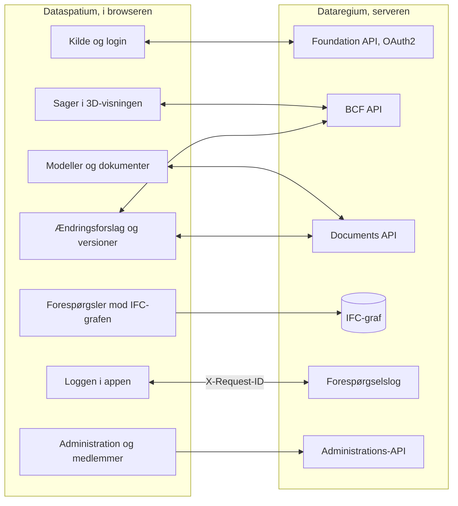

[Svenska](../../README.md) · **Dansk** · [Norsk bokmål](../nb/README.md) · [Norsk nynorsk](../nn/README.md) · [Suomi](../fi/README.md) · [Íslenska](../is/README.md) · [English](../en/README.md)

# Dataspatium OpenCDE-klient

Dataspatium er et program til at arbejde med data, som du åbner i din almindelige browser. Du henter en tabel, et kort, en plan, en
bygningsmodel eller statistik fra en myndighed ind, retter og regner på den, laver diagrammer og rapporter og sender resultatet videre.
Alt sker på din egen computer: ingen installation, ingen konto og ingen server. Intet forlader computeren, medmindre du selv eksporterer
eller deler det, og appen spørger altid, før den bruger internettet.

Dataspatium kan også arbejde sammen med [Dataregium](https://github.com/marwiss/Dataregium), en server hvor et byggeprojekt deler
modeller, dokumenter og sager. Så kan du hente projektets bygningsmodeller, udpege problemer i 3D, kontrollere modellerne og, med hjælp
fra AI, foreslå ændringer, som projektets ansvarlige godkender. Uden Dataregium fungerer alt andet præcis som før.

**For den teknisk kyndige:** en statisk webapp uden byggetrin, der kører fra `file://` i Edge, Chrome og Firefox eller fra en hvilken
som helst statisk webserver. Hvert datasæt er en SQLite-fil (sql.js) i IndexedDB; R kører i WebR 0.5.9 og Python i Pyodide 0.29.5,
begge i workers; IFC læses med web-ifc og IfcOpenShell (wasm). Over for en server er appen en OpenCDE-klient: Foundation API 1.0 med
OAuth2 authorization code og PKCE, BCF API 3.0 og 2.1 og Documents API 1.0. Der sker ingen netværkskald uden samtykke pr. formål, og
hemmeligheder gemmes kun krypteret (AES-GCM).

**Indhold**

- [Download og kom i gang](#download-og-kom-i-gang)
- [Hvad der kræves](#hvad-der-kræves)
- [Ord du bør kende](#ord-du-bør-kende)
- [Hvad du kan](#hvad-du-kan)
- [OpenCDE-API'erne og deres klienter](#opencde-apierne-og-deres-klienter)
- [Dataspatium og Dataregium](#dataspatium-og-dataregium)
- [Lær mere](#lær-mere)
- [Begrænsninger i korte træk](#begrænsninger-i-korte-træk)
- [Personoplysninger](#personoplysninger)
- [Næste i 3-serien](#næste-i-3-serien)
- [Fejl og forslag](#fejl-og-forslag)
- [Udvikling](#udvikling)
- [Licens](#licens)

## Download og kom i gang

1. **Download.** Gå til [seneste udgivelse](https://github.com/marwiss/Dataspatium/releases/latest) og hent ZIP-filen under *Assets*
   (`dataspatium-<version>.zip`, cirka 100 MB; R og de mest almindelige R-pakker er med).
2. **Pak ud.** Højreklik på ZIP-filen og vælg *Udpak alle* (Windows), eller dobbeltklik på den (macOS). Læg mappen, hvor du vil have
   den, for eksempel i Dokumenter. Appen virker ikke direkte inde fra ZIP-filen.
3. **Åbn.** Dobbeltklik på `index.html` i mappen, eller træk filen ind i et browservindue. Hvis Windows spørger, hvilken app der skal
   bruges, vælger du Edge, Chrome eller Firefox. Første gang vælger du sprog, og derefter tilbydes **grundkurset**: en gennemgang af
   alle tilstande med eksempeldata, der tager cirka ti minutter og kan åbnes igen fra hjælpen (?).
4. **Hent data ind.** I tilstanden *Hent* slipper du en fil på fladen, eller klikker på *Prøv med eksempeldata*. Appen viser, hvad
   filen indeholder; klik på *Importér*. Datasættet gemmes i browseren på din computer.
5. **Arbejd videre.** Tilstandene øverst er trinene i arbejdet: *Håndter* holder orden på dine datasæt, *Søg* finder rækker uden kode,
   *Bearbejd* viser tabellen, kortet eller modellen med knapper til at rette og regne, *Analysér* har statistik og kode (R, Python og
   SQL), *Visualisér* laver diagrammer og kort, *Eksportér* gemmer filer på computeren, og *Del* sender til andre.

Det, du gemmer, ligger i browserens egen database på computeren. Rydder du browserens webstedsdata, forsvinder det, så tag jævnligt en
sikkerhedskopi under *Håndter > Arbejdsområde*. Sikkerhedskopien er en ZIP-fil, der kan gendannes på samme eller en anden computer.
Trin for trin med flere detaljer: [kom-igang.md](kom-igang.md).

Appen findes også direkte på nettet, uden download: <https://marwiss.github.io/Dataspatium/>. Derfra kan den installeres som sin egen
app (Edge og Chrome: *Installér* i adresselinjen) og virker så også uden netværk. Webudgaven og mappeudgaven har hver sit
arbejdsområde; flyt data mellem dem med en sikkerhedskopi eller en pakke.

### For den teknisk kyndige

- **Kør:** pak ZIP-filen ud og åbn `index.html` (file://), eller server mappen: `python -m http.server 8080 --bind 127.0.0.1` og åbn
  <http://127.0.0.1:8080/>. Fra en webserver er der service worker, en app der kan installeres, og R og Python der kan afbrydes.
- **Kontrollér ZIP-filen:** sammenlign dens SHA-256 med den i udgivelsens tekst (`Get-FileHash` i PowerShell, `shasum -a 256` på macOS
  og Linux).
- **Med en server:** start Dataregium med Docker eller Podman (`docker compose up -d --build --wait` og
  `docker compose exec api opencde seed` i Dataregiums repo), server Dataspatium på port 8080 og tilføj serveren under *Hent > Tilføj
  kilder > OpenCDE*. Klient-id kan stå tomt, når serveren tillader selvregistrering. Hele vejen på tyve minutter:
  [snabbstart.md](snabbstart.md).
- **Grafen:** serverens IFC-graf (Neo4j eller Memgraph) forespørges med Cypher fra *Hent*, gennem serverens grafforespørgsel eller
  direkte over Bolt; serverens navngivne forespørgsler nås fra AI-panelet.
- **AI:** indtast en nøgle til Anthropic eller et OpenAI-kompatibelt API (også Ollama, vLLM og llama.cpp på din egen computer) i panelet
  *Spørg AI* i modelvisningen; nøglen gemmes krypteret, og projektets politik kan begrænse til lokale modeller.
- **Prøver:** `powershell -File tools/run-tests.ps1` eller `tools/run-tests.sh` kører hele suiten i headless Edge og Firefox.

## Hvad der kræves

- Windows, macOS eller Linux.
- Microsoft Edge eller Google Chrome (version 120 eller nyere) eller Firefox (version 128 eller nyere). Safari understøttes ikke for hele
  appen.
- Cirka 300 MB ledig plads til appmappen og mindst 4 GB arbejdshukommelse (8 GB anbefales til store datasæt og modeller). Der kræves
  ingen administratorrettigheder.
- Internet er kun nødvendigt, når du selv vælger noget, der kræver det, og appen spørger om lov først for hvert formål: hente data fra
  åbne API'er og kort, forbinde til en Dataregium-server eller GitHub, spørge en AI-model i skyen, søge efter opdatering eller hente en
  del, der ikke følger med i mappen (Python, IfcOpenShell og R-pakker ud over de mest almindelige).
- Dataregium kræver en server. At køre din egen kræver Docker eller Podman; det beskriver Dataregiums README.

## Ord du bør kende

Du behøver ikke kende ordene nedenfor for at bruge appen, men de forekommer i teksten.

- **API**: en måde for programmer at hente data fra hinanden over nettet. Appen henter statistik fra myndigheders API'er og taler med
  Dataregium gennem dens API'er.
- **Datasæt**: det, appen gemmer, når du henter noget ind: en tabel, et kort, en plan, en graf, en model eller en samling dokumenter
  eller billeder.
- **Opskrift**: listen over alt, du har gjort med et datasæt, trin for trin, så det kan fortrydes eller gentages på nye data.
- **R, Python og SQL**: sprog til at analysere data. Appen har dem indbygget, men det meste gøres med knapper og formularer, der skriver
  koden for dig.
- **BIM**: at beskrive en bygning som en digital model, hvor hver væg, dør og hvert rum har oplysninger, ikke kun som streger på en
  tegning.
- **IFC**: det åbne filformat for bygningsmodeller, som alle de store programmer til byggeprojektering kan læse og skrive.
- **CAD**: tegninger lavet i et tegneprogram; appen læser dem i det åbne format DXF.
- **IDS**: en åben fil, der siger, hvilke oplysninger en model skal have, så modellen kan kontrolleres automatisk.
- **BCF**: et åbent format for sager om en model, for eksempel "ventilationen går gennem bjælken", med et billede og den visning, der
  viser stedet.
- **OpenCDE**: buildingSMARTs åbne regler for, hvordan programmer deler et byggeprojekts modeller, dokumenter og sager, så programmer
  fra forskellige producenter fungerer sammen.
- **Server**: et program, som andre forbinder til over nettet. Dataregium er en server; Dataspatium behøver ingen.
- **Graf og grafdatabase**: data som ting og forbindelserne mellem dem, for eksempel at en dør sidder i en væg på en etage. Dataregium
  kan gemme hver model som en graf i Neo4j eller Memgraph ved hjælp af modulet IFC-LPG.
- **Container**: et færdigpakket program, der startes med Docker eller Podman, uden at delene installeres hver for sig. Dataregium kører
  sådan; Dataspatium behøver ingen containere.
- **Version og ændringssæt**: en version er en gemt tilstand af en model; et ændringssæt er en samling foreslåede ændringer, som du ser
  og godkender, før de bliver en ny version.
- **AI-model**: en tjeneste som Claude eller ChatGPT, eller en model på din egen computer, der svarer på spørgsmål og foreslår ændringer.
  Appen bruger den kun med din egen nøgle og dit samtykke.
- **OAuth2-login**: den almindelige måde at logge ind på en tjeneste fra en anden app, uden at appen ser din adgangskode.
- **file:// og CORS**: file:// betyder, at appen åbnes direkte fra en mappe. CORS er browserens regel for, hvilke webtjenester en webapp
  må hente data fra; en tjeneste uden CORS kan ikke nås direkte.

## Hvad du kan

Det, der virker i én version, virker også i den næste. Hver version hører sammen med samme version af Dataregium.

### Version 1 (med Dataregium 1)

- **Hent data ind**: filer i en fyrretyve formater, fra Excel og CSV til statistikfiler, geodata og tabeller i Word og websider, og
  statistik fra myndigheder i Sverige, Norden og Europa med ét klik (se [Åbne API'er](api-konfiguration.md)). *Teknisk:* tegnkodning og
  kolonnetyper genkendes; SPSS, Stata, SAS, PX, Parquet og RDS via R; egne kilder som `*.api.json`.
- **Ret og regn**: en halvtreds handlinger med knapper, som at rense, skifte type, omkode, beregne andele, pivotere og koble tabeller,
  med kvalitetsregler, pseudonymisering af personnumre, fortryd og versioner (se [Bearbejd](bearbeta.md)). *Teknisk:* hvert trin gemmes
  i en opskrift, der kan eksporteres som R- eller SQL-kode.
- **Analysér**: R med ggplot2 og tidyverse, SQL på tværs af datasæt, regulære udtryk og notesbøger, der bliver til rapporter, helt i
  browseren (se [R](r-guide.md) og [Regulære udtryk](regex.md)).
- **Planer**: svenske detailplaner og oversigtsplaner som plankort med Boverkets farver og signaturer, i planens eget koordinatsystem (se
  [Planer](planer.md)).
- **Diagrammer, kort og dokumenter**: diagrammer og kort med Vega-Lite, D3 eller R, dashboards og rapporter ud fra skabeloner som HTML,
  Word, PDF, PowerPoint, Markdown eller LaTeX (se [Visualisér](visualisera.md)).
- **Gem og del**: data i en ti formater, delingspakker, kommentarer, sikkerhedskopi, synkronisering med GitHub og en bærbar mappe.
- **Dataregium som dokumentarkiv**: hent dokumenter fra serveren som datasæt, og send datasæt og filer tilbage som nye versioner.
  *Teknisk:* Foundation API og Documents API.
- **Seks sprog og et grundkursus**: svensk, dansk, norsk (bokmål), finsk, islandsk og engelsk, og kommandopaletten (Ctrl+K), der finder
  alt.

### Også i version 2 (med Dataregium 2)

- **Søg og Del**: to nye tilstande. *Søg* finder og lister rækker uden kode; *Del* sender pakker, publicerer dashboards og dokumenter som
  websider og overfører til telefoner med en QR-kode, efter en gennemgang af personoplysninger (se [Søg](soka.md) og [Del](dela.md)).
- **Flere kilder**: Access-filer, databaser, åbne geodata, baggrundskort, dokumenter og billeder som samlinger og tekst fra scannede
  sider (se [Kilder](kallor.md)). *Teknisk:* en lokal bro til SQL Server og ODBC, PostgREST, OData, GraphQL, SPARQL med flere over HTTP,
  WFS, OGC API Features, ArcGIS og Neo4j over Bolt.
- **Kort, planer og grafer**: kort med lag og geoværktøjer, planer fra hele Norden og grafer, der tegnes, forespørges og redigeres (se
  [Kort](kartor.md) og [Grafer](grafer.md)).
- **Bygningsmodeller**: IFC-modeller i 3D med tabeller, egenskaber og mængder, kontrol mod skemaet og mod IDS, og DXF-tegninger (se
  [CAD og BIM](cad-bim.md)). *Teknisk:* web-ifc og three.js til visningen, IfcOpenShell og ifctester i appens Python.
- **Navigér i modellen**: visningskube og standardvisninger, ortografisk visning, snitkasse og snit ved etage, drejepunkt med
  dobbeltklik og tastaturet; kameraet og snittet følger med sagernes viewpoints, og kort og planer har målestok (se [CAD og
  BIM](cad-bim.md#visninger-og-tastaturet)).
- **Flere geodatakilder**: Lantmäteriets vektordata, ortofotos, højdedata og kort som filer med nøgle, hvor vektorfilerne indlæses
  direkte, vejdata fra Trafikverkets NVDB (hastighedsgrænser, vejnumre, bæreevne og 42 objekttyper mere, med nøgle), artsfund fra
  SLU Artdatabanken og bygninger, strandbeskyttelse, kulturhistoriske levn og grænsen for fjeldnær skov fra den nationale
  geodataplatform; kildelisten viser, når en kilde ikke kan nås der, hvor appen kører, og pakker tager kun diagrammer og
  notesbøger med for de valgte datasæt (se [Kilder](kallor.md)).
- **Python og statistik uden kode**: en Python-konsol og formularer til statistik og tidsserier, der skriver og viser koden (se
  [Statistik](statistik.md) og [Python](python.md)).
- **Orden og flows**: mapper, tags og handlinger på mange datasæt, gemte flows, der kører med ét klik, og kilder, der siger til, når de
  har nye data (se [Tilstande](lagen.md)).
- **Dataspatium Mobil**: telefonen modtager og viser data og indsamler rækker i felten, også uden net (se [Mobil](mobil.md)).
- **Dataregium med sager**: projektets modeller og sager, nye sager, der udpeger stedet i 3D, BCF-filer, serverens IFC-graf, kortet
  *Administration* for administratoren og kortet *Projektets medlemmer* for den projektansvarlige (se
  [Dataspatium og Dataregium](#dataspatium-og-dataregium)). *Teknisk:* BCF API 3.0 og 2.1 med viewpoints.
- **Syv sprog**: også nynorsk, med håndbogen i appen og grundkurset gennem alle otte tilstande.

### Også i version 3 (med Dataregium 3)

- **Kontrol af modeller**: kortet *Valider modellen* viser serverens kontrol mod IFC-skemaet, buildingSMARTs regler og projektets
  IDS-filer, og appen finder bygningsdele, der kolliderer eller ligger for tæt på hinanden, og gør dem til sager (se
  [CAD og BIM](cad-bim.md)).
- **Spørg AI om modellen**: stil et spørgsmål som "hvor mange døre er der på etage 2?" og få svaret med bygningsdelene markeret i 3D.
- **Ændr med AI**: bed AI'en for eksempel lave vægge, dæk, døre og vinduer. Du ser forslaget i 3D, appen kontrollerer det, og du
  godkender; AI'en kan aldrig gemme eller publicere selv. Du kan også begynde fra en ny, tom model i IFC4X3_ADD2, IFC4 eller
  IFC2X3 (*Hent > Ny bygningsmodel*). *Teknisk:* skriveværktøjerne fylder et ændringssæt, som modelleringshjulet
  anvender med IfcOpenShell; skemafejl og nye fejl i modellens sammenhænge spærrer godkendelsen.
- **Versioner med Dataregium**: send en ændring som et forslag, som serveren afprøver og en projektansvarlig godkender; serveren fletter
  ændringer fra flere, og ved en konflikt vælger du, hvad der gælder. *Teknisk:* publicering med basisversion (412 ved en nyere version),
  snippet med GlobalId og sti som nøgle.
- **Sammenlign versioner**: se, hvad der er tilføjet, fjernet og ændret mellem to versioner af en model, farvet i 3D, også mod serverens
  versioner.
- **Mere**: serverens IFC-graf i en lettere form med forespørgslen *bygningsdele nær en bygningsdel*, en Dataregium på din egen computer
  som kilde og Sundsvalls kort blandt geodatakilderne.

## OpenCDE-API'erne og deres klienter

OpenCDE er buildingSMART Internationals åbne regler for, hvordan programmer deler et byggeprojekts modeller, dokumenter og sager. Et
program, der følger reglerne, kan arbejde sammen med enhver server, der også gør det, uanset hvem der har bygget dem. Dataspatium er
sådan et program, en klient, og bruger alle tre API'er:

| API | Hvad appen gør med det | Specifikation |
|---|---|---|
| Foundation API 1.0 | Læser, hvilke API'er serveren tilbyder, hvor man logger ind, og hvem brugeren er; registrerer appen som klient, når serveren tillader det | [foundation-API](https://github.com/buildingSMART/foundation-API) |
| BCF API 3.0 og 2.1 | Læser og skriver sager om en model med kommentarer og viewpoints (kamera, komponenter og billeder) fra 3D-visningen; vælger den nyeste version, serveren tilbyder | [BCF-API](https://github.com/buildingSMART/BCF-API) |
| Documents API 1.0 | Vælger og henter dokumenter og versioner via serverens egne sider, så en IFC-model bliver et datasæt, og uploader nye versioner, datasæt og pakker | [documents-API](https://github.com/buildingSMART/documents-API) |

**Dataregium er én server, ikke den eneste.** Intet i appen afhænger af Dataregium. Dataregiums udvidelser uden for specifikationerne
(kapabilitetsdokumentet, de navngivne grafforespørgsler, forhåndskontrollen, basisversionen, ændringsforslagene, diffen mellem versioner
og projektadministrationen) vises kun, når serveren selv angiver dem.

**For den teknisk kyndige:** af en server har appen brug for tre ting:

- CORS fra appens oprindelse: `null` fra file://, `http://127.0.0.1:8080` fra en lokal webserver og `https://marwiss.github.io` fra
  nettet, med headerne Authorization, Content-Type og X-Request-ID;
- en klientregistrering, lavet af serverens administrator (en offentlig klient med omdirigeringsadressen
  `http://127.0.0.1:8080/oauth-callback.html`, eller det tilsvarende for appens adresse) eller af appen selv (RFC 7591), når serveren
  tillader det, og OAuth2 authorization code med PKCE `S256`; fra file:// indsætter du den adresse, du lander på efter login;
- BCF API 3.0 eller 2.1; Documents API er valgfrit, men uden det kan appen ikke hente eller publicere dokumenter.

Indtil videre er det vist mod Dataregium: livesuiten kører mod serveren i begge versioner af BCF API, og en server med kun 2.1 virker.
Andre servere er ikke afprøvet; fortæl, hvordan det gik, under [Fejl og forslag](#fejl-og-forslag). Når appen og en specifikation ikke
stemmer overens, afgør specifikationen det. Appens side beskrives i [kallor.md](kallor.md), serverens i Dataregiums README.

## Dataspatium og Dataregium

*Dataregium hed Kontroll indtil 8. november 2026.*

Dataspatium er appen, du arbejder i, og [Dataregium](https://github.com/marwiss/Dataregium) er serveren, hvor et projekt samler sine
modeller, dokumenter og sager. De er bygget til hinanden, men følger åbne regler, så andre programmer virker også. Du tilføjer serveren
som kilde i *Hent* og logger ind; derefter henter du projektets modeller og dokumenter, udpeger problemer i 3D som sager, sender datasæt
og filer tilbage, stiller spørgsmål til serverens graf over modellerne og, i version 3, foreslår ændringer, som serveren afprøver. Uden
server virker resten af appen som sædvanligt.

**For den teknisk kyndige:** alt undtagen grafforespørgslerne og administrationen går gennem de tre OpenCDE-API'er. Hvert kald bærer et
`X-Request-Id`, som serveren skriver i sin forespørgselslog, så loggen i appen og serverens log kan parres. Samarbejdet beskrives fra
appens side i [kallor.md](kallor.md) og [cad-bim.md](cad-bim.md) og fra serverens side i Dataregiums README og `docs/client-guide.md`.

Sådan hænger de sammen:

Dataspatium 3.0.0 fungerer med Dataregium 3.0.0. Samme nummer hører sammen. Snabbstarten [snabbstart.md](snabbstart.md) tager parret
fra ingenting til en sag på tyve minutter.

### Udgivelserne 1, 2 og 3

Der er én udgivelse pr. hovednummer, og Dataspatium og Dataregium med samme nummer hører sammen:

| Dataspatium | Hvad den har | Hører sammen med |
|---|---|---|
| 1.0.0 | Data fra filer og åbne API'er, bearbejdning, R, SQL og regulære udtryk, svenske planer, diagrammer og kort i diagrammer, dashboards, dokumenter, eksport og deling. Mod en server kun Documents API: hent dokumenter som datasæt og send datasæt og filer tilbage. Ingen sager, ingen modeller og ingen Python | Dataregium 1.0.0 (kun Documents API) |
| 2.0.0 | Alt i 1.0.0 og desuden tilstandene Søg og Del, Python og statistik uden kode, flere kilder, kortvisninger, nordiske planer, grafer, IFC-modeller i 3D med kontrol mod IDS, flows, Dataspatium Mobil, sager med viewpoints (BCF API 3.0 og 2.1), serverens IFC-graf, kortet *Administration* og kortet *Projektets medlemmer*, navigation med visningskube og snit, flere geodatakilder | Dataregium 2.0.0 |
| 3.0.0 | Alt i 2.0.0 og desuden kortet *Valider modellen*, kollisionskontrol, Spørg AI og Ændr med AI, nye tomme modeller i valgfrit skema, Sammenlign versioner, publicering med basisversion og forhåndskontrol, ændringsforslag, der afprøves og godkendes på serveren med valg ved konflikter, og grafen i en lettere form, og efter genudgivelserne AI-assistenten, kommandoerne, flows med betingelser og løkker, styring via broen og Dataregiums teams | Dataregium 3.0.0 |

En ny udgivelse med samme hovednummer erstatter den forrige; kun den seneste i hver serie rettes. Appens opdateringskontrol tilbyder
næste hovednummer, og datasæt, lister, diagrammer, skabeloner og scripts følger med, når du åbner den nye versions `index.html`.

## Lær mere

Filnavnene er de samme på alle sprog (det er de svenske originaler), så links virker ens overalt.

**Begynd her**

- **Grundkurset** i appen: en gennemgang af alle tilstande med eksempeldata; åbn det fra hjælpen (?) eller med Ctrl+K.
- **Håndbogen** i appen: den samme dokumentation som her, med søgning; åbn den med ? øverst til højre eller F1.
- [Kom i gang](kom-igang.md): trin for trin med almindelige spørgsmål.
- [Brugervejledning](anvandarguide.md): hele arbejdsgangen fra fil til rapport.
- [De otte tilstande](lagen.md): hvad der er hvor og hvorfor.
- [Ofte stillede spørgsmål](faq.md): lagring, sikkerhed, R, API'er og opdateringer.

**Efter område**

- [Formater og import](format.md) og [Åbne API'er](api-konfiguration.md): filformater, tegnkodning, de forudindstillede kilder, nøgler og
  egne konfigurationer.
- [Kilder](kallor.md): databaser, broen, åbne geodata, linkede filer og OpenCDE-servere.
- [Bearbejd](bearbeta.md), [Søg](soka.md) og [Regulære udtryk](regex.md): ret, regn og find.
- [Statistik](statistik.md), [R i Dataspatium](r-guide.md), [Python i Dataspatium](python.md) og [Notesbog](anteckningsbok.md): analyse
  med og uden kode.
- [Visualisér](visualisera.md), [Kort](kartor.md) og [Dokumenter og skabeloner](dokumentmallar.md): diagrammer, kort, dashboards og
  rapporter.
- [Planer](planer.md), [Grafer](grafer.md) og [CAD og BIM](cad-bim.md): planer, grafer, bygningsmodeller, kontroller, AI og versioner.
- [Dokumenter og billeder](dokument.md): PDF, Word, OpenDocument, Markdown og billeder som datasæt.
- [Flows](floden.md), [Del](dela.md), [Dataspatium Mobil](mobil.md) og [Indsamling](insamling.md): automatisér, del og indsaml.
- [Snabbstart med Dataregium](snabbstart.md): tyve minutter fra ingenting til en sag oprettet i 3D-visningen og synlig på serveren.
- [Sikkerhed](sakerhet.md) og [Licenser](licenser.md): trusselsmodel, kontroller og prøver, og hvad du må gøre med appen.
- Hvordan bidrag modtages, står i [CONTRIBUTING.md](../../CONTRIBUTING.md) (på svensk).

### Videre læsning

- [BCF API](https://github.com/buildingSMART/BCF-API), [Foundation API](https://github.com/buildingSMART/foundation-API) og [Documents API](https://github.com/buildingSMART/documents-API): de specifikationer, appen følger over for en server.
- [IFC](https://github.com/buildingSMART/IFC4.x-development): filformatet for bygningsmodeller, og [IDS](https://github.com/buildingSMART/IDS): kravspecifikationer, som modeller kontrolleres mod.
- Eksterne ressourcer: [WebR](https://docs.r-wasm.org/webr/latest/), [Pyodide](https://pyodide.org/), [IfcOpenShell](https://ifcopenshell.org/),
  [Vega-Lite](https://vega.github.io/vega-lite/), [SCB's API](https://www.scb.se/en/services/open-data-api/).

## Begrænsninger i korte træk

- Appen skal åbnes fra en udpakket mappe eller en almindelig webserver; den virker ikke direkte inde fra ZIP-filen.
- Webtjenester, der ikke tillader kald fra browsere (mangler CORS, for eksempel den svenske Riksbank), kan ikke nås direkte; en egen
  proxy kan angives.
- Et datasæt bør holde sig under et par millioner rækker, og meget store bygningsmodeller kan være for tunge for browseren; hukommelsen
  sætter grænsen.
- Når appen åbnes fra en mappe, kan R- og Python-kode ikke afbrydes midt i en beregning; brug *Genstart R* eller *Genstart Python*. Fra en
  webserver er der knappen *Afbryd*.
- Python og IfcOpenShell er ikke med i ZIP-filen; de hentes første gang, de skal bruges, efter samtykke, og gemmes derefter i browseren.
- AI-funktionerne kræver din egen nøgle til en AI-tjeneste eller en AI-model på din egen computer. AI'en kan ændre etager, gitre, vægge,
  dæk, åbninger med døre og vinduer, egenskaber, materialer og placering, ikke alt i en model.
- Flere faner virker og holder hinanden orienteret, men redigér ikke samme datasæt i to faner samtidig: den, der gemmer sidst, vinder.
- Den bærbare mappe kræver Edge eller Chrome; Firefox mangler mappeadgang. Sikkerhedskopi som ZIP virker overalt.
- Hele appen er lavet til computere. På telefoner og tablets bruges Dataspatium Mobil (<https://marwiss.github.io/Dataspatium/m/>), der
  modtager, viser, indsamler og sender videre. I smalle vinduer åbnes panelerne som ark over arbejdsfladen.
- Eksempeldata og kortgrænser, der følger med, dækker Sverige, Danmark, Norge og Finland, og de forudindstillede kilder er nordiske og
  europæiske; data fra andre lande kan du lige så nemt hente ind selv.

## Personoplysninger

Dataspatium kører i din browser, og du er selv ansvarlig for de oplysninger, du lægger ind. Alt, appen gemmer (datasæt og deres
versioner, lister, diagrammer, dokumenter, notesbøger, kommentarer og indstillinger), ligger i browserens lager på din computer og
forlader den kun, når du eksporterer, deler eller publicerer; da gennemgås alt i sin helhed først, og personoplysninger kan beholdes,
pseudonymiseres eller fjernes i kopien. Til en Dataregium-server sendes dit login (tokens holdes i sessionen eller krypteret med din
adgangsfrase, aldrig i klartekst), de sager, kommentarer, forslag og filer, du opretter under dit navn på serveren, og et X-Request-ID
pr. kald; serverens egen behandling står i Dataregiums README. Til en AI-leverandør sendes kun det, du spørger om, og de svar,
værktøjerne henter fra modellen, efter samtykke til formålet AI, med din egen nøgle gemt krypteret; projektets politik kan begrænse
til lokale modeller. Kommentarer og pakker bærer det navn, du selv angiver. Kontrollerne og de prøver, der viser dem, står i
[sakerhet.md](sakerhet.md).

## Næste i 3-serien

3.0.0 er 3-seriens udgivelse, lavet sammen med Dataregium 3.0.0, og udgives igen, når serien vokser. Retningen er, at modeller skal kunne
oprettes og ændres ved, at du beskriver, hvad du vil have, mens et menneske altid gennemgår og godkender, og serveren holder styr på
versionerne. Dette afsnit siger, hvad der er besluttet, for den, menneske eller AI-agent, der fører en del af det videre; serverens side
står i Dataregiums README under samme overskrift.

### Besluttet

- **Modelleringen sker i appen.** Modelleringshjulet (skriveværktøjerne og IfcOpenShell i appens Python) er Dataspatiums eget, under
  Dataspatiums licens; Dataregium må bruge det.
- **AI'en foreslår, mennesket godkender.** Et ændringssæt forhåndsvises i 3D, kontrolleres mod skemaet, modellens sammenhænge og
  serverens forhåndskontrol og anvendes først, når du godkender; sletning bekræftes en gang til; publicering og forslag til serveren er
  knapper, aldrig værktøjer, AI'en kan kalde. Bygget i 3.0.0.
- **Serveren fletter.** Et ændringssæt sendes som en BCF-sag med snippet i serverens form (GlobalId og sti som nøgle), serveren afprøver
  det mod basisversionen, og en *manager* godkender det til næste version; serveren tager det med, der ikke er i konflikt, og ved en
  konflikt vælger du i appen mellem basens, den seneste versions og forslagets værdi. Ingen fletning af hele modeller i browseren. Bygget
  i 3.0.0.
- **Sammenlign versioner** med tre kilder: øjebliksbilleder og andre modeller i appen, serverens ændringssæt pr. version og serverens
  diff mellem versioner. Bygget i 3.0.0.
- **Projektets forvaltere** har kortet *Projektets medlemmer* i appen: medlemmer, roller og projektets navn. Bygget i 2.0.0 og 3.0.0.
- **Én Dataregium er nok**, på din egen computer eller på en server: du henter en version, arbejder i appens kopi og publicerer med
  basisversion eller foreslår ændringer, som serveren fletter. Ingen synkronisering mellem flere servere.
- **Næste, når trin 1–3 er afprøvet i praksis:** store modeller tegnet fra serverens geometri-API, når browseren ikke slår til (trin 4),
  og projektprofiler med IDS og bSDD, IDS som AI'en skriver, og buildingSMART-regler knyttet til bygningsdele (trin 5). Derefter måles
  AI'en mod forskningens åbne opgaver for modelredigering.
- **Åbne formater** gælder udvekslingsformater og gemte data, ikke AI-API'er; AI-leverandøren vælges af brugeren med egen nøgle, gemt
  krypteret, og projektets politik kan begrænse til lokale modeller.

## Fejl og forslag

Rapportér fejl eller ønsker som *Issues* her på GitHub. Beskriv browser, version af Dataspatium (vises under
hjælpeknappen), og hvad du gjorde. Se [CONTRIBUTING.md](../../CONTRIBUTING.md). Vedlæg ingen personoplysninger og ingen hemmeligheder. For en
sikkerhedssårbarhed, følg [SECURITY.md](../../SECURITY.md) i stedet for at åbne et issue.

## Udvikling

- Intet byggetrin, intet node.js. Åbn `index.html` direkte, eller server mappen med `python -m http.server 8080`.
- Arkitektur i korte træk: al egen kode er klassiske scripts, der registreres med `Dataspatium.define` i rækkefølgen i `src/boot.js`;
  `src/platform` bærer alt, der er specifikt for file:// (ressourcer, shims, workers, lagring, samtykke); motorerne SQLite, R (WebR) og
  Python (Pyodide) kører i workers; `src/ui` har designvariablerne, komponenterne (`dm-*`), skallen og én tilstand pr. fil. Alt, der
  vises, escapes, og intet hentes fra nettet uden din handling og dit samtykke.
- Tredjepartskomponenter: `python tools/fetch_vendor.py` efterfulgt af `python tools/wrap_assets.py`.
- Prøver: `powershell -File tools/run-tests.ps1` eller `tools/run-tests.sh` (headless Edge og Firefox). Prøverne går aldrig mod nettet;
  rigtige tjenester afprøves kun med egne parametre (`?cde=` mod en Dataregium, `?python=1` med Pyodide).
- Sikkerhed: prøverne for samtykke, hemmeligheder, gennemgang før deling, OAuth2 (PKCE, state, tilbagespring) og loggens maskering er
  med i suiten; se [sakerhet.md](sakerhet.md).

## Licens

Dataspatiums egen kode, dokumentation og forudindstillinger (alt undtagen `vendor/`) er licenseret under
[PolyForm Strict 1.0.0](../../LICENSE): fri at downloade og bruge til ikke-kommercielle formål, også i myndigheder og
andre offentlige institutioner, men ikke at ændre, bygge videre på eller videredistribuere uden skriftlig
tilladelse. Licensgiver er Dataspatiums ophavsperson, der kan kontaktes via GitHub-kontoen
[marwiss](https://github.com/marwiss); opret et issue for andre vilkår. Hvad licensen betyder i praksis, forklares i
[licenser.md](licenser.md).

Tredjepartskomponenter i `vendor/` har deres egne licenser (MIT, BSD, Apache-2.0, ISC, OFL, MPL, LGPL og GPL), se
[THIRD_PARTY_LICENSES.md](../../THIRD_PARTY_LICENSES.md). R og de GPL-licenserede R-pakker distribueres uændret;
kildekoden findes hos [R-projektet](https://cran.r-project.org/sources.html), [webR](https://github.com/r-wasm/webr)
og [CRAN](https://cran.r-project.org/) i de versioner, der angives der. Se [SECURITY.md](../../SECURITY.md) for, hvordan en sårbarhed rapporteres,
og hvad projektet gør for at forblive sikkert.
