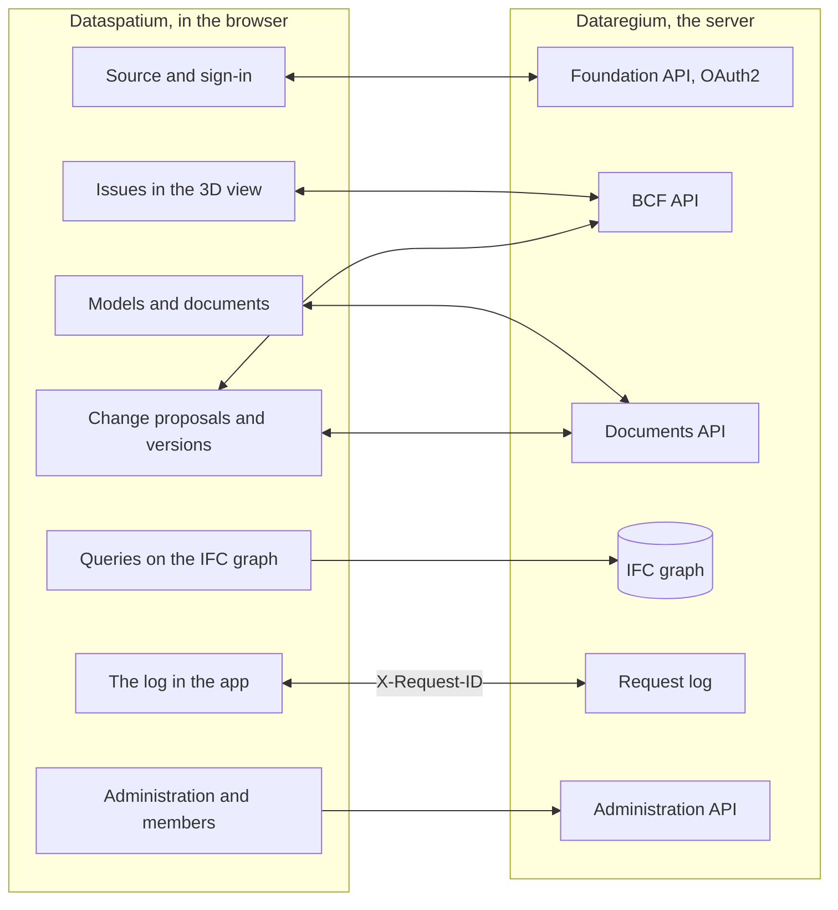

[Svenska](../../README.md) · [Dansk](../da/README.md) · [Norsk bokmål](../nb/README.md) · [Norsk nynorsk](../nn/README.md) · [Suomi](../fi/README.md) · [Íslenska](../is/README.md) · **English**

# Dataspatium OpenCDE client

Dataspatium is a program for working with data that you open in your ordinary web browser. You bring in a table, a map, a plan, a
building model or statistics from a public authority, correct it and calculate with it, make charts and reports and pass the result
on. Everything happens on your own computer: no installation, no account and no server. Nothing leaves the computer unless you export
or share it yourself, and the app always asks before it uses the internet.

Dataspatium can also work with [Dataregium](https://github.com/marwiss/Dataregium), a server where a building project shares its
models, documents and issues. You can then fetch the project's building models, point out problems in 3D, check the models and, with
the help of AI, propose changes that the project's managers approve. Without Dataregium everything else works exactly the same.

**For the technically skilled:** a static web app with no build step that runs from `file://` in Edge, Chrome and Firefox or from any
static web server. Each dataset is an SQLite file (sql.js) in IndexedDB; R runs in WebR 0.5.9 and Python in Pyodide 0.29.5, both in
workers; IFC is read with web-ifc and IfcOpenShell (wasm). Against a server the app is an OpenCDE client: Foundation API 1.0 with OAuth2
authorization code and PKCE, BCF API 3.0 and 2.1 and Documents API 1.0. No network call is made without consent per purpose, and
secrets are stored only encrypted (AES-GCM).

**Contents**

- [Download and get started](#download-and-get-started)
- [Requirements](#requirements)
- [Words to know](#words-to-know)
- [What you can do](#what-you-can-do)
- [The OpenCDE APIs and their clients](#the-opencde-apis-and-their-clients)
- [Dataspatium and Dataregium](#dataspatium-and-dataregium)
- [Learn more](#learn-more)
- [Limitations in brief](#limitations-in-brief)
- [Personal data](#personal-data)
- [Next in the 3 series](#next-in-the-3-series)
- [Bugs and suggestions](#bugs-and-suggestions)
- [Development](#development)
- [Licence](#licence)

The interface is available in Swedish, Danish, Norwegian (Bokmål and Nynorsk), Finnish, Icelandic and English. The screenshots in the
documentation show the app in Swedish.

## Download and get started

1. **Download.** Go to the [latest release](https://github.com/marwiss/Dataspatium/releases/latest) and fetch
   the ZIP file under *Assets* (`dataspatium-<version>.zip`, about 100 MB; R and the most common R packages are included).
2. **Unpack.** Right-click the ZIP file and choose *Extract all* (Windows) or double-click it (macOS). Put the
   folder where you want it, for example in Documents. The app does not work directly inside the ZIP file.
3. **Open.** Double-click `index.html` in the folder, or drag the file into a browser window. If Windows asks which
   app to use, choose Edge, Chrome or Firefox. The first time you choose a language, and then the **beginner's course** is offered:
   a walkthrough of all the modes with example data that takes about ten minutes and can be reopened from the help (?).
4. **Bring in data.** In *Import* mode, drop a file on the surface, or click *Try with example data*. The app shows what the file
   contains; click *Import*. The dataset is stored in the browser on your computer.
5. **Carry on.** The modes at the top are the steps of the work: *Manage* keeps your datasets in order, *Search* finds rows without
   code, *Process* shows the table, the map or the model with buttons to correct and calculate, *Check* tries tables and models
   against requirements, *Analyse* has statistics and code (R, Python and SQL), *Visualise* makes charts and maps, *Export* saves
   files on the computer and *Share* sends to others.

What you save is kept in the browser's own database on the computer. If you clear the browser's site data it disappears, so back up
regularly under *Manage > Workspace*. The backup is a ZIP file that can be restored on the same or another computer. Step by step with
more detail: [kom-igang.md](kom-igang.md) (Getting started).

The app is also available directly on the web, with nothing to download: <https://marwiss.github.io/Dataspatium/>. From there it can
be installed as an app of its own (Edge and Chrome: *Install* in the address bar) and then works without a network too. The web
version and the folder version have separate workspaces; move data between them with a backup or a bundle.

### For the technically skilled

- **Run:** unpack the ZIP file and open `index.html` (file://), or serve the folder: `python -m http.server 8080 --bind 127.0.0.1`
  and open <http://127.0.0.1:8080/>. From a web server there is a service worker, an installable app and interruptible R and Python.
- **Check the ZIP file:** compare its SHA-256 with the one in the release text (`Get-FileHash` in PowerShell, `shasum -a 256` on macOS
  and Linux).
- **With a server:** start Dataregium with Docker or Podman (`docker compose up -d --build --wait` and
  `docker compose exec api opencde seed` in Dataregium's repository), serve Dataspatium on port 8080 and add the server under *Import >
  Add sources > OpenCDE*. The client id can be left empty when the server allows self-registration. The whole way in twenty minutes:
  [snabbstart.md](snabbstart.md) (Quick start).
- **The graph:** the server's IFC graph (Neo4j or Memgraph) is queried with Cypher from *Import*, through the server's graph query or
  directly over Bolt; the server's named queries are reached from the AI panel.
- **AI:** enter a key for Anthropic or an OpenAI-compatible API (also Ollama, vLLM and llama.cpp on your own computer) in the panel
  *Ask AI* in the model view; the key is stored encrypted, and the project's policy can restrict to local models.
- **Tests:** `powershell -File tools/run-tests.ps1` or `tools/run-tests.sh` runs the whole suite in headless Edge and Firefox.

## Requirements

- Windows, macOS or Linux.
- Microsoft Edge or Google Chrome (version 120 or later), or Firefox (version 128 or later). Safari is not supported for the whole
  app.
- About 300 MB of free space for the app folder and at least 4 GB of memory (8 GB recommended for large datasets and models). No
  administrator rights are needed.
- Internet is needed only when you choose something that requires it, and the app asks for permission first for each purpose: fetching
  data from open APIs and maps, connecting to a Dataregium server or GitHub, asking an AI model in the cloud, checking for updates or
  fetching a part that does not ship in the folder (Python, IfcOpenShell and R packages beyond the most common ones).
- Dataregium needs a server. Running your own requires Docker or Podman; Dataregium's README describes it.

## Words to know

You do not need to know the words below to use the app, but they appear in the text.

- **API**: a way for programs to fetch data from each other over the network. The app fetches statistics from public authorities'
  APIs and talks to Dataregium through its APIs.
- **Dataset**: what the app stores when you bring something in: a table, a map, a plan, a graph, a model or a collection of documents
  or pictures.
- **Recipe**: the list of everything you have done with a dataset, step by step, so that it can be undone or repeated on new data.
- **R, Python and SQL**: languages for analysing data. The app has them built in, but most things are done with buttons and forms that
  write the code for you.
- **BIM**: describing a building as a digital model where every wall, door and room carries information, not only as lines on a
  drawing.
- **IFC**: the open file format for building models, which all the major programs for building design can read and write.
- **CAD**: drawings made in a drawing program; the app reads them in the open format DXF.
- **IDS**: an open file that says which information a model must have, so that the model can be checked automatically.
- **BCF**: an open format for issues about a model, for example "the ventilation runs through the beam", with a picture and the view
  that shows the place.
- **OpenCDE**: buildingSMART's open rules for how programs share a building project's models, documents and issues, so that programs
  from different makers work together.
- **Server**: a program that others connect to over the network. Dataregium is a server; Dataspatium needs none.
- **Graph and graph database**: data as things and the connections between them, for example that a door sits in a wall on a storey.
  Dataregium can store each model as a graph in Neo4j or Memgraph, with the help of the module [IFC-DB](https://github.com/marwiss/IFC-DB) (formerly IFC-LPG).
- **Container**: a ready-packaged program started with Docker or Podman without installing its parts one by one. Dataregium runs that
  way; Dataspatium needs no containers.
- **Version and change set**: a version is a saved state of a model; a change set is a collection of proposed changes that you see and
  approve before they become a new version.
- **AI model**: a service such as Claude or ChatGPT, or a model on your own computer, that answers questions and proposes changes. The
  app uses it only with your own key and your consent.
- **OAuth2 sign-in**: the usual way to sign in to a service from another app without the app seeing your password.
- **file:// and CORS**: file:// means that the app is opened directly from a folder. CORS is the browser's rule for which web services
  a web app may fetch data from; a service without CORS cannot be reached directly.

## What you can do

What works in one version also works in the next. Each version goes with the same version of Dataregium.

### Version 1 (with Dataregium 1)

- **Bring in data**: files in some forty formats, from Excel and CSV to statistics files, geodata and tables in Word and web pages, and
  statistics from authorities in Sweden, the Nordic countries and Europe with one click (see [Open APIs](api-konfiguration.md)).
  *Technically:* character encoding and column types are detected; SPSS, Stata, SAS, PX, Parquet and RDS through R; your own sources
  as `*.api.json`.
- **Correct and calculate**: some fifty actions with buttons, such as cleaning, changing types, recoding, computing shares, pivoting and
  joining tables, with quality rules, pseudonymisation of personal identity numbers, undo and versions (see [Process](bearbeta.md)).
  *Technically:* every step is kept in a recipe that can be exported as R or SQL code.
- **Analyse**: R with ggplot2 and the tidyverse, SQL across datasets, regular expressions and notebooks that become reports, all in the
  browser (see [R](r-guide.md) and [Regular expressions](regex.md)).
- **Plans**: Swedish detailed and comprehensive plans as plan maps with the National Board of Housing's colours and symbols, in the
  plan's own coordinate system (see [Plans](planer.md)).
- **Charts, maps and documents**: charts and maps with Vega-Lite, D3 or R, dashboards and reports from templates as HTML, Word, PDF,
  PowerPoint, Markdown or LaTeX (see [Visualise](visualisera.md)).
- **Save and share**: data in some ten formats, sharing bundles, comments, backup, sync with GitHub and a portable folder.
- **Dataregium as a document archive**: fetch documents from the server as datasets and send datasets and files back as new versions.
  *Technically:* Foundation API and Documents API.
- **Six languages and a beginner's course**: Swedish, Danish, Norwegian (Bokmål), Finnish, Icelandic and English, and the command
  palette (Ctrl+K) that finds everything.

### Also in version 2 (with Dataregium 2)

- **Search and Share**: two new modes. *Search* finds and lists rows without code; *Share* sends bundles, publishes dashboards and
  documents as web pages and transfers to phones with a QR code, after a review of personal data (see [Search](soka.md) and
  [Share](dela.md)).
- **More sources**: Access files, databases, open geodata, background maps, documents and pictures as collections and text from scanned
  pages (see [Sources](kallor.md)). *Technically:* a local bridge to SQL Server and ODBC, PostgREST, OData, GraphQL, SPARQL and more over
  HTTP, WFS, OGC API Features, ArcGIS and Neo4j over Bolt.
- **Maps, plans and graphs**: maps with layers and geo tools, plans from all the Nordic countries and graphs that are drawn, queried and
  edited (see [Maps](kartor.md) and [Graphs](grafer.md)).
- **Building models**: IFC models in 3D with tables, properties and quantities, checks against the schema and against IDS, and DXF
  drawings (see [CAD and BIM](cad-bim.md)). *Technically:* web-ifc and three.js for the view, IfcOpenShell and ifctester in the app's
  Python.
- **Navigate the model**: a view cube and standard views, an orthographic view, a section box and a section at a storey, a pivot
  by double click and the keyboard; the camera and the section travel with the issues' viewpoints, and maps and plans have a scale
  bar (see [CAD and BIM](cad-bim.md#views-and-the-keyboard)).
- **More geodata sources**: Lantmäteriet’s vector data, orthophotos, elevation data and maps as files with a key, the vector files
  read in directly, road data from Trafikverket’s NVDB (speed limits, road numbers, bearing capacity and 42 more object types,
  with a key), species observations from SLU Artdatabanken and buildings, shore protection, cultural heritage remains and the
  boundary of forest near the mountains from the national geodata platform; the source list says when a source cannot be reached
  where the app runs, and bundles carry charts and notebooks only for the chosen datasets (see [Sources](kallor.md)).
- **Python and statistics without code**: a Python console and forms for statistics and time series that write and show the code (see
  [Statistics](statistik.md) and [Python](python.md)).
- **Order and flows**: folders, tags and actions on many datasets, saved flows that run with one click and sources that tell you when
  they have new data (see [Modes](lagen.md)).
- **Dataspatium Mobile**: the phone receives and shows data and collects rows in the field, also without a network (see
  [Mobile](mobil.md)).
- **Dataregium with issues**: the project's models and issues, new issues that point out the place in 3D, BCF files, the server's IFC
  graph, the card *Administration* for the administrator and the card *The project's members* for the project manager (see
  [Dataspatium and Dataregium](#dataspatium-and-dataregium)). *Technically:* BCF API 3.0 and 2.1 with viewpoints.
- **Seven languages**: also Nynorsk, with the handbook in the app and the beginner's course through the modes.

### Also in version 3 (with Dataregium 3)

- **Check mode**: a ninth mode, after *Process*. A table is tried against simple rules (type and empty values per column, duplicate
  rows), and an IFC model shows the card *Validate the model* and the panel *Compare versions* (see [Modes](lagen.md#check)).
- **Checking models**: the card *Validate the model* shows the server's check against the IFC schema, buildingSMART's rules and the
  project's IDS files, and the app finds building elements that clash or lie too close to each other and turns them into issues (see
  [CAD and BIM](cad-bim.md)).
- **Ask AI about the model**: ask a question such as "how many doors are there on level 2?" and get the answer with the elements
  marked in 3D.
- **Change with AI**: ask the AI, for example, to create walls, slabs, doors and windows. You see the proposal in 3D, the app checks it
  and you approve; the AI can never save or publish by itself. You can also start from a new, empty model in IFC4X3_ADD2,
  IFC4 or IFC2X3 (*Import > New building model*). *Technically:* the write tools fill a change set that the modelling
  wheel applies with IfcOpenShell; schema errors and new errors in the model's relationships block the approval.
- **A new building from a brief**: write a brief, a description of the building, in the form *New building model* and choose
  *Build from the brief with AI*. In the AI panel's mode *Build from brief* the AI plans, asks when something essential is open
  and builds storeys, walls, slabs and openings with the write tools; nothing is written into the model until you preview and
  approve the change set (see [CAD and BIM](cad-bim.md#a-new-building-from-a-brief)).
- **The digital twin of an existing building**: *The building's facts* (which building, storeys, length, width, height,
  foundation, roof) and the *Level of detail* (sketch, main features or detailed) open the brief, and photos of the façades and
  the inside as well as scanned drawings go along to the AI, labelled and with the position and time from the file; a footprint
  from Lantmäteriet's building layer gives the corners in metres, the model's place on earth (SWEREF 99 TM) and, on request, the
  ground height at the corners. The words are plain English, but behind them lie ISO 19650's information requirements and level
  of information need, and the model is meant as the building's asset information model.
- **Versions with Dataregium**: send a change as a proposal that the server tries and a project manager approves; the server merges
  changes from several people, and at a conflict you choose what applies. *Technically:* publishing with a base version (412 at a
  newer version), a snippet with GlobalId and path as key.
- **Several clients on the same model**: the card *Change proposals on the server* lists the proposals against the model's
  document on Dataregium, and those allowed to approve make a tried proposal the next version; a server that takes the write
  tools' own form also gets new elements, deletions and relationships in the proposal. With *Put the material on the server* the
  brief and the pictures go to the server as the model's material, in the topic *Material*, after the review before sharing, so
  that others who work on the model see what it was built from. *Technically:* the capability `ifc_proposals_url` and the form
  `ops_form` (`dataspatium-tools/1`).
- **Compare versions**: see what has been added, removed and changed between two versions of a model, coloured in 3D, also against the
  server's versions.
- **More**: the server's IFC graph in a lighter form with the query *elements near an element*, a Dataregium on your own computer as a
  source and Sundsvall's maps among the geodata sources.

## The OpenCDE APIs and their clients

OpenCDE is buildingSMART International's open rules for how programs share a building project's models, documents and issues. A program
that follows the rules can work with every server that does too, whoever built them. Dataspatium is such a program, a client, and uses
all three APIs:

| API | What the app does with it | Specification |
|---|---|---|
| Foundation API 1.0 | Reads which APIs the server offers, where to sign in and who the user is; registers the app as a client when the server allows it | [foundation-API](https://github.com/buildingSMART/foundation-API) |
| BCF API 3.0 and 2.1 | Reads and writes issues about a model, with comments and viewpoints (camera, components and pictures) from the 3D view; picks the newest version the server offers | [BCF-API](https://github.com/buildingSMART/BCF-API) |
| Documents API 1.0 | Picks and fetches documents and versions through the server's own pages, so that an IFC model becomes a dataset, and uploads new versions, datasets and bundles | [documents-API](https://github.com/buildingSMART/documents-API) |

**Dataregium is one server, not the only one.** Nothing in the app depends on Dataregium. Dataregium's extensions beyond the
specifications (the capabilities document, the named graph queries, the precheck, the base version, the change proposals, the diff
between versions and the project administration) appear only when the server itself announces them.

**For the technically skilled:** from a server the app needs three things:

- CORS from the app's origin: `null` from file://, `http://127.0.0.1:8080` from a local web server and `https://marwiss.github.io` from
  the web, with the headers Authorization, Content-Type and X-Request-ID;
- a client registration, made by the server's administrator (a public client with the redirect address
  `http://127.0.0.1:8080/oauth-callback.html`, or the equivalent for the app's address) or by the app itself (RFC 7591) when the server
  allows it, and OAuth2 authorization code with PKCE `S256`; from file:// you paste the address you land on after signing in;
- BCF API 3.0 or 2.1; Documents API is optional, but without it the app cannot fetch or publish documents.

So far this is shown against Dataregium: the live suite runs against the server in both versions of BCF API, and a server with only 2.1
works. Other servers have not been tried; tell us how it went under [Bugs and suggestions](#bugs-and-suggestions). When the app and a
specification disagree, the specification decides. The app's side is described in [kallor.md](kallor.md), the server's in Dataregium's
README.

## Dataspatium and Dataregium

*Dataregium was called Kontroll until 8 November 2026.*

Dataspatium is the app you work in, and [Dataregium](https://github.com/marwiss/Dataregium) is the server where a project gathers its
models, documents and issues. They are built for each other but follow open rules, so other programs work too. You add the server as a
source in *Import* and sign in; then you fetch the project's models and documents, point out problems in 3D as issues, send datasets and
files back, ask questions of the server's graph of the models and, in version 3, propose changes that the server tries. Without a
server the rest of the app works as usual.

**For the technically skilled:** everything except the graph queries and the administration goes through the three OpenCDE APIs. Every
call carries an `X-Request-Id` that the server writes in its request log, so that the log in the app and the server's log can be paired.
The collaboration is described from the app's side in [kallor.md](kallor.md) and [cad-bim.md](cad-bim.md), and from the server's side in
Dataregium's README and `docs/client-guide.md`.

This is how they fit together:

Dataspatium 3.0.0 works with Dataregium 3.0.0. The same number goes together. The quick start [snabbstart.md](snabbstart.md) takes the
pair from nothing to an issue in twenty minutes.

### The releases 1, 2 and 3

There is one release per major number, and Dataspatium and Dataregium with the same number go together:

| Dataspatium | What it has | Goes with |
|---|---|---|
| 1.0.0 | Data from files and open APIs, processing, R, SQL and regular expressions, Swedish plans, charts and maps in charts, dashboards, documents, export and sharing. Against a server only Documents API: fetch documents as datasets and send datasets and files back. No issues, no models and no Python | Dataregium 1.0.0 (Documents API only) |
| 2.0.0 | Everything in 1.0.0 and also the modes Search and Share, Python and statistics without code, more sources, map views, Nordic plans, graphs, IFC models in 3D with IDS checks, flows, Dataspatium Mobile, issues with viewpoints (BCF API 3.0 and 2.1), the server's IFC graph, the card *Administration* and the card *The project's members*, navigation with a view cube and sections, more geodata sources | Dataregium 2.0.0 |
| 3.0.0 | Everything in 2.0.0 and also the card *Validate the model*, clash detection, Ask AI and Change with AI, new empty models in the schema of your choice, Compare versions, publishing with a base version and precheck, change proposals that are tried and approved on the server with a choice at conflicts, and the graph in a lighter form, and after the re-releases the AI assistant, the commands, flows with conditions and loops, control through the bridge and Dataregium's teams; also a new building from a brief, the digital twin, the Check mode, the topology, the rooms and the right IFC class; further layered types, properties and Swedish designations, editing elements, more building elements, a climate declaration, a material inventory, buildingSMART's rules, BCF 3.0 and personal data in IFC models | Dataregium 3.0.0 |

A new release in the same major number replaces the previous one; only the latest in each series is corrected. The app's update check
offers the next major number, and datasets, lists, charts, templates and scripts come along when you open the new version's
`index.html`.

## Learn more

The file names are the same in every language (they are the Swedish originals), so links work the same way everywhere.

**Start here**

- **The beginner's course** in the app: a walkthrough of all the modes with example data; open it from the help (?) or with Ctrl+K.
- **The handbook** in the app: the same documentation as here, with search; open it with ? at the top right or F1.
- [Getting started](kom-igang.md): step by step with common questions.
- [User guide](anvandarguide.md): the whole workflow from file to report.
- [The nine modes](lagen.md): what is where and why.
- [FAQ](faq.md): storage, security, R, APIs and updates.

**By area**

- [Formats and import](format.md) and [Open APIs](api-konfiguration.md): file formats, character encoding, the preset sources, keys and
  your own configurations.
- [Sources](kallor.md): databases, the bridge, open geodata, linked files and OpenCDE servers.
- [Process](bearbeta.md), [Search](soka.md) and [Regular expressions](regex.md): correct, calculate and find.
- [Statistics](statistik.md), [R in Dataspatium](r-guide.md), [Python in Dataspatium](python.md) and [Notebook](anteckningsbok.md):
  analysis with and without code.
- [Visualise](visualisera.md), [Maps](kartor.md) and [Documents and templates](dokumentmallar.md): charts, maps, dashboards and reports.
- [Plans](planer.md), [Graphs](grafer.md) and [CAD and BIM](cad-bim.md): plans, graphs, building models, checks, AI and versions.
- [Documents and images](dokument.md): PDF, Word, OpenDocument, Markdown and pictures as datasets.
- [Flows](floden.md), [Share](dela.md), [Dataspatium Mobile](mobil.md) and [Field collection](insamling.md): automate, share and
  collect.
- [Quick start with Dataregium](snabbstart.md): twenty minutes from nothing to an issue created in the 3D view and visible on the server.
- [Security](sakerhet.md) and [Licences](licenser.md): threat model, controls and tests, and what you may do with the app.
- How contributions are received is in [CONTRIBUTING.md](../../CONTRIBUTING.md) (Swedish).

### Further reading

- [BCF API](https://github.com/buildingSMART/BCF-API), [Foundation API](https://github.com/buildingSMART/foundation-API) and [Documents API](https://github.com/buildingSMART/documents-API): the specifications the app follows against a server.
- [IFC](https://github.com/buildingSMART/IFC4.x-development): the file format for building models, and [IDS](https://github.com/buildingSMART/IDS): requirement specifications that models are checked against.
- External resources: [WebR](https://docs.r-wasm.org/webr/latest/), [Pyodide](https://pyodide.org/), [IfcOpenShell](https://ifcopenshell.org/),
  [Vega-Lite](https://vega.github.io/vega-lite/), [Statistics Sweden's API](https://www.scb.se/en/services/open-data-api/).

## Limitations in brief

- The app must be opened from an unpacked folder or an ordinary web server; it does not work directly inside the ZIP file.
- Web services that do not allow calls from browsers (lack CORS, for example the Swedish central bank's) cannot be reached directly; a
  proxy of your own can be given.
- A dataset should stay below a couple of million rows, and very large building models can be too heavy for the browser; memory sets
  the limit.
- When the app is opened from a folder, R and Python code cannot be interrupted in the middle of a calculation; use *Restart R* or
  *Restart Python*. From a web server there is a *Stop* button.
- Python and IfcOpenShell are not in the ZIP file; they are fetched the first time they are needed, after consent, and then kept in the
  browser.
- The AI features need your own key for an AI service, or an AI model on your own computer. The AI can change storeys, grids, walls,
  slabs, openings with doors and windows, properties, materials and placement, not everything in a model.
- Several tabs work and keep each other informed, but do not edit the same dataset in two tabs at once: whoever saves last wins.
- The portable folder needs Edge or Chrome; Firefox lacks folder access. A backup as ZIP works everywhere.
- The full app is made for computers. On phones and tablets, Dataspatium Mobile (<https://marwiss.github.io/Dataspatium/m/>) is used; it
  receives, shows, collects and passes on. In narrow windows the panels open as sheets over the work area.
- The example data and map boundaries that ship cover Sweden, Denmark, Norway and Finland, and the preset sources are Nordic and
  European; data from other countries is just as easy to bring in yourself.

## Personal data

Dataspatium runs in your browser, and you are responsible for the information you put in. Everything the app stores (datasets and their
versions, lists, charts, documents, notebooks, comments and settings) is kept in the browser's storage on your computer and leaves it only
when you export, share or publish; then everything is reviewed in full first, and personal data can be kept, pseudonymised or removed in
the copy. Towards a Dataregium server, your sign-in is sent (tokens are kept in the session or encrypted with your passphrase, never in
clear text), along with the issues, comments, proposals and files you create under your name on the server, and one X-Request-ID per
call; the server's own processing is described in Dataregium's README. Towards an AI provider only what you ask and the answers the
tools fetch from the model are sent, after consent for the purpose AI, with your own key stored encrypted; the project's policy can
restrict to local models. Comments and bundles carry the name you give yourself. The controls and the tests that prove them are in
[sakerhet.md](sakerhet.md) (Security).

## Next in the 3 series

3.0.0 is the 3 series' release, made together with Dataregium 3.0.0, and is released again as the series grows. The direction is that
models can be created and changed by describing what you want, while a human always reviews and approves and the server keeps the
versions in order. This section says what is decided, for whoever, human or AI agent, carries part of it further; the server's side is
in Dataregium's README under the same heading.

### Decided

- **Modelling happens in the app.** The modelling wheel (the write tools and IfcOpenShell in the app's Python) is Dataspatium's own,
  under Dataspatium's licence; Dataregium may use it.
- **The AI proposes, a human approves.** A change set is previewed in 3D, checked against the schema, the model's relationships and the
  server's precheck, and applied only when you approve; deleting is confirmed once more; publishing and proposals to the server are
  buttons, never tools the AI can call. Built in 3.0.0.
- **The server merges.** A change set is sent as a BCF topic with a snippet in the server's form (GlobalId and path as key), the server
  tries it against the base version and a *manager* approves it to the next version; the server brings in what does not conflict, and at
  a conflict you choose in the app between the base's, the latest version's and the proposal's value. No merging of whole models in
  the browser. Built in 3.0.0.
- **Compare versions** with three sources: snapshots and other models in the app, the server's change set per version and the server's
  diff between versions. Built in 3.0.0.
- **The project's managers** have the card *The project's members* in the app: members, roles and the project's name. Built in 2.0.0
  and 3.0.0.
- **One Dataregium is enough**, on your own computer or on a server: you fetch a version, work in the app's copy and publish with a base
  version or propose changes, which the server merges. No sync between several servers.
- **Next, once steps 1–3 have been tried in practice:** large models drawn from the server's geometry API when the browser is not enough
  (step 4), and project profiles with IDS and bSDD, IDS written by the AI and buildingSMART rules tied to building elements (step 5).
  After that the AI is measured against the research's open tasks for model editing.
- **Open formats** apply to exchange formats and stored data, not to AI APIs; the AI provider is chosen by the user with their own key,
  stored encrypted, and the project's policy can restrict to local models.

## Bugs and suggestions

Report bugs or wishes as *Issues* here on GitHub. Describe the browser, the version of Dataspatium (shown under the help button) and what
you did. See [CONTRIBUTING.md](../../CONTRIBUTING.md). Attach no personal data and no secrets. For a security vulnerability, follow
[SECURITY.md](../../SECURITY.md) instead of opening an issue.

## Development

- No build step, no node.js. Open `index.html` directly, or serve the folder with `python -m http.server 8080`.
- Architecture in brief: all own code is classic scripts registered with `Dataspatium.define` in the order of `src/boot.js`;
  `src/platform` carries everything specific to file:// (resources, shims, workers, storage, consent); the engines SQLite, R (WebR) and
  Python (Pyodide) run in workers; `src/ui` has the design variables, the components (`dm-*`), the shell and one mode per file. Everything
  rendered is escaped, and nothing is fetched from the network without your action and your consent.
- Third-party components: `python tools/fetch_vendor.py` followed by `python tools/wrap_assets.py`.
- Tests: `powershell -File tools/run-tests.ps1` or `tools/run-tests.sh` (headless Edge and Firefox). The tests never go to the network;
  real services are tried only with their own parameters (`?cde=` against a Dataregium, `?python=1` with Pyodide).
- Security: the tests for consent, secrets, review before sharing, OAuth2 (PKCE, state, return) and the log's masking are part of the
  suite; see [sakerhet.md](sakerhet.md).

## Licence

Dataspatium's own code, documentation and presets (everything except `vendor/`) are licensed under
[PolyForm Strict 1.0.0](../../LICENSE): free to download and use for non-commercial purposes, including in public
authorities and other public institutions, but not to modify, build on or redistribute without written
permission. The licensor is Dataspatium's author, reachable through the GitHub account
[marwiss](https://github.com/marwiss); open an issue for other terms. What the licence means in practice is
explained in [licenser.md](licenser.md).

Third-party components in `vendor/` have their own licences (MIT, BSD, Apache-2.0, ISC, OFL, MPL, LGPL and GPL), see
[THIRD_PARTY_LICENSES.md](../../THIRD_PARTY_LICENSES.md). R and the GPL-licensed R packages are distributed
unchanged; the source code is available from the [R project](https://cran.r-project.org/sources.html),
[webR](https://github.com/r-wasm/webr) and [CRAN](https://cran.r-project.org/) in the versions stated there. See [SECURITY.md](../../SECURITY.md) for how to report a vulnerability
and what the project does to stay secure.
