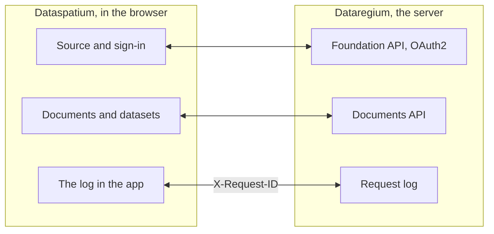

[Svenska](../../README.md) · [Dansk](../da/README.md) · [Norsk](../nb/README.md) · [Suomi](../fi/README.md) · [Íslenska](../is/README.md) · **English**

# Dataspatium OpenCDE client

*This is the README of Dataspatium 1.0.0. The latest release, 3.0.0, is described in the [README on main](https://github.com/marwiss/Dataspatium/blob/main/docs/en/README.md).*

Dataspatium is a program for working with data that you open in your ordinary web browser. You bring in a table, a map, a plan or
statistics from a public authority, correct it and calculate with it, make charts and reports and pass the result on. Everything happens
on your own computer: no installation, no account and no server. Nothing leaves the computer unless you export or share it yourself,
and the app always asks before it uses the internet.

Dataspatium can also fetch documents from [Dataregium](https://github.com/marwiss/Dataregium), a server where a building project keeps
its documents, and send datasets and files back as new versions. Without Dataregium everything else works exactly the same.

**For the technically skilled:** a static web app with no build step that runs from `file://` in Edge, Chrome and Firefox or from any
static web server. Each dataset is an SQLite file (sql.js) in IndexedDB, and R runs in WebR 0.5.9 in a worker. Against a server the app is
an OpenCDE client for Foundation API 1.0, with OAuth2 authorization code and PKCE, and Documents API 1.0. No network call is made without
consent per purpose, and secrets are stored only encrypted (AES-GCM).

**Contents**

- [Download and get started](#download-and-get-started)
- [Requirements](#requirements)
- [Words to know](#words-to-know)
- [What you can do](#what-you-can-do)
- [The OpenCDE APIs and their clients](#the-opencde-apis-and-their-clients)
- [Dataspatium and Dataregium](#dataspatium-and-dataregium)
- [Learn more](#learn-more)
- [Limitations in brief](#limitations-in-brief)
- [Personal data](#personal-data)
- [Newer releases](#newer-releases)
- [Bugs and suggestions](#bugs-and-suggestions)
- [Development](#development)
- [Licence](#licence)

The interface is available in Swedish, Danish, Norwegian, Finnish, Icelandic and English. The screenshots in the documentation show the
app in Swedish.

## Download and get started

1. **Download.** Go to [release 1.0.0](https://github.com/marwiss/Dataspatium/releases/tag/v1.0.0) and fetch the ZIP file under
   *Assets* (`dataspatium-1.0.0.zip`, about 95 MB; R and the most common R packages are included).
2. **Unpack.** Right-click the ZIP file and choose *Extract all* (Windows) or double-click it (macOS). Put the folder where you want it,
   for example in Documents. The app does not work directly inside the ZIP file.
3. **Open.** Double-click `index.html` in the folder, or drag the file into a browser window. If Windows asks which app to use, choose
   Edge, Chrome or Firefox. The first time you choose a language, and then the **beginner's course** is offered: a walkthrough of all six
   modes with example data that takes about ten minutes and can be reopened from the help (?).
4. **Bring in data.** In *Import* mode, drop a file on the surface, or click *Try with example data*. The app shows what the file
   contains; click *Import*. The dataset is stored in the browser on your computer.
5. **Carry on.** The modes at the top are the steps of the work: *Manage* keeps your datasets in order, *Process* shows the table with
   buttons to correct and calculate, *Analyse* has R, SQL and regular expressions, *Visualise* makes charts and maps and *Export* saves
   files on the computer and sharing bundles for others.

What you save is kept in the browser's own database on the computer. If you clear the browser's site data it disappears, so back up
regularly under *Manage > Workspace*. The backup is a ZIP file that can be restored on the same or another computer. Step by step with
more detail: [kom-igang.md](kom-igang.md) (Getting started).

The web version at <https://marwiss.github.io/Dataspatium/> is always the latest release, now 3.0.0.

### For the technically skilled

- **Run:** unpack the ZIP file and open `index.html` (file://), or serve the folder: `python -m http.server 8080 --bind 127.0.0.1` and
  open <http://127.0.0.1:8080/>. From a web server there is a service worker, an installable app and interruptible R.
- **Check the ZIP file:** compare its SHA-256 with the one in the release text (`Get-FileHash` in PowerShell, `shasum -a 256` on macOS
  and Linux).
- **With a server:** start Dataregium 1.0.0 with Docker or Podman, as its README describes, serve Dataspatium on port 8080 and add the
  server with *Import > Add OpenCDE server*. The client id can be left empty when the server allows self-registration.
- **Tests:** `powershell -File tools/run-tests.ps1` runs the whole suite in headless Edge and Firefox.

## Requirements

- Windows, macOS or Linux.
- Microsoft Edge or Google Chrome (version 120 or later), or Firefox (version 128 or later). Safari is not supported.
- About 300 MB of free space for the app folder and at least 4 GB of memory (8 GB recommended for large datasets). No administrator
  rights are needed.
- Internet is needed only when you choose something that requires it, and the app asks for permission first for each purpose: fetching
  data from open APIs and background maps, connecting to a Dataregium server or GitHub, checking for updates or fetching R packages beyond
  the most common ones.
- Dataregium needs a server. Running your own requires Docker or Podman; Dataregium's README describes it.

## Words to know

You do not need to know the words below to use the app, but they appear in the text.

- **API**: a way for programs to fetch data from each other over the network. The app fetches statistics from public authorities' APIs
  and talks to Dataregium through its APIs.
- **Dataset**: what the app stores when you bring something in: a table, a map or a plan.
- **Recipe**: the list of everything you have done with a dataset, step by step, so that it can be undone or repeated on new data.
- **R and SQL**: languages for analysing data. The app has them built in, but most things are done with buttons.
- **OpenCDE**: buildingSMART's open rules for how programs share a building project's models, documents and issues, so that programs from
  different makers work together.
- **Server**: a program that others connect to over the network. Dataregium is a server; Dataspatium needs none.
- **Container**: a ready-packaged program started with Docker or Podman without installing its parts one by one. Dataregium runs that
  way; Dataspatium needs no containers.
- **OAuth2 sign-in**: the usual way to sign in to a service from another app without the app seeing your password.
- **file:// and CORS**: file:// means that the app is opened directly from a folder. CORS is the browser's rule for which web services a
  web app may fetch data from; a service without CORS cannot be reached directly.

## What you can do

What works in one version also works in the next. Each version goes with the same version of Dataregium.

### Version 1 (with Dataregium 1)

- **Bring in data**: files in some forty formats, from Excel and CSV to statistics files, geodata and tables in Word and web pages, and
  statistics from authorities in Sweden, the Nordic countries and Europe with one click (see [Open APIs](api-konfiguration.md)).
  *Technically:* character encoding and column types are detected; SPSS, Stata, SAS, PX, Parquet and RDS through R; your own sources as
  `*.api.json`.
- **Correct and calculate**: some fifty actions with buttons, such as cleaning, changing types, recoding, computing shares, pivoting and
  joining tables, with quality rules, pseudonymisation of personal identity numbers, undo and versions (see [Process](bearbeta.md)).
  *Technically:* every step is kept in a recipe that can be exported as R or SQL code.
- **Analyse**: R with ggplot2 and the tidyverse, SQL across datasets, regular expressions and notebooks that become reports, all in the
  browser (see [R](r-guide.md) and [Regular expressions](regex.md)).
- **Plans**: Swedish detailed and comprehensive plans as plan maps with the National Board of Housing's colours and symbols, in the plan's
  own coordinate system (see [Plans](planer.md)).
- **Charts, maps and documents**: charts and maps with Vega-Lite, D3 or R, dashboards and reports from templates as HTML, Word, PDF,
  PowerPoint, Markdown or LaTeX (see [Visualise](visualisera.md)).
- **Save and share**: data in some ten formats, sharing bundles, comments, backup, sync with GitHub and a portable folder.
- **Dataregium as a document archive**: fetch documents from the server as datasets and send datasets and files back as new versions.
  *Technically:* Foundation API and Documents API.
- **Six languages and a beginner's course**: Swedish, Danish, Norwegian (Bokmål), Finnish, Icelandic and English, and the command palette
  (Ctrl+K) that finds everything.

## The OpenCDE APIs and their clients

OpenCDE is buildingSMART International's open rules for how programs share a building project's models, documents and issues. A program
that follows the rules can work with every server that does too, whoever built them. Dataspatium 1.0.0 is such a program, a client, and
uses two of the APIs:

| API | What the app does with it | Specification |
|---|---|---|
| Foundation API 1.0 | Reads which APIs the server offers, where to sign in and who the user is; registers the app as a client when the server allows it | [foundation-API](https://github.com/buildingSMART/foundation-API) |
| Documents API 1.0 | Picks and fetches documents and versions through the server's own pages, so that a document becomes a dataset, and uploads new versions, datasets and files | [documents-API](https://github.com/buildingSMART/documents-API) |

Issues through BCF API and building models came in version 2. **Dataregium is one server, not the only one.** Nothing in the app depends
on Dataregium; the capabilities document, Dataregium's extension, is used only when the server itself announces it.

**For the technically skilled:** from a server the app needs three things:

- CORS from the app's origin: `null` from file://, `http://127.0.0.1:8080` from a local web server and `https://marwiss.github.io` from
  the web, with the headers Authorization, Content-Type and X-Request-ID;
- a client registration, made by the server's administrator (a public client with the redirect address
  `http://127.0.0.1:8080/oauth-callback.html`, or the equivalent for the app's address) or by the app itself (RFC 7591) when the server
  allows it, and OAuth2 authorization code with PKCE `S256`; from file:// you paste the address you land on after signing in;
- Documents API 1.0.

When the app and a specification disagree, the specification decides. The server's side is described in Dataregium's README.

## Dataspatium and Dataregium

*Dataregium was called Kontroll until 8 November 2026.*

Dataspatium is the app you work in, and [Dataregium](https://github.com/marwiss/Dataregium) is the server where a project keeps its
documents. You add the server as a source in *Import* and sign in; then you pick documents on the server's side, get them as datasets and
send datasets and files back as new documents or versions. Without a server the rest of the app works as usual.

**For the technically skilled:** everything goes through Foundation API and Documents API. Every call carries an `X-Request-Id` that the
server writes in its request log, so that the log in the app and the server's log can be paired.

This is how they fit together:

Dataspatium 1.0.0 works with Dataregium 1.0.0. The same number goes together.

### The releases 1, 2 and 3

There is one release per major number, and Dataspatium and Dataregium with the same number go together:

| Dataspatium | What it has | Goes with |
|---|---|---|
| 1.0.0 | Data from files and open APIs, processing, R, SQL and regular expressions, Swedish plans, charts and maps in charts, dashboards, documents, export and sharing. Against a server only Documents API: fetch documents as datasets and send datasets and files back. No issues, no models and no Python | Dataregium 1.0.0 (Documents API only) |
| 2.0.0 | Everything in 1.0.0 and also the modes Search and Share, Python and statistics without code, more sources, map views, Nordic plans, graphs, IFC models in 3D with IDS checks, flows, Dataspatium Mobile, issues with viewpoints (BCF API 3.0 and 2.1), the server's IFC graph, the card *Administration* and the card *The project's members* | Dataregium 2.0.0 |
| 3.0.0 | Everything in 2.0.0 and also the card *Validate the model*, clash detection, Ask AI and Change with AI, new empty models in the schema of your choice, Compare versions, publishing with a base version and precheck, change proposals that are tried and approved on the server with a choice at conflicts, and the graph in a lighter form | Dataregium 3.0.0 |

A new release in the same major number replaces the previous one; only the latest in each series is corrected. The app's update check
offers the next major number, and datasets, lists, charts, templates and scripts come along when you open the new version's `index.html`.

## Learn more

The file names are the same in every language (they are the Swedish originals), so links work the same way everywhere.

**Start here**

- **The beginner's course** in the app: a walkthrough of all the modes with example data; open it from the help (?) or with Ctrl+K.
- [Getting started](kom-igang.md): step by step with common questions.
- [User guide](anvandarguide.md): the whole workflow from file to report.
- [The six modes](lagen.md): what is where and why.
- [FAQ](faq.md): storage, security, R, APIs and updates.

**By area**

- [Formats and import](format.md) and [Open APIs](api-konfiguration.md): file formats, character encoding, the preset sources, keys,
  your own configurations and OpenCDE servers.
- [Process](bearbeta.md) and [Regular expressions](regex.md): correct, calculate and find.
- [R in Dataspatium](r-guide.md) and [Notebook](anteckningsbok.md): analysis with code.
- [Visualise](visualisera.md) and [Documents and templates](dokumentmallar.md): charts, maps, dashboards and reports.
- [Plans](planer.md): detailed and comprehensive plans.
- [Licences](licenser.md): what you may do with the app and which licences the third-party components have.
- [Development](../utveckling.md), [Architecture](../arkitektur.md) and [Style guide](../stilguide.md) for whoever wants to understand the
  code (in Swedish); how contributions are received is in [CONTRIBUTING.md](../../CONTRIBUTING.md).

### Further reading

- [Foundation API](https://github.com/buildingSMART/foundation-API) and [Documents API](https://github.com/buildingSMART/documents-API): the specifications the app follows against a server.
- External resources: [WebR](https://docs.r-wasm.org/webr/latest/), [Vega-Lite](https://vega.github.io/vega-lite/),
  [Statistics Sweden's API](https://www.scb.se/en/services/open-data-api/).

## Limitations in brief

- The app must be opened from an unpacked folder or an ordinary web server; it does not work directly inside the ZIP file.
- Web services that do not allow calls from browsers (lack CORS, for example the Swedish central bank's) cannot be reached directly; a
  proxy of your own can be given.
- A dataset should stay below a couple of million rows; the browser's memory sets the limit.
- When the app is opened from a folder, R code cannot be interrupted in the middle of a calculation; use *Restart R*. From a web server
  there is a *Stop* button.
- Several tabs work and keep each other informed, but do not edit the same dataset in two tabs at once: whoever saves last wins.
- The portable folder needs Edge or Chrome; Firefox lacks folder access. A backup as ZIP works everywhere.
- The app is made for computers; phones and tablets are not supported in version 1.
- The example data and map boundaries that ship cover Sweden, Denmark, Norway and Finland, and the preset sources are Nordic and
  European; data from other countries is just as easy to bring in yourself.

## Personal data

Dataspatium runs in your browser, and you are responsible for the information you put in. Everything the app stores (datasets and their
versions, charts, documents, notebooks, comments and settings) is kept in the browser's storage on your computer and leaves it only when
you export or share. Towards a Dataregium server, your sign-in is sent (tokens are kept in the session or encrypted with your passphrase,
never in clear text), along with the datasets and files you send and one X-Request-ID per call; the server's own processing is described in
Dataregium's README. Comments and bundles carry the name you give yourself.

## Newer releases

Dataspatium 2.0.0 adds the modes Search and Share, Python, map views, graphs, building models in 3D and issues with Dataregium, and 3.0.0
also the model checks, Ask AI and Change with AI and versions on the server. The latest is fetched from the
[latest release](https://github.com/marwiss/Dataspatium/releases/latest) and described in the
[README on main](https://github.com/marwiss/Dataspatium/blob/main/docs/en/README.md). Datasets, lists, charts, templates and scripts come
along when you open the new version's `index.html`.

## Bugs and suggestions

Report bugs or wishes as *Issues* here on GitHub. Describe the browser, the version of Dataspatium (shown under the help button) and what
you did. See [CONTRIBUTING.md](../../CONTRIBUTING.md). Attach no personal data and no secrets.

## Development

- No build step, no node.js. Open `index.html` directly, or serve the folder with `python -m http.server 8080`.
- Architecture in brief: all own code is classic scripts registered with `Dataspatium.define` in the order of `src/boot.js`;
  `src/platform` carries everything specific to file://; the engines SQLite and R (WebR) run in workers; `src/ui` has the design
  variables, the components (`dm-*`), the shell and one mode per file. See [arkitektur.md](../arkitektur.md).
- Third-party components: `python tools/fetch_vendor.py` followed by `python tools/wrap_assets.py`.
- Tests: `powershell -File tools/run-tests.ps1` (headless Edge and Firefox). The tests never go to the network. See
  [utveckling.md](../utveckling.md).

## Licence

Dataspatium's own code, documentation and presets (everything except `vendor/`) are licensed under
[PolyForm Strict 1.0.0](../../LICENSE): free to download and use for non-commercial purposes, including in public authorities and other
public institutions, but not to modify, build on or redistribute without written permission. The licensor is Dataspatium's author,
reachable through the GitHub account [marwiss](https://github.com/marwiss); open an issue for other terms. What the licence means in
practice is explained in [licenser.md](licenser.md).

Third-party components in `vendor/` have their own licences (MIT, BSD, Apache-2.0, ISC, OFL, MPL, LGPL and GPL), see
[THIRD_PARTY_LICENSES.md](../../THIRD_PARTY_LICENSES.md). R and the GPL-licensed R packages are distributed unchanged; the source code is
available from the [R project](https://cran.r-project.org/sources.html), [webR](https://github.com/r-wasm/webr) and
[CRAN](https://cran.r-project.org/) in the versions stated there.
