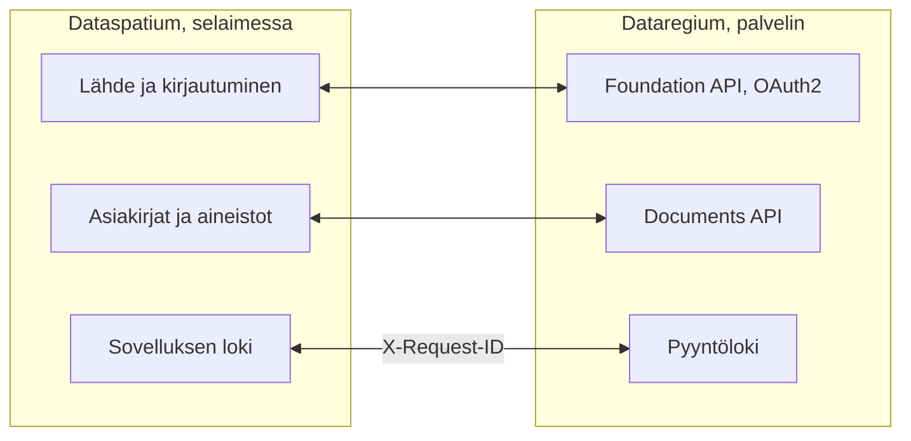

[Svenska](../../README.md) · [Dansk](../da/README.md) · [Norsk](../nb/README.md) · **Suomi** · [Íslenska](../is/README.md) · [English](../en/README.md)

# Dataspatium OpenCDE-asiakas

*Tämä on Dataspatium 1.0.0:n README. Uusin julkaisu, 3.0.0, on kuvattu [main-haaran READMEssä](https://github.com/marwiss/Dataspatium/blob/main/docs/fi/README.md).*

Dataspatium on ohjelma datan käsittelyyn, ja se avataan tavallisessa selaimessasi. Tuot siihen taulukon, kartan, kaavan tai viranomaisen
tilastoja, korjaat ja lasket niitä, teet kaavioita ja raportteja ja lähetät tuloksen eteenpäin. Kaikki tapahtuu omalla tietokoneellasi: ei
asennusta, ei tiliä eikä palvelinta. Mitään ei lähde tietokoneelta, ellet itse vie tai jaa sitä, ja sovellus kysyy aina ennen kuin se
käyttää internetiä.

Dataspatium voi myös noutaa asiakirjoja [Dataregiumista](https://github.com/marwiss/Dataregium), palvelimesta, johon rakennushanke kokoaa
asiakirjansa, ja lähettää aineistoja ja tiedostoja takaisin uusina versioina. Ilman Dataregiumia kaikki muu toimii täsmälleen samoin.

**Teknisesti osaavalle:** staattinen verkkosovellus ilman käännösvaihetta, joka toimii `file://`-osoitteesta Edgessä, Chromessa ja
Firefoxissa tai miltä tahansa staattiselta verkkopalvelimelta. Jokainen aineisto on SQLite-tiedosto (sql.js) IndexedDB:ssä, ja R toimii
WebR 0.5.9:ssä workerissa. Palvelinta vasten sovellus on OpenCDE-asiakas Foundation API 1.0:lle, OAuth2 authorization coden ja PKCE:n
kanssa, ja Documents API 1.0:lle. Verkkokutsuja ei tehdä ilman käyttötarkoituskohtaista suostumusta, ja salaisuudet tallennetaan vain
salattuina (AES-GCM).

**Sisältö**

- [Lataa ja aloita](#lataa-ja-aloita)
- [Vaatimukset](#vaatimukset)
- [Sanoja, jotka on hyvä tuntea](#sanoja-jotka-on-hyvä-tuntea)
- [Mitä voit tehdä](#mitä-voit-tehdä)
- [OpenCDE-rajapinnat ja niiden asiakasohjelmat](#opencde-rajapinnat-ja-niiden-asiakasohjelmat)
- [Dataspatium ja Dataregium](#dataspatium-ja-dataregium)
- [Lue lisää](#lue-lisää)
- [Rajoitukset lyhyesti](#rajoitukset-lyhyesti)
- [Henkilötiedot](#henkilötiedot)
- [Uudemmat julkaisut](#uudemmat-julkaisut)
- [Virheet ja ehdotukset](#virheet-ja-ehdotukset)
- [Kehitys](#kehitys)
- [Lisenssi](#lisenssi)

## Lataa ja aloita

1. **Lataa.** Mene [julkaisuun 1.0.0](https://github.com/marwiss/Dataspatium/releases/tag/v1.0.0) ja nouda ZIP-tiedosto kohdasta *Assets*
   (`dataspatium-1.0.0.zip`, noin 95 Mt; R ja yleisimmät R-paketit sisältyvät).
2. **Pura.** Napsauta ZIP-tiedostoa hiiren oikealla painikkeella ja valitse *Pura kaikki* (Windows) tai kaksoisnapsauta sitä (macOS).
   Siirrä kansio haluamaasi paikkaan, esimerkiksi Tiedostot-kansioon. Sovellus ei toimi suoraan ZIP-tiedoston sisältä.
3. **Avaa.** Kaksoisnapsauta kansiossa olevaa `index.html`-tiedostoa tai vedä tiedosto selainikkunaan. Jos Windows kysyy, millä
   sovelluksella tiedosto avataan, valitse Edge, Chrome tai Firefox. Ensimmäisellä kerralla valitset kielen, ja sitten tarjotaan
   **Peruskurssia**: kaikkien kuuden tilan läpikäyntiä esimerkkidatalla, joka kestää noin kymmenen minuuttia ja jonka voi avata uudelleen
   ohjeesta (?).
4. **Tuo dataa.** *Nouda*-tilassa pudotat tiedoston pinnalle tai napsautat *Kokeile esimerkkidatalla*. Sovellus näyttää, mitä tiedosto
   sisältää; napsauta *Tuo*. Aineisto tallentuu selaimeen omalle tietokoneellesi.
5. **Jatka.** Ylhäällä olevat tilat ovat työn vaiheet: *Hallitse* pitää aineistosi järjestyksessä, *Muokkaa* näyttää taulukon painikkeineen
   korjaamista ja laskemista varten, *Analysoi* sisältää R:n, SQL:n ja säännölliset lausekkeet, *Visualisoi* tekee kaavioita ja karttoja ja
   *Vie* tallentaa tiedostoja tietokoneelle ja jakopaketteja muille.

Tallentamasi tiedot ovat selaimen omassa tietokannassa tietokoneella. Jos tyhjennät selaimen sivustotiedot, ne katoavat, joten ota
säännöllisesti varmuuskopio kohdassa *Hallitse > Työtila*. Varmuuskopio on ZIP-tiedosto, jonka voi palauttaa samalle tai toiselle
tietokoneelle. Vaihe vaiheelta tarkemmin: [kom-igang.md](kom-igang.md).

Verkkoversio osoitteessa <https://marwiss.github.io/Dataspatium/> on aina uusin julkaisu, nyt 3.0.0.

### Teknisesti osaavalle

- **Aja:** pura ZIP-tiedosto ja avaa `index.html` (file://), tai tarjoile kansio: `python -m http.server 8080 --bind 127.0.0.1` ja avaa
  <http://127.0.0.1:8080/>. Verkkopalvelimelta käytössä ovat service worker, asennettava sovellus ja keskeytettävä R.
- **Tarkista ZIP-tiedosto:** vertaa sen SHA-256-tiivistettä julkaisun tekstissä olevaan (`Get-FileHash` PowerShellissä, `shasum -a 256`
  macOS:ssä ja Linuxissa).
- **Palvelimen kanssa:** käynnistä Dataregium 1.0.0 Dockerilla tai Podmanilla sen READMEn mukaan, tarjoile Dataspatium portissa 8080 ja
  lisää palvelin kohdasta *Nouda > Lisää OpenCDE-palvelin*. Asiakastunnuksen voi jättää tyhjäksi, kun palvelin sallii
  itserekisteröinnin.
- **Testit:** `powershell -File tools/run-tests.ps1` ajaa koko testisarjan headless-Edgessä ja -Firefoxissa.

## Vaatimukset

- Windows, macOS tai Linux.
- Microsoft Edge tai Google Chrome (versio 120 tai uudempi) tai Firefox (versio 128 tai uudempi). Safaria ei tueta.
- Noin 300 Mt vapaata tilaa sovelluskansiolle ja vähintään 4 Gt muistia (8 Gt suositellaan suurille aineistoille). Järjestelmänvalvojan
  oikeuksia ei tarvita.
- Internetiä tarvitaan vain, kun itse valitset jotakin, mikä sitä vaatii, ja sovellus kysyy luvan ensin jokaiseen käyttötarkoitukseen:
  datan noutaminen avoimista rajapinnoista ja taustakartoista, yhteys Dataregium-palvelimeen tai GitHubiin, päivitysten haku tai muiden
  kuin yleisimpien R-pakettien noutaminen.
- Dataregium tarvitsee palvelimen. Oman ajaminen vaatii Dockerin tai Podmanin; sen kuvaa Dataregiumin README.

## Sanoja, jotka on hyvä tuntea

Sinun ei tarvitse tuntea alla olevia sanoja käyttääksesi sovellusta, mutta ne esiintyvät tekstissä.

- **Rajapinta (API)**: tapa, jolla ohjelmat noutavat dataa toisiltaan verkon yli. Sovellus noutaa tilastoja viranomaisten rajapinnoista ja
  keskustelee Dataregiumin kanssa sen rajapintojen kautta.
- **Aineisto**: se, minkä sovellus tallentaa, kun tuot jotakin: taulukko, kartta tai kaava.
- **Resepti**: luettelo kaikesta, mitä olet tehnyt aineistolle, vaihe vaiheelta, jotta sen voi perua tai toistaa uudelle datalle.
- **R ja SQL**: kieliä datan analysointiin. Sovelluksessa ne ovat valmiina, mutta useimmat asiat tehdään painikkeilla.
- **OpenCDE**: buildingSMARTin avoimet säännöt sille, miten ohjelmat jakavat rakennushankkeen mallit, asiakirjat ja asiat, jotta eri
  valmistajien ohjelmat toimivat yhdessä.
- **Palvelin**: ohjelma, johon muut ottavat yhteyden verkon yli. Dataregium on palvelin; Dataspatium ei tarvitse sellaista.
- **Kontti**: valmiiksi paketoitu ohjelma, joka käynnistetään Dockerilla tai Podmanilla ilman että sen osia asennetaan erikseen.
  Dataregium toimii näin; Dataspatium ei tarvitse kontteja.
- **OAuth2-kirjautuminen**: tavallinen tapa kirjautua palveluun toisesta sovelluksesta ilman, että sovellus näkee salasanaasi.
- **file:// ja CORS**: file:// tarkoittaa, että sovellus avataan suoraan kansiosta. CORS on selaimen sääntö siitä, mistä verkkopalveluista
  verkkosovellus saa noutaa dataa; palveluun ilman CORS-tukea ei pääse suoraan.

## Mitä voit tehdä

Mikä toimii yhdessä versiossa, toimii myös seuraavassa. Jokainen versio kuuluu yhteen Dataregiumin saman version kanssa.

### Versio 1 (Dataregium 1:n kanssa)

- **Tuo dataa**: tiedostoja noin neljässäkymmenessä muodossa Excelistä ja CSV:stä tilastotiedostoihin, paikkatietoon ja Wordin ja
  verkkosivujen taulukoihin, sekä Ruotsin, Pohjoismaiden ja Euroopan viranomaisten tilastoja yhdellä napsautuksella (ks.
  [Avoimet rajapinnat](api-konfiguration.md)). *Teknisesti:* merkistö ja sarakkeiden tyypit tunnistetaan; SPSS, Stata, SAS, PX, Parquet ja
  RDS R:n kautta; omat lähteet `*.api.json`-tiedostoina.
- **Korjaa ja laske**: noin viisikymmentä toimintoa painikkeilla, kuten siivous, tyypin vaihto, uudelleenkoodaus, osuuksien laskeminen,
  pivotointi ja taulukoiden yhdistäminen, sekä laatusäännöt, henkilötunnusten pseudonymisointi, kumoaminen ja versiot (ks.
  [Muokkaa](bearbeta.md)). *Teknisesti:* jokainen vaihe tallentuu reseptiin, jonka voi viedä R- tai SQL-koodina.
- **Analysoi**: R ggplot2:n ja tidyversen kanssa, SQL useiden aineistojen yli, säännölliset lausekkeet ja muistikirjat, joista tulee
  raportteja, kokonaan selaimessa (ks. [R](r-guide.md) ja [Säännölliset lausekkeet](regex.md)).
- **Kaavat**: Ruotsin asema- ja yleiskaavat kaavakarttoina Boverketin väreillä ja merkinnöillä kaavan omassa koordinaatistossa (ks.
  [Kaavat](planer.md)).
- **Kaaviot, kartat ja asiakirjat**: kaaviot ja kartat Vega-Litellä, D3:lla tai R:llä, koontinäytöt ja raportit malleista HTML-, Word-,
  PDF-, PowerPoint-, Markdown- tai LaTeX-muodossa (ks. [Visualisoi](visualisera.md)).
- **Tallenna ja jaa**: data noin kymmenessä muodossa, jakopaketit, kommentit, varmuuskopio, synkronointi GitHubin kanssa ja siirrettävä
  kansio.
- **Dataregium asiakirja-arkistona**: nouda asiakirjoja palvelimelta aineistoiksi ja lähetä aineistoja ja tiedostoja takaisin uusina
  versioina. *Teknisesti:* Foundation API ja Documents API.
- **Kuusi kieltä ja peruskurssi**: ruotsi, tanska, norja (bokmål), suomi, islanti ja englanti sekä komentopaletti (Ctrl+K), joka löytää
  kaiken.

## OpenCDE-rajapinnat ja niiden asiakasohjelmat

OpenCDE on buildingSMART Internationalin avoimet säännöt sille, miten ohjelmat jakavat rakennushankkeen mallit, asiakirjat ja asiat.
Sääntöjä noudattava ohjelma voi toimia jokaisen samoja sääntöjä noudattavan palvelimen kanssa, rakensi ne kuka tahansa. Dataspatium 1.0.0
on tällainen ohjelma, asiakas, ja käyttää kahta rajapinnoista:

| Rajapinta | Mitä sovellus tekee sillä | Määrittely |
|---|---|---|
| Foundation API 1.0 | Lukee, mitä rajapintoja palvelin tarjoaa, mihin kirjaudutaan ja kuka käyttäjä on; rekisteröi sovelluksen asiakkaaksi, kun palvelin sallii sen | [foundation-API](https://github.com/buildingSMART/foundation-API) |
| Documents API 1.0 | Valitsee ja noutaa asiakirjoja ja versioita palvelimen omien sivujen kautta, jotta asiakirjasta tulee aineisto, ja lataa uusia versioita, aineistoja ja tiedostoja | [documents-API](https://github.com/buildingSMART/documents-API) |

Asiat BCF API:n kautta ja rakennusmallit tulivat versiossa 2. **Dataregium on yksi palvelin, ei ainoa.** Mikään sovelluksessa ei riipu
Dataregiumista; kyvykkyysdokumenttia, Dataregiumin laajennusta, käytetään vain, kun palvelin itse ilmoittaa sen.

**Teknisesti osaavalle:** palvelimelta sovellus tarvitsee kolme asiaa:

- CORS sovelluksen alkuperästä: `null` file://-osoitteesta, `http://127.0.0.1:8080` paikalliselta verkkopalvelimelta ja
  `https://marwiss.github.io` verkosta, otsakkeilla Authorization, Content-Type ja X-Request-ID;
- asiakasrekisteröinti, jonka tekee palvelimen ylläpitäjä (julkinen asiakas uudelleenohjausosoitteella
  `http://127.0.0.1:8080/oauth-callback.html` tai vastaava sovelluksen osoitteelle) tai sovellus itse (RFC 7591), kun palvelin sallii sen,
  sekä OAuth2 authorization code ja PKCE `S256`; file://-osoitteesta liität osoitteen, johon päädyt kirjautumisen jälkeen;
- Documents API 1.0.

Kun sovellus ja määrittely ovat eri mieltä, määrittely ratkaisee. Palvelimen puoli kuvataan Dataregiumin READMEssä.

## Dataspatium ja Dataregium

*Dataregiumin nimi oli Kontroll 8. marraskuuta 2026 asti.*

Dataspatium on sovellus, jossa työskentelet, ja [Dataregium](https://github.com/marwiss/Dataregium) on palvelin, johon hanke kokoaa
asiakirjansa. Lisäät palvelimen lähteeksi *Nouda*-tilassa ja kirjaudut; sen jälkeen valitset asiakirjoja palvelimen puolella, saat ne
aineistoina ja lähetät aineistoja ja tiedostoja takaisin uusina asiakirjoina tai versioina. Ilman palvelinta sovelluksen muu osa toimii
tavalliseen tapaan.

**Teknisesti osaavalle:** kaikki kulkee Foundation API:n ja Documents API:n kautta. Jokainen kutsu kantaa `X-Request-Id`-tunnisteen, jonka
palvelin kirjoittaa pyyntölokiinsa, jotta sovelluksen loki ja palvelimen loki voidaan yhdistää.

Näin ne liittyvät toisiinsa:

Dataspatium 1.0.0 toimii Dataregium 1.0.0:n kanssa. Sama numero kuuluu yhteen.

### Julkaisut 1, 2 ja 3

Kullakin päänumerolla on yksi julkaisu, ja samanumeroiset Dataspatium ja Dataregium kuuluvat yhteen:

| Dataspatium | Mitä siinä on | Kuuluu yhteen |
|---|---|---|
| 1.0.0 | Data tiedostoista ja avoimista rajapinnoista, käsittely, R, SQL ja säännölliset lausekkeet, Ruotsin kaavat, kaaviot ja kartat kaavioissa, koontinäytöt, asiakirjat, vienti ja jakaminen. Palvelinta vasten vain Documents API: asiakirjojen noutaminen aineistoiksi sekä aineistojen ja tiedostojen lähettäminen takaisin. Ei asioita, ei malleja eikä Pythonia | Dataregium 1.0.0 (vain Documents API) |
| 2.0.0 | Kaikki 1.0.0:n sisältö sekä tilat Hae ja Jaa, Python ja tilastot ilman koodia, lisää lähteitä, karttanäkymät, Pohjoismaiden kaavat, graafit, IFC-mallit 3D:nä ja tarkistus IDS:ää vasten, työnkulut, Dataspatium Mobiili, asiat viewpointeineen (BCF API 3.0 ja 2.1), palvelimen IFC-graafi, kortti *Hallinta* ja kortti *Projektin jäsenet* | Dataregium 2.0.0 |
| 3.0.0 | Kaikki 2.0.0:n sisältö sekä kortti *Validoi malli*, törmäystarkastus, Kysy tekoälyltä ja Muuta tekoälyllä, uudet tyhjät mallit valitulla skeemalla, Vertaa versioita, julkaisu perusversion ja ennakkotarkastuksen kanssa, muutosehdotukset, joita palvelimella kokeillaan ja hyväksytään ja joissa ristiriidat ratkaistaan valinnalla, sekä graafi kevyemmässä muodossa | Dataregium 3.0.0 |

Uusi julkaisu samalla päänumerolla korvaa edellisen; vain kunkin sarjan uusinta korjataan. Sovelluksen päivitystarkistus tarjoaa seuraavaa
päänumeroa, ja aineistot, listat, kaaviot, mallipohjat ja skriptit tulevat mukaan, kun avaat uuden version `index.html`-tiedoston.

## Lue lisää

Tiedostonimet ovat samat kaikilla kielillä (ne ovat ruotsinkielisiä alkuperäisiä), joten linkit toimivat kaikkialla samoin.

**Aloita tästä**

- **Peruskurssi** sovelluksessa: kaikkien tilojen läpikäynti esimerkkidatalla; avaa se ohjeesta (?) tai näppäimillä Ctrl+K.
- [Aloitus](kom-igang.md): vaihe vaiheelta tavallisine kysymyksineen.
- [Käyttöopas](anvandarguide.md): koko työnkulku tiedostosta raporttiin.
- [Kuusi tilaa](lagen.md): mitä on missä ja miksi.
- [Usein kysytyt kysymykset](faq.md): tallennus, tietoturva, R, rajapinnat ja päivitykset.

**Aiheittain**

- [Muodot ja tuonti](format.md) ja [Avoimet rajapinnat](api-konfiguration.md): tiedostomuodot, merkistöt, valmiit lähteet, avaimet, omat
  määritykset ja OpenCDE-palvelimet.
- [Muokkaa](bearbeta.md) ja [Säännölliset lausekkeet](regex.md): korjaa, laske ja löydä.
- [R Dataspatiumissa](r-guide.md) ja [Muistikirja](anteckningsbok.md): analyysi koodin kanssa.
- [Visualisoi](visualisera.md) ja [Asiakirjat ja mallipohjat](dokumentmallar.md): kaaviot, kartat, koontinäytöt ja raportit.
- [Kaavat](planer.md): asema- ja yleiskaavat.
- [Lisenssit](licenser.md): mitä saat tehdä sovelluksella ja mitkä lisenssit kolmannen osapuolen komponenteilla on.
- [Kehitys](../utveckling.md), [Arkkitehtuuri](../arkitektur.md) ja [Tyyliopas](../stilguide.md) koodia ymmärtämään haluavalle (ruotsiksi);
  miten kehitysehdotuksia otetaan vastaan, kerrotaan tiedostossa [CONTRIBUTING.md](../../CONTRIBUTING.md).

### Lisälukemista

- [Foundation API](https://github.com/buildingSMART/foundation-API) ja [Documents API](https://github.com/buildingSMART/documents-API): määrittelyt, joita sovellus noudattaa palvelinta vasten.
- Ulkoiset resurssit: [WebR](https://docs.r-wasm.org/webr/latest/), [Vega-Lite](https://vega.github.io/vega-lite/),
  [Ruotsin tilastokeskuksen rajapinta](https://www.scb.se/en/services/open-data-api/).

## Rajoitukset lyhyesti

- Sovellus on avattava puretusta kansiosta tai tavalliselta verkkopalvelimelta; se ei toimi suoraan ZIP-tiedoston sisältä.
- Verkkopalveluihin, jotka eivät salli kutsuja selaimista (ei CORS-tukea, esimerkiksi Ruotsin keskuspankki), ei päästä suoraan; oman
  välityspalvelimen voi määrittää.
- Aineiston kannattaa pysyä alle parin miljoonan rivin; selaimen muisti asettaa rajan.
- Kun sovellus avataan kansiosta, R-koodia ei voi keskeyttää kesken laskennan; käytä painiketta *Käynnistä R uudelleen*.
  Verkkopalvelimelta käytössä on *Keskeytä*-painike.
- Useat välilehdet toimivat ja pitävät toisensa ajan tasalla, mutta älä muokkaa samaa aineistoa kahdessa välilehdessä yhtä aikaa: viimeksi
  tallentava voittaa.
- Siirrettävä kansio vaatii Edgen tai Chromen; Firefoxista puuttuu kansiokäyttö. Varmuuskopio ZIP-tiedostona toimii kaikkialla.
- Sovellus on tehty tietokoneille; puhelimia ja tabletteja ei tueta versiossa 1.
- Mukana tulevat esimerkkidata ja karttarajat kattavat Ruotsin, Tanskan, Norjan ja Suomen, ja valmiit lähteet ovat pohjoismaisia ja
  eurooppalaisia; muiden maiden datan voi tuoda itse yhtä helposti.

## Henkilötiedot

Dataspatium toimii selaimessasi, ja vastaat itse syöttämistäsi tiedoista. Kaikki, mitä sovellus tallentaa (aineistot versioineen,
kaaviot, asiakirjat, muistikirjat, kommentit ja asetukset), on selaimen tallennustilassa tietokoneellasi ja lähtee sieltä vain, kun viet tai
jaat. Dataregium-palvelimelle lähetetään kirjautumisesi (tunnukset pidetään istunnossa tai salattuina salalauseellasi, ei koskaan
selväkielisinä), lähettämäsi aineistot ja tiedostot sekä yksi X-Request-ID kutsua kohden; palvelimen oma käsittely on kuvattu Dataregiumin
README:ssä. Kommentit ja paketit kantavat itse antamaasi nimeä.

## Uudemmat julkaisut

Dataspatium 2.0.0 tuo tilat Hae ja Jaa, Pythonin, karttanäkymät, graafit, rakennusmallit 3D:nä ja asiat Dataregiumin kanssa, ja 3.0.0
lisäksi mallien tarkastuksen, toiminnot Kysy tekoälyltä ja Muuta tekoälyllä sekä versiot palvelimella. Uusimman saa
[uusimmasta julkaisusta](https://github.com/marwiss/Dataspatium/releases/latest), ja se on kuvattu
[main-haaran READMEssä](https://github.com/marwiss/Dataspatium/blob/main/docs/fi/README.md). Aineistot, listat, kaaviot, mallipohjat ja
skriptit tulevat mukaan, kun avaat uuden version `index.html`-tiedoston.

## Virheet ja ehdotukset

Ilmoita virheistä tai toiveista *Issues*-kohdassa täällä GitHubissa. Kerro selain, Dataspatiumin versio (näkyy ohjepainikkeen alla) ja mitä
teit. Ks. [CONTRIBUTING.md](../../CONTRIBUTING.md). Älä liitä henkilötietoja äläkä salaisuuksia.

## Kehitys

- Ei käännösvaihetta, ei node.js:ää. Avaa `index.html` suoraan tai tarjoile kansio komennolla `python -m http.server 8080`.
- Arkkitehtuuri lyhyesti: kaikki oma koodi on klassisia skriptejä, jotka rekisteröidään `Dataspatium.define`-kutsulla `src/boot.js`:n
  järjestyksessä; `src/platform` sisältää kaiken file://-kohtaisen; moottorit SQLite ja R (WebR) toimivat workereissa; `src/ui` sisältää
  suunnittelumuuttujat, komponentit (`dm-*`), kuoren ja yhden tilan tiedostoa kohden. Ks. [arkitektur.md](../arkitektur.md).
- Kolmannen osapuolen komponentit: `python tools/fetch_vendor.py` ja sen jälkeen `python tools/wrap_assets.py`.
- Testit: `powershell -File tools/run-tests.ps1` (headless Edge ja Firefox). Testit eivät koskaan käytä verkkoa. Ks.
  [utveckling.md](../utveckling.md).

## Lisenssi

Dataspatiumin oma koodi, dokumentaatio ja esiasetukset (kaikki paitsi `vendor/`) on lisensoitu
[PolyForm Strict 1.0.0](../../LICENSE) -lisenssillä: vapaa ladata ja käyttää ei-kaupallisiin tarkoituksiin, myös viranomaisissa ja muissa
julkisissa laitoksissa, mutta ei muuttaa, jatkokehittää eikä levittää edelleen ilman kirjallista lupaa. Lisenssinantaja on Dataspatiumin
tekijä, johon saa yhteyden GitHub-tilin [marwiss](https://github.com/marwiss) kautta; avaa issue muista ehdoista. Mitä lisenssi tarkoittaa
käytännössä, selitetään tiedostossa [licenser.md](licenser.md).

Kolmannen osapuolen komponenteilla kansiossa `vendor/` on omat lisenssinsä (MIT, BSD, Apache-2.0, ISC, OFL, MPL, LGPL ja GPL), ks.
[THIRD_PARTY_LICENSES.md](../../THIRD_PARTY_LICENSES.md). R ja GPL-lisensoidut R-paketit levitetään muuttamattomina; lähdekoodi on saatavilla
[R-projektilta](https://cran.r-project.org/sources.html), [webR:ltä](https://github.com/r-wasm/webr) ja [CRANista](https://cran.r-project.org/)
niissä versioissa, jotka siellä mainitaan.
