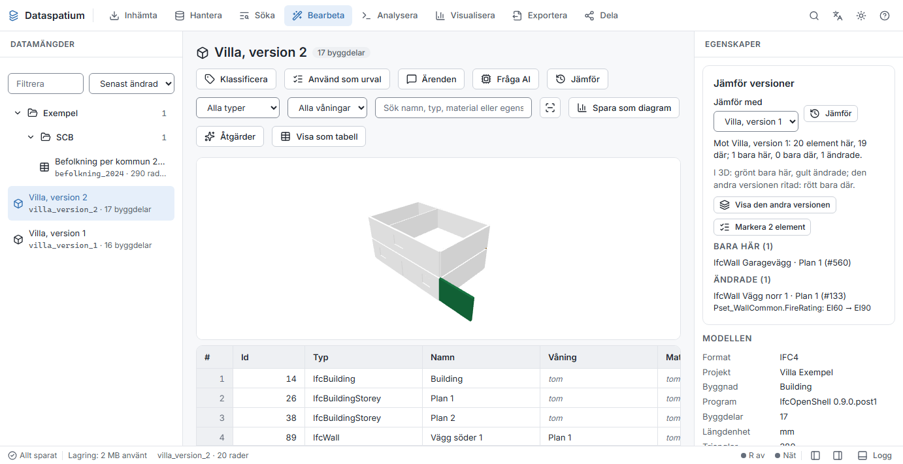
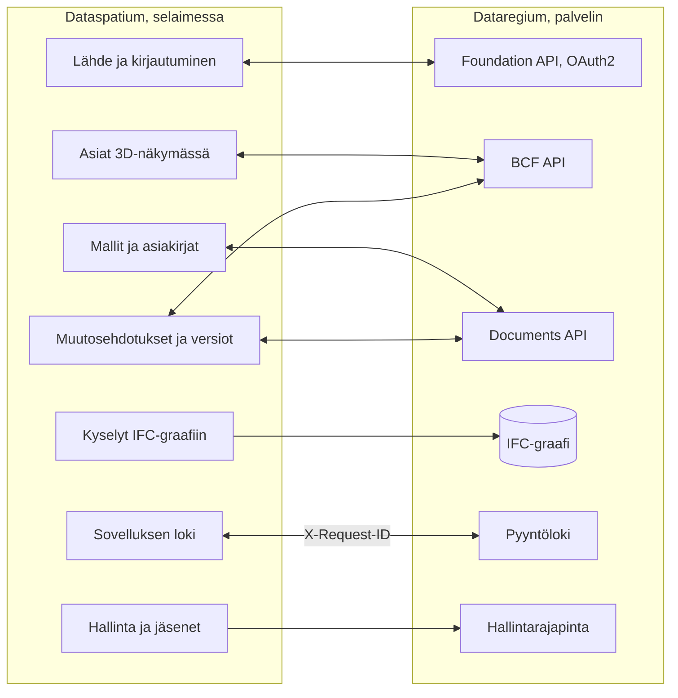

[Svenska](../../README.md) · [Dansk](../da/README.md) · [Norsk bokmål](../nb/README.md) · [Norsk nynorsk](../nn/README.md) · **Suomi** · [Íslenska](../is/README.md) · [English](../en/README.md)

# Dataspatium OpenCDE-asiakas

Dataspatium on ohjelma datan käsittelyyn, ja se avataan tavallisessa selaimessasi. Tuot siihen taulukon, kartan, kaavan,
rakennusmallin tai viranomaisen tilastoja, korjaat ja lasket niitä, teet kaavioita ja raportteja ja lähetät tuloksen eteenpäin. Kaikki
tapahtuu omalla tietokoneellasi: ei asennusta, ei tiliä eikä palvelinta. Mitään ei lähde tietokoneelta, ellet itse vie tai jaa sitä,
ja sovellus kysyy aina ennen kuin se käyttää internetiä.

Dataspatium voi toimia myös [Dataregiumin](https://github.com/marwiss/Dataregium) kanssa. Dataregium on palvelin, jossa
rakennushanke jakaa mallinsa, asiakirjansa ja asiansa. Silloin voit noutaa hankkeen rakennusmallit, osoittaa ongelmia 3D:ssä,
tarkastaa mallit ja ehdottaa tekoälyn avulla muutoksia, jotka hankkeen vastuuhenkilöt hyväksyvät. Ilman Dataregiumia kaikki muu toimii
täsmälleen samoin.

**Teknisesti osaavalle:** staattinen verkkosovellus ilman käännösvaihetta, joka toimii `file://`-osoitteesta Edgessä, Chromessa ja
Firefoxissa tai miltä tahansa staattiselta verkkopalvelimelta. Jokainen aineisto on SQLite-tiedosto (sql.js) IndexedDB:ssä; R toimii
WebR 0.5.9:ssä ja Python Pyodide 0.29.5:ssä, molemmat workereissa; IFC luetaan web-ifc:llä ja IfcOpenShellillä (wasm). Palvelinta
vasten sovellus on OpenCDE-asiakas: Foundation API 1.0 OAuth2 authorization coden ja PKCE:n kanssa, BCF API 3.0 ja 2.1 sekä Documents
API 1.0. Verkkokutsuja ei tehdä ilman käyttötarkoituskohtaista suostumusta, ja salaisuudet tallennetaan vain salattuina (AES-GCM).

**Sisältö**

- [Lataa ja aloita](#lataa-ja-aloita)
- [Vaatimukset](#vaatimukset)
- [Sanoja, jotka on hyvä tuntea](#sanoja-jotka-on-hyvä-tuntea)
- [Mitä voit tehdä](#mitä-voit-tehdä)
- [OpenCDE-rajapinnat ja niiden asiakasohjelmat](#opencde-rajapinnat-ja-niiden-asiakasohjelmat)
- [Dataspatium ja Dataregium](#dataspatium-ja-dataregium)
- [Lue lisää](#lue-lisää)
- [Rajoitukset lyhyesti](#rajoitukset-lyhyesti)
- [Henkilötiedot](#henkilötiedot)
- [Seuraavaksi 3-sarjassa](#seuraavaksi-3-sarjassa)
- [Virheet ja ehdotukset](#virheet-ja-ehdotukset)
- [Kehitys](#kehitys)
- [Lisenssi](#lisenssi)

## Lataa ja aloita

1. **Lataa.** Mene [uusimpaan julkaisuun](https://github.com/marwiss/Dataspatium/releases/latest) ja nouda ZIP-tiedosto kohdasta
   *Assets* (`dataspatium-<version>.zip`, noin 100 Mt; R ja yleisimmät R-paketit sisältyvät).
2. **Pura.** Napsauta ZIP-tiedostoa hiiren oikealla painikkeella ja valitse *Pura kaikki* (Windows) tai kaksoisnapsauta sitä (macOS).
   Siirrä kansio haluamaasi paikkaan, esimerkiksi Tiedostot-kansioon. Sovellus ei toimi suoraan ZIP-tiedoston sisältä.
3. **Avaa.** Kaksoisnapsauta kansiossa olevaa `index.html`-tiedostoa tai vedä tiedosto selainikkunaan. Jos Windows kysyy, millä
   sovelluksella tiedosto avataan, valitse Edge, Chrome tai Firefox. Ensimmäisellä kerralla valitset kielen, ja sitten tarjotaan
   **Peruskurssia**: kaikkien tilojen läpikäyntiä esimerkkidatalla, joka kestää noin kymmenen minuuttia ja jonka voi avata uudelleen
   ohjeesta (?).
4. **Tuo dataa.** *Nouda*-tilassa pudotat tiedoston pinnalle tai napsautat *Kokeile esimerkkidatalla*. Sovellus näyttää, mitä tiedosto
   sisältää; napsauta *Tuo*. Aineisto tallentuu selaimeen omalle tietokoneellesi.
5. **Jatka.** Ylhäällä olevat tilat ovat työn vaiheet: *Hallitse* pitää aineistosi järjestyksessä, *Hae* löytää rivejä ilman koodia,
   *Muokkaa* näyttää taulukon, kartan tai mallin painikkeineen korjaamista ja laskemista varten, *Tarkista* tarkistaa taulukot ja
   mallit vaatimuksia vasten, *Analysoi* sisältää tilastot ja koodin (R, Python ja SQL), *Visualisoi* tekee kaavioita ja karttoja,
   *Vie* tallentaa tiedostoja tietokoneelle ja *Jaa* lähettää muille.

Tallentamasi tiedot ovat selaimen omassa tietokannassa tietokoneella. Jos tyhjennät selaimen sivustotiedot, ne katoavat, joten ota
säännöllisesti varmuuskopio kohdassa *Hallitse > Työtila*. Varmuuskopio on ZIP-tiedosto, jonka voi palauttaa samalle tai toiselle
tietokoneelle. Vaihe vaiheelta tarkemmin: [kom-igang.md](kom-igang.md).

Sovellus on myös suoraan verkossa, ilman latausta: <https://marwiss.github.io/Dataspatium/>. Sieltä sen voi asentaa omaksi
sovelluksekseen (Edge ja Chrome: *Asenna* osoiterivillä), ja sitten se toimii myös ilman verkkoa. Verkkoversiolla ja kansioversiolla on
kummallakin oma työtilansa; siirrä dataa niiden välillä varmuuskopiolla tai paketilla.

### Teknisesti osaavalle

- **Aja:** pura ZIP-tiedosto ja avaa `index.html` (file://), tai tarjoile kansio: `python -m http.server 8080 --bind 127.0.0.1` ja avaa
  <http://127.0.0.1:8080/>. Verkkopalvelimelta käytössä ovat service worker, asennettava sovellus sekä keskeytettävät R ja Python.
- **Tarkista ZIP-tiedosto:** vertaa sen SHA-256-tiivistettä julkaisun tekstissä olevaan (`Get-FileHash` PowerShellissä,
  `shasum -a 256` macOS:ssä ja Linuxissa).
- **Palvelimen kanssa:** käynnistä Dataregium Dockerilla tai Podmanilla (`docker compose up -d --build --wait` ja
  `docker compose exec api opencde seed` Dataregiumin repossa), tarjoile Dataspatium portissa 8080 ja lisää palvelin kohdassa *Nouda >
  Lisää lähteitä > OpenCDE*. Asiakastunnuksen voi jättää tyhjäksi, kun palvelin sallii itserekisteröinnin. Koko matka kahdessakymmenessä
  minuutissa: [snabbstart.md](snabbstart.md).
- **Graafi:** palvelimen IFC-graafia (Neo4j tai Memgraph) kysytään Cypherillä *Nouda*-tilasta, palvelimen graafikyselyn kautta tai
  suoraan Boltin yli; palvelimen nimettyihin kyselyihin päästään tekoälypaneelista.
- **Tekoäly:** syötä Anthropicin tai OpenAI-yhteensopivan rajapinnan avain (myös Ollama, vLLM ja llama.cpp omalla koneella)
  mallinäkymän paneeliin *Kysy tekoälyltä*; avain tallennetaan salattuna, ja hankkeen käytäntö voi rajata paikallisiin malleihin.
- **Testit:** `powershell -File tools/run-tests.ps1` tai `tools/run-tests.sh` ajaa koko testisarjan headless-Edgessä ja -Firefoxissa.

## Vaatimukset

- Windows, macOS tai Linux.
- Microsoft Edge tai Google Chrome (versio 120 tai uudempi) tai Firefox (versio 128 tai uudempi). Safaria ei tueta koko sovellukselle.
- Noin 300 Mt vapaata tilaa sovelluskansiolle ja vähintään 4 Gt muistia (8 Gt suositellaan suurille aineistoille ja malleille).
  Järjestelmänvalvojan oikeuksia ei tarvita.
- Internetiä tarvitaan vain, kun itse valitset jotakin, mikä sitä vaatii, ja sovellus kysyy luvan ensin jokaiseen käyttötarkoitukseen:
  datan noutaminen avoimista rajapinnoista ja kartoista, yhteys Dataregium-palvelimeen tai GitHubiin, kysymys pilvessä toimivalle
  tekoälymallille, päivitysten haku tai sellaisen osan noutaminen, joka ei sisälly kansioon (Python, IfcOpenShell ja muut kuin
  yleisimmät R-paketit).
- Dataregium tarvitsee palvelimen. Oman ajaminen vaatii Dockerin tai Podmanin; sen kuvaa Dataregiumin README.

## Sanoja, jotka on hyvä tuntea

Sinun ei tarvitse tuntea alla olevia sanoja käyttääksesi sovellusta, mutta ne esiintyvät tekstissä.

- **Rajapinta (API)**: tapa, jolla ohjelmat noutavat dataa toisiltaan verkon yli. Sovellus noutaa tilastoja viranomaisten rajapinnoista
  ja keskustelee Dataregiumin kanssa sen rajapintojen kautta.
- **Aineisto**: se, minkä sovellus tallentaa, kun tuot jotakin: taulukko, kartta, kaava, graafi, malli tai asiakirja- tai
  kuvakokoelma.
- **Resepti**: luettelo kaikesta, mitä olet tehnyt aineistolle, vaihe vaiheelta, jotta sen voi perua tai toistaa uudelle datalle.
- **R, Python ja SQL**: kieliä datan analysointiin. Sovelluksessa ne ovat valmiina, mutta useimmat asiat tehdään painikkeilla ja
  lomakkeilla, jotka kirjoittavat koodin puolestasi.
- **BIM**: rakennuksen kuvaaminen digitaalisena mallina, jossa jokaisella seinällä, ovella ja huoneella on tietoja, eikä vain viivoina
  piirustuksessa.
- **IFC**: rakennusmallien avoin tiedostomuoto, jota kaikki suuret rakennussuunnitteluohjelmat osaavat lukea ja kirjoittaa.
- **CAD**: piirto-ohjelmalla tehdyt piirustukset; sovellus lukee niitä avoimessa DXF-muodossa.
- **IDS**: avoin tiedosto, joka kertoo, mitä tietoja mallissa on oltava, jotta malli voidaan tarkastaa automaattisesti.
- **BCF**: avoin muoto mallia koskeville asioille, esimerkiksi ”ilmanvaihto kulkee palkin läpi”, kuvan ja paikan näyttävän näkymän
  kanssa.
- **OpenCDE**: buildingSMARTin avoimet säännöt sille, miten ohjelmat jakavat rakennushankkeen mallit, asiakirjat ja asiat, jotta eri
  valmistajien ohjelmat toimivat yhdessä.
- **Palvelin**: ohjelma, johon muut ottavat yhteyden verkon yli. Dataregium on palvelin; Dataspatium ei tarvitse sellaista.
- **Graafi ja graafitietokanta**: data asioina ja niiden välisinä yhteyksinä, esimerkiksi että ovi on seinässä jossakin kerroksessa.
  Dataregium voi tallentaa jokaisen mallin graafiksi Neo4j- tai Memgraph-tietokantaan [IFC–DB](https://github.com/marwiss/IFC-DB)-moduulin (aiemmin IFC-LPG) avulla.
- **Kontti**: valmiiksi paketoitu ohjelma, joka käynnistetään Dockerilla tai Podmanilla ilman että sen osia asennetaan erikseen.
  Dataregium toimii näin; Dataspatium ei tarvitse kontteja.
- **Versio ja muutosjoukko**: versio on mallin tallennettu tila; muutosjoukko on joukko ehdotettuja muutoksia, jotka näet ja hyväksyt
  ennen kuin niistä tulee uusi versio.
- **Tekoälymalli**: palvelu kuten Claude tai ChatGPT tai omalla koneella toimiva malli, joka vastaa kysymyksiin ja ehdottaa muutoksia.
  Sovellus käyttää sitä vain omalla avaimellasi ja suostumuksellasi.
- **OAuth2-kirjautuminen**: tavallinen tapa kirjautua palveluun toisesta sovelluksesta ilman, että sovellus näkee salasanaasi.
- **file:// ja CORS**: file:// tarkoittaa, että sovellus avataan suoraan kansiosta. CORS on selaimen sääntö siitä, mistä verkkopalveluista
  verkkosovellus saa noutaa dataa; palveluun ilman CORS-tukea ei pääse suoraan.

## Mitä voit tehdä

Mikä toimii yhdessä versiossa, toimii myös seuraavassa. Jokainen versio kuuluu yhteen Dataregiumin saman version kanssa.

### Versio 1 (Dataregium 1:n kanssa)

- **Tuo dataa**: tiedostoja noin neljässäkymmenessä muodossa Excelistä ja CSV:stä tilastotiedostoihin, paikkatietoon ja Wordin ja
  verkkosivujen taulukoihin, sekä Ruotsin, Pohjoismaiden ja Euroopan viranomaisten tilastoja yhdellä napsautuksella (ks.
  [Avoimet rajapinnat](api-konfiguration.md)). *Teknisesti:* merkistö ja sarakkeiden tyypit tunnistetaan; SPSS, Stata, SAS, PX, Parquet
  ja RDS R:n kautta; omat lähteet `*.api.json`-tiedostoina.
- **Korjaa ja laske**: noin viisikymmentä toimintoa painikkeilla, kuten siivous, tyypin vaihto, uudelleenkoodaus, osuuksien laskeminen,
  pivotointi ja taulukoiden yhdistäminen, sekä laatusäännöt, henkilötunnusten pseudonymisointi, kumoaminen ja versiot (ks.
  [Muokkaa](bearbeta.md)). *Teknisesti:* jokainen vaihe tallentuu reseptiin, jonka voi viedä R- tai SQL-koodina.
- **Analysoi**: R ggplot2:n ja tidyversen kanssa, SQL useiden aineistojen yli, säännölliset lausekkeet ja muistikirjat, joista tulee
  raportteja, kokonaan selaimessa (ks. [R](r-guide.md) ja [Säännölliset lausekkeet](regex.md)).
- **Kaavat**: Ruotsin asema- ja yleiskaavat kaavakarttoina Boverketin väreillä ja merkinnöillä kaavan omassa koordinaatistossa (ks.
  [Kaavat](planer.md)).
- **Kaaviot, kartat ja asiakirjat**: kaaviot ja kartat Vega-Litellä, D3:lla tai R:llä, koontinäytöt ja raportit malleista HTML-, Word-,
  PDF-, PowerPoint-, Markdown- tai LaTeX-muodossa (ks. [Visualisoi](visualisera.md)).
- **Tallenna ja jaa**: data noin kymmenessä muodossa, jakopaketit, kommentit, varmuuskopio, synkronointi GitHubin kanssa ja siirrettävä
  kansio.
- **Dataregium asiakirja-arkistona**: nouda asiakirjoja palvelimelta aineistoiksi ja lähetä aineistoja ja tiedostoja takaisin uusina
  versioina. *Teknisesti:* Foundation API ja Documents API.
- **Kuusi kieltä ja peruskurssi**: ruotsi, tanska, norja (bokmål), suomi, islanti ja englanti sekä komentopaletti (Ctrl+K), joka löytää
  kaiken.

### Myös versiossa 2 (Dataregium 2:n kanssa)

- **Hae ja Jaa**: kaksi uutta tilaa. *Hae* löytää ja listaa rivejä ilman koodia; *Jaa* lähettää paketteja, julkaisee koontinäyttöjä ja
  asiakirjoja verkkosivuina ja siirtää puhelimiin QR-koodilla henkilötietojen tarkistuksen jälkeen (ks. [Hae](soka.md) ja
  [Jaa](dela.md)).
- **Lisää lähteitä**: Access-tiedostot, tietokannat, avoin paikkatieto, taustakartat, asiakirjat ja kuvat kokoelmina sekä teksti
  skannatuilta sivuilta (ks. [Lähteet](kallor.md)). *Teknisesti:* paikallinen silta SQL Serveriin ja ODBC:hen, PostgREST, OData, GraphQL,
  SPARQL ja muita HTTP:n yli, WFS, OGC API Features, ArcGIS ja Neo4j Boltin yli.
- **Kartat, kaavat ja graafit**: kartat tasoineen ja paikkatietotyökaluineen, kaavat kaikista Pohjoismaista sekä graafit, joita
  piirretään, kysytään ja muokataan (ks. [Kartat](kartor.md) ja [Graafit](grafer.md)).
- **Rakennusmallit**: IFC-mallit 3D:nä taulukoineen, ominaisuuksineen ja määrineen, tarkistus skeemaa ja IDS:ää vasten sekä
  DXF-piirustukset (ks. [CAD ja BIM](cad-bim.md)). *Teknisesti:* web-ifc ja three.js näkymään, IfcOpenShell ja ifctester sovelluksen
  Pythonissa.
- **Liiku mallissa**: näkymäkuutio ja vakionäkymät, ortografinen näkymä, leikkauslaatikko ja leikkaus kerroksen kohdalta,
  kiertopiste kaksoisnapsautuksella ja näppäimistö; kamera ja leikkaus seuraavat asioiden viewpointeja, ja kartoissa ja kaavoissa
  on mittakaavajana (ks. [CAD ja BIM](cad-bim.md#näkymät-ja-näppäimistö)).
- **Lisää paikkatietolähteitä**: Lantmäterietin vektoriaineistot, ortoilmakuvat, korkeusaineistot ja kartat tiedostoina avaimella,
  vektoritiedostot luettuina suoraan, tietiedot Trafikverketin NVDB:stä (nopeusrajoitukset, tienumerot, kantavuus ja 42 muuta
  kohdetyyppiä, avaimella), lajihavainnot SLU Artdatabankenilta sekä rakennukset, rantojensuojelu, kulttuurihistorialliset
  jäännökset ja tunturien läheisen metsän raja kansallisesta paikkatietoalustasta; lähdeluettelo kertoo, kun lähdettä ei tavoiteta
  siellä, missä sovellus toimii, ja paketit ottavat kaaviot ja muistikirjat mukaan vain valituista aineistoista (ks.
  [Lähteet](kallor.md)).
- **Python ja tilastot ilman koodia**: Python-konsoli sekä lomakkeet tilastoille ja aikasarjoille, jotka kirjoittavat ja näyttävät
  koodin (ks. [Tilastot](statistik.md) ja [Python](python.md)).
- **Järjestys ja työnkulut**: kansiot, tunnisteet ja toiminnot monelle aineistolle, tallennetut työnkulut, jotka ajetaan yhdellä
  napsautuksella, ja lähteet, jotka ilmoittavat uudesta datasta (ks. [Tilat](lagen.md)).
- **Dataspatium Mobiili**: puhelin vastaanottaa ja näyttää dataa ja kerää rivejä maastossa, myös ilman verkkoa (ks.
  [Mobiili](mobil.md)).
- **Dataregium ja asiat**: hankkeen mallit ja asiat, uudet asiat, jotka osoittavat paikan 3D:ssä, BCF-tiedostot, palvelimen IFC-graafi,
  kortti *Hallinta* ylläpitäjälle ja kortti *Projektin jäsenet* hankkeen vastuuhenkilölle (ks.
  [Dataspatium ja Dataregium](#dataspatium-ja-dataregium)). *Teknisesti:* BCF API 3.0 ja 2.1 viewpointeineen.
- **Seitsemän kieltä**: myös nynorsk, käsikirja sovelluksessa ja peruskurssi tilojen läpi.

### Myös versiossa 3 (Dataregium 3:n kanssa)

- **Tarkista-tila**: yhdeksäs tila *Muokkaa*-tilan jälkeen. Taulukko tarkistetaan yksinkertaisia sääntöjä vasten (tyyppi ja tyhjät
  arvot sarakkeittain, rivien kaksoiskappaleet), ja IFC-malli näyttää kortin *Validoi malli* ja paneelin *Vertaa versioita* (ks.
  [Tilat](lagen.md#tarkista)).
- **Mallien tarkastus**: kortti *Validoi malli* näyttää palvelimen tarkastuksen IFC-skeemaa, buildingSMARTin sääntöjä ja hankkeen
  IDS-tiedostoja vasten, ja sovellus löytää rakennusosat, jotka törmäävät tai ovat liian lähellä toisiaan, ja tekee niistä asioita (ks.
  [CAD ja BIM](cad-bim.md)).
- **Kysy tekoälyltä mallista**: kysy esimerkiksi ”montako ovea 2. kerroksessa on?” ja saat vastauksen rakennusosat merkittyinä 3D:ssä.
- **Muuta tekoälyllä**: pyydä tekoälyä esimerkiksi luomaan seiniä, laattoja, ovia ja ikkunoita. Näet ehdotuksen 3D:ssä, sovellus
  tarkastaa sen ja sinä hyväksyt; tekoäly ei voi koskaan tallentaa eikä julkaista itse. Voit myös aloittaa uudesta, tyhjästä mallista
  skeemalla IFC4X3_ADD2, IFC4 tai IFC2X3 (*Nouda > Uusi rakennusmalli*). *Teknisesti:* kirjoitustyökalut täyttävät
  muutosjoukon, jonka mallinnusmoduuli soveltaa IfcOpenShellillä; skeemavirheet ja uudet virheet mallin suhteissa estävät hyväksynnän.
- **Uusi rakennus briefistä**: kirjoita brief eli kuvaus rakennuksesta lomakkeeseen *Uusi rakennusmalli* ja valitse
  *Rakenna briefistä tekoälyllä*. Tekoälypaneelin tilassa *Rakenna briefistä* tekoäly suunnittelee, kysyy, kun jotakin olennaista
  on auki, ja rakentaa kerrokset, seinät, laatat ja aukot kirjoitustyökaluilla; malliin ei kirjoiteta mitään ennen kuin esikatselet
  ja hyväksyt muutosjoukon (ks. [CAD ja BIM](cad-bim.md#uusi-rakennus-briefistä)).
- **Olemassa olevan rakennuksen digitaalinen kaksonen**: *Rakennuksen tiedot* (mikä rakennus, kerrokset, pituus, leveys, korkeus,
  perustus, katto) ja *Tarkkuus* (luonnos, pääpiirteet tai yksityiskohtainen) aloittavat briefin, ja julkisivujen ja sisätilojen
  valokuvat sekä skannatut piirustukset menevät tekoälylle merkittyinä, ja kuvatekstiin tulevat tiedoston sijainti ja ajankohta;
  Lantmäterietin rakennukset-tasolta haettu rakennusala antaa kulmat metreinä, mallin paikan maapallolla (SWEREF 99 TM) ja
  pyydettäessä maanpinnan korkeuden kulmissa. Sanat ovat tavallista suomea, mutta niiden takana ovat ISO 19650:n tietovaatimukset
  ja level of information need, ja malli on tarkoitettu rakennuksen ylläpitomalliksi.
- **Versiot Dataregiumin kanssa**: lähetä muutos ehdotuksena, jonka palvelin kokeilee ja hankkeen vastuuhenkilö hyväksyy; palvelin
  yhdistää useiden muutokset, ja ristiriidassa valitset, mikä on voimassa. *Teknisesti:* julkaisu perusversion kanssa (412 uudemman
  version kohdalla), snippet, jonka avaimena on GlobalId ja polku.
- **Useita asiakasohjelmia saman mallin parissa**: kortti *Muutosehdotukset palvelimella* listaa ehdotukset, jotka kohdistuvat
  mallin asiakirjaan Dataregiumissa, ja se, joka saa hyväksyä, tekee kokeillusta ehdotuksesta seuraavan version; palvelin, joka
  ottaa vastaan kirjoitustyökalujen oman muodon, saa ehdotukseen myös uudet elementit, poistot ja suhteet. Painikkeella
  *Vie aineisto palvelimelle* brief ja kuvat viedään palvelimelle mallin aineistoksi asiaan *Aineisto*, kun olet käynyt läpi
  tarkistuksen ennen jakamista, jotta muut mallin parissa työskentelevät näkevät, mistä se rakennettiin. *Teknisesti:* kyvykkyys
  `ifc_proposals_url` ja muoto `ops_form` (`dataspatium-tools/1`).
- **Vertaa versioita**: näe, mitä on lisätty, poistettu ja muutettu mallin kahden version välillä, väritettynä 3D:ssä, myös palvelimen
  versioita vasten.
- **Lisää**: palvelimen IFC-graafi kevyemmässä muodossa ja kysely *rakennusosat lähellä rakennusosaa*, oma Dataregium omalla koneella
  lähteenä ja Sundsvallin kartat paikkatietolähteiden joukossa.

## OpenCDE-rajapinnat ja niiden asiakasohjelmat

OpenCDE on buildingSMART Internationalin avoimet säännöt sille, miten ohjelmat jakavat rakennushankkeen mallit, asiakirjat ja asiat.
Sääntöjä noudattava ohjelma voi toimia jokaisen samoja sääntöjä noudattavan palvelimen kanssa, rakensi ne kuka tahansa. Dataspatium on
tällainen ohjelma, asiakas, ja käyttää kaikkia kolmea rajapintaa:

| Rajapinta | Mitä sovellus tekee sillä | Määrittely |
|---|---|---|
| Foundation API 1.0 | Lukee, mitä rajapintoja palvelin tarjoaa, mihin kirjaudutaan ja kuka käyttäjä on; rekisteröi sovelluksen asiakkaaksi, kun palvelin sallii sen | [foundation-API](https://github.com/buildingSMART/foundation-API) |
| BCF API 3.0 ja 2.1 | Lukee ja kirjoittaa mallia koskevia asioita kommentteineen ja viewpointeineen (kamera, komponentit ja kuvat) 3D-näkymästä; valitsee uusimman version, jonka palvelin tarjoaa | [BCF-API](https://github.com/buildingSMART/BCF-API) |
| Documents API 1.0 | Valitsee ja noutaa asiakirjoja ja versioita palvelimen omien sivujen kautta, jotta IFC-mallista tulee aineisto, ja lataa uusia versioita, aineistoja ja paketteja | [documents-API](https://github.com/buildingSMART/documents-API) |

**Dataregium on yksi palvelin, ei ainoa.** Mikään sovelluksessa ei riipu Dataregiumista. Dataregiumin määrittelyjen ulkopuoliset
laajennukset (kyvykkyysdokumentti, nimetyt graafikyselyt, ennakkotarkastus, perusversio, muutosehdotukset, versioiden välinen diff ja
hankkeen hallinta) näytetään vain, kun palvelin itse ilmoittaa ne.

**Teknisesti osaavalle:** palvelimelta sovellus tarvitsee kolme asiaa:

- CORS sovelluksen alkuperästä: `null` file://-osoitteesta, `http://127.0.0.1:8080` paikalliselta verkkopalvelimelta ja
  `https://marwiss.github.io` verkosta, otsakkeilla Authorization, Content-Type ja X-Request-ID;
- asiakasrekisteröinti, jonka tekee palvelimen ylläpitäjä (julkinen asiakas uudelleenohjausosoitteella
  `http://127.0.0.1:8080/oauth-callback.html` tai vastaava sovelluksen osoitteelle) tai sovellus itse (RFC 7591), kun palvelin sallii
  sen, sekä OAuth2 authorization code ja PKCE `S256`; file://-osoitteesta liität osoitteen, johon päädyt kirjautumisen jälkeen;
- BCF API 3.0 tai 2.1; Documents API on vapaaehtoinen, mutta ilman sitä sovellus ei voi noutaa eikä julkaista asiakirjoja.

Toistaiseksi tämä on osoitettu Dataregiumia vasten: live-testisarja ajetaan palvelinta vasten BCF API:n molemmilla versioilla, ja pelkkää
2.1:tä tukeva palvelin toimii. Muita palvelimia ei ole kokeiltu; kerro, miten kävi, kohdassa
[Virheet ja ehdotukset](#virheet-ja-ehdotukset). Kun sovellus ja määrittely ovat eri mieltä, määrittely ratkaisee. Sovelluksen puoli
kuvataan tiedostossa [kallor.md](kallor.md), palvelimen puoli Dataregiumin READMEssä.

## Dataspatium ja Dataregium

*Dataregiumin nimi oli Kontroll 8. marraskuuta 2026 asti.*

Dataspatium on sovellus, jossa työskentelet, ja [Dataregium](https://github.com/marwiss/Dataregium) on palvelin, johon hanke kokoaa
mallinsa, asiakirjansa ja asiansa. Ne on rakennettu toisilleen mutta noudattavat avoimia sääntöjä, joten muutkin ohjelmat toimivat.
Lisäät palvelimen lähteeksi *Nouda*-tilassa ja kirjaudut; sen jälkeen noudat hankkeen mallit ja asiakirjat, osoitat ongelmia 3D:ssä
asioina, lähetät aineistoja ja tiedostoja takaisin, kysyt palvelimen mallien graafilta ja ehdotat versiossa 3 muutoksia, joita palvelin
kokeilee. Ilman palvelinta sovelluksen muu osa toimii tavalliseen tapaan.

**Teknisesti osaavalle:** kaikki paitsi graafikyselyt ja hallinta kulkee kolmen OpenCDE-rajapinnan kautta. Jokainen kutsu kantaa
`X-Request-Id`-tunnisteen, jonka palvelin kirjoittaa pyyntölokiinsa, jotta sovelluksen loki ja palvelimen loki voidaan yhdistää.
Yhteistyö kuvataan sovelluksen puolelta tiedostoissa [kallor.md](kallor.md) ja [cad-bim.md](cad-bim.md) ja palvelimen puolelta
Dataregiumin READMEssä ja tiedostossa `docs/client-guide.md`.

Näin ne liittyvät toisiinsa:

Dataspatium 3.0.0 toimii Dataregium 3.0.0:n kanssa. Sama numero kuuluu yhteen. Pikaopas [snabbstart.md](snabbstart.md) vie parin
tyhjästä asiaan kahdessakymmenessä minuutissa.

### Julkaisut 1, 2 ja 3

Kullakin päänumerolla on yksi julkaisu, ja samanumeroiset Dataspatium ja Dataregium kuuluvat yhteen:

| Dataspatium | Mitä siinä on | Kuuluu yhteen |
|---|---|---|
| 1.0.0 | Data tiedostoista ja avoimista rajapinnoista, käsittely, R, SQL ja säännölliset lausekkeet, Ruotsin kaavat, kaaviot ja kartat kaavioissa, koontinäytöt, asiakirjat, vienti ja jakaminen. Palvelinta vasten vain Documents API: asiakirjojen noutaminen aineistoiksi sekä aineistojen ja tiedostojen lähettäminen takaisin. Ei asioita, ei malleja eikä Pythonia | Dataregium 1.0.0 (vain Documents API) |
| 2.0.0 | Kaikki 1.0.0:n sisältö sekä tilat Hae ja Jaa, Python ja tilastot ilman koodia, lisää lähteitä, karttanäkymät, Pohjoismaiden kaavat, graafit, IFC-mallit 3D:nä ja tarkistus IDS:ää vasten, työnkulut, Dataspatium Mobiili, asiat viewpointeineen (BCF API 3.0 ja 2.1), palvelimen IFC-graafi, kortti *Hallinta* ja kortti *Projektin jäsenet*, navigointi näkymäkuutiolla ja leikkauksilla, lisää paikkatietolähteitä | Dataregium 2.0.0 |
| 3.0.0 | Kaikki 2.0.0:n sisältö sekä kortti *Validoi malli*, törmäystarkastus, Kysy tekoälyltä ja Muuta tekoälyllä, uudet tyhjät mallit valitulla skeemalla, Vertaa versioita, julkaisu perusversion ja ennakkotarkastuksen kanssa, muutosehdotukset, joita palvelimella kokeillaan ja hyväksytään ja joissa ristiriidat ratkaistaan valinnalla, sekä graafi kevyemmässä muodossa sekä uudelleenjulkaisujen jälkeen tekoälyavustaja, komennot, ehdolliset ja toistuvat työnkulut, ohjaus sillan kautta ja Dataregiumin tiimit; lisäksi uusi rakennus briefistä, digitaalinen kaksonen, Tarkista-tila, topologia, tilat ja oikea IFC-luokka; edelleen materiaalikerroksiset tyypit, ominaisuudet ja ruotsalaiset tunnukset, elementtien muokkaus, lisää rakennusosia, ilmastoselvitys, materiaali-inventaario, buildingSMARTin säännöt, BCF 3.0 ja henkilötiedot IFC-malleissa | Dataregium 3.0.0 |

Uusi julkaisu samalla päänumerolla korvaa edellisen; vain kunkin sarjan uusinta korjataan. Sovelluksen päivitystarkistus tarjoaa
seuraavaa päänumeroa, ja aineistot, listat, kaaviot, mallipohjat ja skriptit tulevat mukaan, kun avaat uuden version `index.html`-tiedoston.

## Lue lisää

Tiedostonimet ovat samat kaikilla kielillä (ne ovat ruotsinkielisiä alkuperäisiä), joten linkit toimivat kaikkialla samoin.

**Aloita tästä**

- **Peruskurssi** sovelluksessa: kaikkien tilojen läpikäynti esimerkkidatalla; avaa se ohjeesta (?) tai näppäimillä Ctrl+K.
- **Käsikirja** sovelluksessa: sama dokumentaatio kuin täällä, haun kanssa; avaa se oikean yläkulman ?-painikkeesta tai F1:llä.
- [Aloitus](kom-igang.md): vaihe vaiheelta tavallisine kysymyksineen.
- [Käyttöopas](anvandarguide.md): koko työnkulku tiedostosta raporttiin.
- [Yhdeksän tilaa](lagen.md): mitä on missä ja miksi.
- [Usein kysytyt kysymykset](faq.md): tallennus, tietoturva, R, rajapinnat ja päivitykset.

**Aiheittain**

- [Muodot ja tuonti](format.md) ja [Avoimet rajapinnat](api-konfiguration.md): tiedostomuodot, merkistöt, valmiit lähteet, avaimet ja
  omat määritykset.
- [Lähteet](kallor.md): tietokannat, silta, avoin paikkatieto, linkitetyt tiedostot ja OpenCDE-palvelimet.
- [Muokkaa](bearbeta.md), [Hae](soka.md) ja [Säännölliset lausekkeet](regex.md): korjaa, laske ja löydä.
- [Tilastot](statistik.md), [R Dataspatiumissa](r-guide.md), [Python Dataspatiumissa](python.md) ja [Muistikirja](anteckningsbok.md):
  analyysi koodin kanssa ja ilman.
- [Visualisoi](visualisera.md), [Kartat](kartor.md) ja [Asiakirjat ja mallipohjat](dokumentmallar.md): kaaviot, kartat, koontinäytöt ja
  raportit.
- [Kaavat](planer.md), [Graafit](grafer.md) ja [CAD ja BIM](cad-bim.md): kaavat, graafit, rakennusmallit, tarkastukset, tekoäly ja
  versiot.
- [Asiakirjat ja kuvat](dokument.md): PDF, Word, OpenDocument, Markdown ja kuvat aineistoina.
- [Työnkulut](floden.md), [Jaa](dela.md), [Dataspatium Mobiili](mobil.md) ja [Keruu](insamling.md): automatisoi, jaa ja kerää.
- [Pikaopas Dataregiumin kanssa](snabbstart.md): kaksikymmentä minuuttia tyhjästä 3D-näkymässä luotuun ja palvelimella näkyvään asiaan.
- [Tietoturva](sakerhet.md) ja [Lisenssit](licenser.md): uhkamalli, tarkastukset ja testit sekä se, mitä saat tehdä sovelluksella.
- Miten kehitysehdotuksia otetaan vastaan, kerrotaan tiedostossa [CONTRIBUTING.md](../../CONTRIBUTING.md) (ruotsiksi).

### Lisälukemista

- [BCF API](https://github.com/buildingSMART/BCF-API), [Foundation API](https://github.com/buildingSMART/foundation-API) ja [Documents API](https://github.com/buildingSMART/documents-API): määrittelyt, joita sovellus noudattaa palvelinta vasten.
- [IFC](https://github.com/buildingSMART/IFC4.x-development): rakennusmallien tiedostomuoto, ja [IDS](https://github.com/buildingSMART/IDS): vaatimusmäärittelyt, joita vasten malleja tarkastetaan.
- Ulkoiset resurssit: [WebR](https://docs.r-wasm.org/webr/latest/), [Pyodide](https://pyodide.org/), [IfcOpenShell](https://ifcopenshell.org/),
  [Vega-Lite](https://vega.github.io/vega-lite/), [Ruotsin tilastokeskuksen rajapinta](https://www.scb.se/en/services/open-data-api/).

## Rajoitukset lyhyesti

- Sovellus on avattava puretusta kansiosta tai tavalliselta verkkopalvelimelta; se ei toimi suoraan ZIP-tiedoston sisältä.
- Verkkopalveluihin, jotka eivät salli kutsuja selaimista (ei CORS-tukea, esimerkiksi Ruotsin keskuspankki), ei päästä suoraan; oman
  välityspalvelimen voi määrittää.
- Aineiston kannattaa pysyä alle parin miljoonan rivin, ja hyvin suuret rakennusmallit voivat olla selaimelle liian raskaita; muisti
  asettaa rajan.
- Kun sovellus avataan kansiosta, R- ja Python-koodia ei voi keskeyttää kesken laskennan; käytä painiketta *Käynnistä R uudelleen* tai
  *Käynnistä Python uudelleen*. Verkkopalvelimelta käytössä on *Keskeytä*-painike.
- Python ja IfcOpenShell eivät sisälly ZIP-tiedostoon; ne noudetaan ensimmäisellä tarvitsemiskerralla suostumuksen jälkeen ja
  tallennetaan sitten selaimeen.
- Tekoälytoiminnot vaativat oman avaimen tekoälypalveluun tai tekoälymallin omalla koneella. Tekoäly voi muuttaa kerroksia, ruudukkoja,
  seiniä, laattoja, aukkoja ovineen ja ikkunoineen, ominaisuuksia, materiaaleja ja sijaintia, ei kaikkea mallissa.
- Useat välilehdet toimivat ja pitävät toisensa ajan tasalla, mutta älä muokkaa samaa aineistoa kahdessa välilehdessä yhtä aikaa: viimeksi
  tallentava voittaa.
- Siirrettävä kansio vaatii Edgen tai Chromen; Firefoxista puuttuu kansiokäyttö. Varmuuskopio ZIP-tiedostona toimii kaikkialla.
- Koko sovellus on tehty tietokoneille. Puhelimissa ja tableteissa käytetään Dataspatium Mobiilia (<https://marwiss.github.io/Dataspatium/m/>),
  joka vastaanottaa, näyttää, kerää ja välittää eteenpäin. Kapeissa ikkunoissa paneelit avautuvat lehtinä työalueen päälle.
- Mukana tulevat esimerkkidata ja karttarajat kattavat Ruotsin, Tanskan, Norjan ja Suomen, ja valmiit lähteet ovat pohjoismaisia ja
  eurooppalaisia; muiden maiden datan voi tuoda itse yhtä helposti.

## Henkilötiedot

Dataspatium toimii selaimessasi, ja vastaat itse syöttämistäsi tiedoista. Kaikki, mitä sovellus tallentaa (aineistot versioineen,
luettelot, kaaviot, asiakirjat, muistikirjat, kommentit ja asetukset), on selaimen tallennustilassa tietokoneellasi ja lähtee sieltä
vain, kun viet, jaat tai julkaiset; silloin kaikki tarkastetaan ensin kokonaisuudessaan, ja henkilötiedot voidaan säilyttää,
pseudonymisoida tai poistaa kopiosta. Dataregium-palvelimelle lähetetään kirjautumisesi (tunnukset pidetään istunnossa tai salattuina
salalauseellasi, ei koskaan selväkielisinä), nimelläsi palvelimelle luomasi asiat, kommentit, ehdotukset ja tiedostot sekä
X-Request-ID jokaista kutsua kohden; palvelimen oma käsittely on kuvattu Dataregiumin README:ssä. Tekoälytoimittajalle lähetetään
vain se, mitä kysyt, ja vastaukset, jotka työkalut lukevat mallista, AI-tarkoitukseen annetun suostumuksen jälkeen, omalla
salattuna tallennetulla avaimellasi; projektin käytäntö voi rajata paikallisiin malleihin. Kommentit ja paketit kantavat itse
antamaasi nimeä. Kontrollit ja ne osoittavat testit ovat tiedostossa [sakerhet.md](sakerhet.md).

## Seuraavaksi 3-sarjassa

3.0.0 on 3-sarjan julkaisu, tehty yhdessä Dataregium 3.0.0:n kanssa, ja se julkaistaan uudelleen sarjan kasvaessa. Suuntana on, että
malleja voidaan luoda ja muuttaa kuvaamalla, mitä haluat, samalla kun ihminen aina tarkastaa ja hyväksyy ja palvelin pitää versiot
järjestyksessä. Tämä osio kertoo, mitä on päätetty, sille ihmiselle tai tekoälyagentille, joka vie osan siitä eteenpäin; palvelimen puoli
on Dataregiumin READMEssä saman otsikon alla.

### Päätetty

- **Mallinnus tapahtuu sovelluksessa.** Mallinnusmoduuli (kirjoitustyökalut ja IfcOpenShell sovelluksen Pythonissa) on Dataspatiumin
  oma, Dataspatiumin lisenssillä; Dataregium saa käyttää sitä.
- **Tekoäly ehdottaa, ihminen hyväksyy.** Muutosjoukko esikatsellaan 3D:ssä, tarkastetaan skeemaa, mallin suhteita ja palvelimen
  ennakkotarkastusta vasten ja sovelletaan vasta, kun hyväksyt; poisto vahvistetaan vielä kerran; julkaisu ja ehdotukset palvelimelle
  ovat painikkeita, eivät koskaan työkaluja, joita tekoäly voi kutsua. Rakennettu versioon 3.0.0.
- **Palvelin yhdistää.** Muutosjoukko lähetetään BCF-asiana, jossa on snippet palvelimen muodossa (avaimena GlobalId ja polku), palvelin
  kokeilee sitä perusversiota vasten ja *manager* hyväksyy sen seuraavaksi versioksi; palvelin ottaa mukaan sen, mikä ei ole
  ristiriidassa, ja ristiriidassa valitset sovelluksessa perusversion, uusimman version ja ehdotuksen arvon välillä. Kokonaisia malleja
  ei yhdistetä selaimessa. Rakennettu versioon 3.0.0.
- **Vertaa versioita** kolmesta lähteestä: tilannekuvat ja muut mallit sovelluksessa, palvelimen muutosjoukko versioittain ja palvelimen
  diff versioiden välillä. Rakennettu versioon 3.0.0.
- **Hankkeen hoitajilla** on sovelluksessa kortti *Projektin jäsenet*: jäsenet, roolit ja hankkeen nimi. Rakennettu versioihin 2.0.0 ja
  3.0.0.
- **Yksi Dataregium riittää**, omalla koneella tai palvelimella: noudat version, työskentelet sovelluksen kopiossa ja julkaiset
  perusversion kanssa tai ehdotat muutoksia, jotka palvelin yhdistää. Ei synkronointia useiden palvelinten välillä.
- **Seuraavaksi, kun vaiheita 1–3 on kokeiltu käytännössä:** suuret mallit piirrettyinä palvelimen geometriarajapinnasta, kun selain ei
  riitä (vaihe 4), sekä hankeprofiilit IDS:n ja bSDD:n kanssa, tekoälyn kirjoittamat IDS-tiedostot ja rakennusosiin liitetyt
  buildingSMART-säännöt (vaihe 5). Sen jälkeen tekoälyä mitataan tutkimuksen avoimilla mallinmuokkaustehtävillä.
- **Avoimet muodot** koskevat siirtomuotoja ja tallennettua dataa, eivät tekoälyrajapintoja; käyttäjä valitsee tekoälypalvelun omalla
  avaimellaan, joka tallennetaan salattuna, ja hankkeen käytäntö voi rajata paikallisiin malleihin.

## Virheet ja ehdotukset

Ilmoita virheistä tai toiveista *Issues*-kohdassa täällä GitHubissa. Kerro selain, Dataspatiumin versio (näkyy
ohjepainikkeen alla) ja mitä teit. Ks. [CONTRIBUTING.md](../../CONTRIBUTING.md). Älä liitä henkilötietoja tai salaisuuksia. Tietoturvahaavoittuvuudesta
ilmoita [SECURITY.md](../../SECURITY.md):n mukaan sen sijaan, että avaisit issuen.

## Kehitys

- Ei käännösvaihetta, ei node.js:ää. Avaa `index.html` suoraan tai tarjoile kansio komennolla `python -m http.server 8080`.
- Arkkitehtuuri lyhyesti: kaikki oma koodi on klassisia skriptejä, jotka rekisteröidään `Dataspatium.define`-kutsulla `src/boot.js`:n
  järjestyksessä; `src/platform` sisältää kaiken file://-kohtaisen (resurssit, shimit, workerit, tallennus, suostumus); moottorit SQLite,
  R (WebR) ja Python (Pyodide) toimivat workereissa; `src/ui` sisältää suunnittelumuuttujat, komponentit (`dm-*`), kuoren ja yhden tilan
  tiedostoa kohden. Kaikki näytettävä escapoidaan, eikä mitään noudeta verkosta ilman toimintaasi ja suostumustasi.
- Kolmannen osapuolen komponentit: `python tools/fetch_vendor.py` ja sen jälkeen `python tools/wrap_assets.py`.
- Testit: `powershell -File tools/run-tests.ps1` tai `tools/run-tests.sh` (headless Edge ja Firefox). Testit eivät koskaan käytä
  verkkoa; oikeita palveluja kokeillaan vain omilla parametreilla (`?cde=` Dataregiumia vasten, `?python=1` Pyodiden kanssa).
- Tietoturva: suostumuksen, salaisuuksien, jakamista edeltävän tarkistuksen, OAuth2:n (PKCE, state, paluu) ja lokin peittämisen testit
  kuuluvat testisarjaan; ks. [sakerhet.md](sakerhet.md).

## Lisenssi

Dataspatiumin oma koodi, dokumentaatio ja valmisasetukset (kaikki paitsi `vendor/`) on lisensoitu
[PolyForm Strict 1.0.0](../../LICENSE) -lisenssillä: vapaasti ladattavissa ja käytettävissä ei-kaupallisiin tarkoituksiin,
myös viranomaisissa ja muissa julkisissa laitoksissa, mutta muuttaminen, jatkokehittäminen tai edelleen levittäminen vaatii
kirjallisen luvan. Lisenssinantaja on Dataspatiumin tekijä, jonka tavoittaa GitHub-tililtä
[marwiss](https://github.com/marwiss); avaa issue, jos haluat muut ehdot. Mitä lisenssi käytännössä tarkoittaa, kerrotaan
tiedostossa [licenser.md](licenser.md).

Kolmannen osapuolen osilla kansiossa `vendor/` on omat lisenssinsä (MIT, BSD, Apache-2.0, ISC, OFL, MPL, LGPL ja GPL), ks.
[THIRD_PARTY_LICENSES.md](../../THIRD_PARTY_LICENSES.md). R ja GPL-lisensoidut R-paketit levitetään muuttamattomina;
lähdekoodi on saatavilla [R-projektilta](https://cran.r-project.org/sources.html), [webR:ltä](https://github.com/r-wasm/webr)
ja [CRANista](https://cran.r-project.org/) mainituissa versioissa. Ks. [SECURITY.md](../../SECURITY.md): miten haavoittuvuudesta ilmoitetaan
ja mitä projekti tekee pysyäkseen turvallisena.
