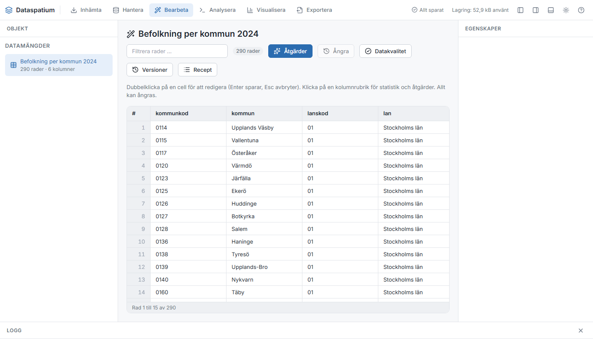

[Svenska](../../README.md) · [Dansk](../da/README.md) · [Norsk](../nb/README.md) · **Suomi** · [Íslenska](../is/README.md) · [English](../en/README.md)

# Dataspatium

Dataspatium on verkkosovellus datan käsittelyyn lähteestä raporttiin: nouda dataa tiedostoista ja avoimista
rajapinnoista, tallenna ja hallitse aineistoja, tarkista ja korjaa arvoja, analysoi R:llä, visualisoi ja vie. Kaikki toimii
omassa selaimessasi. Ei palvelinta, ei asennusta, ei tilejä. Datasi ei koskaan poistu tietokoneelta, ellet itse vie sitä.

Käyttöliittymä on saatavilla ruotsiksi, tanskaksi, norjaksi, suomeksi, islanniksi ja englanniksi. Dokumentaation
kuvakaappaukset näyttävät sovelluksen ruotsiksi.

## Lataa ja aloita

1. **Lataa.** Siirry [uusimpaan julkaisuun](https://github.com/marwiss/Dataspatium/releases/latest) ja lataa ZIP-tiedosto
   kohdasta *Assets* (`dataspatium-<versio>.zip`, noin 100 Mt; R ja kaikki R-paketit ovat mukana).
2. **Pura.** Napsauta ZIP-tiedostoa hiiren kakkospainikkeella ja valitse *Pura kaikki* (Windows) tai kaksoisnapsauta sitä
   (macOS). Sijoita kansio haluamaasi paikkaan, esimerkiksi Tiedostot-kansioon. Sovellus ei toimi suoraan ZIP-tiedoston
   sisältä.
3. **Avaa.** Kaksoisnapsauta kansion `index.html`-tiedostoa tai vedä se selainikkunaan. Jos Windows kysyy, millä sovelluksella
   tiedosto avataan, valitse Edge, Chrome tai Firefox. Ensimmäisellä kerralla sovellus kysyy, mitä kieltä haluat käyttää
   (sen voi vaihtaa oikean yläkulman kielipainikkeella), ja aloittaa sitten **peruskurssin**, noin kymmenen minuutin
   vuorovaikutteisen läpikäynnin kaikista tiloista esimerkkidatalla. Avaa se uudelleen ohjeesta (?).
4. **Tuo.** Pudota *Nouda*-tilassa tiedosto alueelle (tai napsauta *Kokeile esimerkkidatalla*), tarkista saraketyypit ja
   napsauta *Tuo*. Aineisto tallennetaan tietokoneesi selaimeen.
5. **Jatka.** Vaihda tilaa yläreunasta: *Hallitse* näyttää aineistosi ja työtilan, *Hae* löytää niistä rivejä,
   *Muokkaa* näyttää taulukon lajittelun, suodattimien ja toimintojen kanssa, *Analysoi* avaa R- ja SQL-konsolin,
   *Visualisoi* rakentaa kaavioita, *Vie* lataa dataa, kaavioita ja asiakirjoja ja *Jaa* antaa ne muille.

Data tallennetaan selaimen omaan tietokantaan. Jos tyhjennät sivustotiedot, data katoaa, joten tee varmuuskopio
säännöllisesti kohdassa *Hallitse > Työtila*. Varmuuskopio on ZIP-tiedosto, jonka voi palauttaa samalle tai toiselle
tietokoneelle. Vaihe vaiheelta ja tarkemmin: [kom-igang.md](kom-igang.md).

Sovellus on myös suoraan verkossa ilman latausta: <https://marwiss.github.io/Dataspatium/>. Verkkopalvelimelta sen
voi asentaa omaksi sovellukseksi (Edge ja Chrome: *Asenna* osoiterivillä), ja se toimii sen jälkeen myös ilman
verkkoa. Verkkoversiolla ja kansioversiolla on erilliset työtilat; siirrä dataa niiden välillä varmuuskopiolla tai
paketilla.

## Vaatimukset

- Windows, macOS tai Linux.
- Microsoft Edge tai Google Chrome (versio 120 tai uudempi) tai Firefox (versio 128 tai uudempi). Safaria ei tueta.
- Noin 300 Mt vapaata tilaa sovelluskansiolle ja vähintään 4 Gt muistia (8 Gt suositellaan suurille aineistoille).
  Järjestelmänvalvojan oikeuksia ei tarvita.
- Internetiä tarvitaan vain, kun noudat dataa avoimista rajapinnoista, lähetät GitHubiin, tarkistat päivitykset tai
  noudat komponentin tai R-paketin, joka ei tule kansion mukana; sovellus kysyy ensin lupaa.

## Mitä voit tehdä

- **Noutaa**: CSV-, Excel-, ODS-, JSON-, JSON-stat-, SDMX-JSON-, GeoJSON-, XML-, SQLite-, GeoPackage- ja shapefile-tiedostoja, taulukoita HTML-, Markdown-, Word- ja LaTeX-asiakirjoista, KML-, KMZ-, GPX- ja TopoJSON-karttatiedostoja, SQL-skriptejä, vanhempia taulukkolaskentamuotoja (dBase, Lotus 1-2-3, Quattro Pro, SYLK, DIF),
  kiinteälevyistä tekstiä, tilastotiedostoja SPSS:stä, Statasta ja SAS:sta (arvoselitteineen) ja PX-muodosta sekä Parquet- ja RDS-tiedostoja (R:n
  kautta), liitettyä tekstiä, tiedostoja verkko-osoitteista ja dataa suoraan avoimista rajapinnoista: Tilastokeskus,
  THL:n Sotkanet, PRH:n YTJ, Fintrafficin Digitraffic, Ilmatieteen laitos, avoindata.fi, Ruotsin, Norjan, Tanskan, Islannin,
  Grönlannin ja Färsaarten tilastovirastot, ÅSUB, Nordic Statistics, Eurostat, EKP, OECD ja muita viranomaisia,
  maasuodattimella ja tallennetuilla hauilla, jotka päivittyvät yhdellä napsautuksella ja toistavat reseptinsä (ks.
  [api-konfiguration.md](api-konfiguration.md)). Esimerkkidata sekä Ruotsin, Tanskan, Norjan ja Suomen kuntien ja
  alueiden rajat ovat mukana.
- **Tietokannat**: Access-tiedostot luetaan suoraan selaimessa; tietokoneen tai verkon tietokannat (SQL Server, ODBC,
  Excel, SQLite) tavoitetaan paikallisen sillan kautta, ja PostgREST/Supabase, OData, GraphQL, CouchDB, ClickHouse,
  Elasticsearch, SPARQL, InfluxDB, Google Sheets ja Airtable muuttuvat lähteiksi yhdellä napsautuksella. Tiedostoja voi
  linkittää ja lukea uudelleen levyltä (ks. [kallor.md](kallor.md)).
- **Asiakirjat ja kuvat**: PDF, Word, OpenDocument, Markdown ja teksti muuttuvat asiakirjakokoelmiksi, joita luetaan
  lukunäkymässä sivu kerrallaan tai kokonaan; kuvista tulee kuvakokoelma EXIF-tietoineen ja gallerioineen. Työkalut
  Teksti (sanafrekvenssi, avainsanat kontekstissa, yhteisesiintymät) ja Kuvat (yleiskatsaus, kaksoiskappaleet) toimivat ilman koodia (katso [dokument.md](dokument.md)).
- **Muokata**: selata, lajitella ja suodattaa suuria taulukoita, muokata soluja, puhdistaa, tyypittää, koodata arvoja uudelleen, luokitella, järjestää sijoille, laskea osuuksia, kumulatiivisia summia ja muutoksia, pivotoida ja
  yhdistää dataa, tarkistaa datan laadun profiililla ja säännöillä (muun muassa muodot, pohjoismaiset tunnukset, viittaukset muihin aineistoihin ja poikkeavat arvot), pseudonymisoida henkilötunnukset ennen jakamista, ja
  kaikessa on kumoaminen, versiot ja reseptit, jotka voi viedä R- tai SQL-koodina (ks. [bearbeta.md](bearbeta.md)).
- **Analysoida**: sisäänrakennettu R-konsoli, jossa on ggplot2 ja tidyverse (ks. [r-guide.md](r-guide.md)), Python-konsoli,
  jossa on pandas ja matplotlib ja joka haetaan ensimmäisellä kerralla (ks. [python.md](python.md)), SQL-konsoli,
  jossa aineistoja yhdistetään join-liitoksilla niiden lyhytnimien avulla, ja muistikirjat, joiden teksti-, R- ja
  SQL-soluista syntyy raportteja HTML-, Word-, PDF-, Markdown- tai LaTeX-muodossa (ks. [anteckningsbok.md](anteckningsbok.md)),
  sekä Regex-välilehti, jossa säännöllisiä lausekkeita kokeillaan sarakkeeseen ja käytetään suodattamiseen,
  poimimiseen, korvaamiseen ja jakamiseen (ks. [regex.md](regex.md)), kaikki selaimessa.
- **Kartat**: paikkatietoaineistot avautuvat lähennettävinä karttoina, karttanäkymistä useine tasoineen ja
  suostumuksen jälkeen taustakarttoineen tulee koontinäyttöjä ja julkaistua HTML:ää, paikkatietotyökalut laskevat
  pinta-alan, pisteet alueissa, lähimmän, puskurit ja päällekkäisyydet ilman koodia, ja QGIS-projekteista tulee
  karttanäkymiä (katso [kartor.md](kartor.md)).
- **Avoin paikkatieto**: WFS-, OGC API Features- ja ArcGIS-palveluista tulee lähteitä, joiden tasot noudetaan karttoina,
  valmiina SCB, SGU, HaV, RAÄ, Skogsstyrelsen, Kartverket, Tilastokeskus ja SYKE, haku Geodataportalenista sekä
  WMS-palvelut taustakarttana tai tasona (katso [kallor.md](kallor.md)).
- **Kaavat**: ruotsalaiset digitaaliset asemakaavat (kansallinen määrittely, Lantmäterietin paikkatietoalusta) avautuvat
  kaavakarttoina Boverketin väreillä ja merkinnöillä, määräykset haetaan Boverketin kaavamääräysluettelosta (upotettu
  kopio), ja yleiskaavat (määrittely tai Boverketin ÖP-malli) näytetään teema kerrallaan (katso [planer.md](planer.md)).
- **Pohjoismaiset kaavat**: Tanskan paikalliskaavat ja kuntakaavan kehykset (Plandata.dk), Suomen kaavatietomalli ja
  kaavahakemisto (Ryhti), Islannin digitaaliset asema- ja yleiskaavat (Skipulagsstofnun) ja Norjan reguleringsplan-kaavat
  (GeoPackage) avautuvat kaavoina kunkin maan väreillä; koko kaava noudetaan numerollaan Plandatasta ja Skipulagsstofnunilta.
- **Verkot**: GraphML, GEXF, solmu-särmä-JSON ja Cypher-skriptit avautuvat verkkoina yleiskuvalla tunnisteittain, keskitys-
  ja koko verkko -näkymillä (Cytoscape ja sigma), SQL:ksi käännetyllä Cypher-osajoukolla, taustalla lasketuilla verkkomitoilla
  ja viennillä kaikissa neljässä muodossa; kahdesta taulukosta tulee verkko (katso [grafer.md](grafer.md)).
  Verkkoa muokataan Muokkaa-tilassa ja kirjoittavalla Cypherillä (reseptiaskeleet), Neo4j on lähde Boltin yli, Verkko-välilehdellä
  on PageRank, yhteisöt, keskeisyys, kuviokyselyt ja asettelu, ja verkoista tulee kaavioita Visualisoi-tilaan, koontinäyttöihin ja Julkaise-tilaan.
- **CAD ja BIM**: IFC-mallit avautuvat 3D:nä (web-ifc ja three.js) rakennusosien taulukon yläpuolella, ja valinta seuraa molempiin
  suuntiin. Ominaisuuksista ja määristä tulee taulukoita, Määrät-välilehti laskee tyypeittäin, kerroksittain ja materiaaleittain, ja
  DXF-piirustukset näkyvät SVG:nä tasoineen (katso [cad-bim.md](cad-bim.md)).
- **Työnkulut ja seurannat**: tallennettu ketju (nouto, reseptit, skriptit, luettelot, kaaviot, koontinäytöt, asiakirjat, vienti) ajetaan
  yhdellä napsautuksella tai käynnistyksessä, ja seuratut lähteet kertovat tilarivillä uusista tiedoista (katso [floden.md](floden.md)).
- **Tilastot ilman koodia**: Tilastot-välilehti tekee kuvailevat tilastot, ristiintaulukot, korrelaation, hypoteesitestit, regression ja klusteroinnin
  lomakkeilla, jotka kirjoittavat ja näyttävät R- tai Python-koodin. Aikasarjatoiminnot Muokkaa-tilassa (jaksot, muutos, indeksi, liukuva keskiarvo,
  kausitasoitus), ja regression voi tallentaa ja käyttää reseptivaiheena Ennuste (katso [statistik.md](statistik.md)).
- **Visualisoida**: kaavioita Vega-Litellä (myös teemakartat ja pistekartat, kiinteät akselirajat, logaritminen asteikko, vertailuviivat ja trendiviivat), D3-malleilla tai R:llä, vietynä SVG-, PNG-,
  PDF- ja PowerPoint-muotoon, myös eräajona ryhmittäin, ja kojelautoja yhteisillä suodattimilla HTML- tai
  PowerPoint-muodossa (ks. [visualisera.md](visualisera.md)).
- **Dokumentoida**: raportteja ja koodikirjoja malleista HTML-, Word-, PDF-, Markdown- tai LaTeX-muodossa, myös yksi
  asiakirja kuntaa tai vuotta kohden (ks. [dokumentmallar.md](dokumentmallar.md)).
- **Viedä ja jakaa**: dataa CSV-, Excel-, ODS-, JSON-, GeoJSON-, XML-, SQLite-, Parquet-, SPSS-, Stata- ja RDS-muotoon;
  *Jaa*-tilassa paketteja valituista aineistoista ja kohteista viestin ja muutoslokin kera, synkronointi
  GitHub-repositorioon, tietokoneen jakovalikko ja kojelautojen ja asiakirjojen julkaiseminen itsenäisenä HTML:nä
  (ks. [dela.md](dela.md)); suora siirto puhelimiin ja toisiin tietokoneisiin samassa verkossa QR-koodilla ja
  tarkistuskoodilla sekä *Dataspatium Mobiili*, joka vastaanottaa, näyttää ja jakaa edelleen puhelimessa (ks.
  [mobil.md](mobil.md)); henkilötietojen tarkistus ennen jakamista; kommentit aineistoihin ja sarakkeisiin, työtilan
  varmuuskopio ZIP-tiedostona ja Edgessä ja Chromessa siirrettävä kansio tavallisina tiedostoina.
- **Pitää järjestystä**: kansiot ja tunnisteet aineistoille, suodatus ja lajittelu sekä erätoiminnot usealle
  aineistolle kerralla (järjestä, paketoi, vie, nouda uudelleen, suorita resepti, poista).
- **Löytää nopeasti**: *Hae*-tila etsii kaikista sarakkeista yhdessä tai kaikissa aineistoissa, rajaavilla faseteilla
  ja tallennetuilla listoilla (ks. [soka.md](soka.md)); komentopaletti (Ctrl+K) vaihtaa tilaa, avaa aineistoja,
  kaavioita ja kojelautoja ja suorittaa toimintoja yhdestä hakukentästä.
- **Kysely ilman koodia**: Hae-tilan *Kysely*-välilehti yhdistää aineistoja, valitsee sarakkeet ja laskennat,
  asettaa ehdot ja näyttää luomansa SQL:n; tallennetut listat rajaavat Muokkaa-tilan taulukon ja kaavioiden rivit.
- **Ohje sovelluksessa ja esitys**: koko käsikirja hakuineen avautuu ?-painikkeella tai F1:llä sen tilan luvusta,
  jossa olet, ja **Esitä** näyttää kojelaudan koko ikkunassa kaavion kerrallaan.
- **Kuusi kieltä**: käyttöliittymä, viestit ja dokumentaatio ruotsiksi, tanskaksi, norjaksi (bokmål), suomeksi, islanniksi ja
  englanniksi.
- **Peruskurssi**: vuorovaikutteinen läpikäynti kaikista kahdeksasta tilasta esimerkkidatalla kaikilla kuudella kielellä.
  Se näytetään, kun sovellus avataan ensimmäisen kerran, ja sen voi avata milloin tahansa ohjeesta tai komentopaletista.

## Lue lisää

Tiedostonimet ovat samat kaikilla kielillä (ruotsinkieliset alkuperäiset), joten linkit toimivat samoin kaikkialla.

- **Käsikirja** sovelluksessa: sama dokumentaatio kuin täällä, haulla varustettuna; avaa se oikean yläkulman
  ?-painikkeella tai F1:llä.
- **Peruskurssi** sovelluksessa: vuorovaikutteinen läpikäynti kaikista tiloista esimerkkidatalla; avaa se ohjeesta (?)
  tai näppäimillä Ctrl+K.
- [Aloitusopas](kom-igang.md): vaihe vaiheelta ja yleiset kysymykset.
- [Käyttöopas](anvandarguide.md): koko työnkulku tiedostosta raporttiin.
- [Usein kysytyt kysymykset](faq.md): tallennus, tietoturva, R, rajapinnat ja päivitykset.
- [Kahdeksan tilaa](lagen.md): mitä on missä ja miksi.
- [Hae](soka.md) ja [Jaa](dela.md): löydä ilman koodia ja anna tietoa muille.
- [Dataspatium Mobiili](mobil.md): puhelin kuriirina, vastaanottajana ja katselimena; siirto laitteiden välillä.
- [Muistikirja](anteckningsbok.md): tekstiä, R:ää ja SQL:ää soluissa, joista syntyy raportti.
- [Asiakirjat ja kuvat](dokument.md): PDF, Word, OpenDocument, Markdown ja kuvat aineistoina; asiakirjanäkymä, galleria ja työkalut Teksti ja Kuvat.
- [Kartat](kartor.md): kartta Muokkaa-tilassa, karttanäkymät Visualisoi-tilassa, paikkatietotyökalut ja QGIS-projektit.
- [Säännölliset lausekkeet](regex.md): kuviot tekstin analysointiin, korjaamiseen ja jakamiseen aineistoissa.
- [Tiedostomuodot ja tuonti](format.md): tiedostomuodot, merkistökoodaus, desimaalierotin, päivämäärät ja saraketyypit.
- [Avoimet rajapinnat](api-konfiguration.md): valmiit lähteet, avaimet ja omat määritykset.
- [R Dataspatiumissa](r-guide.md): R-konsoli, `dm_read()`, `dm_write()` ja mukana tulevat paketit.
- [Python Dataspatiumissa](python.md): Python-konsoli, `dm_read()`, `dm_write()` ja tarvittaessa haettavat paketit.
- [Visualisoi](visualisera.md): kaaviorakentaja, D3-mallit, R-kaaviot, kartat ja kojelaudat.
- [Asiakirjat ja mallit](dokumentmallar.md): mallikieli ja tulostusmuodot.
- [Lisenssit](licenser.md): mitä sovelluksella saa tehdä ja mitkä lisenssit kolmannen osapuolen osilla on.
- [Kehitys](../utveckling.md), [Arkkitehtuuri](../arkitektur.md) ja [Tyyliopas](../stilguide.md) koodista kiinnostuneille
  (ruotsiksi); miten osallistumiset otetaan vastaan, kerrotaan tiedostossa [CONTRIBUTING.md](../../CONTRIBUTING.md) (ruotsiksi).
- Ulkoiset lähteet: [WebR](https://docs.r-wasm.org/webr/latest/), [R aloittelijoille](https://www.r-project.org/),
  [Vega-Lite](https://vega.github.io/vega-lite/), [Tilastokeskuksen rajapinnat](https://stat.fi/fi/palvelut/tilastodatapalvelut/avoin-data-ja-rajapinnat).

## Rajoitukset lyhyesti

- Sovellus on avattava puretusta kansiosta (file://) tai tavalliselta verkkopalvelimelta; se ei toimi suoraan ZIP-tiedoston
  sisältä.
- Rajapintoja, joilla ei ole CORS-tukea, ei voi kutsua suoraan selaimesta.
- Aineiston kannattaa pysyä alle parin miljoonan rivin; selaimen muisti asettaa rajan.
- Kun sovellus avataan kansiosta, R-koodia ei voi keskeyttää kesken laskennan; käytä toimintoa *Käynnistä R
  uudelleen*. Verkkopalvelimelta (localhost tai https) ajettaessa käytössä on painike *Keskeytä*.
- Useat välilehdet toimivat ja pitävät toisensa ajan tasalla, mutta älä muokkaa samaa aineistoa kahdessa välilehdessä
  yhtä aikaa: viimeksi tallentava voittaa.
- Siirrettävä kansio vaatii Edgen tai Chromen; Firefoxista puuttuu kansioiden käyttö (File System Access). ZIP-varmuuskopio
  toimii kaikkialla.
- Koko sovellus on tehty tietokoneille; puhelimissa ja tableteissa käytetään Dataspatium Mobiilia
  (<https://marwiss.github.io/Dataspatium/m/>), joka vastaanottaa, näyttää ja jakaa edelleen. Safaria ei tueta koko
  sovelluksen osalta. Kapeissa ikkunoissa paneelit avautuvat työalueen päälle.
- Mukana tulevat esimerkkidata ja karttarajat ovat ruotsalaisia; itse sovellus toimii datan kanssa mistä tahansa.

## Virheet ja ehdotukset

Ilmoita virheistä tai toiveista *Issues*-kohdassa täällä GitHubissa. Kerro selain, Dataspatiumin versio (näkyy
ohjepainikkeen alla) ja mitä teit. Ks. [CONTRIBUTING.md](../../CONTRIBUTING.md).

## Kehitys

- Ei käännösvaihetta, ei node.js:ää. Avaa `index.html` suoraan tai tarjoile kansio komennolla `python -m http.server 8080`.
- Kolmannen osapuolen osat: `python tools/fetch_vendor.py` ja sen jälkeen `python tools/wrap_assets.py`.
- Testit: `powershell -File tools/run-tests.ps1` (headless Edge ja Firefox). Ks. [utveckling.md](../utveckling.md) (ruotsiksi).

## Lisenssi

Dataspatiumin oma koodi, dokumentaatio ja valmisasetukset (kaikki paitsi `vendor/`) on lisensoitu
[PolyForm Strict 1.0.0](../../LICENSE) -lisenssillä: vapaasti ladattavissa ja käytettävissä ei-kaupallisiin tarkoituksiin,
myös viranomaisissa ja muissa julkisissa laitoksissa, mutta muuttaminen, jatkokehittäminen tai edelleen levittäminen vaatii
kirjallisen luvan. Lisenssinantaja on Dataspatiumin tekijä, jonka tavoittaa GitHub-tililtä
[marwiss](https://github.com/marwiss); avaa issue, jos haluat muut ehdot. Mitä lisenssi käytännössä tarkoittaa, kerrotaan
tiedostossa [licenser.md](licenser.md).

Kolmannen osapuolen osilla kansiossa `vendor/` on omat lisenssinsä (MIT, BSD, Apache-2.0, ISC, OFL, MPL, LGPL ja GPL), ks.
[THIRD_PARTY_LICENSES.md](../../THIRD_PARTY_LICENSES.md). R ja GPL-lisensoidut R-paketit levitetään muuttamattomina;
lähdekoodi on saatavilla [R-projektilta](https://cran.r-project.org/sources.html), [webR:ltä](https://github.com/r-wasm/webr)
ja [CRANista](https://cran.r-project.org/) mainituissa versioissa.
