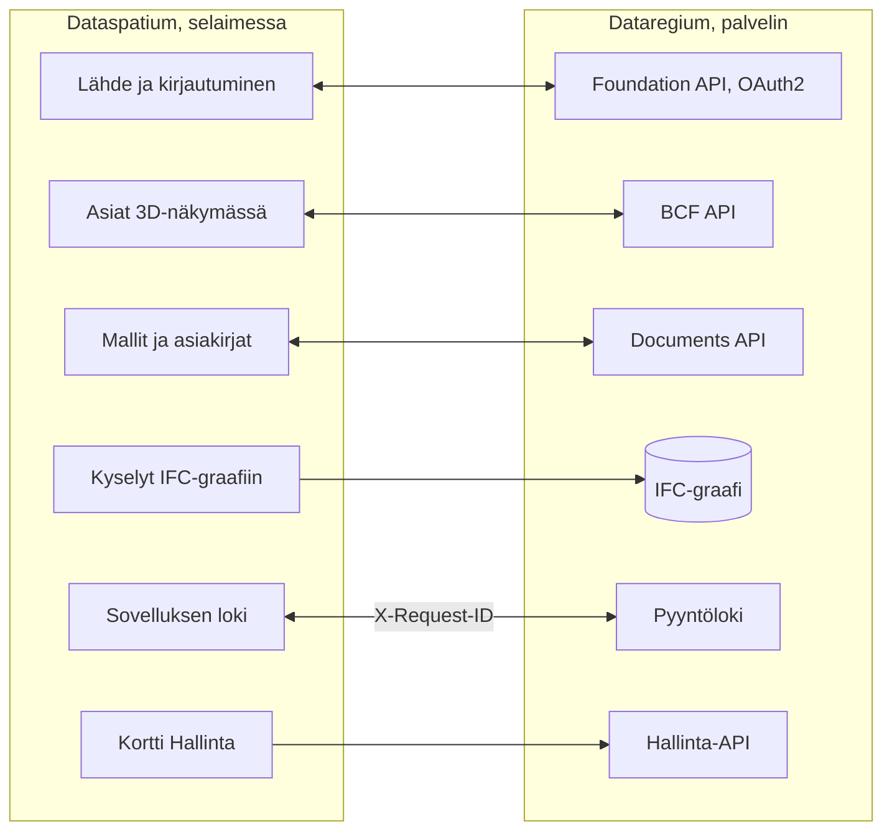

[Svenska](../../README.md) · [Dansk](../da/README.md) · [Norsk bokmål](../nb/README.md) · [Norsk nynorsk](../nn/README.md) · **Suomi** · [Íslenska](../is/README.md) · [English](../en/README.md)

# Dataspatium OpenCDE-asiakas

Dataspatium on verkkosovellus datan käsittelyyn lähteestä raporttiin: nouda dataa tiedostoista ja avoimista
rajapinnoista, tallenna ja hallitse aineistoja, tarkista ja korjaa arvoja, analysoi R:llä, visualisoi ja vie. Kaikki toimii
omassa selaimessasi. Ei palvelinta, ei asennusta, ei tilejä. Datasi ei koskaan poistu tietokoneelta, ellet itse vie sitä. Turvallisuus on ensimmäinen vaatimus: ei verkkokutsuja ilman toimintaasi ja suostumustasi, salaisuudet vain salattuina, komponentit kiinnitettyinä ja tarkistettuina, ja kaikki jaettava tarkistetaan ensin.

**Sisältö**

- [Lataa ja aloita](#lataa-ja-aloita)
- [Vaatimukset](#vaatimukset)
- [Mitä voit tehdä](#mitä-voit-tehdä)
- [OpenCDE-rajapinnat ja niiden asiakasohjelmat](#opencde-rajapinnat-ja-niiden-asiakasohjelmat)
- [Dataspatium ja Dataregium](#dataspatium-ja-dataregium)
- [Lue lisää](#lue-lisää)
- [Rajoitukset lyhyesti](#rajoitukset-lyhyesti)
- [Henkilötiedot](#henkilötiedot)
- [Seuraavaksi 3-sarjassa](#seuraavaksi-3-sarjassa)
- [Virheet ja ehdotukset](#virheet-ja-ehdotukset)
- [Kehitys](#kehitys)
- [Lisenssi](#lisenssi)

Käyttöliittymä on saatavilla ruotsiksi, tanskaksi, norjaksi (bokmål ja nynorsk), suomeksi, islanniksi ja englanniksi. Dokumentaation
kuvakaappaukset näyttävät sovelluksen ruotsiksi.

## Lataa ja aloita

1. **Lataa.** Siirry [uusimpaan julkaisuun](https://github.com/marwiss/Dataspatium/releases/latest) ja lataa ZIP-tiedosto
   kohdasta *Assets* (`dataspatium-<versio>.zip`, noin 100 Mt; R ja kaikki R-paketit ovat mukana).
2. **Pura.** Napsauta ZIP-tiedostoa hiiren kakkospainikkeella ja valitse *Pura kaikki* (Windows) tai kaksoisnapsauta sitä
   (macOS). Sijoita kansio haluamaasi paikkaan, esimerkiksi Tiedostot-kansioon. Sovellus ei toimi suoraan ZIP-tiedoston
   sisältä.
3. **Avaa.** Kaksoisnapsauta kansion `index.html`-tiedostoa tai vedä se selainikkunaan. Jos Windows kysyy, millä sovelluksella
   tiedosto avataan, valitse Edge, Chrome tai Firefox. Ensimmäisellä kerralla sovellus kysyy, mitä kieltä haluat käyttää
   (sen voi vaihtaa oikean yläkulman kielipainikkeella), ja aloittaa sitten **peruskurssin**, noin kymmenen minuutin
   vuorovaikutteisen läpikäynnin kaikista tiloista esimerkkidatalla. Avaa se uudelleen ohjeesta (?).
4. **Tuo.** Pudota *Nouda*-tilassa tiedosto alueelle (tai napsauta *Kokeile esimerkkidatalla*), tarkista saraketyypit ja
   napsauta *Tuo*. Aineisto tallennetaan tietokoneesi selaimeen.
5. **Jatka.** Vaihda tilaa yläreunasta: *Hallitse* näyttää aineistosi ja työtilan, *Hae* löytää niistä rivejä,
   *Muokkaa* näyttää taulukon lajittelun, suodattimien ja toimintojen kanssa, *Analysoi* avaa R- ja SQL-konsolin,
   *Visualisoi* rakentaa kaavioita, *Vie* lataa dataa, kaavioita ja asiakirjoja ja *Jaa* antaa ne muille.

Data tallennetaan selaimen omaan tietokantaan. Jos tyhjennät sivustotiedot, data katoaa, joten tee varmuuskopio
säännöllisesti kohdassa *Hallitse > Työtila*. Varmuuskopio on ZIP-tiedosto, jonka voi palauttaa samalle tai toiselle
tietokoneelle. Vaihe vaiheelta ja tarkemmin: [kom-igang.md](kom-igang.md).

Sovellus on myös suoraan verkossa ilman latausta: <https://marwiss.github.io/Dataspatium/>. Verkkopalvelimelta sen
voi asentaa omaksi sovellukseksi (Edge ja Chrome: *Asenna* osoiterivillä), ja se toimii sen jälkeen myös ilman
verkkoa. Verkkoversiolla ja kansioversiolla on erilliset työtilat; siirrä dataa niiden välillä varmuuskopiolla tai
paketilla.

## Vaatimukset

- Windows, macOS tai Linux.
- Microsoft Edge tai Google Chrome (versio 120 tai uudempi) tai Firefox (versio 128 tai uudempi). Safaria ei tueta.
- Noin 300 Mt vapaata tilaa sovelluskansiolle ja vähintään 4 Gt muistia (8 Gt suositellaan suurille aineistoille).
  Järjestelmänvalvojan oikeuksia ei tarvita.
- Internetiä tarvitaan vain, kun noudat dataa avoimista rajapinnoista, lähetät GitHubiin, tarkistat päivitykset tai
  noudat komponentin tai R-paketin, joka ei tule kansion mukana; sovellus kysyy ensin lupaa.

## Mitä voit tehdä

Mikä toimii yhdessä versiossa, toimii myös seuraavassa. Kukin versio kuuluu yhteen saman Dataregium-version kanssa.

### Versio 1 (Dataregium 1:n kanssa)

- **Noutaa**: tiedostoja noin neljässäkymmenessä muodossa laskentataulukoista ja tilastotiedostoista paikkatietoon ja asiakirjojen
  taulukoihin sekä dataa pohjoismaisten ja eurooppalaisten viranomaisten avoimista rajapinnoista tallennetuin noudoin (ks.
  [Avoimet rajapinnat](api-konfiguration.md)).
- **Muokata**: lajitella, suodattaa, puhdistaa, tyypittää, koodata uudelleen, pivotoida ja yhdistää, datan laatusäännöin,
  pseudonymisoinnilla, kumoamisella, versioilla ja resepteillä (ks. [Muokkaa](bearbeta.md)).
- **Analysoida**: R ggplot2:lla ja tidyversellä, SQL, raporteiksi muuttuvat muistikirjat ja säännölliset lausekkeet, kaikki selaimessa
  (ks. [R](r-guide.md)).
- **Kaavat**: ruotsalaiset asemakaavat ja yleiskaavat kaavakarttoina Boverketin värein ja merkinnöin (ks. [Kaavat](planer.md)).
- **Visualisoida ja dokumentoida**: kaavioita Vega-Litellä, D3:lla tai R:llä, kojelautoja ja raportteja malleista HTML-, Word-, PDF-,
  PowerPoint- tai LaTeX-muodossa (ks. [Visualisoi](visualisera.md)).
- **Viedä ja jakaa**: dataa noin kymmenessä muodossa, paketteja, kommentteja, varmuuskopio, synkronointi GitHubiin ja siirrettävä kansio.
- **Dataregium lähteenä**: asiakirjat haetaan aineistoiksi, ja aineistot ja tiedostot lähetetään takaisin (Documents API).
- **Kuusi kieltä ja peruskurssi**: ruotsi, tanska, norja (bokmål), suomi, islanti ja englanti, vuorovaikutteinen kurssi kaikkien tilojen
  läpi ja komentopaletti (Ctrl+K), joka löytää kaiken.

### Myös versiossa 2 (Dataregium 2:n kanssa)

- **Lisää lähteitä**: tietokannat, avoin paikkatieto ja WMS, asiakirjat ja kuvat kokoelmina sekä teksti skannatuilta sivuilta (ks.
  [Lähteet](kallor.md)).
- **Kartat, kaavat ja verkot**: karttanäkymät tasoineen ja paikkatietotyökaluineen, kaavat koko Pohjolasta sekä verkot, joita
  piirretään, kysellään Cypherillä ja muokataan (ks. [Kartat](kartor.md) ja [Verkot](grafer.md)).
- **CAD ja BIM**: IFC-mallit 3D:nä taulukoineen, ominaisuuksineen ja määrineen sekä DXF-piirustukset (ks. [CAD ja BIM](cad-bim.md)).
- **Python ja tilastot ilman koodia**: Python-konsoli sekä tilastojen ja aikasarjojen lomakkeet, jotka kirjoittavat koodin puolestasi
  (ks. [Tilastot](statistik.md)).
- **Hakea ja pitää järjestystä**: *Hae*-tila faseteilla ja tallennetuilla listoilla, kyselyt ilman koodia, kansiot, tunnisteet ja
  joukkotoiminnot (ks. [Hae](soka.md)).
- **Jaa ja Mobiili**: *Jaa*-tila paketteineen ja julkaisuineen, henkilötietojen tarkistus ennen jakamista, siirto QR-koodilla ja
  *Dataspatium Mobiili* näyttämiseen ja keräämiseen maastossa (ks. [Jaa](dela.md)).
- **Työnkulut ja lajit**: tallennetut ketjut, jotka ajetaan yhdellä napsautuksella, seuratut lähteet ja tilat, jotka tunnistavat
  aineiston lajin ja tarjoavat oikeat näkymät ja työkalut (ks. [Tilat](lagen.md)).
- **Dataregium asioineen**: mallit ja asiat palvelimelta, asiat 3D-näkymästä, BCF-tiedostot, palvelimen IFC-graafi, ylläpito ja kortti Projektin jäsenet projektin vastuuhenkilölle (ks.
  [Dataspatium ja Dataregium](#dataspatium-ja-dataregium)).
- **Seitsemän kieltä**: myös nynorsk, sovelluksen käsikirjan ja kaikkien kahdeksan tilan peruskurssin kanssa.

### Myös versiossa 3 (Dataregium 3:n kanssa)

- **Mallien tarkistus**: kortti *Validoi malli* palvelimen ja sovelluksen tarkistuksin sekä törmäystarkistus, jonka tulokset ovat
  BCF-asioita (ks. [CAD ja BIM](cad-bim.md)).
- **Tekoälymallinnus**: *Kysy tekoälyltä mallista* ja *Muuta tekoälyllä*, joissa tekoäly ehdottaa, ja sinä esikatselet 3D:nä ja
  hyväksyt; tekoäly ei koskaan voi tallentaa tai julkaista.
- **Versiot Dataregiumia vasten**: julkaisu perusversiolla, esitarkistus, muutosehdotukset, joita palvelin kokeilee ja manager
  hyväksyy, sekä *Vertaa versioita* 3D:nä merkittynä.
- **Lisäksi**: hyväksynnän ristiriidat, jotka ratkaiset sovelluksessa, mallin suhteiden tarkistus, joka estää sen, minkä
  muutosjoukko rikkoo, tekoäly, joka esikatselee ja korjaa oman muutosjoukkonsa, palvelimen IFC-graafi runkomuodossa ja
  rakennusosan lähellä olevat rakennusosat, paikallinen Dataregium omalla tietokoneella ja Sundsvallin WFS paikkatietolähteiden joukossa.

## OpenCDE-rajapinnat ja niiden asiakasohjelmat

OpenCDE on buildingSMART Internationalin avointen web-rajapintojen perhe yhteiselle dataympäristölle, paikalle, jossa projekti jakaa
mallinsa, asiakirjansa ja asiansa. Asiakasohjelma ja palvelin, jotka noudattavat samoja määrittelyjä, voivat toimia yhdessä riippumatta
siitä, kuka ne on rakentanut. Dataspatium käyttää kaikkia kolmea:

| Rajapinta | Mitä sovellus tekee sillä | Määrittely |
|---|---|---|
| Foundation API 1.0 | Lukee, mitä rajapintoja palvelin tarjoaa, missä kirjaudutaan ja kuka käyttäjä on; rekisteröi sovelluksen asiakkaaksi, kun palvelin sallii sen | [foundation-API](https://github.com/buildingSMART/foundation-API) |
| BCF API 3.0 ja 2.1 | Lukee ja kirjoittaa mallia koskevia asioita kommentteineen ja viewpointeineen (kamera, komponentit ja kuvat) 3D-näkymästä; valitsee uusimman version, jota palvelin tarjoaa | [BCF-API](https://github.com/buildingSMART/BCF-API) |
| Documents API 1.0 | Valitsee ja hakee asiakirjoja ja versioita palvelimen omien sivujen kautta, jolloin IFC-mallista tulee aineisto, ja lataa uusia versioita, aineistoja ja paketteja | [documents-API](https://github.com/buildingSMART/documents-API) |

**Dataregium on yksi palvelin, ei ainoa.** Sovelluksen pitää voida yhdistyä jokaiseen määrittelyjä noudattavaan palvelimeen: mikään
sovelluksessa ei riipu Dataregiumista, ja Dataregiumin määrittelyjen ulkopuoliset laajennukset (kyvykkyysasiakirja, nimetyt
graafikyselyt, esitarkistus, perusversio, muutosehdotukset ja versioiden välinen diff) näkyvät vain, kun palvelin itse ilmoittaa
niistä. Sovellus tarvitsee palvelimelta kolme asiaa:

- että palvelin sallii kutsut selaimesta (CORS) sovelluksen osoitteesta: `null`, kun sovellus avataan file://-osoitteesta,
  `http://127.0.0.1:8080` paikalliselta web-palvelimelta ja `https://marwiss.github.io` verkosta, otsakkeineen Authorization,
  Content-Type ja X-Request-ID;
- asiakasrekisteröinnin, jonka tekee palvelimen ylläpitäjä (julkinen asiakas, jonka uudelleenohjausosoite on
  `http://127.0.0.1:8080/oauth-callback.html` tai vastaava sovelluksen tarjoiluosoitteelle) tai sovellus itse, kun palvelin sallii
  sen, sekä kirjautumisen OAuth2 authorization code -kululla ja PKCE `S256`:lla; file://-osoitteesta liität osoitteen, johon päädyt
  kirjautumisen jälkeen;
- BCF API 3.0:n tai 2.1:n; Documents API on valinnainen, mutta ilman sitä sovellus ei voi hakea tai julkaista asiakirjoja.

Toistaiseksi tämä on osoitettu Dataregiumia vasten: live-testit ajetaan palvelinta vasten BCF API:n molemmilla versioilla, ja
pelkän 2.1:n palvelin toimii. Muita palvelimia ei ole kokeiltu; kerro, miten kävi, kohdassa [Virheet ja ehdotukset](#virheet-ja-ehdotukset).
Kun sovellus ja määrittely ovat ristiriidassa, määrittely ratkaisee. Palvelimen puoli kuvataan Dataregiumin README:ssä ja
asiakasoppaassa; sovelluksen puoli tiedostossa [kallor.md](kallor.md).

## Dataspatium ja Dataregium

*Dataregiumin nimi oli Kontroll 8. marraskuuta 2026 asti.*

Dataspatium (selaimessa toimiva sovellus) ja [Dataregium](https://github.com/marwiss/Dataregium) (palvelin buildingSMARTin OpenCDE-rajapinnoille Foundation, BCF
ja Documents) on kehitetty toimimaan yhdessä asiakkaana ja palvelimena. Sovellus lisää palvelimen lähteeksi Nouda-tilassa, kirjautuu
OAuth2:lla ja rekisteröi itsensä asiakkaaksi, kun palvelin sallii sen, noutaa projektin mallit ja asiakirjat, lukee ja kirjoittaa
asioita viewpointeineen 3D-näkymästä, lähettää aineistoja, tiedostoja ja työtilapaketteja takaisin Documents API:n kautta, kyselee
palvelimen IFC-graafia Cypherillä ja kirjaa jokaisen kutsun samalla X-Request-Id-tunnisteella, jonka palvelin kirjoittaa omaan
pyyntölokiinsa. Graafikyselyt ja hallinta ovat määrittelyjen ulkopuolisia lisäyksiä; kaikki muu kulkee kolmen OpenCDE-rajapinnan kautta, joten
myös muut OpenCDE-asiakkaat toimivat. Palvelinta ei tarvita sovelluksen muihin osiin: ilman palvelinta kaikki muu toimii kuten ennen. Dataregiumin README ja
`docs/client-guide.md` kuvaavat yhteistyön palvelimen puolelta; tässä se kuvataan tiedostoissa [kallor.md](kallor.md) ja
[cad-bim.md](cad-bim.md).

Näin ne liittyvät toisiinsa:

Sovellus puhuu BCF API -versioita 3.0 ja 2.1, joten se muodostaa yhteyden myös palvelimiin, joilla on vain 2.1, ja se piirtää palvelimen IFC-verkon ja tekee siihen kyselyjä suoraan kohdasta Nouda.

Dataspatium 3.0.0 toimii Dataregium 3.0.0:n kanssa. Molemmat saavat saman julkaisunumeron, joten sama numero kuuluu yhteen. Pika-aloitus
[snabbstart.md](snabbstart.md) vie parin tyhjästä asiaan kahdessakymmenessä minuutissa.

### Julkaisut 1, 2 ja 3

Jokaista päänumeroa kohden on yksi julkaisu, ja samannumeroiset Dataspatium ja Dataregium kuuluvat yhteen:

| Dataspatium | Mitä siinä on | Kuuluu yhteen |
|---|---|---|
| 1.0.0 | Koko 1-sarja: tiedonhaku, käsittely, R, Python, kartat, kaaviot, asiakirjat ja jakaminen sekä kaavat. Palvelinta vasten vain Documents API: hae asiakirjoja aineistoiksi ja lähetä aineistoja ja tiedostoja takaisin. Ei asioita eikä malleja | Dataregium 1.0.0 (vain Documents API) |
| 2.0.0 | Koko 2-sarja: IFC-mallit 3D:nä taulukoineen, ominaisuuksineen ja määrineen, asiat viewpointeineen (BCF API 3.0 ja 2.1), palvelimen IFC-graafi (IFC-LPG) piirrettynä ja kyseltynä sekä kaavat suunnittelutyökaluista täysin sekä kortti Projektin jäsenet projektin vastuuhenkilölle | Dataregium 2.0.0 |
| 3.0.0 | 3-sarja: kortti *Validoi malli*, törmäystarkastus selaimessa, BCF-kamerat mallin koordinaateissa, graafi runkomuodossa, Kysy tekoälyltä ja Muuta tekoälyllä, Vertaa versioita, julkaisu perusversiolla ja esitarkistus, muutosehdotukset, jotka kokeillaan ja hyväksytään palvelimella | Dataregium 3.0.0 |

Uusi julkaisu samassa päänumerossa korvaa edellisen; vain kunkin sarjan uusin korjataan. Sovelluksen päivitystarkistus tarjoaa
seuraavan päänumeron, ja aineistot, luettelot, kaaviot, mallipohjat ja skriptit seuraavat mukana, kun avaat uuden version `index.html`-tiedoston.

## Lue lisää

Tiedostonimet ovat samat kaikilla kielillä (ruotsinkieliset alkuperäiset), joten linkit toimivat samoin kaikkialla.

- **Käsikirja** sovelluksessa: sama dokumentaatio kuin täällä, haulla varustettuna; avaa se oikean yläkulman
  ?-painikkeella tai F1:llä.
- **Peruskurssi** sovelluksessa: vuorovaikutteinen läpikäynti kaikista tiloista esimerkkidatalla; avaa se ohjeesta (?)
  tai näppäimillä Ctrl+K.
- [Aloitusopas](kom-igang.md): vaihe vaiheelta ja yleiset kysymykset.
- [Pika-aloitus Dataregiumin kanssa](snabbstart.md): kaksikymmentä minuuttia tyhjästä 3D-näkymässä luotuun asiaan, joka näkyy palvelimella.
- [Käyttöopas](anvandarguide.md): koko työnkulku tiedostosta raporttiin.
- [Usein kysytyt kysymykset](faq.md): tallennus, tietoturva, R, rajapinnat ja päivitykset.
- [Kahdeksan tilaa](lagen.md): mitä on missä ja miksi.
- [Hae](soka.md) ja [Jaa](dela.md): löydä ilman koodia ja anna tietoa muille.
- [Dataspatium Mobiili](mobil.md): puhelin kuriirina, vastaanottajana ja katselimena; siirto laitteiden välillä.
- [Muistikirja](anteckningsbok.md): tekstiä, R:ää ja SQL:ää soluissa, joista syntyy raportti.
- [Asiakirjat ja kuvat](dokument.md): PDF, Word, OpenDocument, Markdown ja kuvat aineistoina; asiakirjanäkymä, galleria ja työkalut Teksti ja Kuvat.
- [Kartat](kartor.md): kartta Muokkaa-tilassa, karttanäkymät Visualisoi-tilassa, paikkatietotyökalut ja QGIS-projektit.
- [Säännölliset lausekkeet](regex.md): kuviot tekstin analysointiin, korjaamiseen ja jakamiseen aineistoissa.
- [Tiedostomuodot ja tuonti](format.md): tiedostomuodot, merkistökoodaus, desimaalierotin, päivämäärät ja saraketyypit.
- [Avoimet rajapinnat](api-konfiguration.md): valmiit lähteet, avaimet ja omat määritykset.
- [R Dataspatiumissa](r-guide.md): R-konsoli, `dm_read()`, `dm_write()` ja mukana tulevat paketit.
- [Python Dataspatiumissa](python.md): Python-konsoli, `dm_read()`, `dm_write()` ja tarvittaessa haettavat paketit.
- [Visualisoi](visualisera.md): kaaviorakentaja, D3-mallit, R-kaaviot, kartat ja kojelaudat.
- [Asiakirjat ja mallit](dokumentmallar.md): mallikieli ja tulostusmuodot.
- [Turvallisuus](sakerhet.md): uhkamalli, kontrollit ja niitä todistavat testit, henkilötiedot ja säilytys sekä miten haavoittuvuudesta ilmoitetaan.
- [Lisenssit](licenser.md): mitä sovelluksella saa tehdä ja mitkä lisenssit kolmannen osapuolen osilla on.
- Miten osallistumiset otetaan vastaan, kerrotaan tiedostossa [CONTRIBUTING.md](../../CONTRIBUTING.md) (ruotsiksi).

### Lisälukemista

- [BCF API](https://github.com/buildingSMART/BCF-API), [Foundation API](https://github.com/buildingSMART/foundation-API) ja [Documents API](https://github.com/buildingSMART/documents-API): määrittelyt, joita sovellus noudattaa palvelinta vasten.
- [IFC](https://github.com/buildingSMART/IFC4.x-development): rakennusmallien tiedostomuoto, ja [IDS](https://github.com/buildingSMART/IDS): vaatimusmäärittelyt, joita vasten malleja tarkistetaan.
- Ulkoiset lähteet: [WebR](https://docs.r-wasm.org/webr/latest/), [R aloittelijoille](https://www.r-project.org/),
  [Vega-Lite](https://vega.github.io/vega-lite/), [Tilastokeskuksen rajapinnat](https://stat.fi/fi/palvelut/tilastodatapalvelut/avoin-data-ja-rajapinnat).

## Rajoitukset lyhyesti

- Sovellus on avattava puretusta kansiosta (file://) tai tavalliselta verkkopalvelimelta; se ei toimi suoraan ZIP-tiedoston
  sisältä.
- Rajapintoja, joilla ei ole CORS-tukea, ei voi kutsua suoraan selaimesta.
- Aineiston kannattaa pysyä alle parin miljoonan rivin; selaimen muisti asettaa rajan.
- Kun sovellus avataan kansiosta, R-koodia ei voi keskeyttää kesken laskennan; käytä toimintoa *Käynnistä R
  uudelleen*. Verkkopalvelimelta (localhost tai https) ajettaessa käytössä on painike *Keskeytä*.
- Useat välilehdet toimivat ja pitävät toisensa ajan tasalla, mutta älä muokkaa samaa aineistoa kahdessa välilehdessä
  yhtä aikaa: viimeksi tallentava voittaa.
- Siirrettävä kansio vaatii Edgen tai Chromen; Firefoxista puuttuu kansioiden käyttö (File System Access). ZIP-varmuuskopio
  toimii kaikkialla.
- Koko sovellus on tehty tietokoneille; puhelimissa ja tableteissa käytetään Dataspatium Mobiilia
  (<https://marwiss.github.io/Dataspatium/m/>), joka vastaanottaa, näyttää ja jakaa edelleen. Safaria ei tueta koko
  sovelluksen osalta. Kapeissa ikkunoissa paneelit avautuvat työalueen päälle.
- Mukana tulevat esimerkkidata ja karttarajat ovat ruotsalaisia; itse sovellus toimii datan kanssa mistä tahansa.

## Henkilötiedot

Dataspatium toimii selaimessasi, ja vastaat itse syöttämistäsi tiedoista. Kaikki, mitä sovellus tallentaa (aineistot versioineen,
luettelot, kaaviot, asiakirjat, muistikirjat, kommentit ja asetukset), on selaimen tallennustilassa tietokoneellasi ja lähtee sieltä
vain, kun viet, jaat tai julkaiset; silloin kaikki tarkastetaan ensin kokonaisuudessaan, ja henkilötiedot voidaan säilyttää,
pseudonymisoida tai poistaa kopiosta. Dataregium-palvelimelle lähetetään kirjautumisesi (tunnukset pidetään istunnossa tai salattuina
salalauseellasi, ei koskaan selväkielisinä), nimelläsi palvelimelle luomasi asiat, kommentit, ehdotukset ja tiedostot sekä
X-Request-ID jokaista kutsua kohden; palvelimen oma käsittely on kuvattu Dataregiumin README:ssä. Tekoälytoimittajalle lähetetään
vain se, mitä kysyt, ja vastaukset, jotka työkalut lukevat mallista, AI-tarkoitukseen annetun suostumuksen jälkeen, omalla
salattuna tallennetulla avaimellasi; projektin käytäntö voi rajata paikallisiin malleihin. Kommentit ja paketit kantavat itse
antamaasi nimeä. Kontrollit ja ne osoittavat testit ovat tiedostossa [sakerhet.md](sakerhet.md).

## Seuraavaksi 3-sarjassa

3.0.0 on 3-sarjan ensimmäinen julkaisu, tehty yhdessä Dataregium 3.0.0:n kanssa: mallien tarkistus, törmäystarkastus, tekoälyvaiheet
ja versiovertailu, jotka [Mitä voit tehdä](#mitä-voit-tehdä) kuvaa. Kuten jokaisella päänumerolla, sarjalla on yksi julkaisu, joka
julkaistaan uudelleen sen kasvaessa. Seuraava tekee sovelluksesta asiakasohjelman, joka muokkaa palvelimen mallia ja näyttää sen
versiot: tekoäly ehdottaa, ihminen tarkastaa ja hyväksyy, palvelin kokeilee ja yhdistää. Tämä osio kertoo, mitä on päätetty, sille,
ihmiselle tai tekoälyagentille, joka vie osan siitä eteenpäin; palvelimen puoli on Dataregiumin README:ssä saman otsikon alla.

### Päätetty

- **Mallinnus tapahtuu sovelluksessa, ei palvelimella.** Mallinnuspyörä (kirjoitustyökalut ja IfcOpenShell sovelluksen Pythonissa) on
  Dataspatiumin oma, Dataspatiumin lisenssillä, eikä sisällä koodia IFC-LPG:stä; palvelin tavoittaa sen vain rajapintojen kautta.
- **Tekoäly ehdottaa, ihminen hyväksyy.** Muutosjoukko esikatsellaan 3D:nä, tarkistetaan paikallisesti ja palvelimen esitarkistuksella
  ja sovelletaan vasta, kun hyväksyt; poisto vahvistetaan vielä kerran; julkaisu ja ehdotus palvelimelle ovat painikkeita, eivät
  koskaan työkaluja, joita tekoäly voi kutsua. Rakennettu 3.0.0:ssa.
- **Versiomalli.** Muutosjoukko lähetetään palvelimelle BCF-asiana, jonka snippet on palvelimen muodossa (GlobalId ja polku
  avaimena), palvelin kokeilee sitä perusversiota vasten ja *manager* hyväksyy sen seuraavaksi versioksi; vanhentuneella perusversiolla
  tehty julkaisu hylätään (412) ja ristiriidat näytetään. Rakennettu 3.0.0:ssa, samoin kuin valinta ristiriidoissa,
  joita palvelin ei voi yhdistää, palvelimen muutosjoukko versiota kohden ja BCF-asia jokaista hyväksyttyä muutosjoukkoa kohden.
- **Vertaa versioita** kolmesta lähteestä: tilannekuvat ja muut mallit sovelluksessa, palvelimen muutosjoukko versiota kohden ja
  palvelimen diff versioiden välillä. Rakennettu 3.0.0:ssa.
- **Projektin hallinnoijalla** on sovelluksessa kortti *Projektin jäsenet*: jäsenet, roolit ja projektin nimi. Rakennettu
  versioissa 2.0.0 ja 3.0.0.
- **Vaiheet 4 ja 5, vaiheen 3 jälkeen:** repositoriotila projektia kohden paikallisella Dataregiumilla omalla tietokoneella sekä haku
  ja julkaisu paikallisen ja etäpalvelimen välillä; suuret mallit piirrettynä palvelimen geometriarajapinnasta, kun selain ei riitä;
  projektiprofiilit IDS:llä ja bSDD:llä, tekoälyn kirjoittamat IDS:t ja elementteihin sidotut buildingSMART-säännöt.
- **Avoimet formaatit** koskevat vaihtoformaatteja ja tallennettua dataa, eivät tekoälyrajapintoja; käyttäjä valitsee
  tekoälytoimittajan omalla avaimellaan, joka tallennetaan salattuna, ja projektin käytäntö voi rajata paikallisiin malleihin.

## Virheet ja ehdotukset

Ilmoita virheistä tai toiveista *Issues*-kohdassa täällä GitHubissa. Kerro selain, Dataspatiumin versio (näkyy
ohjepainikkeen alla) ja mitä teit. Ks. [CONTRIBUTING.md](../../CONTRIBUTING.md). Älä liitä henkilötietoja tai salaisuuksia. Tietoturvahaavoittuvuudesta
ilmoita [SECURITY.md](../../SECURITY.md):n mukaan sen sijaan, että avaisit issuen.

## Kehitys

- Ei käännösvaihetta, ei node.js:ää. Avaa `index.html` suoraan tai tarjoile kansio komennolla `python -m http.server 8080`.
- Arkkitehtuuri lyhyesti: kaikki sovelluksen oma koodi on perinteisiä skriptejä, jotka rekisteröidään `Dataspatium.define`-kutsulla tiedoston `src/boot.js` järjestyksessä; `src/platform` sisältää kaiken file://-kohtaisen (resurssit, shimit, workerit, tallennus, suostumus); moottorit SQLite, R (WebR) ja Python (Pyodide) toimivat workereissa; `src/ui` sisältää suunnittelumuuttujat, komponentit (`dm-*`), kuoren ja yhden tilan tiedostoa kohti. Kaikki näytettävä escapetaan, eikä mitään haeta verkosta ilman toimintaasi ja suostumustasi.
- Kolmannen osapuolen osat: `python tools/fetch_vendor.py` ja sen jälkeen `python tools/wrap_assets.py`.
- Testit: `powershell -File tools/run-tests.ps1` tai `tools/run-tests.sh` (headless Edge ja Firefox).
- Turvallisuus: suostumuksen, salaisuuksien, jakamista edeltävän tarkistuksen, OAuth2:n (PKCE, state, paluu) ja lokin peittämisen testit kuuluvat testisarjaan; ks. [sakerhet.md](sakerhet.md).

## Lisenssi

Dataspatiumin oma koodi, dokumentaatio ja valmisasetukset (kaikki paitsi `vendor/`) on lisensoitu
[PolyForm Strict 1.0.0](../../LICENSE) -lisenssillä: vapaasti ladattavissa ja käytettävissä ei-kaupallisiin tarkoituksiin,
myös viranomaisissa ja muissa julkisissa laitoksissa, mutta muuttaminen, jatkokehittäminen tai edelleen levittäminen vaatii
kirjallisen luvan. Lisenssinantaja on Dataspatiumin tekijä, jonka tavoittaa GitHub-tililtä
[marwiss](https://github.com/marwiss); avaa issue, jos haluat muut ehdot. Mitä lisenssi käytännössä tarkoittaa, kerrotaan
tiedostossa [licenser.md](licenser.md).

Kolmannen osapuolen osilla kansiossa `vendor/` on omat lisenssinsä (MIT, BSD, Apache-2.0, ISC, OFL, MPL, LGPL ja GPL), ks.
[THIRD_PARTY_LICENSES.md](../../THIRD_PARTY_LICENSES.md). R ja GPL-lisensoidut R-paketit levitetään muuttamattomina;
lähdekoodi on saatavilla [R-projektilta](https://cran.r-project.org/sources.html), [webR:ltä](https://github.com/r-wasm/webr)
ja [CRANista](https://cran.r-project.org/) mainituissa versioissa. Ks. [SECURITY.md](../../SECURITY.md): miten haavoittuvuudesta ilmoitetaan
ja mitä projekti tekee pysyäkseen turvallisena.
