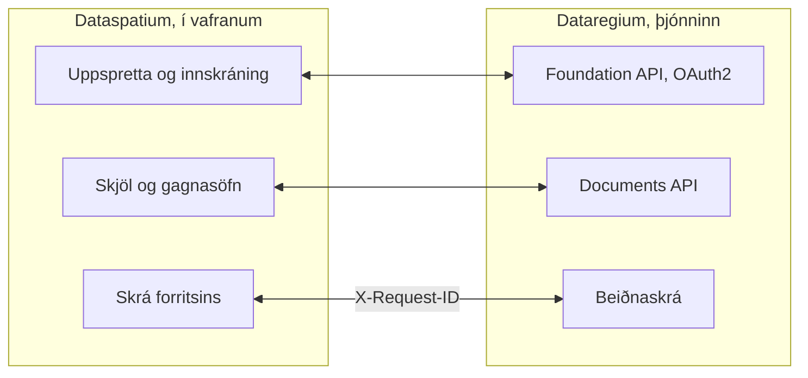

[Svenska](../../README.md) · [Dansk](../da/README.md) · [Norsk](../nb/README.md) · [Suomi](../fi/README.md) · **Íslenska** · [English](../en/README.md)

# Dataspatium OpenCDE-biðlari

*Þetta er README fyrir Dataspatium 1.0.0. Nýjasta útgáfan, 3.0.0, er lýst í [README á main](https://github.com/marwiss/Dataspatium/blob/main/docs/is/README.md).*

Dataspatium er forrit til að vinna með gögn sem þú opnar í venjulega vafranum þínum. Þú sækir töflu, kort, skipulag eða tölfræði frá
stofnun, leiðréttir hana og reiknar, gerir myndrit og skýrslur og sendir niðurstöðuna áfram. Allt gerist í þinni eigin tölvu: engin
uppsetning, enginn aðgangur og enginn þjónn. Ekkert fer úr tölvunni nema þú flytjir það út eða deilir því sjálf(ur), og forritið spyr alltaf
áður en það notar internetið.

Dataspatium getur líka sótt skjöl úr [Dataregium](https://github.com/marwiss/Dataregium), þjóni þar sem byggingarverkefni geymir skjöl
sín, og sent gagnasöfn og skrár til baka sem nýjar útgáfur. Án Dataregium virkar allt annað nákvæmlega eins.

**Fyrir þau sem kunna tæknina:** kyrrstætt vefforrit án smíðaskrefs sem keyrir frá `file://` í Edge, Chrome og Firefox eða frá hvaða
kyrrstæða vefþjóni sem er. Hvert gagnasafn er SQLite-skrá (sql.js) í IndexedDB, og R keyrir í WebR 0.5.9 í worker. Gagnvart þjóni er
forritið OpenCDE-biðlari fyrir Foundation API 1.0, með OAuth2 authorization code og PKCE, og Documents API 1.0. Engin netköll eru gerð án
samþykkis fyrir hvern tilgang, og leyndarmál eru aðeins geymd dulkóðuð (AES-GCM).

**Efni**

- [Sækja og hefjast handa](#sækja-og-hefjast-handa)
- [Kröfur](#kröfur)
- [Orð sem gott er að þekkja](#orð-sem-gott-er-að-þekkja)
- [Hvað þú getur gert](#hvað-þú-getur-gert)
- [OpenCDE-forritaskilin og biðlarar þeirra](#opencde-forritaskilin-og-biðlarar-þeirra)
- [Dataspatium og Dataregium](#dataspatium-og-dataregium)
- [Lærðu meira](#lærðu-meira)
- [Takmarkanir í stuttu máli](#takmarkanir-í-stuttu-máli)
- [Persónuupplýsingar](#persónuupplýsingar)
- [Nýrri útgáfur](#nýrri-útgáfur)
- [Villur og tillögur](#villur-og-tillögur)
- [Þróun](#þróun)
- [Leyfi](#leyfi)

## Sækja og hefjast handa

1. **Sæktu.** Farðu í [útgáfu 1.0.0](https://github.com/marwiss/Dataspatium/releases/tag/v1.0.0) og sæktu ZIP-skrána undir *Assets*
   (`dataspatium-1.0.0.zip`, um 95 MB; R og algengustu R-pakkarnir fylgja með).
2. **Afþjappaðu.** Hægrismelltu á ZIP-skrána og veldu *Extract all* (Windows) eða tvísmelltu á hana (macOS). Settu möppuna þar sem þú vilt
   hafa hana, til dæmis í Skjöl. Forritið virkar ekki beint inni í ZIP-skránni.
3. **Opnaðu.** Tvísmelltu á `index.html` í möppunni, eða dragðu skrána inn í vafraglugga. Ef Windows spyr hvaða forrit eigi að nota velurðu
   Edge, Chrome eða Firefox. Í fyrsta sinn velurðu tungumál, og síðan er **Grunnnámskeiðið** í boði: yfirferð um alla sex hamina með
   sýnigögnum sem tekur um tíu mínútur og má opna aftur úr hjálpinni (?).
4. **Sæktu gögn.** Í hamnum *Sækja* sleppirðu skrá á flötinn, eða smellir á *Prófa með sýnigögnum*. Forritið sýnir hvað skráin
   inniheldur; smelltu á *Flytja inn*. Gagnasafnið er geymt í vafranum í tölvunni þinni.
5. **Haltu áfram.** Hamirnir efst eru skref vinnunnar: *Umsjón* heldur gagnasöfnunum þínum í röð og reglu, *Vinna* sýnir töfluna með
   hnöppum til að leiðrétta og reikna, *Greina* hefur R, SQL og reglulegar segðir, *Myndgera* gerir myndrit og kort og *Flytja út* vistar
   skrár í tölvunni og deilipakka til annarra.

Það sem þú vistar er geymt í eigin gagnagrunni vafrans í tölvunni. Ef þú hreinsar vefsvæðisgögn vafrans hverfur það, svo taktu reglulega
afrit undir *Umsjón > Vinnusvæði*. Afritið er ZIP-skrá sem má endurheimta í sömu eða annarri tölvu. Skref fyrir skref með fleiri
smáatriðum: [kom-igang.md](kom-igang.md).

Vefútgáfan á <https://marwiss.github.io/Dataspatium/> er alltaf nýjasta útgáfan, nú 3.0.0.

### Fyrir þau sem kunna tæknina

- **Keyrðu:** afþjappaðu ZIP-skrána og opnaðu `index.html` (file://), eða þjónaðu möppunni: `python -m http.server 8080 --bind
  127.0.0.1` og opnaðu <http://127.0.0.1:8080/>. Frá vefþjóni er service worker, forrit sem má setja upp, og R sem má stöðva.
- **Prófaðu ZIP-skrána:** berðu SHA-256 hennar saman við það sem stendur í texta útgáfunnar (`Get-FileHash` í PowerShell,
  `shasum -a 256` á macOS og Linux).
- **Með þjóni:** ræstu Dataregium 1.0.0 með Docker eða Podman eins og README þess lýsir, þjónaðu Dataspatium á porti 8080 og bættu
  þjóninum við með *Sækja > Bæta við OpenCDE-þjóni*. Auðkenni biðlara má vera autt þegar þjónninn leyfir sjálfskráningu.
- **Prófanir:** `powershell -File tools/run-tests.ps1` keyrir allar prófanirnar í headless Edge og Firefox.

## Kröfur

- Windows, macOS eða Linux.
- Microsoft Edge eða Google Chrome (útgáfa 120 eða nýrri), eða Firefox (útgáfa 128 eða nýrri). Safari er ekki stutt.
- Um 300 MB laust pláss fyrir forritsmöppuna og að minnsta kosti 4 GB vinnsluminni (mælt er með 8 GB fyrir stór gagnasöfn). Engin
  stjórnandaréttindi þarf.
- Internet þarf aðeins þegar þú velur sjálf(ur) eitthvað sem krefst þess, og forritið biður um leyfi fyrst fyrir hvern tilgang: sækja gögn
  úr opnum forritaskilum og bakgrunnskortum, tengjast Dataregium-þjóni eða GitHub, leita að uppfærslu eða sækja R-pakka umfram þá
  algengustu.
- Dataregium þarf þjón. Til að keyra eigin þjón þarf Docker eða Podman; því er lýst í README Dataregium.

## Orð sem gott er að þekkja

Þú þarft ekki að kunna orðin hér að neðan til að nota forritið, en þau koma fyrir í textanum.

- **API (forritaskil)**: leið fyrir forrit til að sækja gögn hvert frá öðru yfir netið. Forritið sækir tölfræði úr forritaskilum stofnana
  og talar við Dataregium gegnum forritaskil þess.
- **Gagnasafn**: það sem forritið geymir þegar þú sækir eitthvað: tafla, kort eða skipulag.
- **Uppskrift**: listinn yfir allt sem þú hefur gert við gagnasafn, skref fyrir skref, svo að það megi afturkalla eða endurtaka á nýjum
  gögnum.
- **R og SQL**: tungumál til að greina gögn. Forritið hefur þau innbyggð, en flest er gert með hnöppum.
- **OpenCDE**: opnar reglur buildingSMART um hvernig forrit deila líkönum, skjölum og málum byggingarverkefnis, svo að forrit frá ólíkum
  framleiðendum vinni saman.
- **Þjónn**: forrit sem aðrir tengjast yfir netið. Dataregium er þjónn; Dataspatium þarf engan.
- **Gámur (container)**: tilbúið forrit sem er ræst með Docker eða Podman án þess að hlutar þess séu settir upp hver fyrir sig. Dataregium
  keyrir þannig; Dataspatium þarf enga gáma.
- **OAuth2-innskráning**: venjulega leiðin til að skrá sig inn í þjónustu úr öðru forriti án þess að forritið sjái lykilorðið þitt.
- **file:// og CORS**: file:// merkir að forritið er opnað beint úr möppu. CORS er regla vafrans um hvaða vefþjónustur vefforrit má sækja
  gögn til; þjónustu án CORS er ekki hægt að ná beint.

## Hvað þú getur gert

Það sem virkar í einni útgáfu virkar líka í þeirri næstu. Hver útgáfa á saman við sömu útgáfu af Dataregium.

### Útgáfa 1 (með Dataregium 1)

- **Sæktu gögn**: skrár á um fjörutíu sniðum, frá Excel og CSV til tölfræðiskráa, landupplýsinga og taflna í Word og á vefsíðum, og
  tölfræði frá stofnunum í Svíþjóð, á Norðurlöndum og í Evrópu með einum smelli (sjá [Opin forritaskil](api-konfiguration.md)).
  *Tæknilega:* stafakóðun og dálkagerðir eru greindar; SPSS, Stata, SAS, PX, Parquet og RDS gegnum R; eigin uppsprettur sem `*.api.json`.
- **Leiðréttu og reiknaðu**: um fimmtíu aðgerðir með hnöppum, eins og að hreinsa, skipta um gerð, endurkóða, reikna hlutföll, snúa og
  tengja töflur, með gæðareglum, dulnefnun kennitalna, afturköllun og útgáfum (sjá [Vinna](bearbeta.md)). *Tæknilega:* hvert skref er
  geymt í uppskrift sem má flytja út sem R- eða SQL-kóða.
- **Greindu**: R með ggplot2 og tidyverse, SQL þvert á gagnasöfn, reglulegar segðir og minnisbækur sem verða að skýrslum, alveg í vafranum
  (sjá [R](r-guide.md) og [Reglulegar segðir](regex.md)).
- **Skipulag**: sænsk deiliskipulög og aðalskipulög sem skipulagskort með litum og táknum Boverket, í eigin hnitakerfi skipulagsins (sjá
  [Skipulag](planer.md)).
- **Myndrit, kort og skjöl**: myndrit og kort með Vega-Lite, D3 eða R, mælaborð og skýrslur úr sniðmátum sem HTML, Word, PDF, PowerPoint,
  Markdown eða LaTeX (sjá [Myndgera](visualisera.md)).
- **Vistaðu og deildu**: gögn á um tíu sniðum, deilipakkar, athugasemdir, afrit, samstilling við GitHub og ferðamappa.
- **Dataregium sem skjalasafn**: sæktu skjöl af þjóninum sem gagnasöfn og sendu gagnasöfn og skrár til baka sem nýjar útgáfur.
  *Tæknilega:* Foundation API og Documents API.
- **Sex tungumál og grunnnámskeið**: sænska, danska, norska (bókmál), finnska, íslenska og enska, og skipanaspjaldið (Ctrl+K) sem finnur
  allt.

## OpenCDE-forritaskilin og biðlarar þeirra

OpenCDE eru opnar reglur buildingSMART International um hvernig forrit deila líkönum, skjölum og málum byggingarverkefnis. Forrit sem fylgir
reglunum getur unnið með hverjum þeim þjóni sem gerir það líka, sama hver smíðaði þá. Dataspatium 1.0.0 er slíkt forrit, biðlari, og notar
tvö forritaskilanna:

| Forritaskil | Hvað forritið gerir með þeim | Forskrift |
|---|---|---|
| Foundation API 1.0 | Les hvaða forritaskil þjónninn býður, hvar á að skrá sig inn og hver notandinn er; skráir forritið sem biðlara þegar þjónninn leyfir það | [foundation-API](https://github.com/buildingSMART/foundation-API) |
| Documents API 1.0 | Velur og sækir skjöl og útgáfur gegnum eigin síður þjónsins, svo að skjal verði gagnasafn, og hleður upp nýjum útgáfum, gagnasöfnum og skrám | [documents-API](https://github.com/buildingSMART/documents-API) |

Mál gegnum BCF API og byggingarlíkön komu í útgáfu 2. **Dataregium er einn þjónn, ekki sá eini.** Ekkert í forritinu er háð Dataregium;
getuskjalið, viðbót Dataregium, er aðeins notað þegar þjónninn sjálfur gefur það upp.

**Fyrir þau sem kunna tæknina:** af þjóni þarf forritið þrennt:

- CORS frá uppruna forritsins: `null` frá file://, `http://127.0.0.1:8080` frá staðbundnum vefþjóni og `https://marwiss.github.io` af
  vefnum, með hausunum Authorization, Content-Type og X-Request-ID;
- skráningu biðlara, gerða af stjórnanda þjónsins (opinber biðlari með framvísunarslóðinni `http://127.0.0.1:8080/oauth-callback.html`,
  eða samsvarandi fyrir slóð forritsins) eða af forritinu sjálfu (RFC 7591) þegar þjónninn leyfir það, og OAuth2 authorization code með
  PKCE `S256`; frá file:// límirðu inn slóðina sem þú lendir á eftir innskráningu;
- Documents API 1.0.

Þegar forritið og forskrift eru ósammála ræður forskriftin. Hlið þjónsins er lýst í README Dataregium.

## Dataspatium og Dataregium

*Dataregium hét Kontroll til 8. nóvember 2026.*

Dataspatium er forritið sem þú vinnur í, og [Dataregium](https://github.com/marwiss/Dataregium) er þjónninn þar sem verkefni geymir skjöl
sín. Þú bætir þjóninum við sem uppsprettu í *Sækja* og skráir þig inn; síðan velurðu skjöl á síðu þjónsins, færð þau sem gagnasöfn og
sendir gagnasöfn og skrár til baka sem ný skjöl eða útgáfur. Án þjóns virkar restin af forritinu eins og venjulega.

**Fyrir þau sem kunna tæknina:** allt fer gegnum Foundation API og Documents API. Hvert kall ber `X-Request-Id` sem þjónninn skrifar í
beiðnaskrá sína, svo að para megi skrá forritsins og skrá þjónsins.

Svona tengjast þau:

Dataspatium 1.0.0 virkar með Dataregium 1.0.0. Sama númer á saman.

### Útgáfurnar 1, 2 og 3

Það er ein útgáfa fyrir hvert aðalnúmer, og Dataspatium og Dataregium með sama númer eiga saman:

| Dataspatium | Hvað hún hefur | Á saman við |
|---|---|---|
| 1.0.0 | Gögn úr skrám og opnum forritaskilum, vinnsla, R, SQL og reglulegar segðir, sænskt skipulag, myndrit og kort í myndritum, mælaborð, skjöl, útflutningur og deiling. Gagnvart þjóni aðeins Documents API: sækja skjöl sem gagnasöfn og senda gagnasöfn og skrár til baka. Engin mál, engin líkön og ekkert Python | Dataregium 1.0.0 (aðeins Documents API) |
| 2.0.0 | Allt í 1.0.0 og auk þess hamirnir Leita og Deila, Python og tölfræði án kóða, fleiri uppsprettur, kortasýnir, norrænt skipulag, gröf, IFC-líkön í þrívídd með prófun gegn IDS, flæði, Dataspatium Farsími, mál með viewpoints (BCF API 3.0 og 2.1), IFC-graf þjónsins, kortið *Stjórnun* og kortið *Meðlimir verkefnisins* | Dataregium 2.0.0 |
| 3.0.0 | Allt í 2.0.0 og auk þess kortið *Sannprófa líkanið*, árekstrarprófun, Spyrja gervigreind og Breyta með gervigreind, ný auð líkön á völdu skema, Bera saman útgáfur, birting með grunnútgáfu og forprófun, breytingatillögur sem eru prófaðar og samþykktar á þjóninum með vali við árekstra, og grafið í léttara formi | Dataregium 3.0.0 |

Ný útgáfa með sama aðalnúmeri kemur í stað þeirrar fyrri; aðeins sú nýjasta í hverri röð er leiðrétt. Uppfærsluathugun forritsins býður
næsta aðalnúmer, og gagnasöfn, listar, myndrit, sniðmát og skriftur fylgja með þegar þú opnar `index.html` nýju útgáfunnar.

## Lærðu meira

Skráarheitin eru þau sömu á öllum tungumálum (þau eru sænsku frumritin), svo að tenglar virka eins alls staðar.

**Byrjaðu hér**

- **Grunnnámskeiðið** í forritinu: yfirferð um alla hamina með sýnigögnum; opnaðu það úr hjálpinni (?) eða með Ctrl+K.
- [Að hefjast handa](kom-igang.md): skref fyrir skref með algengum spurningum.
- [Notendaleiðbeiningar](anvandarguide.md): allt vinnuferlið frá skrá til skýrslu.
- [Hamirnir sex](lagen.md): hvað er hvar og hvers vegna.
- [Algengar spurningar](faq.md): geymsla, öryggi, R, forritaskil og uppfærslur.

**Eftir sviðum**

- [Snið og innflutningur](format.md) og [Opin forritaskil](api-konfiguration.md): skráarsnið, stafakóðun, forstilltu uppspretturnar,
  lyklar, eigin stillingar og OpenCDE-þjónar.
- [Vinna](bearbeta.md) og [Reglulegar segðir](regex.md): leiðrétta, reikna og finna.
- [R í Dataspatium](r-guide.md) og [Minnisbók](anteckningsbok.md): greining með kóða.
- [Myndgera](visualisera.md) og [Skjöl og sniðmát](dokumentmallar.md): myndrit, kort, mælaborð og skýrslur.
- [Skipulag](planer.md): deiliskipulag og aðalskipulag.
- [Leyfi](licenser.md): hvað þú mátt gera með forritið og hvaða leyfi íhlutir þriðja aðila hafa.
- [Þróun](../utveckling.md), [Arkitektúr](../arkitektur.md) og [Stílleiðbeiningar](../stilguide.md) fyrir þann sem vill skilja kóðann (á
  sænsku); hvernig framlögum er tekið er lýst í [CONTRIBUTING.md](../../CONTRIBUTING.md).

### Frekari lesning

- [Foundation API](https://github.com/buildingSMART/foundation-API) og [Documents API](https://github.com/buildingSMART/documents-API): forskriftirnar sem forritið fylgir gagnvart þjóni.
- Ytri tilföng: [WebR](https://docs.r-wasm.org/webr/latest/), [Vega-Lite](https://vega.github.io/vega-lite/),
  [forritaskil sænsku hagstofunnar](https://www.scb.se/en/services/open-data-api/).

## Takmarkanir í stuttu máli

- Forritið verður að opna úr afþjappaðri möppu eða venjulegum vefþjóni; það virkar ekki beint inni í ZIP-skránni.
- Vefþjónustum sem leyfa ekki köll úr vöfrum (skortir CORS, til dæmis sænska seðlabankanum) er ekki hægt að ná beint; tilgreina má eigin
  milliþjón.
- Gagnasafn ætti að vera undir nokkrum milljónum raða; minni vafrans setur mörkin.
- Þegar forritið er opnað úr möppu er ekki hægt að stöðva R-kóða í miðjum útreikningi; notaðu *Endurræsa R*. Frá vefþjóni er hnappurinn
  *Stöðva*.
- Margir flipar virka og halda hver öðrum upplýstum, en breyttu ekki sama gagnasafni í tveimur flipum í einu: sá sem vistar síðast vinnur.
- Ferðamappan krefst Edge eða Chrome; Firefox skortir möppuaðgang. Afrit sem ZIP virkar alls staðar.
- Forritið er gert fyrir tölvur; símar og spjaldtölvur eru ekki studd í útgáfu 1.
- Sýnigögn og kortamörk sem fylgja ná yfir Svíþjóð, Danmörku, Noreg og Finnland, og forstilltu uppspretturnar eru norrænar og evrópskar;
  gögn frá öðrum löndum geturðu sótt sjálf(ur) jafn auðveldlega.

## Persónuupplýsingar

Dataspatium keyrir í vafranum þínum og þú berð sjálf(ur) ábyrgð á gögnunum sem þú setur inn. Allt sem forritið vistar (gagnasöfn og
útgáfur þeirra, myndrit, skjöl, minnisbækur, athugasemdir og stillingar) er geymt í geymslu vafrans í tölvunni þinni og fer þaðan aðeins
þegar þú flytur út eða deilir. Til Dataregium-þjóns er innskráning þín send (tákn eru geymd í setunni eða dulkóðuð með lykilsetningu
þinni, aldrei í ljósu letri), gagnasöfnin og skrárnar sem þú sendir og eitt X-Request-ID fyrir hvert kall; vinnsla þjónsins sjálfs er
lýst í README Dataregium. Athugasemdir og pakkar bera nafnið sem þú gefur sjálf(ur) upp.

## Nýrri útgáfur

Dataspatium 2.0.0 bætir við hamina Leita og Deila, Python, kortasýnum, gröfum, byggingarlíkönum í þrívídd og málum með Dataregium, og 3.0.0
auk þess prófun líkana, Spyrja gervigreind og Breyta með gervigreind og útgáfum á þjóninum. Sú nýjasta er sótt úr
[nýjustu útgáfunni](https://github.com/marwiss/Dataspatium/releases/latest) og lýst í
[README á main](https://github.com/marwiss/Dataspatium/blob/main/docs/is/README.md). Gagnasöfn, listar, myndrit, sniðmát og skriftur fylgja
með þegar þú opnar `index.html` nýju útgáfunnar.

## Villur og tillögur

Tilkynntu villur eða óskir sem *Issues* hér á GitHub. Lýstu vafranum, útgáfu Dataspatium (sést undir hjálparhnappnum) og hvað þú gerðir.
Sjá [CONTRIBUTING.md](../../CONTRIBUTING.md). Hengdu engar persónuupplýsingar og engin leyndarmál við.

## Þróun

- Ekkert smíðaskref, ekkert node.js. Opnaðu `index.html` beint, eða þjónaðu möppunni með `python -m http.server 8080`.
- Arkitektúr í stuttu máli: allur eigin kóði er klassískar skriftur sem eru skráðar með `Dataspatium.define` í röðinni í `src/boot.js`;
  `src/platform` ber allt sem er sérstakt fyrir file://; vélarnar SQLite og R (WebR) keyra í workerum; `src/ui` hefur hönnunarbreyturnar,
  íhlutina (`dm-*`), skelina og einn ham í hverri skrá. Sjá [arkitektur.md](../arkitektur.md).
- Íhlutir þriðja aðila: `python tools/fetch_vendor.py` og síðan `python tools/wrap_assets.py`.
- Prófanir: `powershell -File tools/run-tests.ps1` (headless Edge og Firefox). Prófanirnar fara aldrei á netið. Sjá
  [utveckling.md](../utveckling.md).

## Leyfi

Eigin kóði Dataspatium, skjölun og forstillingar (allt nema `vendor/`) eru gefin út með leyfinu [PolyForm Strict 1.0.0](../../LICENSE):
frjálst að sækja og nota í óviðskiptalegum tilgangi, líka hjá stofnunum og öðrum opinberum aðilum, en ekki að breyta, byggja á eða dreifa
áfram án skriflegs leyfis. Leyfisveitandi er höfundur Dataspatium, sem má ná í gegnum GitHub-aðganginn [marwiss](https://github.com/marwiss);
stofnaðu issue fyrir aðra skilmála. Hvað leyfið þýðir í reynd er útskýrt í [licenser.md](licenser.md).

Íhlutir þriðja aðila í `vendor/` hafa eigin leyfi (MIT, BSD, Apache-2.0, ISC, OFL, MPL, LGPL og GPL), sjá
[THIRD_PARTY_LICENSES.md](../../THIRD_PARTY_LICENSES.md). R og GPL-leyfðu R-pakkarnir eru dreifðir óbreyttir; frumkóðinn fæst hjá
[R-verkefninu](https://cran.r-project.org/sources.html), [webR](https://github.com/r-wasm/webr) og [CRAN](https://cran.r-project.org/) í
þeim útgáfum sem þar eru tilgreindar.
