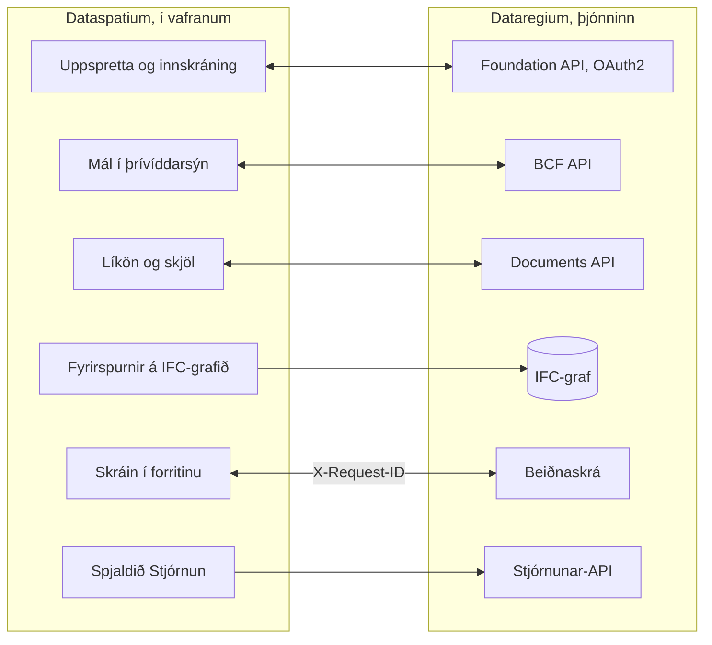

[Svenska](../../README.md) · [Dansk](../da/README.md) · [Norsk bokmål](../nb/README.md) · [Norsk nynorsk](../nn/README.md) · [Suomi](../fi/README.md) · **Íslenska** · [English](../en/README.md)

# Dataspatium OpenCDE-biðlari

Dataspatium er vefforrit fyrir gögn frá uppruna til skýrslu: sæktu gögn úr skrám og opnum vefþjónustum, vistaðu og haltu
utan um gagnasöfn, farðu yfir og leiðréttu gildi, greindu með R, myndgerðu og fluttu út. Allt keyrir í þínum eigin vafra.
Enginn þjónn, engin uppsetning, engir aðgangar. Gögnin þín yfirgefa aldrei tölvuna nema þú flytjir þau sjálf(ur) út. Öryggi er fyrsta krafan: engin netköll án aðgerðar þinnar og samþykkis, leyndarmál aðeins dulrituð, íhlutir fastsettir og staðfestir, og allt sem er deilt er fyrst yfirfarið.

**Efni**

- [Sækja og hefjast handa](#sækja-og-hefjast-handa)
- [Kröfur](#kröfur)
- [Hvað þú getur gert](#hvað-þú-getur-gert)
- [OpenCDE-forritaskilin og biðlarar þeirra](#opencde-forritaskilin-og-biðlarar-þeirra)
- [Dataspatium og Dataregium](#dataspatium-og-dataregium)
- [Lærðu meira](#lærðu-meira)
- [Takmarkanir í stuttu máli](#takmarkanir-í-stuttu-máli)
- [Persónuupplýsingar](#persónuupplýsingar)
- [Næst í 3-röðinni](#næst-í-3-röðinni)
- [Villur og tillögur](#villur-og-tillögur)
- [Þróun](#þróun)
- [Leyfi](#leyfi)

Viðmótið er á sænsku, dönsku, norsku (bókmáli og nýnorsku), finnsku, íslensku og ensku. Skjámyndirnar í skjöluninni sýna forritið á sænsku.

## Sækja og hefjast handa

1. **Sæktu.** Farðu í [nýjustu útgáfuna](https://github.com/marwiss/Dataspatium/releases/latest) og sæktu ZIP-skrána undir
   *Assets* (`dataspatium-<útgáfa>.zip`, um 100 MB; R og allir R-pakkar fylgja með).
2. **Afþjappaðu.** Hægrismelltu á ZIP-skrána og veldu *Extract all* (Windows) eða tvísmelltu á hana (macOS). Settu möppuna
   þar sem þú vilt hafa hana, til dæmis í Skjöl. Forritið virkar ekki beint inni í ZIP-skránni.
3. **Opnaðu.** Tvísmelltu á `index.html` í möppunni eða dragðu skrána í vafraglugga. Ef Windows spyr hvaða forrit eigi að
   nota velurðu Edge, Chrome eða Firefox. Í fyrsta skipti spyr forritið hvaða tungumál þú vilt (því má breyta með
   tungumálahnappnum efst til hægri) og hefur síðan **grunnnámskeiðið**, gagnvirka yfirferð yfir alla hami með
   sýnigögnum sem tekur um tíu mínútur. Opnaðu það aftur úr hjálpinni (?).
4. **Flyttu inn.** Í hamnum *Sækja* sleppirðu skrá á flötinn (eða smellir á *Prófa með sýnigögnum*), athugar gerðir dálkanna
   og smellir á *Flytja inn*. Gagnasafnið er vistað í vafranum á tölvunni þinni.
5. **Haltu áfram.** Skiptu um ham efst: *Umsjón* sýnir gagnasöfnin þín og vinnusvæðið, *Leita* finnur raðir í þeim, *Vinna*
   sýnir töfluna með röðun, síum og aðgerðum, *Greina* opnar R- og SQL-stjórnborðið, *Myndgera* býr til myndrit, *Flytja út*
   hleður niður gögnum, myndritum og skjölum og *Deila* gefur þau öðrum.

Gögn eru vistuð í eigin gagnagrunni vafrans. Ef þú hreinsar vefgögn hverfa þau, svo taktu afrit reglulega undir *Umsjón >
Vinnusvæði*. Afritið er ZIP-skrá sem má endurheimta á sömu eða annarri tölvu. Skref fyrir skref með nánari upplýsingum:
[kom-igang.md](kom-igang.md).

Forritið er líka beint á vefnum, án niðurhals: <https://marwiss.github.io/Dataspatium/>. Af vefþjóni má setja það upp
sem sjálfstætt forrit (Edge og Chrome: *Setja upp* í veffangastikunni) og það virkar síðan líka án nets. Vefútgáfan og
möppuútgáfan hafa aðskilin vinnusvæði; færðu gögn á milli þeirra með afriti eða pakka.

## Kröfur

- Windows, macOS eða Linux.
- Microsoft Edge eða Google Chrome (útgáfa 120 eða nýrri) eða Firefox (útgáfa 128 eða nýrri). Safari er ekki stutt.
- Um 300 MB laust pláss fyrir forritsmöppuna og minnst 4 GB vinnsluminni (8 GB mælt með fyrir stór gagnasöfn). Engin
  stjórnandaréttindi þarf.
- Net þarf aðeins þegar þú sækir gögn úr opnum vefþjónustum, sendir á GitHub, leitar að uppfærslum eða sækir íhlut eða
  R-pakka sem fylgir ekki í möppunni; forritið spyr fyrst um leyfi.

## Hvað þú getur gert

Það sem virkar í einni útgáfu virkar einnig í þeirri næstu. Hver útgáfa á saman við sömu útgáfu Dataregium.

### Útgáfa 1 (með Dataregium 1)

- **Sækja**: skrár á um fjörutíu sniðum, frá töflureiknum og tölfræðiskrám til landupplýsinga og taflna í skjölum, og gögn úr opnum
  forritaskilum norrænna og evrópskra stofnana, með vistuðum sóknum (sjá [Opin forritaskil](api-konfiguration.md)).
- **Vinna**: raða, sía, hreinsa, ákvarða gerðir, endurkóða, snúa og tengja, með reglum um gagnagæði, dulnefnum, afturköllun,
  útgáfum og uppskriftum (sjá [Vinna](bearbeta.md)).
- **Greina**: R með ggplot2 og tidyverse, SQL, minnisbækur sem verða að skýrslum og reglulegar segðir, allt í vafranum (sjá
  [R](r-guide.md)).
- **Skipulag**: sænskar deiliskipulags- og aðalskipulagsáætlanir sem skipulagskort með litum og táknum Boverket (sjá
  [Skipulag](planer.md)).
- **Myndgera og skrá**: myndrit með Vega-Lite, D3 eða R, mælaborð og skýrslur úr sniðmátum sem HTML, Word, PDF, PowerPoint eða LaTeX
  (sjá [Myndgera](visualisera.md)).
- **Flytja út og deila**: gögn á um tíu sniðum, pakkar, athugasemdir, afrit, samstilling við GitHub og færanleg mappa.
- **Dataregium sem uppspretta**: skjöl eru sótt sem gagnasöfn, og gagnasöfn og skrár eru send til baka (Documents API).
- **Sex tungumál og námskeið**: sænska, danska, norska (bókmál), finnska, íslenska og enska, gagnvirkt námskeið um alla hamina og
  skipanaspjaldið (Ctrl+K) sem finnur allt.

### Einnig í útgáfu 2 (með Dataregium 2)

- **Fleiri uppsprettur**: gagnagrunnar, opnar landupplýsingar og WMS, skjöl og myndir sem söfn og texti af skönnuðum síðum (sjá
  [Uppsprettur](kallor.md)).
- **Kort, skipulag og net**: kortasýnir með lögum og landupplýsingatólum, skipulag frá öllum Norðurlöndunum og net sem eru teiknuð,
  spurð með Cypher og breytt (sjá [Kort](kartor.md) og [Net](grafer.md)).
- **CAD og BIM**: IFC-líkön í þrívídd með töflum, eiginleikum og magni, og DXF-teikningar (sjá [CAD og BIM](cad-bim.md)).
- **Python og tölfræði án kóða**: Python-stjórnborð og eyðublöð fyrir tölfræði og tímaraðir sem skrifa kóðann fyrir þig (sjá
  [Tölfræði](statistik.md)).
- **Leita og halda reglu**: hamurinn *Leita* með flokkum og vistuðum listum, fyrirspurnir án kóða, möppur, merki og runuaðgerðir (sjá
  [Leita](soka.md)).
- **Deila og farsími**: hamurinn *Deila* með pökkum og birtingu, yfirferð persónuupplýsinga fyrir deilingu, flutningur með QR-kóða og
  *Dataspatium Farsími* til að sýna og safna á vettvangi (sjá [Deila](dela.md)).
- **Flæði og gerðir**: vistaðar keðjur sem keyra með einum smelli, vaktaðar uppsprettur og hamir sem þekkja hvað gagnasafn er og bjóða
  réttu sýnirnar og tólin (sjá [Hamir](lagen.md)).
- **Dataregium með málum**: líkön og mál frá þjóninum, mál úr þrívíddarsýninni, BCF-skrár, IFC-graf þjónsins og stjórnunin (sjá
  [Dataspatium og Dataregium](#dataspatium-og-dataregium)).
- **Sjö tungumál**: einnig nýnorska, með handbókinni í forritinu og námskeiðinu um alla átta hamina.

### Einnig í útgáfu 3 (með Dataregium 3)

- **Prófun líkana**: spjaldið *Sannprófa líkanið* með athugunum þjónsins og forritsins, og árekstraprófun með niðurstöðunum sem
  BCF-málum (sjá [CAD og BIM](cad-bim.md)).
- **Gervigreindarlíkanagerð**: *Spyrja gervigreind um líkanið* og *Breyta með gervigreind*, þar sem gervigreindin leggur til og þú
  forskoðar í þrívídd og samþykkir; gervigreindin getur aldrei vistað eða birt.
- **Útgáfur gagnvart Dataregium**: birting með grunnútgáfu, forathugun, breytingatillögur sem þjónninn reynir og manager samþykkir, og
  *Bera saman útgáfur* merkt í þrívídd.
- **Meira**: IFC-graf þjónsins á beinagrindarformi, staðbundinn Dataregium á eigin tölvu og WFS Sundsvall meðal landupplýsingauppsprettna.

## OpenCDE-forritaskilin og biðlarar þeirra

OpenCDE er fjölskylda opinna vefforritaskila frá buildingSMART International fyrir sameiginlegt gagnaumhverfi, staðinn þar sem
verkefni deilir líkönum sínum, skjölum og málum. Biðlari og þjónn sem fylgja sömu forskriftum geta unnið saman, hver sem smíðaði þá.
Dataspatium notar öll þrjú:

| Forritaskil | Hvað forritið gerir með þeim | Forskrift |
|---|---|---|
| Foundation API 1.0 | Les hvaða forritaskil þjónninn býður, hvar er skráð inn og hver notandinn er; skráir forritið sem biðlara þegar þjónninn leyfir það | [foundation-API](https://github.com/buildingSMART/foundation-API) |
| BCF API 3.0 og 2.1 | Les og skrifar mál um líkan, með athugasemdum og sjónarhornum (myndavél, hlutum og myndum) úr þrívíddarsýn; velur nýjustu útgáfuna sem þjónninn býður | [BCF-API](https://github.com/buildingSMART/BCF-API) |
| Documents API 1.0 | Velur og sækir skjöl og útgáfur gegnum eigin síður þjónsins, svo að IFC-líkan verður gagnasafn, og hleður upp nýjum útgáfum, gagnasöfnum og pökkum | [documents-API](https://github.com/buildingSMART/documents-API) |

**Dataregium er einn þjónn, ekki sá eini.** Forritið á að geta tengst hverjum þjóni sem fylgir forskriftunum: ekkert í forritinu er
háð Dataregium, og viðbætur Dataregium utan forskriftanna (getuskjalið, nefndu graffyrirspurnirnar, forathugunin, grunnútgáfan,
breytingatillögurnar og mismunurinn milli útgáfa) birtast aðeins þegar þjónninn sjálfur tilgreinir þær. Forritið þarf þrennt frá
þjóni:

- að þjónninn leyfi köll úr vafranum (CORS) frá vistfangi forritsins: `null` þegar forritið er opnað frá file://,
  `http://127.0.0.1:8080` frá staðbundnum vefþjóni og `https://marwiss.github.io` af vefnum, með hausunum Authorization, Content-Type
  og X-Request-ID;
- biðlaraskráningu, gerða af stjórnanda þjónsins (opinber biðlari með endurbeiningarvistfangið `http://127.0.0.1:8080/oauth-callback.html`
  eða samsvarandi fyrir vistfangið sem forritið er þjónað frá) eða af forritinu sjálfu þegar þjónninn leyfir það, og innskráningu með
  OAuth2 authorization code með PKCE `S256`; frá file:// límir þú inn vistfangið sem þú lendir á eftir innskráningu;
- BCF API 3.0 eða 2.1; Documents API er valfrjálst, en án þess getur forritið hvorki sótt né birt skjöl.

Hingað til er þetta sýnt gagnvart Dataregium: lifandi prófunarsvítan keyrir gegn þjóninum í báðum útgáfum BCF API, og þjónn með
aðeins 2.1 virkar. Aðrir þjónar eru óprófaðir; segðu frá hvernig gekk undir [Villur og tillögur](#villur-og-tillögur). Þegar forritið
og forskrift stangast á ræður forskriftin. Hlið þjónsins er lýst í README og biðlaraleiðbeiningum Dataregium; hlið forritsins í
[kallor.md](kallor.md).

## Dataspatium og Dataregium

*Dataregium hét Kontroll til 8. nóvember 2026.*

Dataspatium (forritið í vafranum) og [Dataregium](https://github.com/marwiss/Dataregium) (þjónn fyrir OpenCDE-API buildingSMART: Foundation, BCF og Documents)
eru þróuð til að vinna saman sem biðlari og þjónn. Forritið bætir þjóninum við sem uppsprettu í Sækja, skráir sig inn með OAuth2 og
skráir sig sjálft sem biðlara þegar þjónninn leyfir það, sækir líkön og skjöl verkefnisins, les og skrifar mál með viewpoints úr
3D-sýninni, sendir gagnasöfn, skrár og vinnusvæðispakka aftur í gegnum Documents API, spyr IFC-graf þjónsins með Cypher og skráir
hvert kall með sama X-Request-Id sem þjónninn skrifar í eigin beiðnaskrá. Fyrirspurnirnar í grafið og stjórnunin eru viðbætur utan forskriftanna; allt annað fer í gegnum þrjú OpenCDE-API, svo aðrir
OpenCDE-biðlarar virka einnig. Þjónninn er ekki nauðsynlegur fyrir annað í forritinu: án þjóns virkar allt annað eins og áður. README Dataregium og `docs/client-guide.md` lýsa samstarfinu frá hlið þjónsins; hér er því lýst í
[kallor.md](kallor.md) og [cad-bim.md](cad-bim.md).

Svona tengjast þau:

Forritið talar BCF API 3.0 og 2.1, svo það tengist líka þjónum sem hafa aðeins 2.1, og það teiknar og spyr IFC-net þjónsins beint úr Sækja.

Dataspatium 3.0.0 virkar með Dataregium 3.0.0. Bæði fá sama útgáfunúmer, svo sama númer á saman. Fljótlega byrjunin
[snabbstart.md](snabbstart.md) fer með parið frá engu að máli á tuttugu mínútum.

### Útgáfurnar 1, 2 og 3

Ein útgáfa er fyrir hvert aðalnúmer, og Dataspatium og Dataregium með sama númeri eiga saman:

| Dataspatium | Hvað hún hefur | Á saman við |
|---|---|---|
| 1.0.0 | Öll 1-röðin: gagnaöflun, úrvinnsla, R, Python, kort, gröf, skjöl og deiling, auk skipulagsáætlana. Gagnvart þjóni aðeins Documents API: sækja skjöl sem gagnasöfn og senda gagnasöfn og skrár til baka. Engin mál og engin líkön | Dataregium 1.0.0 (aðeins Documents API) |
| 2.0.0 | Öll 2-röðin: IFC-líkön í þrívídd með töflum, eiginleikum og magni, mál með sjónarhornum (BCF API 3.0 og 2.1), IFC-graf þjónsins (IFC-LPG) teiknað og spurt, og skipulagsáætlanir úr skipulagsverkfærum að fullu | Dataregium 2.0.0 |
| 3.0.0 | 3-röðin: spjaldið *Prófa líkanið*, árekstrarprófun í vafranum, BCF-myndavélar í hnitum líkansins, grafið á beinagrindarformi, Spyrja gervigreind og Breyta með gervigreind, Bera saman útgáfur, birting með grunnútgáfu og forathugun, breytingatillögur sem eru reyndar og samþykktar á þjóninum | Dataregium 3.0.0 |

Ný útgáfa í sama aðalnúmeri kemur í stað þeirrar fyrri; aðeins sú nýjasta í hverri röð fær lagfæringar. Uppfærsluathugun forritsins
býður næsta aðalnúmer, og gagnasöfn, listar, gröf, sniðmát og skriftur fylgja með þegar þú opnar `index.html` nýju útgáfunnar.

## Lærðu meira

Skráarheitin eru þau sömu á öllum tungumálum (sænsku frumheitin), svo tenglar virka eins alls staðar.

- **Handbókin** í forritinu: sömu skjölun og hér, með leit; opnaðu hana með ? efst til hægri eða F1.
- **Grunnnámskeiðið** í forritinu: gagnvirk yfirferð yfir alla hami með sýnigögnum; opnaðu það úr hjálpinni (?) eða
  með Ctrl+K.
- [Hafist handa](kom-igang.md): skref fyrir skref með algengum spurningum.
- [Fljótleg byrjun með Dataregium](snabbstart.md): tuttugu mínútur frá engu að máli sem er búið til í þrívíddarsýninni og sést á þjóninum.
- [Notendahandbók](anvandarguide.md): allt vinnuferlið frá skrá til skýrslu.
- [Algengar spurningar](faq.md): geymsla, öryggi, R, vefþjónustur og uppfærslur.
- [Hamirnir átta](lagen.md): hvað er hvar og hvers vegna.
- [Leita](soka.md) og [Deila](dela.md): finna án kóða, og gefa öðrum gögn.
- [Dataspatium Farsími](mobil.md): síminn sem sendill, viðtakandi og skoðari; flutningur milli tækja.
- [Minnisbók](anteckningsbok.md): texti, R og SQL í reitum sem verða að skýrslu.
- [Skjöl og myndir](dokument.md): PDF, Word, OpenDocument, Markdown og myndir sem gagnasöfn; skjalasýn, myndasafn og tólin Texti og Myndir.
- [Kort](kartor.md): kortið í Vinna, kortasýnir í Myndgera, landfræðitólin og QGIS-verkefni.
- [Reglulegar segðir](regex.md): mynstur til að greina, leiðrétta og skipta upp texta í gagnasöfnum.
- [Snið og innflutningur](format.md): skráarsnið, stafakóðun, tugabrotstákn, dagsetningar og dálkgerðir.
- [Opnar vefþjónustur](api-konfiguration.md): forstilltir upprunar, lyklar og eigin uppsetningar.
- [R í Dataspatium](r-guide.md): R-stjórnborðið, `dm_read()`, `dm_write()` og meðfylgjandi pakkar.
- [Python í Dataspatium](python.md): Python-stjórnborðið, `dm_read()`, `dm_write()` og pakkar sem eru sóttir eftir þörfum.
- [Myndgera](visualisera.md): myndritasmiðurinn, D3-snið, R-myndrit, kort og mælaborð.
- [Skjöl og snið](dokumentmallar.md): sniðmálið og úttakssniðin.
- [Öryggi](sakerhet.md): ógnarlíkan, stýringarnar og prófanirnar sem sanna þær, persónuupplýsingar og geymsla, og hvernig veikleiki er tilkynntur.
- [Leyfi](licenser.md): hvað þú mátt gera með forritið og hvaða leyfi íhlutir þriðja aðila hafa.
- Hvernig framlögum er tekið kemur fram í [CONTRIBUTING.md](../../CONTRIBUTING.md) (á sænsku).

### Frekari lesning

- [BCF API](https://github.com/buildingSMART/BCF-API), [Foundation API](https://github.com/buildingSMART/foundation-API) og [Documents API](https://github.com/buildingSMART/documents-API): forskriftirnar sem forritið fylgir gagnvart þjóni.
- [IFC](https://github.com/buildingSMART/IFC4.x-development): skráarsnið byggingarlíkana, og [IDS](https://github.com/buildingSMART/IDS): kröfulýsingar sem líkön eru prófuð gegn.
- Ytri upprunar: [WebR](https://docs.r-wasm.org/webr/latest/), [R fyrir byrjendur](https://www.r-project.org/),
  [Vega-Lite](https://vega.github.io/vega-lite/), [opin gögn Hagstofu Íslands](https://hagstofa.is/).

## Takmarkanir í stuttu máli

- Opna þarf forritið úr afþjappaðri möppu (file://) eða venjulegum vefþjóni; það virkar ekki beint inni í ZIP-skrá.
- Vefþjónustur án CORS-stuðnings er ekki hægt að kalla beint úr vafranum.
- Gagnasafn ætti að vera undir nokkrum milljónum raða; minni vafrans setur mörkin.
- Þegar forritið er opnað úr möppu er ekki hægt að stöðva R-kóða í miðjum útreikningi; notaðu *Endurræsa R*. Af
  vefþjóni (localhost eða https) er hnappurinn *Stöðva* til staðar.
- Fleiri flipar virka og halda hver öðrum upplýstum, en breyttu ekki sama gagnasafni í tveimur flipum samtímis: sá sem vistar
  síðast vinnur.
- Færanlega mappan krefst Edge eða Chrome; Firefox hefur ekki möppuaðgang (File System Access). Afrit sem ZIP virkar alls
  staðar.
- Allt forritið er gert fyrir tölvur; í símum og spjaldtölvum er Dataspatium Farsími notaður
  (<https://marwiss.github.io/Dataspatium/m/>), sem tekur á móti, sýnir og sendir áfram. Safari er ekki stutt fyrir
  allt forritið. Í þröngum gluggum opnast spjöldin sem yfirlagsspjöld yfir vinnuflötinn.
- Meðfylgjandi sýnigögn og kortamörk eru sænsk; forritið sjálft virkar með gögn hvaðan sem er.

## Persónuupplýsingar

Dataspatium keyrir í vafranum þínum og þú berð sjálf(ur) ábyrgð á gögnunum sem þú setur inn. Allt sem forritið vistar (gagnasöfn og
útgáfur þeirra, listar, gröf, skjöl, minnisbækur, athugasemdir og stillingar) liggur í geymslu vafrans á tölvunni þinni og fer þaðan
aðeins þegar þú flytur út, deilir eða birtir; þá er allt fyrst yfirfarið í heild og persónuupplýsingar má halda, dulnefna eða fjarlægja
í afritinu. Til Dataregium-þjóns er innskráning þín send (tákn eru geymd í setunni eða dulkóðuð með lykilsetningu þinni, aldrei í
hreinum texta), málin, athugasemdirnar, tillögurnar og skrárnar sem þú stofnar undir nafni þínu á þjóninum, og X-Request-ID fyrir
hvert kall; vinnsla þjónsins sjálfs er lýst í README Dataregium. Til gervigreindarveitu er aðeins sent það sem þú spyrð og svörin sem
tólin lesa úr líkaninu, eftir samþykki fyrir tilganginn gervigreind, með eigin lykli vistuðum dulkóðuðum; stefna verkefnisins getur
takmarkað við staðbundin líkön. Athugasemdir og pakkar bera nafnið sem þú gefur sjálf(ur) upp. Eftirlitið og prófin sem sýna það eru í
[sakerhet.md](sakerhet.md).

## Næst í 3-röðinni

3.0.0 er fyrsta útgáfa 3-raðarinnar, gerð ásamt Dataregium 3.0.0: prófun líkana, árekstrarprófunin, gervigreindarskrefin og
útgáfusamanburðurinn, sem [Hvað þú getur gert](#hvað-þú-getur-gert) lýsir. Eins og hvert aðalnúmer hefur röðin eina útgáfu, sem er
gefin út aftur þegar hún vex. Það sem fylgir gerir forritið að biðlaranum sem breytir líkani þjónsins og sýnir útgáfur þess:
gervigreindin leggur til, manneskjan fer yfir og samþykkir, þjónninn reynir og sameinar. Þessi kafli segir hvað er ákveðið, fyrir
þann, manneskju eða gervigreindarumboðsmann, sem heldur hluta þess áfram; hlið þjónsins er í README Dataregium undir sömu fyrirsögn.

### Ákveðið

- **Líkanagerðin fer fram í forritinu, ekki á þjóninum.** Líkanahjólið (skriftólin og IfcOpenShell í Python forritsins) er Dataspatiums
  eigið, undir leyfi Dataspatium, og ber engan kóða úr IFC-LPG; þjónninn nær því aðeins gegnum forritaskilin.
- **Gervigreindin leggur til, manneskjan samþykkir.** Breytingasett er forskoðað í þrívídd, athugað staðbundið og með forathugun
  þjónsins, og beitt fyrst þegar þú samþykkir; eyðing er staðfest einu sinni enn; birting og tillögur til þjónsins eru hnappar, aldrei
  tól sem gervigreindin getur kallað. Smíðað í 3.0.0.
- **Útgáfulíkanið.** Breytingasett er sent til þjónsins sem BCF-mál með snippet á formi þjónsins (GlobalId og slóð sem lykill),
  þjónninn reynir það á grunnútgáfunni og *manager* samþykkir það sem næstu útgáfu; birting með úreltum grunni er hafnað (412) og
  árekstrarnir sýndir. Smíðað í 3.0.0. Næst: þríhliða sameining í forritinu við árekstur, útgáfusaga hvers skjals og BCF-mál fyrir
  hvert samþykkt breytingasett.
- **Bera saman útgáfur** úr þremur uppsprettum: svipmyndum og öðrum líkönum í forritinu, breytingasetti þjónsins fyrir hverja útgáfu
  og mismun þjónsins milli útgáfa. Smíðað í 3.0.0.
- **Umsjónarmaður verkefnisins** fær síðu í forritinu þegar forritaskil Dataregium fyrir meðlimi og hlutverk eru til.
- **Skref 4 og 5, eftir skref 3:** geymsluhamur fyrir hvert verkefni með staðbundnum Dataregium á eigin tölvu og sækja og birta milli
  staðbundna og fjarlæga þjónsins; stór líkön teiknuð úr rúmfræðiforritaskilum þjónsins þegar vafrinn dugar ekki; verkefnissnið með
  IDS og bSDD, IDS sem gervigreindin skrifar og buildingSMART-reglur tengdar stökum.
- **Opin snið** eiga við skiptisnið og vistuð gögn, ekki gervigreindarforritaskil; notandinn velur gervigreindarveitu með eigin lykli,
  vistuðum dulkóðuðum, og stefna verkefnisins getur takmarkað við staðbundin líkön.

## Villur og tillögur

Tilkynntu villur eða óskir sem *Issues* hér á GitHub. Lýstu vafranum, útgáfu Dataspatium (birtist undir hjálparhnappnum) og
hvað þú gerðir. Sjá [CONTRIBUTING.md](../../CONTRIBUTING.md). Hengdu engar persónuupplýsingar og engin leyndarmál við. Fyrir öryggisveikleika,
fylgdu [SECURITY.md](../../SECURITY.md) í stað þess að opna issue.

## Þróun

- Ekkert smíðaskref, ekkert node.js. Opnaðu `index.html` beint eða berðu möppuna fram með `python -m http.server 8080`.
- Högun í stuttu máli: allur eigin kóði er hefðbundnar skriftur sem eru skráðar með `Dataspatium.define` í röðinni í `src/boot.js`; `src/platform` ber allt sem er sértækt fyrir file:// (tilföng, shim, workers, geymslu, samþykki); vélarnar SQLite, R (WebR) og Python (Pyodide) keyra í workers; `src/ui` hefur hönnunarbreyturnar, einingarnar (`dm-*`), skelina og einn ham á hverja skrá. Allt sem er birt er escape-að og ekkert er sótt af netinu án aðgerðar þinnar og samþykkis.
- Íhlutir þriðja aðila: `python tools/fetch_vendor.py` og síðan `python tools/wrap_assets.py`.
- Prófanir: `powershell -File tools/run-tests.ps1` eða `tools/run-tests.sh` (headless Edge og Firefox).
- Öryggi: prófanirnar fyrir samþykki, leyndarmál, yfirferð áður en deilt er, OAuth2 (PKCE, state, afturhvarf) og hulun atvikaskrár eru hluti af prófunasafninu; sjá [sakerhet.md](sakerhet.md).

## Leyfi

Eigin kóði Dataspatium, skjölun og forstillingar (allt nema `vendor/`) eru með leyfið
[PolyForm Strict 1.0.0](../../LICENSE): frjálst að hlaða niður og nota í óviðskiptalegum tilgangi, líka hjá stjórnvöldum og
öðrum opinberum stofnunum, en ekki að breyta, byggja á eða dreifa áfram án skriflegs leyfis. Leyfisveitandi er höfundur
Dataspatium, sem næst í gegnum GitHub-aðganginn [marwiss](https://github.com/marwiss); stofnaðu issue fyrir aðra skilmála.
Hvað leyfið þýðir í reynd er útskýrt í [licenser.md](licenser.md).

Íhlutir þriðja aðila í `vendor/` hafa sín eigin leyfi (MIT, BSD, Apache-2.0, ISC, OFL, MPL, LGPL og GPL), sjá
[THIRD_PARTY_LICENSES.md](../../THIRD_PARTY_LICENSES.md). R og GPL-leyfðir R-pakkar eru dreifðir óbreyttir; frumkóðinn fæst hjá
[R-verkefninu](https://cran.r-project.org/sources.html), [webR](https://github.com/r-wasm/webr) og
[CRAN](https://cran.r-project.org/) í þeim útgáfum sem þar eru tilgreindar. Sjá [SECURITY.md](../../SECURITY.md) um hvernig veikleiki er tilkynntur og hvað
verkefnið gerir til að vera áfram öruggt.
