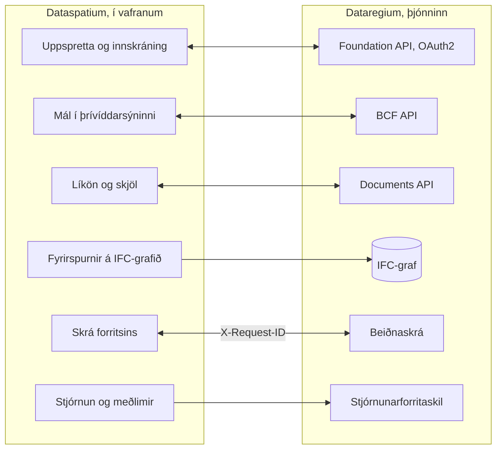

[Svenska](../../README.md) · [Dansk](../da/README.md) · [Norsk bokmål](../nb/README.md) · [Norsk nynorsk](../nn/README.md) · [Suomi](../fi/README.md) · **Íslenska** · [English](../en/README.md)

# Dataspatium OpenCDE-biðlari

*Þetta er README fyrir Dataspatium 2.0.0. Nýjasta útgáfan, 3.0.0, er lýst í [README á main](https://github.com/marwiss/Dataspatium/blob/main/docs/is/README.md).*

Dataspatium er forrit til að vinna með gögn sem þú opnar í venjulega vafranum þínum. Þú sækir töflu, kort, skipulag, byggingarlíkan eða
tölfræði frá stofnun, leiðréttir hana og reiknar, gerir myndrit og skýrslur og sendir niðurstöðuna áfram. Allt gerist í þinni eigin
tölvu: engin uppsetning, enginn aðgangur og enginn þjónn. Ekkert fer úr tölvunni nema þú flytjir það út eða deilir því sjálf(ur), og
forritið spyr alltaf áður en það notar internetið.

Dataspatium getur líka unnið með [Dataregium](https://github.com/marwiss/Dataregium), þjóni þar sem byggingarverkefni deilir líkönum,
skjölum og málum. Þá geturðu sótt byggingarlíkön verkefnisins, bent á vandamál í þrívídd sem mál og spurt graf þjónsins um líkönin.
Án Dataregium virkar allt annað nákvæmlega eins.

**Fyrir þau sem kunna tæknina:** kyrrstætt vefforrit án smíðaskrefs sem keyrir frá `file://` í Edge, Chrome og Firefox eða frá hvaða
kyrrstæða vefþjóni sem er. Hvert gagnasafn er SQLite-skrá (sql.js) í IndexedDB; R keyrir í WebR 0.5.9 og Python í Pyodide 0.29.5, bæði
í workerum; IFC er lesið með web-ifc og IfcOpenShell (wasm). Gagnvart þjóni er forritið OpenCDE-biðlari: Foundation API 1.0 með OAuth2
authorization code og PKCE, BCF API 3.0 og 2.1 og Documents API 1.0. Engin netköll eru gerð án samþykkis fyrir hvern tilgang, og
leyndarmál eru aðeins geymd dulkóðuð (AES-GCM).

**Efni**

- [Sækja og hefjast handa](#sækja-og-hefjast-handa)
- [Kröfur](#kröfur)
- [Orð sem gott er að þekkja](#orð-sem-gott-er-að-þekkja)
- [Hvað þú getur gert](#hvað-þú-getur-gert)
- [OpenCDE-forritaskilin og biðlarar þeirra](#opencde-forritaskilin-og-biðlarar-þeirra)
- [Dataspatium og Dataregium](#dataspatium-og-dataregium)
- [Lærðu meira](#lærðu-meira)
- [Takmarkanir í stuttu máli](#takmarkanir-í-stuttu-máli)
- [Persónuupplýsingar](#persónuupplýsingar)
- [Nýrri útgáfur](#nýrri-útgáfur)
- [Villur og tillögur](#villur-og-tillögur)
- [Þróun](#þróun)
- [Leyfi](#leyfi)

## Sækja og hefjast handa

1. **Sæktu.** Farðu í [útgáfu 2.0.0](https://github.com/marwiss/Dataspatium/releases/tag/v2.0.0) og sæktu ZIP-skrána undir *Assets*
   (`dataspatium-<version>.zip`, um 100 MB; R og algengustu R-pakkarnir fylgja með).
2. **Afþjappaðu.** Hægrismelltu á ZIP-skrána og veldu *Extract all* (Windows) eða tvísmelltu á hana (macOS). Settu möppuna þar sem þú
   vilt hafa hana, til dæmis í Skjöl. Forritið virkar ekki beint inni í ZIP-skránni.
3. **Opnaðu.** Tvísmelltu á `index.html` í möppunni, eða dragðu skrána inn í vafraglugga. Ef Windows spyr hvaða forrit eigi að nota
   velurðu Edge, Chrome eða Firefox. Í fyrsta sinn velurðu tungumál, og síðan er **Grunnnámskeiðið** í boði: yfirferð um alla hamina með
   sýnigögnum sem tekur um tíu mínútur og má opna aftur úr hjálpinni (?).
4. **Sæktu gögn.** Í hamnum *Sækja* sleppirðu skrá á flötinn, eða smellir á *Prófa með sýnigögnum*. Forritið sýnir hvað skráin
   inniheldur; smelltu á *Flytja inn*. Gagnasafnið er geymt í vafranum í tölvunni þinni.
5. **Haltu áfram.** Hamirnir efst eru skref vinnunnar: *Umsjón* heldur gagnasöfnunum þínum í röð og reglu, *Leita* finnur raðir án
   kóða, *Vinna* sýnir töfluna, kortið eða líkanið með hnöppum til að leiðrétta og reikna, *Greina* hefur tölfræði og kóða (R, Python og
   SQL), *Myndgera* gerir myndrit og kort, *Flytja út* vistar skrár í tölvunni og *Deila* sendir til annarra.

Það sem þú vistar er geymt í eigin gagnagrunni vafrans í tölvunni. Ef þú hreinsar vefsvæðisgögn vafrans hverfur það, svo taktu reglulega
afrit undir *Umsjón > Vinnusvæði*. Afritið er ZIP-skrá sem má endurheimta í sömu eða annarri tölvu. Skref fyrir skref með fleiri
smáatriðum: [kom-igang.md](kom-igang.md).

Vefútgáfan á <https://marwiss.github.io/Dataspatium/> er alltaf nýjasta útgáfan, nú 3.0.0.

### Fyrir þau sem kunna tæknina

- **Keyrðu:** afþjappaðu ZIP-skrána og opnaðu `index.html` (file://), eða þjónaðu möppunni: `python -m http.server 8080 --bind
  127.0.0.1` og opnaðu <http://127.0.0.1:8080/>. Frá vefþjóni er service worker, forrit sem má setja upp, og R og Python sem má stöðva.
- **Prófaðu ZIP-skrána:** berðu SHA-256 hennar saman við það sem stendur í texta útgáfunnar (`Get-FileHash` í PowerShell,
  `shasum -a 256` á macOS og Linux).
- **Með þjóni:** ræstu Dataregium með Docker eða Podman (`docker compose up -d --build --wait` og `docker compose exec api opencde seed`
  í geymslu Dataregium), þjónaðu Dataspatium á porti 8080 og bættu þjóninum við undir *Sækja > Bæta við uppsprettum > OpenCDE*. Auðkenni
  biðlara má vera autt þegar þjónninn leyfir sjálfskráningu. Öll leiðin á tuttugu mínútum: [snabbstart.md](snabbstart.md).
- **Grafið:** IFC-graf þjónsins (Neo4j eða Memgraph) er spurt með Cypher úr *Sækja*, með grafafyrirspurn þjónsins eða beint yfir Bolt.
- **Prófanir:** `powershell -File tools/run-tests.ps1` eða `tools/run-tests.sh` keyrir allar prófanirnar í headless Edge og Firefox.

## Kröfur

- Windows, macOS eða Linux.
- Microsoft Edge eða Google Chrome (útgáfa 120 eða nýrri), eða Firefox (útgáfa 128 eða nýrri). Safari er ekki stutt fyrir allt
  forritið.
- Um 300 MB laust pláss fyrir forritsmöppuna og að minnsta kosti 4 GB vinnsluminni (mælt er með 8 GB fyrir stór gagnasöfn og líkön).
  Engin stjórnandaréttindi þarf.
- Internet þarf aðeins þegar þú velur sjálf(ur) eitthvað sem krefst þess, og forritið biður um leyfi fyrst fyrir hvern tilgang: sækja
  gögn úr opnum forritaskilum og kortum, tengjast Dataregium-þjóni eða GitHub, leita að uppfærslu
  eða sækja hluta sem fylgir ekki möppunni (Python, IfcOpenShell og R-pakka umfram þá algengustu).
- Dataregium þarf þjón. Til að keyra eigin þjón þarf Docker eða Podman; því er lýst í README Dataregium.

## Orð sem gott er að þekkja

Þú þarft ekki að kunna orðin hér að neðan til að nota forritið, en þau koma fyrir í textanum.

- **API (forritaskil)**: leið fyrir forrit til að sækja gögn hvert frá öðru yfir netið. Forritið sækir tölfræði úr forritaskilum stofnana
  og talar við Dataregium gegnum forritaskil þess.
- **Gagnasafn**: það sem forritið geymir þegar þú sækir eitthvað: tafla, kort, skipulag, graf, líkan eða safn skjala eða mynda.
- **Uppskrift**: listinn yfir allt sem þú hefur gert við gagnasafn, skref fyrir skref, svo að það megi afturkalla eða endurtaka á nýjum
  gögnum.
- **R, Python og SQL**: tungumál til að greina gögn. Forritið hefur þau innbyggð, en flest er gert með hnöppum og eyðublöðum sem skrifa
  kóðann fyrir þig.
- **BIM**: að lýsa byggingu sem stafrænu líkani þar sem hver veggur, hurð og hvert herbergi ber upplýsingar, ekki aðeins sem línur á
  teikningu.
- **IFC**: opna skráarsniðið fyrir byggingarlíkön, sem öll helstu hönnunarforrit bygginga geta lesið og skrifað.
- **CAD**: teikningar gerðar í teikniforriti; forritið les þær á opna sniðinu DXF.
- **IDS**: opin skrá sem segir hvaða upplýsingar líkan verður að hafa, svo að prófa megi líkanið sjálfvirkt.
- **BCF**: opið snið fyrir mál um líkan, til dæmis „loftræstingin fer í gegnum bitann“, með mynd og þeirri sýn sem sýnir staðinn.
- **OpenCDE**: opnar reglur buildingSMART um hvernig forrit deila líkönum, skjölum og málum byggingarverkefnis, svo að forrit frá ólíkum
  framleiðendum vinni saman.
- **Þjónn**: forrit sem aðrir tengjast yfir netið. Dataregium er þjónn; Dataspatium þarf engan.
- **Graf og grafagagnagrunnur**: gögn sem hlutir og tengslin milli þeirra, til dæmis að hurð sé í vegg á hæð. Dataregium getur geymt hvert
  líkan sem graf í Neo4j eða Memgraph með hjálp einingarinnar IFC-LPG.
- **Gámur (container)**: tilbúið forrit sem er ræst með Docker eða Podman án þess að hlutar þess séu settir upp hver fyrir sig.
  Dataregium keyrir þannig; Dataspatium þarf enga gáma.
- **OAuth2-innskráning**: venjulega leiðin til að skrá sig inn í þjónustu úr öðru forriti án þess að forritið sjái lykilorðið þitt.
- **file:// og CORS**: file:// merkir að forritið er opnað beint úr möppu. CORS er regla vafrans um hvaða vefþjónustur vefforrit má sækja
  gögn til; þjónustu án CORS er ekki hægt að ná beint.

## Hvað þú getur gert

Það sem virkar í einni útgáfu virkar líka í þeirri næstu. Hver útgáfa á saman við sömu útgáfu af Dataregium.

### Útgáfa 1 (með Dataregium 1)

- **Sæktu gögn**: skrár á um fjörutíu sniðum, frá Excel og CSV til tölfræðiskráa, landupplýsinga og taflna í Word og á vefsíðum, og
  tölfræði frá stofnunum í Svíþjóð, á Norðurlöndum og í Evrópu með einum smelli (sjá [Opin forritaskil](api-konfiguration.md)).
  *Tæknilega:* stafakóðun og dálkagerðir eru greindar; SPSS, Stata, SAS, PX, Parquet og RDS gegnum R; eigin uppsprettur sem `*.api.json`.
- **Leiðréttu og reiknaðu**: um fimmtíu aðgerðir með hnöppum, eins og að hreinsa, skipta um gerð, endurkóða, reikna hlutföll, snúa og
  tengja töflur, með gæðareglum, dulnefnun kennitalna, afturköllun og útgáfum (sjá [Vinna](bearbeta.md)). *Tæknilega:* hvert skref er
  geymt í uppskrift sem má flytja út sem R- eða SQL-kóða.
- **Greindu**: R með ggplot2 og tidyverse, SQL þvert á gagnasöfn, reglulegar segðir og minnisbækur sem verða að skýrslum, alveg í
  vafranum (sjá [R](r-guide.md) og [Reglulegar segðir](regex.md)).
- **Skipulag**: sænsk deiliskipulög og aðalskipulög sem skipulagskort með litum og táknum Boverket, í eigin hnitakerfi skipulagsins (sjá
  [Skipulag](planer.md)).
- **Myndrit, kort og skjöl**: myndrit og kort með Vega-Lite, D3 eða R, mælaborð og skýrslur úr sniðmátum sem HTML, Word, PDF, PowerPoint,
  Markdown eða LaTeX (sjá [Myndgera](visualisera.md)).
- **Vistaðu og deildu**: gögn á um tíu sniðum, deilipakkar, athugasemdir, afrit, samstilling við GitHub og ferðamappa.
- **Dataregium sem skjalasafn**: sæktu skjöl af þjóninum sem gagnasöfn og sendu gagnasöfn og skrár til baka sem nýjar útgáfur.
  *Tæknilega:* Foundation API og Documents API.
- **Sex tungumál og grunnnámskeið**: sænska, danska, norska (bókmál), finnska, íslenska og enska, og skipanaspjaldið (Ctrl+K) sem finnur
  allt.

### Einnig í útgáfu 2 (með Dataregium 2)

- **Leita og Deila**: tveir nýir hamir. *Leita* finnur og listar raðir án kóða; *Deila* sendir pakka, birtir mælaborð og skjöl sem
  vefsíður og flytur í síma með QR-kóða, eftir yfirferð persónuupplýsinga (sjá [Leita](soka.md) og [Deila](dela.md)).
- **Fleiri uppsprettur**: Access-skrár, gagnagrunnar, opnar landupplýsingar, bakgrunnskort, skjöl og myndir sem söfn og texti úr skönnuðum
  síðum (sjá [Uppsprettur](kallor.md)). *Tæknilega:* staðbundin brú í SQL Server og ODBC, PostgREST, OData, GraphQL, SPARQL og fleira yfir
  HTTP, WFS, OGC API Features, ArcGIS og Neo4j yfir Bolt.
- **Kort, skipulag og gröf**: kort með lögum og landupplýsingatólum, skipulag frá öllum Norðurlöndum og gröf sem eru teiknuð, spurð og
  breytt (sjá [Kort](kartor.md) og [Gröf](grafer.md)).
- **Byggingarlíkön**: IFC-líkön í þrívídd með töflum, eiginleikum og magntölum, prófun gegn skemanu og gegn IDS, og DXF-teikningar (sjá
  [CAD og BIM](cad-bim.md)). *Tæknilega:* web-ifc og three.js fyrir sýnina, IfcOpenShell og ifctester í Python forritsins.
- **Python og tölfræði án kóða**: Python-skel og eyðublöð fyrir tölfræði og tímaraðir sem skrifa og sýna kóðann (sjá
  [Tölfræði](statistik.md) og [Python](python.md)).
- **Röð og reglur og flæði**: möppur, merki og aðgerðir á mörg gagnasöfn, vistuð flæði sem keyra með einum smelli, og uppsprettur sem
  láta vita þegar ný gögn eru komin (sjá [Hamir](lagen.md)).
- **Dataspatium Farsími**: síminn tekur við og sýnir gögn og safnar röðum á vettvangi, líka án nets (sjá [Farsími](mobil.md)).
- **Dataregium með málum**: líkön og mál verkefnisins, ný mál sem benda á staðinn í þrívídd, BCF-skrár, IFC-graf þjónsins, kortið
  *Stjórnun* fyrir stjórnandann og kortið *Meðlimir verkefnisins* fyrir verkefnisstjórann (sjá
  [Dataspatium og Dataregium](#dataspatium-og-dataregium)). *Tæknilega:* BCF API 3.0 og 2.1 með viewpoints.
- **Sjö tungumál**: líka nýnorska, með handbókinni í forritinu og grunnnámskeiðinu um alla átta hamina.

## OpenCDE-forritaskilin og biðlarar þeirra

OpenCDE eru opnar reglur buildingSMART International um hvernig forrit deila líkönum, skjölum og málum byggingarverkefnis. Forrit sem
fylgir reglunum getur unnið með hverjum þeim þjóni sem gerir það líka, sama hver smíðaði þá. Dataspatium er slíkt forrit, biðlari, og
notar öll þrjú forritaskilin:

| Forritaskil | Hvað forritið gerir með þeim | Forskrift |
|---|---|---|
| Foundation API 1.0 | Les hvaða forritaskil þjónninn býður, hvar á að skrá sig inn og hver notandinn er; skráir forritið sem biðlara þegar þjónninn leyfir það | [foundation-API](https://github.com/buildingSMART/foundation-API) |
| BCF API 3.0 og 2.1 | Les og skrifar mál um líkan, með athugasemdum og viewpoints (myndavél, íhlutir og myndir) úr þrívíddarsýninni; velur nýjustu útgáfu sem þjónninn býður | [BCF-API](https://github.com/buildingSMART/BCF-API) |
| Documents API 1.0 | Velur og sækir skjöl og útgáfur gegnum eigin síður þjónsins, svo að IFC-líkan verði gagnasafn, og hleður upp nýjum útgáfum, gagnasöfnum og pökkum | [documents-API](https://github.com/buildingSMART/documents-API) |

**Dataregium er einn þjónn, ekki sá eini.** Ekkert í forritinu er háð Dataregium. Viðbætur Dataregium utan forskriftanna
(getuskjalið, grafafyrirspurnirnar og verkefnisstjórnunin) birtast aðeins þegar þjónninn sjálfur gefur þær upp.

**Fyrir þau sem kunna tæknina:** af þjóni þarf forritið þrennt:

- CORS frá uppruna forritsins: `null` frá file://, `http://127.0.0.1:8080` frá staðbundnum vefþjóni og `https://marwiss.github.io` af
  vefnum, með hausunum Authorization, Content-Type og X-Request-ID;
- skráningu biðlara, gerða af stjórnanda þjónsins (opinber biðlari með framvísunarslóðinni `http://127.0.0.1:8080/oauth-callback.html`,
  eða samsvarandi fyrir slóð forritsins) eða af forritinu sjálfu (RFC 7591) þegar þjónninn leyfir það, og OAuth2 authorization code með
  PKCE `S256`; frá file:// límirðu inn slóðina sem þú lendir á eftir innskráningu;
- BCF API 3.0 eða 2.1; Documents API er valkvætt, en án þess getur forritið ekki sótt eða birt skjöl.

Hingað til hefur þetta verið sýnt gagnvart Dataregium: lifandi prófanirnar keyra gegn þjóninum í báðum útgáfum BCF API, og þjónn með
aðeins 2.1 virkar. Aðrir þjónar hafa ekki verið prófaðir; segðu frá hvernig gekk undir [Villur og tillögur](#villur-og-tillögur). Þegar
forritið og forskrift eru ósammála ræður forskriftin. Hlið forritsins er lýst í [kallor.md](kallor.md), hlið þjónsins í README Dataregium.

## Dataspatium og Dataregium

*Dataregium hét Kontroll til 8. nóvember 2026.*

Dataspatium er forritið sem þú vinnur í, og [Dataregium](https://github.com/marwiss/Dataregium) er þjónninn þar sem verkefni safnar
líkönum sínum, skjölum og málum. Þau eru smíðuð hvort fyrir annað en fylgja opnum reglum, svo að önnur forrit virka líka. Þú bætir
þjóninum við sem uppsprettu í *Sækja* og skráir þig inn; síðan sækirðu líkön og skjöl verkefnisins, bendir á vandamál í þrívídd sem mál,
sendir gagnasöfn og skrár til baka og spyrð graf þjónsins um líkönin. Án þjóns
virkar restin af forritinu eins og venjulega.

**Fyrir þau sem kunna tæknina:** allt nema grafafyrirspurnirnar og stjórnunin fer gegnum OpenCDE-forritaskilin þrjú. Hvert kall ber
`X-Request-Id` sem þjónninn skrifar í beiðnaskrá sína, svo að para megi skrá forritsins og skrá þjónsins. Samstarfinu er lýst frá hlið
forritsins í [kallor.md](kallor.md) og [cad-bim.md](cad-bim.md) og frá hlið þjónsins í README Dataregium og `docs/client-guide.md`.

Svona tengjast þau:

Dataspatium 2.0.0 virkar með Dataregium 2.0.0. Sama númer á saman. Flýtileiðarvísirinn [snabbstart.md](snabbstart.md) fer með parið úr
engu í mál á tuttugu mínútum.

### Útgáfurnar 1, 2 og 3

Það er ein útgáfa fyrir hvert aðalnúmer, og Dataspatium og Dataregium með sama númer eiga saman:

| Dataspatium | Hvað hún hefur | Á saman við |
|---|---|---|
| 1.0.0 | Gögn úr skrám og opnum forritaskilum, vinnsla, R, SQL og reglulegar segðir, sænskt skipulag, myndrit og kort í myndritum, mælaborð, skjöl, útflutningur og deiling. Gagnvart þjóni aðeins Documents API: sækja skjöl sem gagnasöfn og senda gagnasöfn og skrár til baka. Engin mál, engin líkön og ekkert Python | Dataregium 1.0.0 (aðeins Documents API) |
| 2.0.0 | Allt í 1.0.0 og auk þess hamirnir Leita og Deila, Python og tölfræði án kóða, fleiri uppsprettur, kortasýnir, norrænt skipulag, gröf, IFC-líkön í þrívídd með prófun gegn IDS, flæði, Dataspatium Farsími, mál með viewpoints (BCF API 3.0 og 2.1), IFC-graf þjónsins, kortið *Stjórnun* og kortið *Meðlimir verkefnisins* | Dataregium 2.0.0 |
| 3.0.0 | Allt í 2.0.0 og auk þess kortið *Sannprófa líkanið*, árekstrarprófun, Spyrja gervigreind og Breyta með gervigreind, ný auð líkön á völdu skema, Bera saman útgáfur, birting með grunnútgáfu og forprófun, breytingatillögur sem eru prófaðar og samþykktar á þjóninum með vali við árekstra, og grafið í léttara formi | Dataregium 3.0.0 |

Ný útgáfa með sama aðalnúmeri kemur í stað þeirrar fyrri; aðeins sú nýjasta í hverri röð er leiðrétt. Uppfærsluathugun forritsins býður
næsta aðalnúmer, og gagnasöfn, listar, myndrit, sniðmát og skriftur fylgja með þegar þú opnar `index.html` nýju útgáfunnar.

## Lærðu meira

Skráarheitin eru þau sömu á öllum tungumálum (þau eru sænsku frumritin), svo að tenglar virka eins alls staðar.

**Byrjaðu hér**

- **Grunnnámskeiðið** í forritinu: yfirferð um alla hamina með sýnigögnum; opnaðu það úr hjálpinni (?) eða með Ctrl+K.
- **Handbókin** í forritinu: sömu skjöl og hér, með leit; opnaðu hana með ? efst til hægri eða F1.
- [Að hefjast handa](kom-igang.md): skref fyrir skref með algengum spurningum.
- [Notendaleiðbeiningar](anvandarguide.md): allt vinnuferlið frá skrá til skýrslu.
- [Hamirnir átta](lagen.md): hvað er hvar og hvers vegna.
- [Algengar spurningar](faq.md): geymsla, öryggi, R, forritaskil og uppfærslur.

**Eftir sviðum**

- [Snið og innflutningur](format.md) og [Opin forritaskil](api-konfiguration.md): skráarsnið, stafakóðun, forstilltu uppspretturnar,
  lyklar og eigin stillingar.
- [Uppsprettur](kallor.md): gagnagrunnar, brúin, opnar landupplýsingar, tengdar skrár og OpenCDE-þjónar.
- [Vinna](bearbeta.md), [Leita](soka.md) og [Reglulegar segðir](regex.md): leiðrétta, reikna og finna.
- [Tölfræði](statistik.md), [R í Dataspatium](r-guide.md), [Python í Dataspatium](python.md) og [Minnisbók](anteckningsbok.md):
  greining með og án kóða.
- [Myndgera](visualisera.md), [Kort](kartor.md) og [Skjöl og sniðmát](dokumentmallar.md): myndrit, kort, mælaborð og skýrslur.
- [Skipulag](planer.md), [Gröf](grafer.md) og [CAD og BIM](cad-bim.md): skipulag, gröf, byggingarlíkön og prófanir.
- [Skjöl og myndir](dokument.md): PDF, Word, OpenDocument, Markdown og myndir sem gagnasöfn.
- [Flæði](floden.md), [Deila](dela.md), [Dataspatium Farsími](mobil.md) og [Gagnaöflun](insamling.md): sjálfvirkni, deiling og söfnun.
- [Flýtileiðarvísir með Dataregium](snabbstart.md): tuttugu mínútur úr engu í mál sem búið er til í þrívíddarsýninni og sést á þjóninum.
- [Öryggi](sakerhet.md) og [Leyfi](licenser.md): ógnalíkan, varnir og prófanir, og hvað þú mátt gera með forritið.
- Hvernig framlögum er tekið er lýst í [CONTRIBUTING.md](../../CONTRIBUTING.md) (á sænsku).

### Frekari lesning

- [BCF API](https://github.com/buildingSMART/BCF-API), [Foundation API](https://github.com/buildingSMART/foundation-API) og [Documents API](https://github.com/buildingSMART/documents-API): forskriftirnar sem forritið fylgir gagnvart þjóni.
- [IFC](https://github.com/buildingSMART/IFC4.x-development): skráarsniðið fyrir byggingarlíkön, og [IDS](https://github.com/buildingSMART/IDS): kröfuforskriftir sem líkön eru prófuð gegn.
- Ytri tilföng: [WebR](https://docs.r-wasm.org/webr/latest/), [Pyodide](https://pyodide.org/), [IfcOpenShell](https://ifcopenshell.org/),
  [Vega-Lite](https://vega.github.io/vega-lite/), [forritaskil sænsku hagstofunnar](https://www.scb.se/en/services/open-data-api/).

## Takmarkanir í stuttu máli

- Forritið verður að opna úr afþjappaðri möppu eða venjulegum vefþjóni; það virkar ekki beint inni í ZIP-skránni.
- Vefþjónustum sem leyfa ekki köll úr vöfrum (skortir CORS, til dæmis sænska seðlabankanum) er ekki hægt að ná beint; tilgreina má eigin
  milliþjón.
- Gagnasafn ætti að vera undir nokkrum milljónum raða, og mjög stór byggingarlíkön geta verið of þung fyrir vafrann; minnið setur mörkin.
- Þegar forritið er opnað úr möppu er ekki hægt að stöðva R- og Python-kóða í miðjum útreikningi; notaðu *Endurræsa R* eða *Endurræsa
  Python*. Frá vefþjóni er hnappurinn *Stöðva*.
- Python og IfcOpenShell fylgja ekki ZIP-skránni; þau eru sótt í fyrsta sinn sem þeirra er þörf, eftir samþykki, og síðan geymd í
  vafranum.
- Margir flipar virka og halda hver öðrum upplýstum, en breyttu ekki sama gagnasafni í tveimur flipum í einu: sá sem vistar síðast vinnur.
- Ferðamappan krefst Edge eða Chrome; Firefox skortir möppuaðgang. Afrit sem ZIP virkar alls staðar.
- Allt forritið er gert fyrir tölvur. Í símum og spjaldtölvum er Dataspatium Farsími (<https://marwiss.github.io/Dataspatium/m/>) notaður,
  sem tekur við, sýnir, safnar og sendir áfram. Í þröngum gluggum opnast spjöldin sem blöð yfir vinnusvæðinu.
- Sýnigögn og kortamörk sem fylgja ná yfir Svíþjóð, Danmörku, Noreg og Finnland, og forstilltu uppspretturnar eru norrænar og evrópskar;
  gögn frá öðrum löndum geturðu sótt sjálf(ur) jafn auðveldlega.

## Persónuupplýsingar

Dataspatium keyrir í vafranum þínum og þú berð sjálf(ur) ábyrgð á gögnunum sem þú setur inn. Allt sem forritið vistar (gagnasöfn og
útgáfur þeirra, listar, gröf, skjöl, minnisbækur, athugasemdir og stillingar) liggur í geymslu vafrans á tölvunni þinni og fer þaðan
aðeins þegar þú flytur út, deilir eða birtir; þá er allt fyrst yfirfarið í heild og persónuupplýsingar má halda, dulnefna eða fjarlægja
í afritinu. Til Dataregium-þjóns er innskráning þín send (tákn eru geymd í setunni eða dulkóðuð með lykilsetningu þinni, aldrei í
hreinum texta), málin, athugasemdirnar og skrárnar sem þú stofnar undir nafni þínu á þjóninum, og X-Request-ID fyrir
hvert kall; vinnsla þjónsins sjálfs er lýst í README Dataregium. Athugasemdir og pakkar bera nafnið sem þú gefur sjálf(ur) upp. Eftirlitið og prófin sem sýna það eru í
[sakerhet.md](sakerhet.md).

## Nýrri útgáfur

Dataspatium 3.0.0, gerð með Dataregium 3.0.0, bætir við prófun líkana, árekstrarprófun, Spyrja gervigreind og Breyta með
gervigreind, nýjum auðum líkönum, Bera saman útgáfur og breytingatillögum sem þjónninn prófar og samþykkir. Hún er sótt úr
[nýjustu útgáfunni](https://github.com/marwiss/Dataspatium/releases/latest) og lýst í [README á main](https://github.com/marwiss/Dataspatium/blob/main/docs/is/README.md). Gagnasöfn, listar, myndrit, sniðmát og skriftur fylgja með þegar þú
opnar `index.html` nýju útgáfunnar.

## Villur og tillögur

Tilkynntu villur eða óskir sem *Issues* hér á GitHub. Lýstu vafranum, útgáfu Dataspatium (birtist undir hjálparhnappnum) og
hvað þú gerðir. Sjá [CONTRIBUTING.md](../../CONTRIBUTING.md). Hengdu engar persónuupplýsingar og engin leyndarmál við. Fyrir öryggisveikleika,
fylgdu [SECURITY.md](../../SECURITY.md) í stað þess að opna issue.

## Þróun

- Ekkert smíðaskref, ekkert node.js. Opnaðu `index.html` beint, eða þjónaðu möppunni með `python -m http.server 8080`.
- Arkitektúr í stuttu máli: allur eigin kóði er klassískar skriftur sem eru skráðar með `Dataspatium.define` í röðinni í `src/boot.js`;
  `src/platform` ber allt sem er sérstakt fyrir file:// (tilföng, shims, workerar, geymsla, samþykki); vélarnar SQLite, R (WebR) og Python
  (Pyodide) keyra í workerum; `src/ui` hefur hönnunarbreyturnar, íhlutina (`dm-*`), skelina og einn ham í hverri skrá. Allt sem birtist er
  escapað, og ekkert er sótt af netinu án aðgerðar þinnar og samþykkis.
- Íhlutir þriðja aðila: `python tools/fetch_vendor.py` og síðan `python tools/wrap_assets.py`.
- Prófanir: `powershell -File tools/run-tests.ps1` eða `tools/run-tests.sh` (headless Edge og Firefox). Prófanirnar fara aldrei á netið;
  raunverulegar þjónustur eru aðeins prófaðar með eigin breytum (`?cde=` gegn Dataregium, `?python=1` með Pyodide).
- Öryggi: prófanirnar fyrir samþykki, leyndarmál, yfirferð fyrir deilingu, OAuth2 (PKCE, state, endurkomu) og huldun skrárinnar eru hluti
  af prófunum; sjá [sakerhet.md](sakerhet.md).

## Leyfi

Eigin kóði Dataspatium, skjölun og forstillingar (allt nema `vendor/`) eru með leyfið
[PolyForm Strict 1.0.0](../../LICENSE): frjálst að hlaða niður og nota í óviðskiptalegum tilgangi, líka hjá stjórnvöldum og
öðrum opinberum stofnunum, en ekki að breyta, byggja á eða dreifa áfram án skriflegs leyfis. Leyfisveitandi er höfundur
Dataspatium, sem næst í gegnum GitHub-aðganginn [marwiss](https://github.com/marwiss); stofnaðu issue fyrir aðra skilmála.
Hvað leyfið þýðir í reynd er útskýrt í [licenser.md](licenser.md).

Íhlutir þriðja aðila í `vendor/` hafa sín eigin leyfi (MIT, BSD, Apache-2.0, ISC, OFL, MPL, LGPL og GPL), sjá
[THIRD_PARTY_LICENSES.md](../../THIRD_PARTY_LICENSES.md). R og GPL-leyfðir R-pakkar eru dreifðir óbreyttir; frumkóðinn fæst hjá
[R-verkefninu](https://cran.r-project.org/sources.html), [webR](https://github.com/r-wasm/webr) og
[CRAN](https://cran.r-project.org/) í þeim útgáfum sem þar eru tilgreindar. Sjá [SECURITY.md](../../SECURITY.md) um hvernig veikleiki er tilkynntur og hvað
verkefnið gerir til að vera áfram öruggt.
