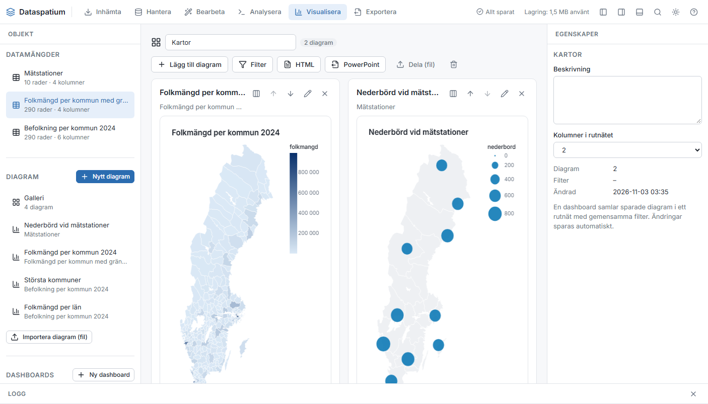

# Myndgera

Hamurinn Myndgera býr til myndrit úr gagnasöfnunum með þremur vélum sem allar nota litaspjald, letur og talnasnið forritsins:
myndritasmið (Vega-Lite), tilbúin D3-snið og R-skriftur (ggplot2). Myndrit eru vistuð í vinnusvæðinu, má flytja út sem SVG,
PNG og PDF, deila sem skrám og búa til í hópkeyrslu eftir hópum.

## Búa til myndrit

1. Veldu gagnasafn í hlutaspjaldinu og ýttu á **Nýtt myndrit**.
2. Veldu vél: **Myndritasmiður**, **D3-snið**, **R-skrifta** eða **Python-skrifta**.
3. Gefðu myndritinu heiti í titilreitnum og ýttu á **Vista**. Vistuð myndrit birtast undir Myndrit í hlutaspjaldinu og í safninu.

Forskoðunin uppfærist meðan þú breytir. Undir myndritinu kemur fram hve margar raðir voru notaðar; stór gagnasöfn eru tekin
saman í SQL þegar myndritið þarf aðeins summur, meðaltöl eða fjölda, annars er fjöldi raða takmarkaður (sjálfgefið 50 000,
breytt undir Fleiri valkostir).

## Myndritasmiðurinn (Vega-Lite)

| Myndritagerð | Notað fyrir |
|---|---|
| Súlur, Láréttar súlur | Samanburð flokka, með valfrjálsri litaskiptingu og stöflun |
| Lína, Flötur | Þróun yfir tíma eða raðaða flokka |
| Punktar | Samband tveggja talna, litur og stærð sem viðbótarvíddir |
| Stuðlarit | Dreifingu tölu í bil |
| Hitakort | Tvo flokka með gildi sem lit |
| Kassarit | Dreifingu eftir flokkum |
| Kökurit | Hlutföll af heild (fáir flokkar) |
| Kort | Svæði lituð eftir gildi (þemakort) úr rúmfræðidálki, sjá *Kort* hér á eftir |
| Punktakort | Punkta úr lengd og breidd (eða SWEREF 99 TM) með stærð og lit eftir gildum, yfir sveitarfélaga- eða lénamörkum |

Fyrir hverja rás (X, Y, Litur, Stærð, Smáspjöld) velurðu dálk, hvernig hann skal túlkaður (tala, flokkur, raðaður flokkur,
tími), útreikning (summa, meðaltal, miðgildi, lægst, hæst, fjöldi, fjöldi ólíkra), röðun, tímaeiningu og ásheiti. Aðrar
stillingar: titill og undirtitill, talnasnið, hæð, staðsetning skýringa, stöflun (staflað, prósent, skarast), gildismerki á súlum
og punktar á línum. **Síur** takmarka raðirnar með skilyrðum á dálka. Undir **Fleiri valkostir** eru raðatakmark, litakvarði
(raðbundinn eða tvíátta) og **Eigin Vega-Lite-lýsing**: JSON-lýsingunni má breyta beint fyrir allt sem smiðurinn nær ekki yfir;
gögn eru sett inn úr gagnasafninu þegar myndritið er teiknað.

Myndritið er vistað sem staða smiðsins (eða eigin lýsing) ásamt heiti og stuttheiti gagnasafnsins, svo endurgera má það á ný
gögn með sömu dálkum.

### Ásar og línur

Hlutinn **Ásar og línur** (allar myndritagerðir nema kökurit og kort) stýrir ásunum og bætir við línum. Auð svæði
gefa sjálfvirk gildi.

| Stilling | Hvað hún gerir |
|---|---|
| Lægsta og hæsta gildi gildisáss | Föst mörk fyrir gildisásinn (Y, eða X í láréttum súlum), til dæmis 0–100 fyrir prósentur eða sami kvarði í mörgum myndritum. Það sem lendir utan markanna er klippt burt |
| Lægsta og hæsta gildi x-áss | Birtist þegar x-ásinn er tala (punktar og línur), til dæmis til að þysja inn á bil |
| Kvarði gildisáss | Línulegur, lograkvarði (fyrir gildi sem spanna mörg tíuveldi; krefst jákvæðra gilda) eða kvaðratrót |
| Gildisás byrjar á núlli | Sjálfgefið kveikt; slökktu til að láta ásinn byrja nálægt lægsta gildinu, til dæmis fyrir hitastig |
| Halli merkimiða | Sjálfvirkt, 0°, 45° eða 90° fyrir flokka með löng heiti |
| Hnitalínur | Netið á bak við myndritið, sjálfgefið kveikt |
| Viðmiðunarlína við gildið | Strikalína við gildi á gildisásnum, til dæmis markmið eða landsmeðaltal, með valfrjálsum texta |
| Leitnilína | Punktar og línur með tölu á x-ásnum: bein lína (línuleg aðhvarfsgreining) eða jöfnuð lína (loess), ein fyrir hvern litahóp |
| Þekja | Hversu ógegnsæir punktar, fletir og súlur eru (0,05–1), til dæmis þegar margir punktar skarast |

Viðmiðunar- og leitnilínur eru ekki teiknaðar í myndritum með smáspjöldum. Stillingarnar eru vistaðar með myndritinu
og fylgja deildum myndritaskrám og hópkeyrslum.

**Listi** undir síunum velur vistaða leit úr Leita sem raðir myndritsins eru sóttar úr (valið birtist aðeins þegar
gagnasafnið á lista). Listinn er keyrður aftur í hvert sinn sem myndritið er teiknað, svo myndritið fylgir gögnum
dagsins, og síurnar bætast ofan á. Valið er vistað með myndritinu og gildir líka í mælaborðum og útflutningi.

## D3-snið

- **Röðun**: ein röð fyrir hvern flokk, raðað eftir gildi, með punkti og línu. Veldu flokk, gildi, útreikning, fjölda og röð.
- **Hallarit**: tvö tímabil fyrir hvern flokk með línu á milli; grænar línur hækka, rauðar lækka.
- **Aldurspíramídi**: hópar (aldur) sem súlur í tvær áttir, til dæmis konur og karlar.

Sniðin eru skrifuð í D3 með stíleiningu forritsins og gefa vigurgrafík sem er flutt út óbreytt.

## R-skriftur

Skriftan keyrir í R-setunni með gagnasafnið hlaðið inn sem `df` (lesið með stuttheiti sínu). Teiknaðu með ggplot2 eða
grunnteikningu; `theme_dataspatium()` og `dm_palette()` gefa útlit forritsins. Nýjasta myndritið birtist og er vistað með
skriftunni. Útflutningur fer gegnum R (svglite fyrir SVG, `png()` og `pdf()`), og hópkeyrslur keyra skriftuna einu sinni fyrir
hvern hóp með `df` síað. Ctrl+Enter keyrir skriftuna.

## Python-skriftur

Skriftan keyrir í Python-setunni með gagnasafnið hlaðið sem `df` (pandas). Teiknaðu með matplotlib (`fig, ax =
plt.subplots()`) eða plotly (`fig.show()`); `theme_dataspatium()` er sett sjálfkrafa. Nýjasta myndritið birtist og er
vistað með skriftunni; plotly-myndrit er að auki vistað sem mynd og birtist gagnvirkt í mælaborðum og birtu HTML.
Python ræsist með *Ræsa Python* eða *Keyra* (sótt í fyrsta sinn, sjá [python.md](python.md)). Útflutningur og
hópkeyrsla eftir hópum virka eins og fyrir R-skriftur.

## Flytja út

**Flytja út** opnar glugga með sniði (PNG, SVG, PDF, PowerPoint), breidd, hæð, kvarða fyrir PNG og skráarheiti. PNG er teiknað í
vafranum með letri forritsins. SVG inniheldur letrið innfellt svo skráin líti eins út á öðrum tölvum. PDF er vigurgrafík (jsPDF
og svg2pdf.js); texti er settur með PDF-staðalletrinu Helvetica. PowerPoint (pptx, gegnum PptxGenJS) gefur kynningu með
titilglæru og myndritinu sem mynd í hárri upplausn; í hamnum Flytja út er auk þess **Öll myndrit sem PowerPoint**, ein glæra
fyrir hvert vistað myndrit. Myndritin má líka flytja út úr hamnum Flytja út, þar sem öll vistuð myndrit eru talin upp.

## Hópkeyrsla eftir hópum

**Hópkeyrsla eftir hópum** býr til myndritið einu sinni fyrir hvert gildi í hópunardálki (til dæmis hvert sveitarfélag eða ár),
síað á gildið og með gildið í titlinum, og pakkar öllum skrám í ZIP ásamt `manifest.json`. Veldu dálk, snið (eitt eða fleiri),
mynstur skráarheitis (`{diagram}` og `{grupp}` er skipt út), breidd og hámarksfjölda hópa. Hætta má við keyrsluna. Hópar sem
bregðast eru taldir upp í skráarlistanum. Sniðið PowerPoint gefur í stað ZIP eina kynningu með einni glæru fyrir hvern hóp.

## Safn og spjald

**Safn** sýnir öll vistuð myndrit sem spjöld með smámynd, gagnasafni og tíma. Veldu fjölda dálka og ýttu á **Teikna öll
(spjald)** til að teikna myndritin lifandi hlið við hlið. Héðan eru myndrit opnuð, flutt út og þeim eytt.

## Kort

Tvær myndritagerðir teikna kort, báðar án kortaþjóns: **Kort** (þemakort: svæði lituð eftir gildi) og **Punktakort** (punktar á
hnitum með stærð og lit eftir gildum). Mörk sveitarfélaga og svæða fyrir Svíþjóð, Danmörku, Noreg og Finnland fylgja
forritinu; mörk annarra landa, þar á meðal Íslands, eru flutt inn úr GeoJSON, shapefile eða GeoPackage.

### Þemakort (Kort)

1. Sæktu mörkin: veldu til dæmis **Sveitarfélagamörk Noregs (Kartverket)** eða **Sveitarfélagamörk Svíþjóðar (SCB)** í
   listanum *Mörk fyrir kort* í Sækja og ýttu á **Flytja inn mörk**, eða fluttu inn eigin mörk úr GeoJSON, shapefile eða
   GeoPackage. Þau verða gagnasöfn með kóða, heiti og rúmfræðidálki (`geometry`, GeoJSON í lengd og breidd). Kóðarnir
   eru þeir opinberu: fjögurra stafa sveitarfélagakóðar í Svíþjóð, Danmörku (DAGI, eins og `0101`; Danmarks Statistik
   skrifar `101`) og Noregi, þriggja stafa í Finnlandi (eins og `091`; StatFin skrifar `KU091`). Ef kóðarnir í
   tölfræðinni eru öðruvísi má samræma þá í Vinna með *Fylla með núllum í upphafi* eða *Finna og skipta út*.
2. Tengdu gildin við mörkin í Vinna (*Tengja gagnasöfn*) á kóðanum, svo gagnasafnið hafi bæði `geometry` og gildið sem á að
   lita. Einnig geta gildin þegar hafa verið flutt inn með rúmfræðinni.
3. Veldu *Kort* í myndritasmiðnum. Rúmfræðidálkurinn finnst sjálfkrafa (dálkurinn `geometry`), merkimiðinn er textadálkur sem
   birtist þegar þú bendir á svæði, og gildið stýrir litnum með raðbundnum kvarða forritsins (veldu tvíátta undir *Fleiri
   valkostir* fyrir frávik kringum miðgildi).

Rúmfræðidálkurinn má innihalda GeoJSON eða WKT (`POLYGON((...))`, `POINT(...)` og fleira, líka með `SRID=...;`-forskeyti), svo
útflutningur úr GeoPackage, PostGIS og töflureiknum virki beint.

### Punktakort

Veldu *Punktakort* fyrir gagnasafn með hnitum, til dæmis veðurstöðvar eða heimilisföng með lengd og breidd. Dálkarnir finnast
eftir heiti (`longitude`/`latitude`, `lon`/`lat`, `x`/`y`, `öst`/`norr`) og má skipta um þá. Hnit í metrum (SWEREF 99 TM) eru
greind og umreiknuð í lengd og breidd. **Stærð** og **Litur** taka gildisdálka (eða flokk fyrir litinn), **Merkimiði** birtist
þegar þú bendir á punkt og **Bakgrunnur** velur ein af meðfylgjandi mörkunum eða engan bakgrunn. Ef gagnasafnið hefur svæði
í stað punkta gefur *Vinna > Landupplýsingar > Miðpunktur úr rúmfræði* lengd og breidd fyrir hvert svæði, svo teikna megi gildi
sem bólur.

### Vörpun og mörk

Vörpunin er valin eftir hnitunum: metrar (SWEREF 99 TM) eru teiknaðir eins og þeir eru, lengd og breidd innan Evrópu gegnum
þverlæga Mercator-vörpun kringum miðlengdarbaug hnitakerfis landsins þar sem gögnin liggja (9° austur fyrir Danmörku, 15° austur
fyrir Svíþjóð og Noreg, 27° austur fyrir Finnland) og annað gegnum Mercator. Meðfylgjandi mörk eru einfölduð fyrir þemakort og
ekki ætluð til nákvæmrar markalýsingar: sveitarfélaga- og lénamörk SCB (CC0, útgáfa febrúar 2026), DAGI 1:500 000 fyrir
Danmörku, N1000 frá Kartverket fyrir Noreg (skorið eftir strandlínunni, þar sem norsk sveitarfélög ná annars út á haf) og
skipting Hagstofu Finnlands 1:1 000 000 fyrir Finnland (sjá `presets/geo/KALLA.md`). Kort eru flutt út, þeim deilt, sett í
mælaborð og keyrð í hópkeyrslu eins og öll önnur myndrit smiðsins; síur í mælaborðum virka líka á kort. Gagnasafn með
rúmfræði má flytja út sem GeoJSON úr Flytja út.

## Mælaborð

Mælaborð er nefnt úrval vistaðra myndrita í hnitaneti með sameiginlegum síum. Búðu til eitt með **Nýtt mælaborð** í
hlutaspjaldinu, gefðu því heiti og smelltu á **Bæta við myndriti** til að velja meðal vistuðu myndritanna. Hvert spjald má gera
breiðara (einn, tveir eða þrír dálkar), færa upp eða niður, opna í smiðnum eða fjarlægja af mælaborðinu; fjöldi dálka í
hnitanetinu og lýsing eru stillt í eiginleikaspjaldinu. Allar breytingar eru vistaðar sjálfkrafa.

**Síur** sýna þá dálka sem eru til í öllum gagnasöfnum sem myndrit mælaborðsins nota (texti, heiltala, dagsetning og já/nei).
Hver valin sía verður valreitur fyrir ofan myndritin, og valið gildir um öll Vega- og D3-myndrit í einu (R- og Python-myndrit birtast sem
vistuð mynd). Síunum er bætt við eigin síur myndritanna.

Mælaborðið er flutt út sem sjálfstæð **HTML** (myndritin sem innfelld SVG, með virku síunum tilgreindum), sem **PowerPoint**
(titilglæra auk einnar glæru fyrir hvert myndrit) eða deilt sem `*.dash.json`, skrá sem inniheldur skilgreiningar myndritanna.
Við innflutning eru myndritin tengd fyrirliggjandi myndritum með sama heiti og gagnasafni; þau sem vantar eru endurgerð úr
skránni. Afritið og færanlega mappan innihalda öll mælaborð. Mælaborð má líka opna gegnum skipanaspjaldið (Ctrl+K) og flytja út
úr hamnum Flytja út.

**Kynna** sýnir mælaborðið í öllum glugganum, á stórum skjá eða skjávarpa: hnappurinn er í titilröð mælaborðsins og
skipunin *Kynna: nafn* í skipanaspjaldinu. Yfirlitið sýnir öll myndrit; hægri og vinstri ör (eða bilslá og Page
Up/Page Down) fara eitt myndrit í einu í fullri stærð, Home sýnir yfirlitið aftur, F víxlar fullum skjá þar sem
vafrinn leyfir það og Esc lýkur. Sameiginlegu síurnar haldast í röðinni efst og gilda um öll myndrit. Engu er breytt
í mælaborðinu meðan á kynningunni stendur.

## Deila myndritum

**Flytja út uppsetningu** hleður niður myndritinu sem `*.viz.json` án gagna. Annar notandi bætir skránni við með **Flytja inn
myndrit (skrá)**; myndritið er tengt gagnasafni með sama stuttheiti eða heiti í því vinnusvæði. Afrit vinnusvæðisins (Umsjón)
inniheldur öll myndrit sem slíkar skrár.

## Takmarkanir

- Myndritin lifa í vafranum; mjög stór gagnasöfn án samantektar eru takmörkuð við raðatakmarkið.
- PDF notar Helvetica, ekki Inter, fyrir texta.
- R- og Python-myndrit keyra í vél sinni við útflutning, hópkeyrslu, skjöl og PowerPoint; það tekur nokkrar sekúndur á myndrit, og Python er sótt í fyrsta sinn.
- Meðfylgjandi mörk eru einfölduð fyrir þemakort, ekki nákvæm mörk.
- PowerPoint-útflutningur notar myndir (PNG) af myndritunum, ekki breytanleg PowerPoint-myndrit.
