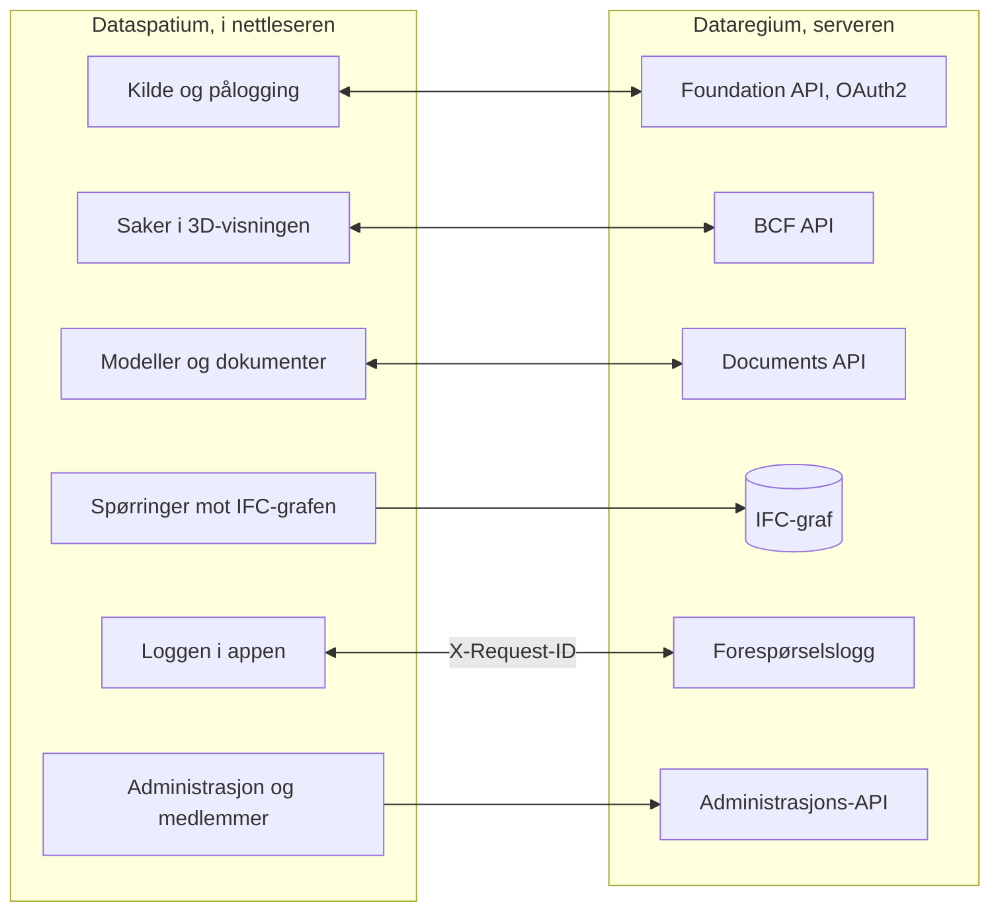

[Svenska](../../README.md) · [Dansk](../da/README.md) · **Norsk bokmål** · [Norsk nynorsk](../nn/README.md) · [Suomi](../fi/README.md) · [Íslenska](../is/README.md) · [English](../en/README.md)

# Dataspatium OpenCDE-klient

*Dette er README for Dataspatium 2.0.0. Den siste utgivelsen, 3.0.0, beskrives i [README på main](https://github.com/marwiss/Dataspatium/blob/main/docs/nb/README.md).*

Dataspatium er et program for å arbeide med data, som du åpner i den vanlige nettleseren din. Du henter inn en tabell, et kart, en
plan, en bygningsmodell eller statistikk fra en myndighet, retter og regner på den, lager diagrammer og rapporter og sender resultatet
videre. Alt skjer på din egen datamaskin: ingen installasjon, ingen konto og ingen server. Ingenting forlater datamaskinen med mindre
du selv eksporterer eller deler det, og appen spør alltid før den bruker internett.

Dataspatium kan også arbeide mot [Dataregium](https://github.com/marwiss/Dataregium), en server der et byggeprosjekt deler modeller,
dokumenter og saker. Da kan du hente prosjektets bygningsmodeller, peke ut problemer i 3D som saker og stille spørsmål til serverens
graf over modellene. Uten Dataregium fungerer alt annet akkurat som før.

**For den teknisk kyndige:** en statisk nettapp uten byggesteg som kjører fra `file://` i Edge, Chrome og Firefox eller fra hvilken som
helst statisk nettserver. Hvert datasett er en SQLite-fil (sql.js) i IndexedDB; R kjører i WebR 0.5.9 og Python i Pyodide 0.29.5, begge
i workers; IFC leses med web-ifc og IfcOpenShell (wasm). Mot en server er appen en OpenCDE-klient: Foundation API 1.0 med OAuth2
authorization code og PKCE, BCF API 3.0 og 2.1 og Documents API 1.0. Ingen nettverkskall skjer uten samtykke per formål, og
hemmeligheter lagres bare kryptert (AES-GCM).

**Innhold**

- [Last ned og kom i gang](#last-ned-og-kom-i-gang)
- [Hva som kreves](#hva-som-kreves)
- [Ord du bør kjenne](#ord-du-bør-kjenne)
- [Hva du kan gjøre](#hva-du-kan-gjøre)
- [OpenCDE-API-ene og klientene deres](#opencde-api-ene-og-klientene-deres)
- [Dataspatium og Dataregium](#dataspatium-og-dataregium)
- [Lær mer](#lær-mer)
- [Begrensninger i korte trekk](#begrensninger-i-korte-trekk)
- [Personopplysninger](#personopplysninger)
- [Nyere utgivelser](#nyere-utgivelser)
- [Feil og forslag](#feil-og-forslag)
- [Utvikling](#utvikling)
- [Lisens](#lisens)

## Last ned og kom i gang

1. **Last ned.** Gå til [utgivelse 2.0.0](https://github.com/marwiss/Dataspatium/releases/tag/v2.0.0) og hent ZIP-filen under *Assets*
   (`dataspatium-<version>.zip`, omtrent 100 MB; R og de vanligste R-pakkene følger med).
2. **Pakk ut.** Høyreklikk på ZIP-filen og velg *Pakk ut alle* (Windows), eller dobbeltklikk på den (macOS). Legg mappen der du vil ha
   den, for eksempel i Dokumenter. Appen virker ikke direkte inne i ZIP-filen.
3. **Åpne.** Dobbeltklikk på `index.html` i mappen, eller dra filen inn i et nettleservindu. Hvis Windows spør hvilken app som skal
   brukes, velger du Edge, Chrome eller Firefox. Første gang velger du språk, og deretter tilbys **grunnkurset**: en gjennomgang av alle
   moduser med eksempeldata som tar omtrent ti minutter og kan åpnes igjen fra hjelpen (?).
4. **Hent inn data.** I modusen *Hent* slipper du en fil på flaten, eller klikker på *Prøv med eksempeldata*. Appen viser hva filen
   inneholder; klikk på *Importer*. Datasettet lagres i nettleseren på datamaskinen din.
5. **Arbeid videre.** Modusene øverst er stegene i arbeidet: *Håndter* holder orden på datasettene dine, *Søk* finner rader uten kode,
   *Bearbeid* viser tabellen, kartet eller modellen med knapper for å rette og regne, *Analyser* har statistikk og kode (R, Python og
   SQL), *Visualiser* lager diagrammer og kart, *Eksporter* lagrer filer på datamaskinen, og *Del* sender til andre.

Det du lagrer, ligger i nettleserens egen database på datamaskinen. Sletter du nettleserens nettstedsdata, forsvinner det, så ta jevnlig
en sikkerhetskopi under *Håndter > Arbeidsområde*. Sikkerhetskopien er en ZIP-fil som kan gjenopprettes på samme eller en annen
datamaskin. Steg for steg med flere detaljer: [kom-igang.md](kom-igang.md).

Nettversjonen på <https://marwiss.github.io/Dataspatium/> er alltid den siste utgivelsen, nå 3.0.0.

### For den teknisk kyndige

- **Kjør:** pakk ut ZIP-filen og åpne `index.html` (file://), eller server mappen: `python -m http.server 8080 --bind 127.0.0.1` og åpne
  <http://127.0.0.1:8080/>. Fra en nettserver finnes service worker, en app som kan installeres, og R og Python som kan avbrytes.
- **Kontroller ZIP-filen:** sammenlign SHA-256 med den i utgivelsens tekst (`Get-FileHash` i PowerShell, `shasum -a 256` på macOS og
  Linux).
- **Med en server:** start Dataregium med Docker eller Podman (`docker compose up -d --build --wait` og
  `docker compose exec api opencde seed` i Dataregiums repo), server Dataspatium på port 8080 og legg til serveren under *Hent > Legg
  til kilder > OpenCDE*. Klient-id kan stå tomt når serveren tillater selvregistrering. Hele veien på tjue minutter:
  [snabbstart.md](snabbstart.md).
- **Grafen:** serverens IFC-graf (Neo4j eller Memgraph) spørres med Cypher fra *Hent*, gjennom serverens grafspørring eller direkte over
  Bolt.
- **Prøver:** `powershell -File tools/run-tests.ps1` eller `tools/run-tests.sh` kjører hele suiten i headless Edge og Firefox.

## Hva som kreves

- Windows, macOS eller Linux.
- Microsoft Edge eller Google Chrome (versjon 120 eller nyere), eller Firefox (versjon 128 eller nyere). Safari støttes ikke for hele
  appen.
- Omtrent 300 MB ledig plass til appmappen og minst 4 GB minne (8 GB anbefales for store datasett og modeller). Ingen
  administratorrettigheter trengs.
- Internett trengs bare når du selv velger noe som krever det, og appen spør om lov først for hvert formål: hente data fra åpne API-er
  og kart, koble til en Dataregium-server eller GitHub, se etter oppdatering eller hente en del som ikke
  følger med i mappen (Python, IfcOpenShell og R-pakker utover de vanligste).
- Dataregium trenger en server. Å kjøre din egen krever Docker eller Podman; det beskriver Dataregiums README.

## Ord du bør kjenne

Du trenger ikke kunne ordene nedenfor for å bruke appen, men de forekommer i teksten.

- **API**: en måte for programmer å hente data fra hverandre over nettet. Appen henter statistikk fra myndigheters API-er og snakker
  med Dataregium gjennom dens API-er.
- **Datasett**: det appen lagrer når du henter inn noe: en tabell, et kart, en plan, en graf, en modell eller en samling dokumenter
  eller bilder.
- **Oppskrift**: listen over alt du har gjort med et datasett, steg for steg, slik at det kan angres eller gjentas på nye data.
- **R, Python og SQL**: språk for å analysere data. Appen har dem innebygd, men det meste gjøres med knapper og skjemaer som skriver
  koden for deg.
- **BIM**: å beskrive en bygning som en digital modell der hver vegg, dør og hvert rom har opplysninger, ikke bare som streker på en
  tegning.
- **IFC**: det åpne filformatet for bygningsmodeller, som alle de store programmene for byggeprosjektering kan lese og skrive.
- **CAD**: tegninger laget i et tegneprogram; appen leser dem i det åpne formatet DXF.
- **IDS**: en åpen fil som sier hvilke opplysninger en modell må ha, slik at modellen kan kontrolleres automatisk.
- **BCF**: et åpent format for saker om en modell, for eksempel «ventilasjonen går gjennom bjelken», med et bilde og visningen som viser
  stedet.
- **OpenCDE**: buildingSMARTs åpne regler for hvordan programmer deler et byggeprosjekts modeller, dokumenter og saker, slik at
  programmer fra ulike produsenter fungerer sammen.
- **Server**: et program som andre kobler seg til over nettet. Dataregium er en server; Dataspatium trenger ingen.
- **Graf og grafdatabase**: data som ting og forbindelsene mellom dem, for eksempel at en dør sitter i en vegg i en etasje. Dataregium
  kan lagre hver modell som en graf i Neo4j eller Memgraph ved hjelp av modulen IFC-LPG.
- **Container**: et ferdigpakket program som startes med Docker eller Podman uten at delene installeres hver for seg. Dataregium kjører
  slik; Dataspatium trenger ingen containere.
- **OAuth2-pålogging**: den vanlige måten å logge på en tjeneste fra en annen app uten at appen ser passordet ditt.
- **file:// og CORS**: file:// betyr at appen åpnes direkte fra en mappe. CORS er nettleserens regel for hvilke nettjenester en nettapp
  får hente data fra; en tjeneste uten CORS kan ikke nås direkte.

## Hva du kan gjøre

Det som virker i én versjon, virker også i den neste. Hver versjon hører sammen med samme versjon av Dataregium.

### Versjon 1 (med Dataregium 1)

- **Hent inn data**: filer i rundt førti formater, fra Excel og CSV til statistikkfiler, geodata og tabeller i Word og nettsider, og
  statistikk fra myndigheter i Sverige, Norden og Europa med ett klikk (se [Åpne API-er](api-konfiguration.md)). *Teknisk:* tegnkoding og
  kolonnetyper gjenkjennes; SPSS, Stata, SAS, PX, Parquet og RDS via R; egne kilder som `*.api.json`.
- **Rett og regn**: rundt femti handlinger med knapper, som å rense, bytte type, omkode, regne andeler, pivotere og koble tabeller, med
  kvalitetsregler, pseudonymisering av personnumre, angre og versjoner (se [Bearbeid](bearbeta.md)). *Teknisk:* hvert steg lagres i en
  oppskrift som kan eksporteres som R- eller SQL-kode.
- **Analyser**: R med ggplot2 og tidyverse, SQL på tvers av datasett, regulære uttrykk og notatbøker som blir rapporter, helt i
  nettleseren (se [R](r-guide.md) og [Regulære uttrykk](regex.md)).
- **Planer**: svenske detaljplaner og oversiktsplaner som plankart med Boverkets farger og tegnforklaringer, i planens eget
  koordinatsystem (se [Planer](planer.md)).
- **Diagrammer, kart og dokumenter**: diagrammer og kart med Vega-Lite, D3 eller R, dashboards og rapporter fra maler som HTML, Word,
  PDF, PowerPoint, Markdown eller LaTeX (se [Visualiser](visualisera.md)).
- **Lagre og dele**: data i rundt ti formater, delingspakker, kommentarer, sikkerhetskopi, synkronisering med GitHub og en bærbar mappe.
- **Dataregium som dokumentarkiv**: hent dokumenter fra serveren som datasett, og send datasett og filer tilbake som nye versjoner.
  *Teknisk:* Foundation API og Documents API.
- **Seks språk og et grunnkurs**: svensk, dansk, norsk (bokmål), finsk, islandsk og engelsk, og kommandopaletten (Ctrl+K) som finner alt.

### Også i versjon 2 (med Dataregium 2)

- **Søk og Del**: to nye moduser. *Søk* finner og lister rader uten kode; *Del* sender pakker, publiserer dashboards og dokumenter som
  nettsider og overfører til telefoner med en QR-kode, etter en gjennomgang av personopplysninger (se [Søk](soka.md) og [Del](dela.md)).
- **Flere kilder**: Access-filer, databaser, åpne geodata, bakgrunnskart, dokumenter og bilder som samlinger og tekst fra skannede sider
  (se [Kilder](kallor.md)). *Teknisk:* en lokal bro til SQL Server og ODBC, PostgREST, OData, GraphQL, SPARQL med flere over HTTP, WFS,
  OGC API Features, ArcGIS og Neo4j over Bolt.
- **Kart, planer og grafer**: kart med lag og geoverktøy, planer fra hele Norden og grafer som tegnes, spørres og redigeres (se
  [Kart](kartor.md) og [Grafer](grafer.md)).
- **Bygningsmodeller**: IFC-modeller i 3D med tabeller, egenskaper og mengder, kontroll mot skjemaet og mot IDS, og DXF-tegninger (se
  [CAD og BIM](cad-bim.md)). *Teknisk:* web-ifc og three.js for visningen, IfcOpenShell og ifctester i appens Python.
- **Naviger i modellen**: visningskube og standardvisninger, ortografisk visning, snittboks og snitt ved etasje, dreiepunkt med
  dobbeltklikk og tastaturet; kameraet og snittet følger med sakenes viewpoints, og kart og planer har målestokk (se [CAD og
  BIM](cad-bim.md#visninger-og-tastaturet)).
- **Flere geodatakilder**: Lantmäteriets vektordata, ortofoto, høydedata og kart som filer med nøkkel, der vektorfilene leses inn
  direkte, vegdata fra Trafikverkets NVDB (fartsgrenser, vegnummer, bæreevne og 42 objekttyper til, med nøkkel), artsfunn fra SLU
  Artdatabanken og bygninger, strandvern, kulturhistoriske levninger og grensen for fjellnær skog fra den nasjonale
  geodataplattformen; kildelisten viser når en kilde ikke kan nås der appen kjører, og pakker tar bare med diagrammer og
  notatbøker for de valgte datasettene (se [Kilder](kallor.md)).
- **Python og statistikk uten kode**: en Python-konsoll og skjemaer for statistikk og tidsserier som skriver og viser koden (se
  [Statistikk](statistik.md) og [Python](python.md)).
- **Orden og flyter**: mapper, tagger og handlinger på mange datasett, lagrede flyter som kjører med ett klikk, og kilder som sier fra
  når de har nye data (se [Moduser](lagen.md)).
- **Dataspatium Mobil**: telefonen tar imot og viser data og samler inn rader i felt, også uten nett (se [Mobil](mobil.md)).
- **Dataregium med saker**: prosjektets modeller og saker, nye saker som peker ut stedet i 3D, BCF-filer, serverens IFC-graf, kortet
  *Administrasjon* for administratoren og kortet *Prosjektets medlemmer* for den prosjektansvarlige (se
  [Dataspatium og Dataregium](#dataspatium-og-dataregium)). *Teknisk:* BCF API 3.0 og 2.1 med viewpoints.
- **Sju språk**: også nynorsk, med håndboken i appen og grunnkurset gjennom alle åtte moduser.

## OpenCDE-API-ene og klientene deres

OpenCDE er buildingSMART Internationals åpne regler for hvordan programmer deler et byggeprosjekts modeller, dokumenter og saker. Et
program som følger reglene, kan arbeide med hver server som også gjør det, uansett hvem som har laget dem. Dataspatium er et slikt
program, en klient, og bruker alle tre API-ene:

| API | Hva appen gjør med det | Spesifikasjon |
|---|---|---|
| Foundation API 1.0 | Leser hvilke API-er serveren tilbyr, hvor man logger på og hvem brukeren er; registrerer appen som klient når serveren tillater det | [foundation-API](https://github.com/buildingSMART/foundation-API) |
| BCF API 3.0 og 2.1 | Leser og skriver saker om en modell, med kommentarer og viewpoints (kamera, komponenter og bilder) fra 3D-visningen; velger den nyeste versjonen serveren tilbyr | [BCF-API](https://github.com/buildingSMART/BCF-API) |
| Documents API 1.0 | Velger og henter dokumenter og versjoner via serverens egne sider, slik at en IFC-modell blir et datasett, og laster opp nye versjoner, datasett og pakker | [documents-API](https://github.com/buildingSMART/documents-API) |

**Dataregium er én server, ikke den eneste.** Ingenting i appen avhenger av Dataregium. Dataregiums utvidelser utenfor
spesifikasjonene (kapabilitetsdokumentet, grafspørringene og prosjektadministrasjonen) vises bare når serveren selv oppgir dem.

**For den teknisk kyndige:** av en server trenger appen tre ting:

- CORS fra appens opprinnelse: `null` fra file://, `http://127.0.0.1:8080` fra en lokal nettserver og `https://marwiss.github.io` fra
  nettet, med hodene Authorization, Content-Type og X-Request-ID;
- en klientregistrering, gjort av serverens administrator (en offentlig klient med omdirigeringsadressen
  `http://127.0.0.1:8080/oauth-callback.html`, eller tilsvarende for appens adresse) eller av appen selv (RFC 7591) når serveren tillater
  det, og OAuth2 authorization code med PKCE `S256`; fra file:// limer du inn adressen du havner på etter påloggingen;
- BCF API 3.0 eller 2.1; Documents API er valgfritt, men uten det kan appen ikke hente eller publisere dokumenter.

Så langt er det vist mot Dataregium: livesuiten kjøres mot serveren i begge versjonene av BCF API, og en server med bare 2.1 virker.
Andre servere er ikke prøvd; fortell hvordan det gikk under [Feil og forslag](#feil-og-forslag). Når appen og en spesifikasjon ikke
stemmer overens, avgjør spesifikasjonen. Appens side beskrives i [kallor.md](kallor.md), serverens i Dataregiums README.

## Dataspatium og Dataregium

*Dataregium het Kontroll fram til 8. november 2026.*

Dataspatium er appen du arbeider i, og [Dataregium](https://github.com/marwiss/Dataregium) er serveren der et prosjekt samler modeller,
dokumenter og saker. De er bygget for hverandre, men følger åpne regler, så andre programmer virker også. Du legger til serveren som
kilde i *Hent* og logger på; deretter henter du prosjektets modeller og dokumenter, peker ut problemer i 3D som saker, sender datasett og
filer tilbake og stiller spørsmål til serverens graf over modellene. Uten server
virker resten av appen som vanlig.

**For den teknisk kyndige:** alt unntatt grafspørringene og administrasjonen går gjennom de tre OpenCDE-API-ene. Hvert kall bærer en
`X-Request-Id` som serveren skriver i forespørselsloggen sin, slik at loggen i appen og serverens logg kan pares. Samarbeidet beskrives
fra appens side i [kallor.md](kallor.md) og [cad-bim.md](cad-bim.md) og fra serverens side i Dataregiums README og
`docs/client-guide.md`.

Slik henger de sammen:

Dataspatium 2.0.0 fungerer med Dataregium 2.0.0. Samme nummer hører sammen. Hurtigstarten [snabbstart.md](snabbstart.md) tar paret fra
ingenting til en sak på tjue minutter.

### Utgivelsene 1, 2 og 3

Det finnes én utgivelse per hovednummer, og Dataspatium og Dataregium med samme nummer hører sammen:

| Dataspatium | Hva den har | Hører sammen med |
|---|---|---|
| 1.0.0 | Data fra filer og åpne API-er, bearbeiding, R, SQL og regulære uttrykk, svenske planer, diagrammer og kart i diagrammer, dashboards, dokumenter, eksport og deling. Mot en server bare Documents API: hent dokumenter som datasett og send datasett og filer tilbake. Ingen saker, ingen modeller og ingen Python | Dataregium 1.0.0 (bare Documents API) |
| 2.0.0 | Alt i 1.0.0 og dessuten modusene Søk og Del, Python og statistikk uten kode, flere kilder, kartvisninger, nordiske planer, grafer, IFC-modeller i 3D med kontroll mot IDS, flyter, Dataspatium Mobil, saker med viewpoints (BCF API 3.0 og 2.1), serverens IFC-graf, kortet *Administrasjon* og kortet *Prosjektets medlemmer*, navigasjon med visningskube og snitt, flere geodatakilder | Dataregium 2.0.0 |
| 3.0.0 | Alt i 2.0.0 og dessuten kortet *Valider modellen*, kollisjonskontroll, Spør AI og Endre med AI, nye tomme modeller i valgfritt skjema, Sammenlign versjoner, publisering med basisversjon og forhåndskontroll, endringsforslag som prøves og godkjennes på serveren med valg ved konflikter, og grafen i en lettere form | Dataregium 3.0.0 |

En ny utgivelse med samme hovednummer erstatter den forrige; bare den siste i hver serie rettes. Appens oppdateringskontroll tilbyr neste
hovednummer, og datasett, lister, diagrammer, maler og skript følger med når du åpner den nye versjonens `index.html`.

## Lær mer

Filnavnene er de samme på alle språk (de er de svenske originalene), så lenker virker likt overalt.

**Begynn her**

- **Grunnkurset** i appen: en gjennomgang av alle moduser med eksempeldata; åpne det fra hjelpen (?) eller med Ctrl+K.
- **Håndboken** i appen: den samme dokumentasjonen som her, med søk; åpne den med ? øverst til høyre eller F1.
- [Kom i gang](kom-igang.md): steg for steg med vanlige spørsmål.
- [Brukerveiledning](anvandarguide.md): hele arbeidsflyten fra fil til rapport.
- [De åtte modusene](lagen.md): hva som finnes hvor, og hvorfor.
- [Vanlige spørsmål](faq.md): lagring, sikkerhet, R, API-er og oppdateringer.

**Etter område**

- [Formater og import](format.md) og [Åpne API-er](api-konfiguration.md): filformater, tegnkoding, de forhåndsinnstilte kildene, nøkler
  og egne konfigurasjoner.
- [Kilder](kallor.md): databaser, broen, åpne geodata, lenkede filer og OpenCDE-servere.
- [Bearbeid](bearbeta.md), [Søk](soka.md) og [Regulære uttrykk](regex.md): rett, regn og finn.
- [Statistikk](statistik.md), [R i Dataspatium](r-guide.md), [Python i Dataspatium](python.md) og [Notatbok](anteckningsbok.md): analyse
  med og uten kode.
- [Visualiser](visualisera.md), [Kart](kartor.md) og [Dokumenter og maler](dokumentmallar.md): diagrammer, kart, dashboards og rapporter.
- [Planer](planer.md), [Grafer](grafer.md) og [CAD og BIM](cad-bim.md): planer, grafer, bygningsmodeller og kontroller.
- [Dokumenter og bilder](dokument.md): PDF, Word, OpenDocument, Markdown og bilder som datasett.
- [Flyter](floden.md), [Del](dela.md), [Dataspatium Mobil](mobil.md) og [Innsamling](insamling.md): automatiser, del og samle inn.
- [Hurtigstart med Dataregium](snabbstart.md): tjue minutter fra ingenting til en sak opprettet i 3D-visningen og synlig på serveren.
- [Sikkerhet](sakerhet.md) og [Lisenser](licenser.md): trusselmodell, kontroller og prøver, og hva du får gjøre med appen.
- Hvordan bidrag tas imot, står i [CONTRIBUTING.md](../../CONTRIBUTING.md) (på svensk).

### Videre lesning

- [BCF API](https://github.com/buildingSMART/BCF-API), [Foundation API](https://github.com/buildingSMART/foundation-API) og [Documents API](https://github.com/buildingSMART/documents-API): spesifikasjonene appen følger mot en server.
- [IFC](https://github.com/buildingSMART/IFC4.x-development): filformatet for bygningsmodeller, og [IDS](https://github.com/buildingSMART/IDS): kravspesifikasjoner som modeller kontrolleres mot.
- Eksterne ressurser: [WebR](https://docs.r-wasm.org/webr/latest/), [Pyodide](https://pyodide.org/), [IfcOpenShell](https://ifcopenshell.org/),
  [Vega-Lite](https://vega.github.io/vega-lite/), [SCBs API](https://www.scb.se/en/services/open-data-api/).

## Begrensninger i korte trekk

- Appen må åpnes fra en utpakket mappe eller en vanlig nettserver; den virker ikke direkte inne i ZIP-filen.
- Nettjenester som ikke tillater kall fra nettlesere (mangler CORS, for eksempel den svenske Riksbanken), kan ikke nås direkte; en egen
  proxy kan oppgis.
- Et datasett bør holde seg under et par millioner rader, og svært store bygningsmodeller kan være for tunge for nettleseren; minnet
  setter grensen.
- Når appen åpnes fra en mappe, kan R- og Python-kode ikke avbrytes midt i en beregning; bruk *Start R på nytt* eller *Start Python på
  nytt*. Fra en nettserver finnes knappen *Avbryt*.
- Python og IfcOpenShell følger ikke med i ZIP-filen; de hentes første gang de trengs, etter samtykke, og lagres deretter i nettleseren.
- Flere faner virker og holder hverandre orientert, men ikke rediger samme datasett i to faner samtidig: den som lagrer sist, vinner.
- Den bærbare mappen krever Edge eller Chrome; Firefox mangler mappetilgang. Sikkerhetskopi som ZIP virker overalt.
- Hele appen er laget for datamaskiner. På telefoner og nettbrett brukes Dataspatium Mobil (<https://marwiss.github.io/Dataspatium/m/>),
  som tar imot, viser, samler inn og sender videre. I smale vinduer åpnes panelene som ark over arbeidsflaten.
- Eksempeldata og kartgrenser som følger med, dekker Sverige, Danmark, Norge og Finland, og de forhåndsinnstilte kildene er nordiske og
  europeiske; data fra andre land kan du like gjerne hente inn selv.

## Personopplysninger

Dataspatium kjører i nettleseren din, og du er selv ansvarlig for opplysningene du legger inn. Alt appen lagrer (datasett og
versjonene deres, lister, diagrammer, dokumenter, notatbøker, kommentarer og innstillinger) ligger i nettleserens lager på din
datamaskin og forlater den bare når du eksporterer, deler eller publiserer; da gjennomgås alt i sin helhet først, og personopplysninger
kan beholdes, pseudonymiseres eller fjernes i kopien. Til en Dataregium-server sendes innloggingen din (token holdes i økten eller
kryptert med passfrasen din, aldri i klartekst), sakene, kommentarene og filene du oppretter under navnet ditt på
serveren, og en X-Request-ID per kall; serverens egen behandling står i Dataregiums README. Kommentarer og pakker bærer navnet du selv oppgir. Kontrollene og prøvene som viser dem står
i [sakerhet.md](sakerhet.md).

## Nyere utgivelser

Dataspatium 3.0.0, laget sammen med Dataregium 3.0.0, legger til kontroll av modeller, kollisjonskontroll, Spør AI og Endre med AI,
nye tomme modeller, Sammenlign versjoner og endringsforslag som serveren prøver og godkjenner. Den hentes fra
[siste utgivelse](https://github.com/marwiss/Dataspatium/releases/latest) og beskrives i [README på main](https://github.com/marwiss/Dataspatium/blob/main/docs/nb/README.md). Datasett, lister, diagrammer, maler og skript følger med når du
åpner den nye versjonens `index.html`.

## Feil og forslag

Rapporter feil eller ønsker som *Issues* her på GitHub. Beskriv nettleser, versjon av Dataspatium (vises under
hjelpeknappen) og hva du gjorde. Se [CONTRIBUTING.md](../../CONTRIBUTING.md). Legg ikke ved personopplysninger eller hemmeligheter. For en
sikkerhetssårbarhet, følg [SECURITY.md](../../SECURITY.md) i stedet for å åpne et issue.

## Utvikling

- Intet byggesteg, ingen node.js. Åpne `index.html` direkte, eller server mappen med `python -m http.server 8080`.
- Arkitektur i korte trekk: all egen kode er klassiske skript som registreres med `Dataspatium.define` i rekkefølgen i `src/boot.js`;
  `src/platform` bærer alt som er spesifikt for file:// (ressurser, shims, workers, lagring, samtykke); motorene SQLite, R (WebR) og
  Python (Pyodide) kjører i workers; `src/ui` har designvariablene, komponentene (`dm-*`), skallet og én modus per fil. Alt som vises,
  escapes, og ingenting hentes fra nettet uten din handling og ditt samtykke.
- Tredjepartskomponenter: `python tools/fetch_vendor.py` fulgt av `python tools/wrap_assets.py`.
- Prøver: `powershell -File tools/run-tests.ps1` eller `tools/run-tests.sh` (headless Edge og Firefox). Prøvene går aldri mot nettet;
  ekte tjenester prøves bare med egne parametere (`?cde=` mot en Dataregium, `?python=1` med Pyodide).
- Sikkerhet: prøvene for samtykke, hemmeligheter, gjennomgang før deling, OAuth2 (PKCE, state, tilbakehopp) og loggens maskering inngår
  i suiten; se [sakerhet.md](sakerhet.md).

## Lisens

Dataspatiums egen kode, dokumentasjon og forhåndsinnstillinger (alt unntatt `vendor/`) er lisensiert under
[PolyForm Strict 1.0.0](../../LICENSE): fri å laste ned og bruke til ikke-kommersielle formål, også i offentlige etater og
andre offentlige institusjoner, men ikke å endre, bygge videre på eller distribuere videre uten skriftlig tillatelse.
Lisensgiver er Dataspatiums opphavsperson, som kan kontaktes via GitHub-kontoen [marwiss](https://github.com/marwiss); opprett
et issue for andre vilkår. Hva lisensen betyr i praksis, forklares i [licenser.md](licenser.md).

Tredjepartskomponenter i `vendor/` har egne lisenser (MIT, BSD, Apache-2.0, ISC, OFL, MPL, LGPL og GPL), se
[THIRD_PARTY_LICENSES.md](../../THIRD_PARTY_LICENSES.md). R og de GPL-lisensierte R-pakkene distribueres uendret; kildekoden
finnes hos [R-prosjektet](https://cran.r-project.org/sources.html), [webR](https://github.com/r-wasm/webr) og
[CRAN](https://cran.r-project.org/) i versjonene som er oppgitt der. Se [SECURITY.md](../../SECURITY.md) for hvordan en sårbarhet rapporteres,
og hva prosjektet gjør for å forbli sikkert.
