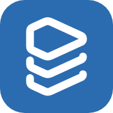
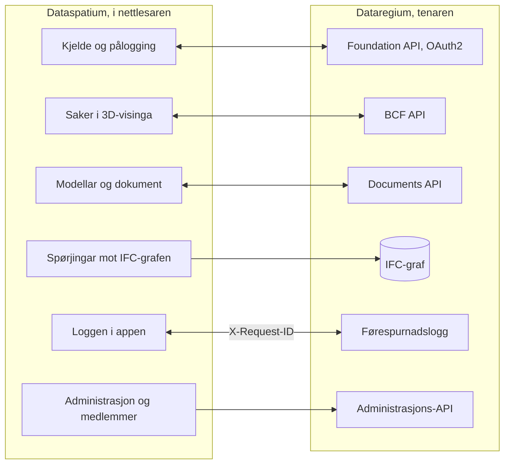

[Svenska](../../README.md) · [Dansk](../da/README.md) · [Norsk bokmål](../nb/README.md) · **Norsk nynorsk** · [Suomi](../fi/README.md) · [Íslenska](../is/README.md) · [English](../en/README.md)

# Dataspatium OpenCDE-klient

*Dette er README-en for Dataspatium 2.0.0. Den siste utgjevinga, 3.0.0, er skildra i [README-en på main](https://github.com/marwiss/Dataspatium/blob/main/docs/nn/README.md).*

Dataspatium er eit program for å arbeide med data, som du opnar i den vanlege nettlesaren din. Du hentar inn ein tabell, eit kart, ein
plan, ein bygningsmodell eller statistikk frå ei styresmakt, rettar og reknar på han, lagar diagram og rapportar og sender resultatet
vidare. Alt skjer på din eigen datamaskin: ingen installasjon, ingen konto og ingen tenar. Ingenting forlèt datamaskinen med mindre du
sjølv eksporterer eller deler det, og appen spør alltid før han brukar internett.

Dataspatium kan også arbeide mot [Dataregium](https://github.com/marwiss/Dataregium), ein tenar der eit byggjeprosjekt deler modellar,
dokument og saker. Då kan du hente bygningsmodellane til prosjektet, peike ut problem i 3D som saker og stille spørsmål til grafen over
modellane på tenaren. Utan Dataregium fungerer alt anna akkurat som før.

**For den teknisk kunnige:** ein statisk nettapp utan byggjesteg som køyrer frå `file://` i Edge, Chrome og Firefox eller frå kva statisk
nettenar som helst. Kvart datasett er ei SQLite-fil (sql.js) i IndexedDB; R køyrer i WebR 0.5.9 og Python i Pyodide 0.29.5, begge i
workers; IFC blir lesen med web-ifc og IfcOpenShell (wasm). Mot ein tenar er appen ein OpenCDE-klient: Foundation API 1.0 med OAuth2
authorization code og PKCE, BCF API 3.0 og 2.1 og Documents API 1.0. Ingen nettverkskall skjer utan samtykke per føremål, og løyndomar
blir berre lagra krypterte (AES-GCM).

**Innhald**

- [Last ned og kom i gang](#last-ned-og-kom-i-gang)
- [Kva som krevst](#kva-som-krevst)
- [Ord du bør kjenne](#ord-du-bør-kjenne)
- [Kva du kan gjere](#kva-du-kan-gjere)
- [OpenCDE-API-ane og klientane deira](#opencde-api-ane-og-klientane-deira)
- [Dataspatium og Dataregium](#dataspatium-og-dataregium)
- [Lær meir](#lær-meir)
- [Avgrensingar i korte trekk](#avgrensingar-i-korte-trekk)
- [Personopplysningar](#personopplysningar)
- [Nyare utgjevingar](#nyare-utgjevingar)
- [Feil og framlegg](#feil-og-framlegg)
- [Utvikling](#utvikling)
- [Lisens](#lisens)

## Last ned og kom i gang

1. **Last ned.** Gå til [utgjevinga 2.0.0](https://github.com/marwiss/Dataspatium/releases/tag/v2.0.0) og hent ZIP-fila under *Assets*
   (`dataspatium-<version>.zip`, om lag 100 MB; R og dei vanlegaste R-pakkane følgjer med).
2. **Pakk ut.** Høgreklikk på ZIP-fila og vel *Pakk ut alle* (Windows), eller dobbeltklikk på henne (macOS). Legg mappa der du vil ha
   henne, til dømes i Dokument. Appen verkar ikkje direkte inne i ZIP-fila.
3. **Opne.** Dobbeltklikk på `index.html` i mappa, eller dra fila inn i eit nettlesarvindauge. Om Windows spør kva app som skal brukast,
   vel du Edge, Chrome eller Firefox. Første gongen vel du språk, og deretter blir **grunnkurset** tilbode: ein gjennomgang av alle
   modusane med dømedata som tek om lag ti minutt og kan opnast igjen frå hjelpa (?).
4. **Hent inn data.** I modusen *Hent* slepper du ei fil på flata, eller klikkar på *Prøv med dømedata*. Appen viser kva fila
   inneheld; klikk på *Importer*. Datasettet blir lagra i nettlesaren på datamaskinen din.
5. **Arbeid vidare.** Modusane øvst er stega i arbeidet: *Handter* held orden på datasetta dine, *Søk* finn rader utan kode, *Bearbeid*
   viser tabellen, kartet eller modellen med knappar for å rette og rekne, *Analyser* har statistikk og kode (R, Python og SQL),
   *Visualiser* lagar diagram og kart, *Eksporter* lagrar filer på datamaskinen, og *Del* sender til andre.

Det du lagrar, ligg i den eigne databasen til nettlesaren på datamaskinen. Slettar du nettstaddata i nettlesaren, forsvinn det, så ta
jamleg ein tryggingskopi under *Handter > Arbeidsområde*. Tryggingskopien er ei ZIP-fil som kan gjenopprettast på same eller ein annan
datamaskin. Steg for steg med fleire detaljar: [kom-igang.md](kom-igang.md).

Nettversjonen på <https://marwiss.github.io/Dataspatium/> er alltid den siste utgjevinga, no 3.0.0.

### For den teknisk kunnige

- **Køyr:** pakk ut ZIP-fila og opne `index.html` (file://), eller server mappa: `python -m http.server 8080 --bind 127.0.0.1` og opne
  <http://127.0.0.1:8080/>. Frå ein nettenar finst service worker, ein app som kan installerast, og R og Python som kan avbrytast.
- **Kontroller ZIP-fila:** samanlikn SHA-256 med den i teksten til utgjevinga (`Get-FileHash` i PowerShell, `shasum -a 256` på macOS og
  Linux).
- **Med ein tenar:** start Dataregium med Docker eller Podman (`docker compose up -d --build --wait` og
  `docker compose exec api opencde seed` i repoet til Dataregium), server Dataspatium på port 8080 og legg til tenaren under *Hent >
  Legg til kjelder > OpenCDE*. Klient-id kan stå tomt når tenaren tillèt sjølvregistrering. Heile vegen på tjue minutt:
  [snabbstart.md](snabbstart.md).
- **Grafen:** IFC-grafen til tenaren (Neo4j eller Memgraph) blir spurd med Cypher frå *Hent*, gjennom grafspørjinga til tenaren eller
  direkte over Bolt.
- **Prøver:** `powershell -File tools/run-tests.ps1` eller `tools/run-tests.sh` køyrer heile suiten i headless Edge og Firefox.

## Kva som krevst

- Windows, macOS eller Linux.
- Microsoft Edge eller Google Chrome (versjon 120 eller nyare), eller Firefox (versjon 128 eller nyare). Safari er ikkje støtta for
  heile appen.
- Om lag 300 MB ledig plass til appmappa og minst 4 GB minne (8 GB er tilrådd for store datasett og modellar). Ingen
  administratorrettar trengst.
- Internett trengst berre når du sjølv vel noko som krev det, og appen spør om lov først for kvart føremål: hente data frå opne API-ar
  og kart, kople til ein Dataregium-tenar eller GitHub, sjå etter oppdatering eller hente ein del som
  ikkje følgjer med i mappa (Python, IfcOpenShell og R-pakkar utover dei vanlegaste).
- Dataregium treng ein tenar. Å køyre din eigen krev Docker eller Podman; det skildrar README-en til Dataregium.

## Ord du bør kjenne

Du treng ikkje kunne orda nedanfor for å bruke appen, men dei finst i teksten.

- **API**: ein måte for program å hente data frå kvarandre over nettet. Appen hentar statistikk frå API-ane til styresmakter og snakkar
  med Dataregium gjennom API-ane hans.
- **Datasett**: det appen lagrar når du hentar inn noko: ein tabell, eit kart, ein plan, ein graf, ein modell eller ei samling dokument
  eller bilete.
- **Oppskrift**: lista over alt du har gjort med eit datasett, steg for steg, slik at det kan angrast eller gjerast om att på nye data.
- **R, Python og SQL**: språk for å analysere data. Appen har dei innebygde, men det meste blir gjort med knappar og skjema som skriv
  koden for deg.
- **BIM**: å skildre ein bygning som ein digital modell der kvar vegg, dør og kvart rom har opplysningar, ikkje berre som strekar på ei
  teikning.
- **IFC**: det opne filformatet for bygningsmodellar, som alle dei store programma for byggjeprosjektering kan lese og skrive.
- **CAD**: teikningar laga i eit teikneprogram; appen les dei i det opne formatet DXF.
- **IDS**: ei open fil som seier kva opplysningar ein modell må ha, slik at modellen kan kontrollerast automatisk.
- **BCF**: eit ope format for saker om ein modell, til dømes «ventilasjonen går gjennom bjelken», med eit bilete og visinga som viser
  staden.
- **OpenCDE**: dei opne reglane til buildingSMART for korleis program deler modellane, dokumenta og sakene i eit byggjeprosjekt, slik at
  program frå ulike produsentar fungerer saman.
- **Tenar**: eit program som andre koplar seg til over nettet. Dataregium er ein tenar; Dataspatium treng ingen.
- **Graf og grafdatabase**: data som ting og sambanda mellom dei, til dømes at ei dør sit i ein vegg i ein etasje. Dataregium kan lagre
  kvar modell som ein graf i Neo4j eller Memgraph ved hjelp av modulen IFC-LPG.
- **Container**: eit ferdigpakka program som blir starta med Docker eller Podman utan at delane blir installerte kvar for seg.
  Dataregium køyrer slik; Dataspatium treng ingen containerar.
- **OAuth2-pålogging**: den vanlege måten å logge på ei teneste frå ein annan app utan at appen ser passordet ditt.
- **file:// og CORS**: file:// tyder at appen blir opna direkte frå ei mappe. CORS er regelen i nettlesaren for kva nettenester ein
  nettapp får hente data frå; ei teneste utan CORS kan ikkje nåast direkte.

## Kva du kan gjere

Det som verkar i éin versjon, verkar også i den neste. Kvar versjon høyrer saman med same versjon av Dataregium.

### Versjon 1 (med Dataregium 1)

- **Hent inn data**: filer i kring førti format, frå Excel og CSV til statistikkfiler, geodata og tabellar i Word og nettsider, og
  statistikk frå styresmakter i Sverige, Norden og Europa med eitt klikk (sjå [Opne API-ar](api-konfiguration.md)). *Teknisk:* teiknkoding
  og kolonnetypar blir kjende att; SPSS, Stata, SAS, PX, Parquet og RDS via R; eigne kjelder som `*.api.json`.
- **Rett og rekn**: kring femti handlingar med knappar, som å reinske, byte type, omkode, rekne delar, pivotere og kople tabellar, med
  kvalitetsreglar, pseudonymisering av personnummer, angre og versjonar (sjå [Bearbeid](bearbeta.md)). *Teknisk:* kvart steg blir lagra
  i ei oppskrift som kan eksporterast som R- eller SQL-kode.
- **Analyser**: R med ggplot2 og tidyverse, SQL på tvers av datasett, regulære uttrykk og notatbøker som blir rapportar, heilt i
  nettlesaren (sjå [R](r-guide.md) og [Regulære uttrykk](regex.md)).
- **Planar**: svenske detaljplanar og oversiktsplanar som plankart med fargane og teikna til Boverket, i det eigne koordinatsystemet til
  planen (sjå [Planar](planer.md)).
- **Diagram, kart og dokument**: diagram og kart med Vega-Lite, D3 eller R, dashboards og rapportar frå malar som HTML, Word, PDF,
  PowerPoint, Markdown eller LaTeX (sjå [Visualiser](visualisera.md)).
- **Lagre og dele**: data i kring ti format, delingspakkar, kommentarar, tryggingskopi, synkronisering med GitHub og ei berbar mappe.
- **Dataregium som dokumentarkiv**: hent dokument frå tenaren som datasett, og send datasett og filer tilbake som nye versjonar.
  *Teknisk:* Foundation API og Documents API.
- **Seks språk og eit grunnkurs**: svensk, dansk, norsk (bokmål), finsk, islandsk og engelsk, og kommandopaletten (Ctrl+K) som finn alt.

### Også i versjon 2 (med Dataregium 2)

- **Søk og Del**: to nye modusar. *Søk* finn og listar rader utan kode; *Del* sender pakkar, publiserer dashboards og dokument som
  nettsider og overfører til telefonar med ein QR-kode, etter ein gjennomgang av personopplysningar (sjå [Søk](soka.md) og
  [Del](dela.md)).
- **Fleire kjelder**: Access-filer, databasar, opne geodata, bakgrunnskart, dokument og bilete som samlingar og tekst frå skanna sider
  (sjå [Kjelder](kallor.md)). *Teknisk:* ei lokal bru til SQL Server og ODBC, PostgREST, OData, GraphQL, SPARQL med fleire over HTTP,
  WFS, OGC API Features, ArcGIS og Neo4j over Bolt.
- **Kart, planar og grafar**: kart med lag og geoverktøy, planar frå heile Norden og grafar som blir teikna, spurde og redigerte (sjå
  [Kart](kartor.md) og [Grafar](grafer.md)).
- **Bygningsmodellar**: IFC-modellar i 3D med tabellar, eigenskapar og mengder, kontroll mot skjemaet og mot IDS, og DXF-teikningar (sjå
  [CAD og BIM](cad-bim.md)). *Teknisk:* web-ifc og three.js for visinga, IfcOpenShell og ifctester i Python i appen.
- **Python og statistikk utan kode**: ein Python-konsoll og skjema for statistikk og tidsseriar som skriv og viser koden (sjå
  [Statistikk](statistik.md) og [Python](python.md)).
- **Orden og flytar**: mapper, taggar og handlingar på mange datasett, lagra flytar som køyrer med eitt klikk, og kjelder som seier frå
  når dei har nye data (sjå [Modusar](lagen.md)).
- **Dataspatium Mobil**: telefonen tek imot og viser data og samlar inn rader i felt, også utan nett (sjå [Mobil](mobil.md)).
- **Dataregium med saker**: modellane og sakene til prosjektet, nye saker som peikar ut staden i 3D, BCF-filer, IFC-grafen til tenaren,
  kortet *Administrasjon* for administratoren og kortet *Medlemmene i prosjektet* for den prosjektansvarlege (sjå
  [Dataspatium og Dataregium](#dataspatium-og-dataregium)). *Teknisk:* BCF API 3.0 og 2.1 med viewpoints.
- **Sju språk**: også nynorsk, med handboka i appen og grunnkurset gjennom alle åtte modusane.

## OpenCDE-API-ane og klientane deira

OpenCDE er dei opne reglane til buildingSMART International for korleis program deler modellane, dokumenta og sakene i eit
byggjeprosjekt. Eit program som følgjer reglane, kan arbeide med kvar tenar som også gjer det, same kven som har laga dei. Dataspatium er
eit slikt program, ein klient, og brukar alle tre API-ane:

| API | Kva appen gjer med det | Spesifikasjon |
|---|---|---|
| Foundation API 1.0 | Les kva API-ar tenaren tilbyr, kvar ein loggar på og kven brukaren er; registrerer appen som klient når tenaren tillèt det | [foundation-API](https://github.com/buildingSMART/foundation-API) |
| BCF API 3.0 og 2.1 | Les og skriv saker om ein modell, med kommentarar og viewpoints (kamera, komponentar og bilete) frå 3D-visinga; vel den nyaste versjonen tenaren tilbyr | [BCF-API](https://github.com/buildingSMART/BCF-API) |
| Documents API 1.0 | Vel og hentar dokument og versjonar via dei eigne sidene til tenaren, slik at ein IFC-modell blir eit datasett, og lastar opp nye versjonar, datasett og pakkar | [documents-API](https://github.com/buildingSMART/documents-API) |

**Dataregium er éin tenar, ikkje den einaste.** Ingenting i appen er avhengig av Dataregium. Utvidingane til Dataregium utanfor
spesifikasjonane (kapabilitetsdokumentet, grafspørjingane og prosjektadministrasjonen) blir berre viste når tenaren sjølv oppgjev dei.

**For den teknisk kunnige:** av ein tenar treng appen tre ting:

- CORS frå opphavet til appen: `null` frå file://, `http://127.0.0.1:8080` frå ein lokal nettenar og `https://marwiss.github.io` frå
  nettet, med hovuda Authorization, Content-Type og X-Request-ID;
- ei klientregistrering, gjord av administratoren til tenaren (ein offentleg klient med omdirigeringsadressa
  `http://127.0.0.1:8080/oauth-callback.html`, eller tilsvarande for adressa til appen) eller av appen sjølv (RFC 7591) når tenaren
  tillèt det, og OAuth2 authorization code med PKCE `S256`; frå file:// limer du inn adressa du hamnar på etter pålogginga;
- BCF API 3.0 eller 2.1; Documents API er valfritt, men utan det kan appen ikkje hente eller publisere dokument.

Så langt er det vist mot Dataregium: livesuiten blir køyrd mot tenaren i begge versjonane av BCF API, og ein tenar med berre 2.1 verkar.
Andre tenarar er ikkje prøvde; fortel korleis det gjekk under [Feil og framlegg](#feil-og-framlegg). Når appen og ein spesifikasjon ikkje
stemmer overeins, avgjer spesifikasjonen. Sida til appen er skildra i [kallor.md](kallor.md), sida til tenaren i README-en til Dataregium.

## Dataspatium og Dataregium

*Dataregium heitte Kontroll fram til 8. november 2026.*

Dataspatium er appen du arbeider i, og [Dataregium](https://github.com/marwiss/Dataregium) er tenaren der eit prosjekt samlar modellar,
dokument og saker. Dei er bygde for kvarandre, men følgjer opne reglar, så andre program verkar også. Du legg til tenaren som kjelde i
*Hent* og loggar på; deretter hentar du modellane og dokumenta til prosjektet, peikar ut problem i 3D som saker, sender datasett og filer
tilbake og stiller spørsmål til grafen over modellane på tenaren. Utan tenar verkar
resten av appen som vanleg.

**For den teknisk kunnige:** alt unnateke grafspørjingane og administrasjonen går gjennom dei tre OpenCDE-API-ane. Kvart kall ber ein
`X-Request-Id` som tenaren skriv i førespurnadsloggen sin, slik at loggen i appen og loggen til tenaren kan parast. Samarbeidet er
skildra frå sida til appen i [kallor.md](kallor.md) og [cad-bim.md](cad-bim.md) og frå sida til tenaren i README-en til Dataregium og
`docs/client-guide.md`.

Slik heng dei saman:

Dataspatium 2.0.0 fungerer med Dataregium 2.0.0. Same nummer høyrer saman. Snøggstarten [snabbstart.md](snabbstart.md) tek paret frå
ingenting til ei sak på tjue minutt.

### Utgjevingane 1, 2 og 3

Det finst éi utgjeving per hovudnummer, og Dataspatium og Dataregium med same nummer høyrer saman:

| Dataspatium | Kva ho har | Høyrer saman med |
|---|---|---|
| 1.0.0 | Data frå filer og opne API-ar, bearbeiding, R, SQL og regulære uttrykk, svenske planar, diagram og kart i diagram, dashboards, dokument, eksport og deling. Mot ein tenar berre Documents API: hent dokument som datasett og send datasett og filer tilbake. Ingen saker, ingen modellar og ingen Python | Dataregium 1.0.0 (berre Documents API) |
| 2.0.0 | Alt i 1.0.0 og dessutan modusane Søk og Del, Python og statistikk utan kode, fleire kjelder, kartvisingar, nordiske planar, grafar, IFC-modellar i 3D med kontroll mot IDS, flytar, Dataspatium Mobil, saker med viewpoints (BCF API 3.0 og 2.1), IFC-grafen til tenaren, kortet *Administrasjon* og kortet *Medlemmene i prosjektet* | Dataregium 2.0.0 |
| 3.0.0 | Alt i 2.0.0 og dessutan kortet *Valider modellen*, kollisjonskontroll, Spør AI og Endre med AI, nye tomme modellar i valfritt skjema, Samanlikn versjonar, publisering med basisversjon og førehandskontroll, endringsframlegg som blir prøvde og godkjende på tenaren med val ved konfliktar, og grafen i ei lettare form | Dataregium 3.0.0 |

Ei ny utgjeving med same hovudnummer erstattar den førre; berre den siste i kvar serie blir retta. Oppdateringskontrollen i appen tilbyr
neste hovudnummer, og datasett, lister, diagram, malar og skript følgjer med når du opnar `index.html` i den nye versjonen.

## Lær meir

Filnamna er dei same på alle språk (dei er dei svenske originalane), så lenkjer verkar likt overalt.

**Byrj her**

- **Grunnkurset** i appen: ein gjennomgang av alle modusane med dømedata; opne det frå hjelpa (?) eller med Ctrl+K.
- **Handboka** i appen: den same dokumentasjonen som her, med søk; opne henne med ? øvst til høgre eller F1.
- [Kom i gang](kom-igang.md): steg for steg med vanlege spørsmål.
- [Brukarrettleiing](anvandarguide.md): heile arbeidsflyten frå fil til rapport.
- [Dei åtte modusane](lagen.md): kva som finst kvar, og kvifor.
- [Vanlege spørsmål](faq.md): lagring, tryggleik, R, API-ar og oppdateringar.

**Etter område**

- [Format og import](format.md) og [Opne API-ar](api-konfiguration.md): filformat, teiknkoding, dei førehandsinnstilte kjeldene, nøklar
  og eigne konfigurasjonar.
- [Kjelder](kallor.md): databasar, brua, opne geodata, lenkja filer og OpenCDE-tenarar.
- [Bearbeid](bearbeta.md), [Søk](soka.md) og [Regulære uttrykk](regex.md): rett, rekn og finn.
- [Statistikk](statistik.md), [R i Dataspatium](r-guide.md), [Python i Dataspatium](python.md) og [Notatbok](anteckningsbok.md): analyse
  med og utan kode.
- [Visualiser](visualisera.md), [Kart](kartor.md) og [Dokument og malar](dokumentmallar.md): diagram, kart, dashboards og rapportar.
- [Planar](planer.md), [Grafar](grafer.md) og [CAD og BIM](cad-bim.md): planar, grafar, bygningsmodellar og kontrollar.
- [Dokument og bilete](dokument.md): PDF, Word, OpenDocument, Markdown og bilete som datasett.
- [Flytar](floden.md), [Del](dela.md), [Dataspatium Mobil](mobil.md) og [Innsamling](insamling.md): automatiser, del og samle inn.
- [Snøggstart med Dataregium](snabbstart.md): tjue minutt frå ingenting til ei sak oppretta i 3D-visinga og synleg på tenaren.
- [Tryggleik](sakerhet.md) og [Lisensar](licenser.md): trusselmodell, kontrollar og prøver, og kva du får gjere med appen.
- Korleis bidrag blir tekne imot, står i [CONTRIBUTING.md](../../CONTRIBUTING.md) (på svensk).

### Vidare lesing

- [BCF API](https://github.com/buildingSMART/BCF-API), [Foundation API](https://github.com/buildingSMART/foundation-API) og [Documents API](https://github.com/buildingSMART/documents-API): spesifikasjonane appen følgjer mot ein tenar.
- [IFC](https://github.com/buildingSMART/IFC4.x-development): filformatet for bygningsmodellar, og [IDS](https://github.com/buildingSMART/IDS): kravspesifikasjonar som modellar blir kontrollerte mot.
- Eksterne ressursar: [WebR](https://docs.r-wasm.org/webr/latest/), [Pyodide](https://pyodide.org/), [IfcOpenShell](https://ifcopenshell.org/),
  [Vega-Lite](https://vega.github.io/vega-lite/), [API-et til SCB](https://www.scb.se/en/services/open-data-api/).

## Avgrensingar i korte trekk

- Appen må opnast frå ei utpakka mappe eller ein vanleg nettenar; han verkar ikkje direkte inne i ZIP-fila.
- Nettenester som ikkje tillèt kall frå nettlesarar (manglar CORS, til dømes den svenske Riksbanken), kan ikkje nåast direkte; ein eigen
  proxy kan oppgjevast.
- Eit datasett bør halde seg under eit par millionar rader, og svært store bygningsmodellar kan vere for tunge for nettlesaren; minnet
  set grensa.
- Når appen blir opna frå ei mappe, kan R- og Python-kode ikkje avbrytast midt i ei utrekning; bruk *Start R på nytt* eller *Start Python
  på nytt*. Frå ein nettenar finst knappen *Avbryt*.
- Python og IfcOpenShell følgjer ikkje med i ZIP-fila; dei blir henta første gongen dei trengst, etter samtykke, og blir deretter lagra
  i nettlesaren.
- Fleire faner verkar og held kvarandre orienterte, men ikkje rediger same datasett i to faner samstundes: den som lagrar sist, vinn.
- Den berbare mappa krev Edge eller Chrome; Firefox manglar mappetilgang. Tryggingskopi som ZIP verkar overalt.
- Heile appen er laga for datamaskiner. På telefonar og nettbrett blir Dataspatium Mobil (<https://marwiss.github.io/Dataspatium/m/>)
  brukt, som tek imot, viser, samlar inn og sender vidare. I smale vindauge blir panela opna som ark over arbeidsflata.
- Dømedata og kartgrenser som følgjer med, dekkjer Sverige, Danmark, Noreg og Finland, og dei førehandsinnstilte kjeldene er nordiske og
  europeiske; data frå andre land kan du like gjerne hente inn sjølv.

## Personopplysningar

Dataspatium køyrer i nettlesaren din, og du er sjølv ansvarleg for opplysningane du legg inn. Alt appen lagrar (datasett og
versjonane deira, lister, diagram, dokument, notatbøker, kommentarar og innstillingar) ligg i lageret til nettlesaren på di
datamaskin og forlèt ho berre når du eksporterer, deler eller publiserer; då vert alt gått gjennom i sin heilskap fyrst, og
personopplysningar kan haldast, pseudonymiserast eller fjernast i kopien. Til ein Dataregium-tenar vert innlogginga di send (token
vert halde i økta eller kryptert med passfrasen din, aldri i klartekst), sakene, kommentarane og filene du opprettar under
namnet ditt på tenaren, og ein X-Request-ID per kall; den eigne handsaminga til tenaren står i Dataregiums README. Kommentarar og pakkar ber namnet du sjølv oppgjev.
Kontrollane og prøvene som viser dei står i [sakerhet.md](sakerhet.md).

## Nyare utgjevingar

Dataspatium 3.0.0, laga saman med Dataregium 3.0.0, legg til kontroll av modellar, kollisjonskontroll, Spør AI og Endre med AI, nye
tomme modellar, Samanlikn versjonar og endringsframlegg som tenaren prøver og godkjenner. Han blir henta frå
[siste utgjevinga](https://github.com/marwiss/Dataspatium/releases/latest) og er skildra i [README-en på main](https://github.com/marwiss/Dataspatium/blob/main/docs/nn/README.md). Datasett, lister, diagram, malar og skript følgjer med når du
opnar `index.html` i den nye versjonen.

## Feil og framlegg

Rapporter feil eller ønske som *Issues* her på GitHub. Skildre nettlesar, versjon av Dataspatium (blir vist under
hjelpeknappen) og kva du gjorde. Sjå [CONTRIBUTING.md](../../CONTRIBUTING.md). Legg ikkje ved personopplysningar eller løyndomar. For ei
tryggleikssårbarheit, følg [SECURITY.md](../../SECURITY.md) i staden for å opne eit issue.

## Utvikling

- Ikkje noko byggjesteg, ikkje node.js. Opne `index.html` direkte, eller server mappa med `python -m http.server 8080`.
- Arkitektur i korte trekk: all eigen kode er klassiske skript som blir registrerte med `Dataspatium.define` i rekkjefølgja i
  `src/boot.js`; `src/platform` ber alt som er særskilt for file:// (ressursar, shims, workers, lagring, samtykke); motorane SQLite, R
  (WebR) og Python (Pyodide) køyrer i workers; `src/ui` har designvariablane, komponentane (`dm-*`), skalet og éin modus per fil. Alt
  som blir vist, blir escapa, og ingenting blir henta frå nettet utan handlinga og samtykket ditt.
- Tredjepartskomponentar: `python tools/fetch_vendor.py` følgd av `python tools/wrap_assets.py`.
- Prøver: `powershell -File tools/run-tests.ps1` eller `tools/run-tests.sh` (headless Edge og Firefox). Prøvene går aldri mot nettet;
  ekte tenester blir berre prøvde med eigne parametrar (`?cde=` mot ein Dataregium, `?python=1` med Pyodide).
- Tryggleik: prøvene for samtykke, løyndomar, gjennomgang før deling, OAuth2 (PKCE, state, tilbakehopp) og maskeringa i loggen er med i
  suiten; sjå [sakerhet.md](sakerhet.md).

## Lisens

Dataspatiums eigen kode, dokumentasjon og førehandsinnstillingar (alt unnateke `vendor/`) er lisensiert under
[PolyForm Strict 1.0.0](../../LICENSE): fri å laste ned og bruke til ikkje-kommersielle føremål, òg i offentlege etatar og
andre offentlege institusjonar, men ikkje å endre, byggje vidare på eller distribuere vidare utan skriftleg løyve.
Lisensgjevar er opphavspersonen til Dataspatium, som kan kontaktast via GitHub-kontoen [marwiss](https://github.com/marwiss); opprett
eit issue for andre vilkår. Kva lisensen tyder i praksis, blir forklart i [licenser.md](licenser.md).

Tredjepartskomponentar i `vendor/` har eigne lisensar (MIT, BSD, Apache-2.0, ISC, OFL, MPL, LGPL og GPL), sjå
[THIRD_PARTY_LICENSES.md](../../THIRD_PARTY_LICENSES.md). R og dei GPL-lisensierte R-pakkane blir distribuerte uendra; kjeldekoden
finst hos [R-prosjektet](https://cran.r-project.org/sources.html), [webR](https://github.com/r-wasm/webr) og
[CRAN](https://cran.r-project.org/) i versjonane som er oppgjevne der. Sjå [SECURITY.md](../../SECURITY.md) for korleis ei sårbarheit blir rapportert,
og kva prosjektet gjer for å halde seg trygt.
