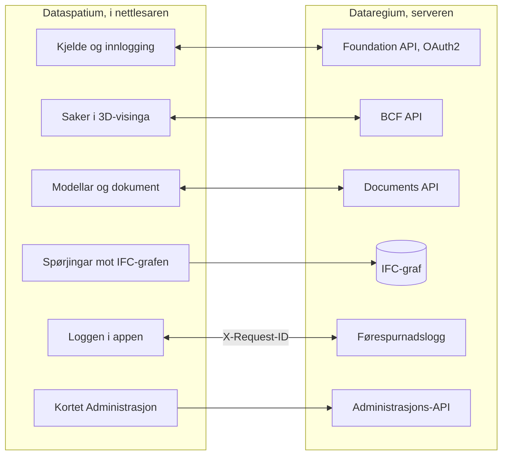

[Svenska](../../README.md) · [Dansk](../da/README.md) · [Norsk bokmål](../nb/README.md) · **Norsk nynorsk** · [Suomi](../fi/README.md) · [Íslenska](../is/README.md) · [English](../en/README.md)

# Dataspatium OpenCDE-klient

Dataspatium er ein nettapp for data frå kjelde til rapport: hent data frå filer og opne API-ar, lagre og handter datasett,
gå gjennom og rett verdiar, analyser med R, visualiser og eksporter. Alt køyrer i din eigen nettlesar. Ingen tenar, ingen
installasjon, ingen kontoar. Dataa dine forlèt aldri datamaskina med mindre du sjølv eksporterer dei. Tryggleiken er det første kravet: ingen nettverkskall utan di handling og ditt samtykke, løyndomar berre krypterte, komponentar låste og kontrollerte, og alt som blir delt, blir gått gjennom først.

**Innhald**

- [Last ned og kom i gang](#last-ned-og-kom-i-gang)
- [Kva som krevst](#kva-som-krevst)
- [Kva du kan gjere](#kva-du-kan-gjere)
- [OpenCDE-API-ane og klientane deira](#opencde-api-ane-og-klientane-deira)
- [Dataspatium og Dataregium](#dataspatium-og-dataregium)
- [Lær meir](#lær-meir)
- [Avgrensingar i korte trekk](#avgrensingar-i-korte-trekk)
- [Personopplysningar](#personopplysningar)
- [Neste i 3-serien](#neste-i-3-serien)
- [Feil og framlegg](#feil-og-framlegg)
- [Utvikling](#utvikling)
- [Lisens](#lisens)

Brukargrensesnittet finst på svensk, dansk, norsk (bokmål og nynorsk), finsk, islandsk og engelsk. Skjermbileta i
dokumentasjonen viser appen på svensk.

## Last ned og kom i gang

1. **Last ned.** Gå til den [siste utgåva](https://github.com/marwiss/Dataspatium/releases/latest), og hent ZIP-fila
   under *Assets* (`dataspatium-<versjon>.zip`, om lag 100 MB; R og alle R-pakkane er med).
2. **Pakk ut.** Høgreklikk på ZIP-fila, og vel *Pakk ut alle* (Windows), eller dobbeltklikk på henne (macOS). Legg mappa
   der du vil ha henne, til dømes i Dokument. Appen fungerer ikkje direkte inne i ZIP-fila.
3. **Opne.** Dobbeltklikk på `index.html` i mappa, eller dra fila til eit nettlesarvindauge. Om Windows spør kva app som
   skal brukast, vel du Edge, Chrome eller Firefox. Første gongen spør appen kva språk du vil ha (det kan endrast med
   språkknappen øvst til høgre), og startar deretter **grunnkurset**, ein interaktiv gjennomgang av alle modusar med
   dømedata som tek om lag ti minutt. Opne det igjen frå hjelpa (?).
4. **Importer.** I modusen *Hent* slepper du ei fil på flata (eller klikkar på *Prøv med dømedata*), kontrollerer
   kolonnetypane og klikkar på *Importer*. Datasettet blir lagra i nettlesaren på datamaskina di.
5. **Arbeid vidare.** Byt modus øvst: *Handter* viser datasetta dine og arbeidsområdet, *Søk* finn rader i dei,
   *Bearbeid* viser tabellen med sortering, filter og handlingar, *Analyser* opnar R- og SQL-konsollen, *Visualiser*
   lagar diagram, *Eksporter* lastar ned data, diagram og dokument, og *Del* gjev dei til andre.

Data blir lagra i den eigne databasen til nettlesaren. Slettar du nettstaddata, forsvinn dei, så ta tryggingskopi
regelmessig under *Handter > Arbeidsområde*. Tryggingskopien er ei ZIP-fil som kan gjenopprettast på same eller ei anna
datamaskin. Steg for steg med fleire detaljar: [kom-igang.md](kom-igang.md).

Appen finst òg direkte på nettet, utan nedlasting: <https://marwiss.github.io/Dataspatium/>. Frå ein nettenar kan han
installerast som eigen app (Edge og Chrome: *Installer* i adressefeltet) og fungerer deretter òg utan nettverk.
Nettversjonen og mappeversjonen har skilde arbeidsområde; flytt data mellom dei med ein tryggingskopi eller ein pakke.

## Kva som krevst

- Windows, macOS eller Linux.
- Microsoft Edge eller Google Chrome (versjon 120 eller nyare) eller Firefox (versjon 128 eller nyare). Safari blir ikkje støtta.
- Om lag 300 MB ledig plass til appmappa og minst 4 GB minne (8 GB er tilrådd for store datasett). Det krevst ingen
  administratorrettar.
- Internett trengst berre når du hentar data frå opne API-ar, sender til GitHub, ser etter oppdateringar eller hentar ein
  komponent eller ein R-pakke som ikkje følgjer med i mappa; appen spør om løyve først.

## Kva du kan gjere

Det som verkar i éin versjon, verkar også i den neste. Kvar versjon høyrer saman med same versjon av Dataregium.

### Versjon 1 (med Dataregium 1)

- **Hente**: filer i rundt førti format, frå rekneark og statistikkfiler til geodata og tabellar i dokument, og data frå opne API-ar
  hos nordiske og europeiske styresmakter, med lagra hentingar (sjå [Opne API-ar](api-konfiguration.md)).
- **Bearbeide**: sortere, filtrere, reinse, setje typar, omkode, pivotere og kople, med reglar for datakvalitet, pseudonymisering,
  angre, versjonar og oppskrifter (sjå [Bearbeid](bearbeta.md)).
- **Analysere**: R med ggplot2 og tidyverse, SQL, notatbøker som blir rapportar, og regulære uttrykk, heilt i nettlesaren (sjå
  [R](r-guide.md)).
- **Planar**: svenske detaljplanar og översiktsplanar som plankart med fargane og teikna til Boverket (sjå [Planar](planer.md)).
- **Visualisere og dokumentere**: diagram med Vega-Lite, D3 eller R, dashbord og rapportar frå malar som HTML, Word, PDF, PowerPoint
  eller LaTeX (sjå [Visualiser](visualisera.md)).
- **Eksportere og dele**: data i rundt ti format, pakkar, kommentarar, tryggingskopi, synkronisering med GitHub og ei portabel mappe.
- **Dataregium som kjelde**: dokument blir henta som datasett, og datasett og filer blir sende tilbake (Documents API).
- **Seks språk og grunnkurs**: svensk, dansk, norsk (bokmål), finsk, islandsk og engelsk, eit interaktivt kurs gjennom alle modusane og
  kommandopaletten (Ctrl+K) som finn alt.

### Også i versjon 2 (med Dataregium 2)

- **Fleire kjelder**: databasar, opne geodata og WMS, dokument og bilete som samlingar, og tekst frå skanna sider (sjå
  [Kjelder](kallor.md)).
- **Kart, planar og grafar**: kartvisingar med lag og geoverktøy, planar frå heile Norden, og grafar som blir teikna, spurde med
  Cypher og redigerte (sjå [Kart](kartor.md) og [Grafar](grafer.md)).
- **CAD og BIM**: IFC-modellar i 3D med tabellar, eigenskapar og mengder, og DXF-teikningar (sjå [CAD og BIM](cad-bim.md)).
- **Python og statistikk utan kode**: ein Python-konsoll og skjema for statistikk og tidsseriar som skriv koden for deg (sjå
  [Statistikk](statistik.md)).
- **Søkje og halde orden**: modusen *Søk* med fasettar og lagra lister, spørjingar utan kode, mapper, taggar og batchhandlingar (sjå
  [Søk](soka.md)).
- **Del og Mobil**: modusen *Del* med pakkar og publisering, gjennomgang av personopplysningar før deling, overføring med QR-kode og
  *Dataspatium Mobil* for å vise og samle inn i felt (sjå [Del](dela.md)).
- **Flytar og slag**: lagra kjeder som blir køyrde med eitt klikk, overvaka kjelder, og modusar som kjenner att kva eit datasett er og
  tilbyr dei rette visingane og verktøya (sjå [Modusar](lagen.md)).
- **Dataregium med saker**: modellar og saker frå tenaren, saker frå 3D-visinga, BCF-filer, IFC-grafen til tenaren,
  administrasjonen og kortet Medlemmene i prosjektet for den prosjektansvarlege (sjå [Dataspatium og Dataregium](#dataspatium-og-dataregium)).
- **Sju språk**: også nynorsk, med handboka i appen og grunnkurset gjennom alle dei åtte modusane.

### Også i versjon 3 (med Dataregium 3)

- **Kontroll av modellar**: kortet *Valider modellen* med kontrollane til tenaren og appen, og kollisjonskontroll med resultata som
  BCF-saker (sjå [CAD og BIM](cad-bim.md)).
- **AI-modellering**: *Spør AI om modellen* og *Endre med AI*, der AI-en føreslår, og du førehandsviser i 3D og godkjenner; AI-en kan
  aldri lagre eller publisere.
- **Versjonar mot Dataregium**: publisering med basisversjon, førehandskontroll, endringsframlegg som tenaren prøver og ein manager
  godkjenner, og *Samanlikn versjonar* markert i 3D.
- **Meir**: kollisjonar ved godkjenning som du avgjer i appen, ein kontroll av relasjonane i modellen som sperrar det eit
  endringssett øydelegg, AI-en som førehandsviser og rettar sitt eige endringssett, IFC-grafen til tenaren i skjelettform med
  bygningsdelar nær ein bygningsdel, ein lokal Dataregium på di eiga datamaskin og WFS-en til Sundsvall blant geodatakjeldene.

## OpenCDE-API-ane og klientane deira

OpenCDE er buildingSMART Internationals familie av opne web-API-ar for eit felles datamiljø, staden der eit prosjekt deler modellane,
dokumenta og sakene sine. Ein klient og ein tenar som følgjer dei same spesifikasjonane, kan arbeide saman, same kven som har bygd
dei. Dataspatium brukar alle tre:

| API | Kva appen gjer med det | Spesifikasjon |
|---|---|---|
| Foundation API 1.0 | Les kva API-ar tenaren tilbyr, kvar ein loggar inn og kven brukaren er; registrerer appen som klient når tenaren tillèt det | [foundation-API](https://github.com/buildingSMART/foundation-API) |
| BCF API 3.0 og 2.1 | Les og skriv saker om ein modell, med kommentarar og viewpoints (kamera, komponentar og bilete) frå 3D-visinga; vel den nyaste versjonen tenaren tilbyr | [BCF-API](https://github.com/buildingSMART/BCF-API) |
| Documents API 1.0 | Vel og hentar dokument og versjonar via tenaren sine eigne sider, slik at ein IFC-modell vert eit datasett, og lastar opp nye versjonar, datasett og pakkar | [documents-API](https://github.com/buildingSMART/documents-API) |

**Dataregium er éin tenar, ikkje den einaste.** Appen skal kunne kople til kvar tenar som følgjer spesifikasjonane: ingenting i
appen er avhengig av Dataregium, og utvidingane til Dataregium utanfor spesifikasjonane (kapabilitetsdokumentet, dei namngjevne
grafspørjingane, førehandskontrollen, basisversjonen, endringsframlegga og diffen mellom versjonar) vert berre viste når tenaren
sjølv seier frå om dei. Appen treng tre ting av ein tenar:

- at tenaren tillèt kall frå nettlesaren (CORS) frå adressa til appen: `null` når appen vert opna frå file://, `http://127.0.0.1:8080`
  frå ein lokal webtenar og `https://marwiss.github.io` frå nettet, med hovuda Authorization, Content-Type og X-Request-ID;
- ei klientregistrering, gjord av administratoren til tenaren (ein offentleg klient med omdirigeringsadressa
  `http://127.0.0.1:8080/oauth-callback.html`, eller tilsvarande for adressa appen vert servert frå) eller av appen sjølv når tenaren
  tillèt det, og innlogging med OAuth2 authorization code med PKCE `S256`; frå file:// limer du inn adressa du hamnar på etter
  innlogginga;
- BCF API 3.0 eller 2.1; Documents API er valfritt, men utan det kan appen verken hente eller publisere dokument.

Så langt er det vist mot Dataregium: live-suiten vert køyrd mot tenaren i begge versjonane av BCF API, og ein tenar med berre 2.1
fungerer. Andre tenarar er ikkje prøvde; fortel korleis det gjekk under [Feil og framlegg](#feil-og-framlegg). Når appen og ein
spesifikasjon ikkje stemmer overeins, avgjer spesifikasjonen. Sida til tenaren er skildra i Dataregiums README og klientguide; sida
til appen i [kallor.md](kallor.md).

## Dataspatium og Dataregium

*Dataregium heitte Kontroll fram til 8. november 2026.*

Dataspatium (appen i nettlesaren) og [Dataregium](https://github.com/marwiss/Dataregium) (ein tenar for buildingSMARTs OpenCDE-API-ar Foundation, BCF og
Documents) er utvikla for å fungere saman som klient og tenar. Appen legg til tenaren som kjelde i Hent, loggar inn med OAuth2 og
registrerer seg sjølv som klient når tenaren tillèt det, hentar modellane og dokumenta til prosjektet, les og skriv saker med
viewpoints frå 3D-visinga, sender datasett, filer og arbeidsområdepakkar tilbake gjennom Documents API, spør IFC-grafen til tenaren med
Cypher og loggar kvart kall med same X-Request-Id som tenaren skriv i førespurnadsloggen sin. Spørjingane mot grafen og administrasjonen er tillegg utanfor spesifikasjonane; alt anna går gjennom dei tre OpenCDE-API-ane, så
andre OpenCDE-klientar fungerer òg. Tenaren trengst ikkje for resten av appen: utan tenar fungerer alt anna som før. Dataregiums README og `docs/client-guide.md` skildrar samarbeidet frå tenaren si side;
her blir det skildra i [kallor.md](kallor.md) og [cad-bim.md](cad-bim.md).

Slik heng dei saman:

Appen snakkar BCF API 3.0 og 2.1, så han også koplar seg til tenarar som berre har 2.1, og han teiknar og spør IFC-grafen til tenaren direkte frå Hent.

Dataspatium 3.0.0 fungerer med Dataregium 3.0.0. Begge får same utgåvenummer, så same nummer høyrer saman. Snøggstarten
[snabbstart.md](snabbstart.md) tek paret frå ingenting til ei sak på tjue minutt.

### Utgjevingane 1, 2 og 3

Det finst éi utgjeving per hovudnummer, og Dataspatium og Dataregium med same nummer høyrer saman:

| Dataspatium | Kva ho har | Høyrer saman med |
|---|---|---|
| 1.0.0 | Heile 1-serien: datainnhenting, handsaming, R, Python, kart, diagram, dokument og deling, og planar. Mot ein tenar berre Documents API: hent dokument som datasett, og send datasett og filer tilbake. Ingen saker og ingen modellar | Dataregium 1.0.0 (berre Documents API) |
| 2.0.0 | Heile 2-serien: IFC-modellar i 3D med tabellar, eigenskapar og mengder, saker med viewpoints (BCF API 3.0 og 2.1), IFC-grafen til tenaren (IFC-LPG) teikna og spurd, og planar frå planleggingsverktøy fullt ut, og kortet Medlemmene i prosjektet for den prosjektansvarlege | Dataregium 2.0.0 |
| 3.0.0 | 3-serien: kortet *Valider modellen*, kollisjonskontroll i nettlesaren, BCF-kamera i koordinatane til modellen, grafen i skjelettform, Spør AI og Endre med AI, Samanlikn versjonar, publisering med basisversjon og førehandskontroll, endringsframlegg som vert prøvde og godkjende på tenaren | Dataregium 3.0.0 |

Ei ny utgjeving i same hovudnummer erstattar den førre; berre den nyaste i kvar serie vert retta. Oppdateringskontrollen i appen
tilbyr neste hovudnummer, og datasett, lister, diagram, malar og skript følgjer med når du opnar `index.html` i den nye versjonen.

## Lær meir

Filnamna er dei same på alle språk (dei svenske originalane), så lenkjene verkar likt overalt.

- **Handboka** i appen: den same dokumentasjonen som her, med søk; opne henne med ? øvst til høgre eller F1.
- **Grunnkurset** i appen: ein interaktiv gjennomgang av alle modusar med dømedata; opne det frå hjelpa (?) eller
  med Ctrl+K.
- [Kom i gang](kom-igang.md): steg for steg med vanlege spørsmål.
- [Snøggstart med Dataregium](snabbstart.md): tjue minutt frå ingenting til ei sak oppretta i 3D-visinga og synleg på serveren.
- [Brukarrettleiing](anvandarguide.md): heile arbeidsflyten frå fil til rapport.
- [Vanlege spørsmål](faq.md): lagring, tryggleik, R, API-ar og oppdateringar.
- [Dei åtte modusane](lagen.md): kva som finst kvar og kvifor.
- [Søk](soka.md) og [Del](dela.md): finn utan kode, og gje data til andre.
- [Dataspatium Mobil](mobil.md): telefonen som kurér, mottakar og visar; overføring mellom einingar.
- [Notatbok](anteckningsbok.md): tekst, R og SQL i celler som blir ein rapport.
- [Dokument og bilete](dokument.md): PDF, Word, OpenDocument, Markdown og bilete som datasett; dokumentvising, galleri og verktøya Tekst og Bilete.
- [Kart](kartor.md): kartet i Bearbeid, kartvisingar i Visualiser, geoverktøya og QGIS-prosjekt.
- [Regulære uttrykk](regex.md): mønster for å analysere, rette og dele opp tekst i datasett.
- [Format og import](format.md): filformat, teiknkoding, desimalteikn, datoar og kolonnetypar.
- [Opne API-ar](api-konfiguration.md): dei førehandsinnstilte kjeldene, nøklar og eigne konfigurasjonar.
- [R i Dataspatium](r-guide.md): R-konsollen, `dm_read()`, `dm_write()` og pakkane som følgjer med.
- [Python i Dataspatium](python.md): Python-konsollen, `dm_read()`, `dm_write()` og pakkar som blir henta ved behov.
- [Visualiser](visualisera.md): diagrambyggjaren, D3-malar, R-diagram, kart og dashbord.
- [Dokument og malar](dokumentmallar.md): malspråket og utdataformata.
- [Tryggleik](sakerhet.md): trugsmålsmodell, kontrollane og prova som viser dei, personopplysningar og lagring, og korleis ein sårbarheit blir rapportert.
- [Lisensar](licenser.md): kva du kan gjere med appen, og kva lisensar tredjepartskomponentane har.
- Korleis bidrag blir tekne imot, står i [CONTRIBUTING.md](../../CONTRIBUTING.md) (svensk).

### Vidare lesing

- [BCF API](https://github.com/buildingSMART/BCF-API), [Foundation API](https://github.com/buildingSMART/foundation-API) og [Documents API](https://github.com/buildingSMART/documents-API): spesifikasjonane appen følgjer mot ein tenar.
- [IFC](https://github.com/buildingSMART/IFC4.x-development): filformatet for bygningsmodellar, og [IDS](https://github.com/buildingSMART/IDS): kravspesifikasjonar som modellar vert kontrollerte mot.
- Eksterne ressursar: [WebR](https://docs.r-wasm.org/webr/latest/), [R for nybegynnarar](https://www.r-project.org/),
  [Vega-Lite](https://vega.github.io/vega-lite/), [SSBs API](https://www.ssb.no/api).

## Avgrensingar i korte trekk

- Appen må opnast frå ei utpakka mappe (file://) eller ein vanleg nettenar; han fungerer ikkje direkte inne i ei ZIP-fil.
- API-ar utan CORS-støtte (til dømes data.norge.no) kan ikkje kallast direkte frå nettlesaren.
- Eit datasett bør halde seg under eit par millionar rader; minnet til nettlesaren set grensa.
- Når appen blir opna frå ei mappe, kan R-kode ikkje avbrytast midt i ei utrekning; bruk *Start R på nytt*. Frå ein
  nettenar (localhost eller https) finst knappen *Avbryt*.
- Fleire faner fungerer og held kvarandre oppdaterte, men ikkje rediger same datasett i to faner samtidig: den som lagrar
  sist, vinn.
- Den portable mappa krev Edge eller Chrome; Firefox manglar mappetilgang (File System Access). Tryggingskopi som ZIP
  fungerer overalt.
- Heile appen er laga for datamaskiner; på telefonar og nettbrett blir Dataspatium Mobil brukt
  (<https://marwiss.github.io/Dataspatium/m/>), som tek imot, viser og sender vidare. Safari blir ikkje støtta for heile
  appen. I smale vindauge blir panela opna som ark over arbeidsflata.
- Dømedataa og kartgrensene som følgjer med, er svenske; sjølve appen fungerer med data frå kvar som helst.

## Personopplysningar

Dataspatium køyrer i nettlesaren din, og du er sjølv ansvarleg for opplysningane du legg inn. Alt appen lagrar (datasett og
versjonane deira, lister, diagram, dokument, notatbøker, kommentarar og innstillingar) ligg i lageret til nettlesaren på di
datamaskin og forlèt ho berre når du eksporterer, deler eller publiserer; då vert alt gått gjennom i sin heilskap fyrst, og
personopplysningar kan haldast, pseudonymiserast eller fjernast i kopien. Til ein Dataregium-tenar vert innlogginga di send (token
vert halde i økta eller kryptert med passfrasen din, aldri i klartekst), sakene, kommentarane, framlegga og filene du opprettar under
namnet ditt på tenaren, og ein X-Request-ID per kall; den eigne handsaminga til tenaren står i Dataregiums README. Til ein
AI-leverandør vert berre det du spør om sendt, og svara verktøya hentar frå modellen, etter samtykke til føremålet AI, med din eigen
nøkkel lagra kryptert; policyen til prosjektet kan avgrense til lokale modellar. Kommentarar og pakkar ber namnet du sjølv oppgjev.
Kontrollane og prøvene som viser dei står i [sakerhet.md](sakerhet.md).

## Neste i 3-serien

3.0.0 er den fyrste utgjevinga i 3-serien, laga saman med Dataregium 3.0.0: kontrollen av modellar, kollisjonskontrollen, AI-stega
og versjonssamanlikninga, som [Kva du kan gjere](#kva-du-kan-gjere) skildrar. Som kvart hovudnummer har serien éi utgjeving, som vert
gjeven ut på nytt når ho veks. Det som følgjer, gjer appen til klienten som redigerer modellen til tenaren og viser versjonane hans:
AI-en føreslår, mennesket går gjennom og godkjenner, tenaren prøver og flettar saman. Dette avsnittet seier kva som er avgjort, for
den, menneske eller AI-agent, som fører ein del av det vidare; sida til tenaren står i Dataregiums README under same overskrift.

### Avgjort

- **Modelleringa skjer i appen, ikkje på tenaren.** Modelleringshjulet (skriveverktøya og IfcOpenShell i Python i appen) er
  Dataspatiums eige, under Dataspatiums lisens, og ber ingen kode frå IFC-LPG; tenaren når det berre gjennom API-ane.
- **AI-en føreslår, mennesket godkjenner.** Eit endringssett vert førehandsvist i 3D, kontrollert lokalt og av førehandskontrollen
  til tenaren, og brukt fyrst når du godkjenner; sletting vert stadfesta éin gong til; publisering og framlegg til tenaren er knappar,
  aldri verktøy AI-en kan kalle. Bygd i 3.0.0.
- **Versjonsmodellen.** Eit endringssett vert sendt til tenaren som ei BCF-sak med ein snippet i forma til tenaren (GlobalId og sti
  som nøkkel), tenaren prøver det mot basisversjonen, og ein *manager* godkjenner det til neste versjon; ei publisering med utdatert
  basis vert avvist (412), og kollisjonane vert viste. Bygd i 3.0.0, i likskap med valet ved kollisjonar som
  tenaren ikkje kan flette, endringssettet til tenaren per versjon og ei BCF-sak per godkjent endringssett.
- **Samanlikn versjonar** frå tre kjelder: augneblinksbilete og andre modellar i appen, endringssettet til tenaren per versjon og
  diffen til tenaren mellom versjonar. Bygd i 3.0.0.
- **Forvaltaren av prosjektet** har kortet *Medlemmene i prosjektet* i appen: medlemmer, roller og namnet på prosjektet. Bygd i
  2.0.0 og 3.0.0.
- **Steg 4 og 5, etter steg 3:** repomodus per prosjekt med ein lokal Dataregium på eiga datamaskin og hent og publiser mellom den
  lokale og den fjerne; store modellar teikna frå geometri-API-et til tenaren når nettlesaren ikkje strekk til; prosjektprofilar med
  IDS og bSDD, IDS skrivne av AI-en og buildingSMART-reglar knytte til element.
- **Opne format** gjeld utvekslingsformat og lagra data, ikkje AI-API-ar; AI-leverandør vel brukaren med eigen nøkkel, lagra
  kryptert, og policyen til prosjektet kan avgrense til lokale modellar.

## Feil og framlegg

Rapporter feil eller ønske som *Issues* her på GitHub. Skildre nettlesar, versjon av Dataspatium (blir vist under
hjelpeknappen) og kva du gjorde. Sjå [CONTRIBUTING.md](../../CONTRIBUTING.md). Legg ikkje ved personopplysningar eller løyndomar. For ei
tryggleikssårbarheit, følg [SECURITY.md](../../SECURITY.md) i staden for å opne eit issue.

## Utvikling

- Ingen byggjesteg, ingen node.js. Opne `index.html` direkte, eller server mappa med `python -m http.server 8080`.
- Arkitektur i korte trekk: all eigen kode er klassiske skript som blir registrerte med `Dataspatium.define` i rekkjefølgja i `src/boot.js`; `src/platform` ber alt som er spesifikt for file:// (ressursar, shims, workers, lagring, samtykke); motorane SQLite, R (WebR) og Python (Pyodide) køyrer i workers; `src/ui` har designvariablane, komponentane (`dm-*`), skalet og éin modus per fil. Alt som blir teikna blir escapa, og ingenting blir henta frå nettet utan handlinga og samtykket ditt.
- Tredjepartskomponentar: `python tools/fetch_vendor.py` følgt av `python tools/wrap_assets.py`.
- Testar: `powershell -File tools/run-tests.ps1` eller `tools/run-tests.sh` (headless Edge og Firefox).
- Tryggleik: prova for samtykke, løyndomar, gjennomgang før deling, OAuth2 (PKCE, state, tilbakekall) og maskeringa i loggen er med i suiten; sjå [sakerhet.md](sakerhet.md).

## Lisens

Dataspatiums eigen kode, dokumentasjon og førehandsinnstillingar (alt unnateke `vendor/`) er lisensiert under
[PolyForm Strict 1.0.0](../../LICENSE): fri å laste ned og bruke til ikkje-kommersielle føremål, òg i offentlege etatar og
andre offentlege institusjonar, men ikkje å endre, byggje vidare på eller distribuere vidare utan skriftleg løyve.
Lisensgjevar er opphavspersonen til Dataspatium, som kan kontaktast via GitHub-kontoen [marwiss](https://github.com/marwiss); opprett
eit issue for andre vilkår. Kva lisensen tyder i praksis, blir forklart i [licenser.md](licenser.md).

Tredjepartskomponentar i `vendor/` har eigne lisensar (MIT, BSD, Apache-2.0, ISC, OFL, MPL, LGPL og GPL), sjå
[THIRD_PARTY_LICENSES.md](../../THIRD_PARTY_LICENSES.md). R og dei GPL-lisensierte R-pakkane blir distribuerte uendra; kjeldekoden
finst hos [R-prosjektet](https://cran.r-project.org/sources.html), [webR](https://github.com/r-wasm/webr) og
[CRAN](https://cran.r-project.org/) i versjonane som er oppgjevne der. Sjå [SECURITY.md](../../SECURITY.md) for korleis ei sårbarheit blir rapportert,
og kva prosjektet gjer for å halde seg trygt.
